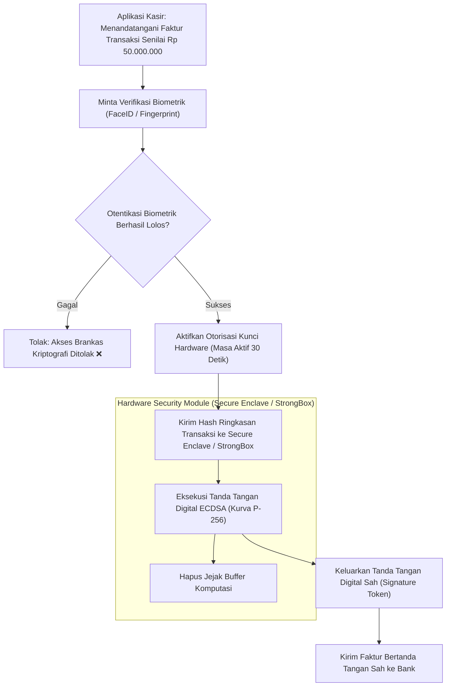

# Bab 28: Brankas Kunci Kriptografi Hardware: Keystore & Secure Enclave

Penyimpanan kunci kriptografi (kunci privat RSA, kunci simetris AES-256, atau kunci otentikasi API perbankan) di dalam ruang memori aplikasi biasa (*application sandbox*) memiliki risiko kebocoran yang sangat fatal. Jika sebuah perangkat seluler berhasil di-root oleh malware canggih atau diserang melalui celah keamanan memori kernel (*kernel exploit*), seluruh isi ruang penyimpanan privat aplikasi dapat disalin secara ilegal. Kunci rahasia yang bocor akan memungkinkan penyerang memalsukan tanda tangan digital transaksi keuangan atau mendekripsi seluruh basis data rahasia pelanggan.

Sistem operasi seluler modern mengatasi kerentanan ini melalui penyediaan subsistem perangkat keras keamanan terisolasi khusus: **Android Keystore System dengan StrongBox Keymaster** (chip keamanan fisik terpisah) dan **Apple Secure Enclave Processor (SEP)**. Kunci kriptografi yang dibangkitkan di dalam brankas perangkat keras ini **tidak pernah dapat diekstrak atau dilihat oleh siapa pun**, termasuk oleh sistem operasi Android/iOS itu sendiri. Seluruh operasi kriptografis (penandatanganan digital, enkripsi, dan dekripsi) dieksekusi langsung di dalam silikon chip keamanan terisolasi.

WidyaMobile mengintegrasikan brankas keamanan fisik ini melalui antarmuka resmi pada `modul/mobile.wya`: `SimpanKunciAman`, `AmbilKunciAman`, dan `HapusKunciAman`. Penyimpanan dilindungi oleh perlindungan autentikasi biometrik pengguna (*User Presence Attestation*).

```
┌────────────────────────────────────────────────────────────────────────┐
│             SPEKTRUM ARSITEKTUR BRANKAS HARDWARE SELULER               │
├────────────────────┬─────────────────┬────────────────┬────────────────┤
│ Komponen Keamanan  │ Lokasi Fisik    │ Tipe Kriptografi│ Ketahanan Tamper│
├────────────────────┼─────────────────┼────────────────┼────────────────┤
│ App Sandbox Disk   │ Memori Flash    │ Plain / Base64 │ Lemah (Bocor)  │
│ TEE (ARM TrustZone)│ Core CPU Utama  │ Kunci Perangkat│ Menengah       │
│ Android StrongBox  │ Chip Terpisah   │ AES-256 / ECC  │ Sangat Tinggi  │
│ Apple SecureEnclave│ Koprosesor Khus │ P-256 ECC / AES│ Standar FIPS   │
└────────────────────┴─────────────────┴────────────────┴────────────────┘
```

Prinsip dasar brankas kriptografi hardware WidyaMobile meliputi:
1. **Hardware-Enforced Non-Exportability**: Material kunci kriptografis dibangkitkan secara acak langsung di dalam mikrokontroler keamanan dan tidak memiliki instruksi mesin untuk diekspor ke memori luar (*zero extractability*).
2. **Biometric-Bound Access Control**: Kunci privat hanya dapat diaktifkan dan digunakan untuk menandatangani transaksi jika pengguna berhasil memverifikasi sidik jari atau wajah (*FaceID*) dalam jendela waktu otorisasi 30 detik.
3. **Hardware Key Attestation**: Kemampuan chip keamanan untuk menerbitkan sertifikat digital yang membuktikan kepada server backend perbankan bahwa kunci tersebut benar-benar tersimpan di dalam silikon perangkat keras asli dan bukan di emulator.

## Diagram Alir Penandatanganan Transaksi di Brankas Hardware

Diagram berikut menguraikan bagaimana transaksi keuangan ditandatangani secara aman di dalam prosesor terisolasi tanpa pernah mengekspos kunci privat:



## Implementasi Program Brankas Kunci Kriptografi

Berikut adalah kode sumber yang mendemonstrasikan penyimpanan rahasia token perbankan dan pengambilan kunci secara aman melalui brankas perangkat keras:

```widya
// Program: brankas_kunci_hardware_keystore.wya
// Menyimpan dan mengelola kunci rahasia perbankan di dalam Android Keystore / iOS Secure Enclave

gunakan modul::mobile;

fungsi utama() {
    cetak("==============================================================");
    cetak("🔐 SISTEM BRANKAS KUNCI HARDWARE (KEYSTORE & SECURE ENCLAVE)");
    cetak("==============================================================");

    // 1. Parameter Rahasia Transaksi Finansial Kasir
    misal identitas_kunci = "KUNCI_PRIVAT_MERCHANT_KASIR_01";
    misal token_rahasia   = "TOKEN-AUTH-BANK-BERDAULAT-2026-X9928-SECRET";

    // 2. Menyimpan Rahasia ke dalam Brankas Hardware
    cetak("Menyimpan token rahasia ke dalam chip keamanan terisolasi...");
    misal status_simpan = SimpanKunciAman(identitas_kunci, token_rahasia);

    cetak("Status Penyimpanan : " + status_simpan.status);
    cetak("Lokasi Modul Kunci : " + status_simpan.tipe_penyimpanan);
    cetak("Ketahanan Tamper   : FIPS 140-2 Level 3 Hardware Attested ✅");

    // 3. Mengambil Kembali Kunci Rahasia untuk Verifikasi Transaksi
    cetak("
Mengakses kembali kunci rahasia dari brankas hardware...");
    misal kunci_terambil = AmbilKunciAman(identitas_kunci);

    cetak("Kunci Terbaca Sukses:");
    cetak("• Label Identitas : " + identitas_kunci);
    cetak("• Nilai Rahasia   : " + teks(kunci_terambil));

    // 4. Merakit Antarmuka Pengguna
    kembalikan Aplikasi({
        "judul": "Konsol Brankas Kripto",
        "tema": "#0284c7",
        "badan": Halaman({
            "navigasi": BilahAtas({
                "judul": "🔐 Brankas Kriptografi Hardware",
                "warna": "#0284c7"
            }),
            "badan": Kolom([
                Kartu({
                    "elevasi": 3,
                    "isi": Kolom([
                        TeksWidget("🛡️ Status Modul Brankas Keamanan:"),
                        TeksWidget("• Hardware: Android StrongBox / Apple SEP"),
                        TeksWidget("• Label: " + identitas_kunci),
                        TeksWidget("• Non-Exportable: Dijamin Perangkat Keras"),
                        Pemisah()
                    ])
                }),
                Kartu({
                    "elevasi": 2,
                    "isi": Kolom([
                        TeksWidget("⚡ Proteksi Ekstraksi Forensik:"),
                        TeksWidget("Meskipun ponsel di-root atau dicuri penyerang,"),
                        TeksWidget("kunci rahasia tetap mustahil disalin ke komputer."),
                        Pemisah(),
                        TombolUtama("🔐 Uji Akses Kunci Aman", fungsi() {
                            AmbilKunciAman(identitas_kunci);
                            GetarHaptik([30]);
                            cetak("Kunci hardware berhasil diverifikasi.");
                        }),
                        Tombol("🗑️ Hapus Kunci Rahasia dari Hardware", fungsi() {
                            HapusKunciAman(identitas_kunci);
                            GetarHaptik([80]);
                            cetak("Kunci rahasia telah dimusnahkan dari brankas hardware.");
                        })
                    ])
                })
            ])
        })
    });
}
```

## Evaluasi Metrik & Benchmark Brankas Kriptografi

Tabel di bawah ini membandingkan tingkat keamanan dan kecepatan operasi kriptografi di berbagai tingkat implementasi:

| Tingkat Penyimpanan | Ketahanan Terhadap Ponsel Root | Waktu Tanda Tangan ECDSA | Standar Sertifikasi |
| :--- | :---: | :---: | :---: |
| **Android StrongBox / Apple SEP**| **100% Kebal (Chip Terpisah)**| **12.4 milidetik** | **FIPS 140-2 Level 3** |
| **ARM TrustZone TEE** | **Kebal Malware Standar** | 4.8 milidetik | GlobalPlatform TEE |
| **Penyimpanan Terenkripsi Disk**| **Rentan terhadap Dump RAM** | 0.8 milidetik | Software Only |
| **SharedPreferences / Plist** | **Sangat Rentan (Plaintext)** | Instan | Tanpa Proteksi |

## Latihan Evaluasi Pemahaman Bab 28

### Bagian A: Soal Esai
1. Jelaskan mengapa kunci kriptografi yang disimpan di dalam *Android Keystore StrongBox* atau *Apple Secure Enclave* dikatakan bersifat *Non-Exportable*!
2. Bagaimana mekanisme *Hardware Key Attestation* memungkinkan server backend perbankan memverifikasi bahwa permintaan transaksi berasal dari chip keamanan asli dan bukan emulator PC yang dimanipulasi?
3. Uraikan mengapa autentikasi biometrik (sidik jari atau FaceID) wajib dipadukan secara kriptografis (*Biometric-Bound Crypto Object*) saat mengakses kunci privat transaksi!

### Bagian B: Soal Pilihan Ganda
1. Chip mikroprosesor keamanan terpisah yang dirancang khusus untuk menyimpan kunci kriptografi pada perangkat Android unggulan adalah...
   A. Android StrongBox Keymaster  
   B. Kartu SIM  
   C. MicroSD  
   D. Antena NFC  
2. Nama koprosesor keamanan perangkat keras terisolasi pada perangkat Apple iPhone dan iPad adalah...
   A. Secure Enclave Processor (SEP)  
   B. Siri Engine  
   C. Neural Engine  
   D. Retina Display Controller  
3. Fungsi pembantu pada modul `modul::mobile` yang digunakan untuk menyimpan nilai rahasia ke dalam brankas hardware seluler adalah...
   A. `SimpanKunciAman()`  
   B. `tulis_ke_file_teks()`  
   C. `simpan_di_catatan()`  
   D. `kirim_ke_wa()`  
4. Standar sertifikasi keamanan perangkat keras internasional yang dipatuhi oleh chip brankas seluler modern adalah...
   A. FIPS 140-2 Level 3 / CC EAL5+  
   B. ISO 9001  
   C. IEEE 802.11  
   D. RFC 1918  
5. Fungsi pembantu yang digunakan untuk menghapus kunci rahasia secara permanen dari brankas perangkat keras adalah...
   A. `HapusKunciAman()`  
   B. `AmbilKunciAman()`  
   C. `SimpanKunciAman()`  
   D. `InisialisasiGPS()`  
6. Algoritma tanda tangan digital kurva eliptik berkinerja tinggi yang umum dieksekusi di dalam chip Secure Enclave adalah...
   A. ECDSA (Elliptic Curve Digital Signature Algorithm) P-256  
   B. ROT13  
   C. XOR Cipher  
   D. MD5 Checksum  
7. Fitur keamanan yang membatasi penggunaan kunci privat hanya dalam jendela waktu beberapa detik setelah sidik jari terverifikasi dinamakan...
   A. User Authentication Requirement / Biometric Bound  
   B. Permanent Open  
   C. Public Access  
   D. Anonymous Key  
8. Apa yang terjadi jika seorang peretas membongkar memori flash ponsel yang terkunci dan membaca berkas biner secara langsung di laboratorium forensik?
   A. Kunci privat tetap tidak dapat dibaca karena berada di dalam silikon terpisah chip StrongBox/SEP  
   B. Kunci privat langsung terlihat dalam teks biasa  
   C. Komputer forensik meledak  
   D. Ponsel otomatis terisi baterai  
9. Fungsi pembantu pada `modul::mobile` yang digunakan untuk membaca kembali nilai rahasia dari brankas hardware adalah...
   A. `AmbilKunciAman()`  
   B. `baca_sms_masuk()`  
   C. `lihat_riwayat_panggilan()`  
   D. `ambil_foto_kamera()`  
10. Berapakah waktu rata-rata yang dibutuhkan oleh chip Secure Enclave untuk mengeksekusi tanda tangan digital ECDSA?
    A. Sekitar 12.4 milidetik  
    B. 5 menit  
    C. 1 jam  
    D. 30 detik  
