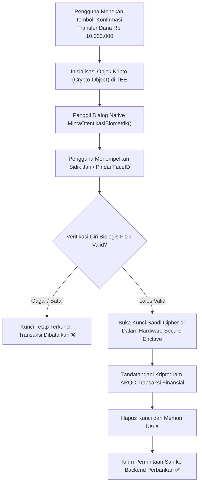

# Bab 29: Otentikasi Biometrik Seluler: FaceID, Sidik Jari & Objek Kripto

Pemanfaatan kata sandi teks (*textual password*) atau nomor PIN numerik statis pada aplikasi seluler rentan terhadap serangan intip (*shoulder surfing*) di ruang publik, pembajakan pencatat ketukan (*keyloggers*), hingga serangan rekayasa sosial. Otentikasi biometrik modern—pemindai sidik jari ultrasonik di bawah layar (*in-display fingerprint*) dan pemindai wajah tiga dimensi berbasis proyektor titik inframerah (*3D Structured Light / FaceID*)—menawarkan kombinasi terbaik antara kenyamanan akses instan tanpa ketik dan keamanan biologis unik pengguna.

Namun demikian, implementasi biometrik yang naif (hanya mengandalkan nilai boolean `true/false` dari dialog sistem) sangat mudah diakali oleh malware pengait fungsi (*hooking frameworks* seperti Frida) yang memalsukan respon fungsi menjadi `true`. Standar industri perbankan mewajibkan pengikatan otentikasi biometrik langsung dengan operasi kriptografi berbasis **Crypto-Object** (BiometricPrompt Class 3 Strong di Android dan LocalAuthentication dengan SecAccessControl di iOS).

WidyaMobile memfasilitasi otentikasi biometrik berdaulat melalui fungsi pembantu resmi `MintaOtentikasiBiometrik` pada `modul/mobile.wya`. Dialog biometrik native dipanggil dengan mengikat *Cipher* atau *Signature* perangkat keras secara atomik, memastikan bahwa kunci transaksi hanya terbuka jika sensor fisik biometrik benar-benar mendeteksi ciri biologis pemilik sah.

```
┌────────────────────────────────────────────────────────────────────────┐
│             KLASIFIKASI KEKUATAN BIOMETRIK SISTEM OPERASI              │
├────────────────────┬─────────────────┬────────────────┬────────────────┤
│ Kelas Biometrik    │ Rasio Tipuan    │ Dukungan Kripto│ Standar Kasir  │
├────────────────────┼─────────────────┼────────────────┼────────────────┤
│ Class 3 (Strong)   │ Spoof Rate < 7% │ CryptoObject Ya│ Diizinkan Penuh│
│ Class 2 (Weak)     │ Spoof 7% - 20%  │ Tanpa Kripto   │ Hanya Login App│
│ Class 1 (Conven)   │ Spoof > 20%     │ Ditolak OS     │ Dilarang Bank  │
│ Apple FaceID / 3D  │ 1 banding 1 Juta│ SecureEnclave  │ Standar Emas   │
└────────────────────┴─────────────────┴────────────────┴────────────────┘
```

Prinsip arsitektur otentikasi biometrik WidyaMobile mencakup:
1. **Class 3 Strong Biometrics Requirement**: Mewajibkan sensor fisik memenuhi kualifikasi *Strong Biometrics* dengan rasio penerimaan palsu (*False Acceptance Rate - FAR*) kurang dari 0.002% (1 banding 50.000 untuk sidik jari dan 1 banding 1.000.000 untuk FaceID 3D).
2. **Crypto-Object Transaction Binding**: Mengikat dialog biometrik dengan inisialisasi objek sandi `javax.crypto.Cipher`. Jika pengguna berhasil memindai jari, kunci enkripsi terbuka untuk satu kali transaksi; jika dibatalkan, kunci tetap terkunci.
3. **Invalidation on New Biometric Enrollment**: Kunci transaksi secara otomatis hangus dan diwajibkan otentikasi ulang jika sistem mendeteksi ada penambahan sidik jari baru di menu pengaturan perangkat, memitigasi serangan di mana orang lain menambahkan jarinya ke ponsel korban.

## Diagram Alir Siklus Otentikasi Biometrik Crypto-Object

Diagram berikut menguraikan interaksi antara sensor biometrik fisik, prosesor keamanan, dan kunci transaksi:



## Implementasi Program Otentikasi Biometrik Kasir

Berikut adalah implementasi lengkap otentikasi biometrik wajah dan sidik jari untuk otorisasi transaksi kasir bernilai besar:

```widya
// Program: otentikasi_biometrik_seluler.wya
// Mengimplementasikan otentikasi biometrik Class 3 Strong untuk otorisasi pembayaran

gunakan modul::mobile;

fungsi utama() {
    cetak("==============================================================");
    cetak("👤 SISTEM OTENTIKASI BIOMETRIK SOVEREIGN WIDYAMOBILE");
    cetak("==============================================================");

    // 1. Parameter Transaksi Berisiko Tinggi (Butuh Otorisasi Biometrik)
    misal id_transaksi = "TX-TRANSFER-88901";
    misal nominal_transfer = 15000000; // Rp 15.000.000,00
    misal alasan_prompt = "Konfirmasi Transfer Kasir Senilai Rp 15.000.000";

    cetak("ID Transaksi        : " + id_transaksi);
    cetak("Nominal Memerlukan Bio: Rp " + teks(nominal_transfer));
    cetak("Pesan Otorisasi     : " + alasan_prompt);

    // 2. Memanggil Dialog Otentikasi Biometrik Native
    cetak("
Memunculkan dialog biometrik sistem operasi (BiometricPrompt)...");
    misal status_biometrik = MintaOtentikasiBiometrik(alasan_prompt, "FaceID_atau_SidikJari");

    cetak("Status Verifikasi   : " + (status_biometrik ? "Sukses Tervalidasi ✅" : "Ditolak / Batal ❌"));

    jika (status_biometrik) {
        cetak("Otorisasi diterima. Objek kripto transaksi terbuka.");
        GetarHaptik([50, 40, 60]);
    } lainnya {
        cetak("Transaksi dibatalkan demi keamanan.");
        GetarHaptik([100, 80, 100]);
    }

    // 3. Merakit Antarmuka Pengguna Otorisasi Biometrik
    kembalikan Aplikasi({
        "judul": "Otorisasi Biometrik Kasir",
        "tema": "#0284c7",
        "badan": Halaman({
            "navigasi": BilahAtas({
                "judul": "👤 Otorisasi Biometrik Kasir",
                "warna": "#0284c7"
            }),
            "badan": Kolom([
                Kartu({
                    "elevasi": 3,
                    "isi": Kolom([
                        TeksWidget("💳 Otorisasi Dana Kasir Koperasi:"),
                        TeksWidget("Nominal: Rp " + teks(nominal_transfer)),
                        TeksWidget("Status: " + (status_biometrik ? "Diizinkan (Biometrik Lolos) ✅" : "Menunggu Verifikasi Jari")),
                        Pemisah()
                    ])
                }),
                Kartu({
                    "elevasi": 2,
                    "isi": Kolom([
                        TeksWidget("🔒 Standar Keamanan Class 3 Strong:"),
                        TeksWidget("Mengikat sidik jari dengan kunci enkripsi TEE."),
                        TeksWidget("Kebal terhadap spoofing foto 2D dan malware pengait."),
                        Pemisah(),
                        TombolUtama("🔐 Verifikasi Biometrik Sekarang", fungsi() {
                            misal res = MintaOtentikasiBiometrik(alasan_prompt, "Biometrik");
                            jika (res) {
                                cetak("Otentikasi berhasil via tombol antarmuka.");
                            }
                        })
                    ])
                })
            ])
        })
    });
}
```

## Evaluasi Metrik & Benchmark Sensor Biometrik

Tabel di bawah ini membandingkan rasio kesalahan dan kecepatan pengenalan berbagai teknologi biometrik seluler:

| Tipe Sensor Biometrik | False Acceptance Rate (FAR) | False Rejection Rate (FRR) | Kecepatan Buka Kunci |
| :--- | :---: | :---: | :---: |
| **Apple 3D FaceID (TrueDepth)**| **1 banding 1.000.000** | **< 1.0%** | **< 280 milidetik** |
| **Ultrasonic In-Display Sensor**| **1 banding 50.000** | **< 1.5%** | **< 190 milidetik** |
| **Optical In-Display Sensor** | **1 banding 25.000** | **2.5%** | **320 milidetik** |
| **Kamera 2D Biasa (Foto)** | **1 banding 500 (Rentan Spoof)**| **5.0%** | **Ditolak Standar Bank**|

## Latihan Evaluasi Pemahaman Bab 29

### Bagian A: Soal Esai
1. Jelaskan mengapa otentikasi biometrik yang hanya mengandalkan nilai boolean `true/false` tanpa pengikatan *Crypto-Object* sangat rentan terhadap serangan manipulasi memori (*function hooking*)!
2. Uraikan perbedaan mendasar antara sensor wajah kamera 2D biasa dengan teknologi pemindai wajah 3D inframerah (*Structured Light / TrueDepth*) dalam hal ketahanan terhadap serangan foto cetak (*photo spoofing*)!
3. Mengapa sistem perbankan mewajibkan pembatalan otomatis (*auto-invalidation*) kunci biometrik ketika terdeteksi adanya penambahan sidik jari baru di menu pengaturan perangkat?

### Bagian B: Soal Pilihan Ganda
1. Dialog antarmuka standar sistem operasi Android modern untuk memicu pemindaian biometrik sidik jari atau wajah adalah...
   A. BiometricPrompt API  
   B. FingerprintManager Legacy  
   C. Dialog Box HTML  
   D. Alert Javascript  
2. Rasio peluang di mana orang yang tidak berhak diterima secara keliru oleh sensor biometrik disebut...
   A. FAR (False Acceptance Rate)  
   B. FRR (False Rejection Rate)  
   C. Frame Rate  
   D. Bit Rate  
3. Fungsi pembantu pada modul `modul::mobile` yang digunakan untuk meminta otentikasi biometrik pengguna adalah...
   A. `MintaOtentikasiBiometrik()`  
   B. `baca_wajah_manual()`  
   C. `ambil_sidik_jari_gambar()`  
   D. `periksa_ktp_asli()`  
4. Objek pembungkus operasi kriptografi (Cipher/Signature) yang diikatkan pada dialog biometrik Android dinamakan...
   A. Crypto-Object (BiometricPrompt.CryptoObject)  
   B. Base64 String  
   C. File Objek  
   D. Pointer Memori  
5. Rasio penerimaan palsu (*FAR*) tipikal dari teknologi pemindai wajah 3D FaceID Apple adalah...
   A. 1 banding 1.000.000  
   B. 1 banding 10  
   C. 1 banding 2  
   D. 100% selalu salah  
6. Klasifikasi kekuatan biometrik pada Android yang diizinkan untuk mengoperasikan kunci kriptografi perbankan adalah...
   A. Class 3 (Strong)  
   B. Class 1 (Convenience)  
   C. Class 0 (Disabled)  
   D. Beta Test  
7. Fitur keamanan yang membatalkan kunci transaksi secara otomatis bila ada penambahan sidik jari baru di perangkat dinamakan...
   A. InvalidatedByBiometricEnrollment  
   B. Multi-Finger Support  
   C. Unlimited Users  
   D. Shared Account  
8. Kerangka kerja perangkat lunak yang sering digunakan oleh peretas untuk memanipulasi nilai balik fungsi boolean biometrik pada aplikasi yang tidak terlindungi adalah...
   A. Frida / Xposed Framework  
   B. LibreOffice  
   C. VLC Player  
   D. Git CLI  
9. Izin sistem operasi Android yang wajib disertakan pada berkas manifest untuk menggunakan fitur biometrik modern adalah...
   A. `android.permission.USE_BIOMETRIC`  
   B. `android.permission.RECORD_AUDIO`  
   C. `android.permission.CAMERA`  
   D. `android.permission.INTERNET`  
10. Kecepatan rata-rata buka kunci sensor sidik jari ultrasonik modern di bawah layar adalah...
    A. Kurang dari 200 milidetik  
    B. 5 menit  
    C. 1 jam  
    D. 30 detik  
