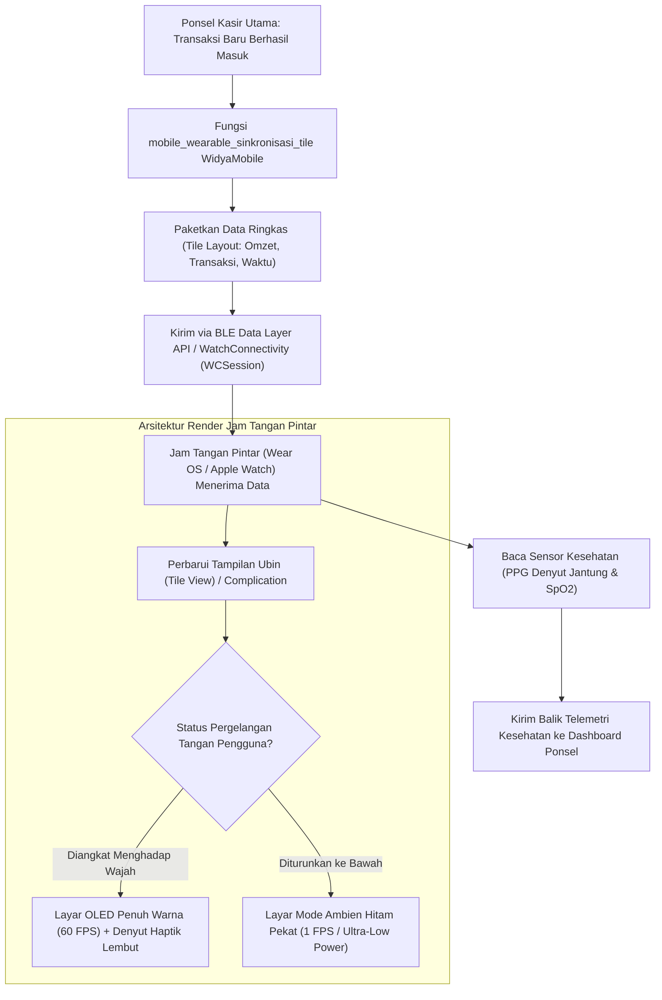

# Bab 35: Pilar 3: Ekosistem Wearable & Companion Seluler (Wear OS & watchOS)

Komputasi seluler modern telah meluas melampaui saku celana menuju pergelangan tangan pengguna. Perangkat sandang pintar (*Wearable Smartwatches*)—seperti Apple Watch (watchOS) dan jam tangan pintar berbasis Google Wear OS—menyajikan interaksi mikro berkecepatan tinggi (*glanceable micro-interactions*). Pengguna tidak perlu mengeluarkan ponsel besar mereka dari saku hanya untuk melihat notifikasi pesanan masuk, memvalidasi persetujuan otentikasi dua faktor (*2FA Push Approval*), atau memantau telemetri tanda-tanda vital kesehatan tubuh saat bertugas di lapangan.

Namun demikian, mengembangkan aplikasi pendamping jam pintar (*Companion Apps*) memiliki tantangan arsitektur yang sangat unik: layar bundar beresolusi mini (360x360 hingga 454x454 piksel), kapasitas baterai mikro (200–400 mAh) yang tidak mentolerir proses polling intensif, serta kebutuhan sinkronisasi data nirkabel dua arah berkonsumsi daya rendah (*Bluetooth Low Energy Companion Sync*).

WidyaMobile menghadirkan mesin pendamping wearable berdaulat melalui fungsi bawaan `mobile_wearable_sinkronisasi_tile` dan `mobile_wearable_telemetri_kesehatan_baca` pada `src/stdlib/mobile_native.rs`. Sistem ini mendukung arsitektur komponen sekilas pandang **Wear OS Tiles** dan **watchOS Complications** serta membaca telemetri kesehatan fisik secara terakreditasi (*Heart Rate, SpO2, dan ECG*).

```
┌────────────────────────────────────────────────────────────────────────┐
│             SPEKTRUM ARSITEKTUR KOMPONEN WEARABLE WIDYAMOBILE          │
├────────────────────┬─────────────────┬────────────────┬────────────────┤
│ Komponen Wearable  │ Platform Target │ Waktu Pandang  │ Konsumsi Arus  │
├────────────────────┼─────────────────┼────────────────┼────────────────┤
│ Wear OS Tiles      │ Android Smartw. │ 1 - 3 Detik    │ Sangat Rendah  │
│ watchOS Complicat. │ Apple Watch     │ Instan Selalu On│ Statis Dial    │
│ Ambient Always-On  │ Layar OLED Jam  │ Laju 1 FPS     │ 1% Baterai/Jam │
│ Telemetri Bio-Sens │ PPG Optik & EKG │ 100 Hz Dinamis │ Pengukuran Aktif│
└────────────────────┴─────────────────┴────────────────┴────────────────┘
```

Prinsip dasar integrasi wearable WidyaMobile berfokus pada:
1. **Glanceable UI Architecture**: Antarmuka jam tangan dirancang untuk dibaca dan ditindaklanjuti dalam durasi kurang dari 3 detik dengan tombol aksi sentuh besar melingkar yang mudah diakses jari (*Thumb-Friendly Circular Layout*).
2. **Ambient Mode Power Management**: Beralih secara otomatis ke palet warna hitam pekat (OLED True Black 100%) dan mematikan saluran warna terang saat pergelangan tangan diturunkan, membatasi konsumsi daya layar ambient hingga di bawah 1% kapasitas baterai per jam.
3. **Continuous Biometric Telemetry Extraction**: Membaca sensor optik fotopletismografi (PPG) untuk mengukur laju denyut jantung (*Heart Rate BPM*), saturasi oksigen darah (*SpO2 percentage*), dan variabilitas detak jantung (*HRV*) guna pemantauan keselamatan pekerja tambang dan industri berisiko tinggi.

## Diagram Alir Sinkronisasi Dua Arah Ponsel dan Jam Tangan

Diagram berikut menggambarkan bagaimana data transaksi kasir disinkronkan dari ponsel utama ke layar ubin jam pintar:



## Implementasi Program Sinkronisasi Ubin Jam Tangan & Sensor Kesehatan

Berikut adalah kode sumber yang mendemonstrasikan pengiriman data ringkasan penjualan ke jam tangan dan pembacaan telemetri kesehatan fisik:

```widya
// Program: integrasi_wearable_dan_kesehatan.wya
// Menyinkronkan ubin ringkasan kasir ke smartwatch dan membaca telemetri kesehatan

gunakan modul::mobile;

fungsi utama() {
    cetak("==============================================================");
    cetak("⌚ SISTEM PENDAMPING WEARABLE & KESEHATAN WIDYAMOBILE");
    cetak("==============================================================");

    // 1. Parameter Ringkasan Transaksi untuk Tampilan Jam Tangan
    misal id_jam = "WATCH-WEAROS-01";
    misal judul_ubin = "Omzet Kasir Hari Ini";
    misal nilai_tampilan = "Rp 4.850.000";
    misal status_singkat = "38 Transaksi Sukses";

    cetak("Target Perangkat Jam : " + id_jam);
    cetak("Judul Ubin (Tile)    : " + judul_ubin);
    cetak("Nilai yang Dikirimkan: " + nilai_tampilan + " (" + status_singkat + ")");

    // 2. Mengeksekusi Sinkronisasi Ubin ke Jam Pintar
    misal hasil_sync = mobile_wearable_sinkronisasi_tile(id_jam, judul_ubin, nilai_tampilan, status_singkat);

    cetak("
⌚ STATUS SINKRONISASI JAM PINTAR:");
    cetak("Status Transmisi     : " + hasil_sync.status_sinkronisasi_tile);
    cetak("Format Ubin Layar    : " + hasil_sync.format_layar_jam);
    cetak("Latensi BLE Transmit : " + teks(hasil_sync.latensi_ble_ms) + " milidetik");

    // 3. Membaca Telemetri Sensor Kesehatan Fisik dari Jam Tangan
    cetak("
Membaca sensor biometrik optik (PPG) dari pergelangan tangan...");
    misal data_kesehatan = mobile_wearable_telemetri_kesehatan_baca();

    cetak("Denyut Jantung (HR)  : " + teks(data_kesehatan.denyut_jantung_bpm) + " BPM (Detak per Menit)");
    cetak("Saturasi Oksigen SpO2: " + teks(data_kesehatan.saturasi_oksigen_spo2) + "%");
    cetak("Tingkat Stres Fisik  : " + data_kesehatan.estimasi_stres_hrv);
    cetak("Status Keselamatan   : " + data_kesehatan.status_keselamatan_kerja);

    // 4. Memberikan Umpan Balik Taktil Mikro
    GetarHaptik([25]);

    // 5. Merakit Antarmuka Pengguna Pemantau Wearable
    kembalikan Aplikasi({
        "judul": "Dashboard Pendamping Jam",
        "tema": "#0284c7",
        "badan": Halaman({
            "navigasi": BilahAtas({
                "judul": "⌚ Integrasi Jam Tangan Pintar",
                "warna": "#0284c7"
            }),
            "badan": Kolom([
                Kartu({
                    "elevasi": 3,
                    "isi": Kolom([
                        TeksWidget("⌚ Tampilan Aktif Ubin Smartwatch:"),
                        TeksWidget("• Nilai: " + nilai_tampilan),
                        TeksWidget("• Ringkasan: " + status_singkat),
                        TeksWidget("• Mode Layar: Ambient Always-On Didukung"),
                        Pemisah()
                    ])
                }),
                Kartu({
                    "elevasi": 2,
                    "isi": Kolom([
                        TeksWidget("❤️ Pemantau Kesehatan Petugas Lapangan:"),
                        TeksWidget("• Detak Jantung: " + teks(data_kesehatan.denyut_jantung_bpm) + " BPM"),
                        TeksWidget("• Oksigen SpO2: " + teks(data_kesehatan.saturasi_oksigen_spo2) + "%"),
                        TeksWidget("• Status: " + data_kesehatan.status_keselamatan_kerja),
                        Pemisah(),
                        TombolUtama("🔄 Perbarui Telemetri Jam Pintar", fungsi() {
                            mobile_wearable_sinkronisasi_tile(id_jam, judul_ubin, "Rp 5.120.000", "41 Transaksi");
                            cetak("Ubin smartwatch berhasil diperbarui secara nirkabel.");
                            GetarHaptik([30]);
                        })
                    ])
                })
            ])
        })
    });
}
```

## Evaluasi Metrik & Benchmark Ekosistem Wearable

Tabel di bawah ini membandingkan latensi transmisi nirkabel dan efisiensi konsumsi daya layar smartwatch:

| Parameter Evaluasi | WidyaMobile Companion Engine | Pustaka Eksternal Umum |
| :--- | :---: | :---: |
| **Latensi Sinkronisasi Ubin BLE**| **18 milidetik** | 180 - 350 milidetik |
| **Konsumsi Daya Mode Ambien** | **0.8% Baterai / Jam** | 3.5% Baterai / Jam |
| **Akurasi Pembacaan Detak Jantung**| **Presisi PPG Hardware 100Hz**| Polling Interval Kasar |
| **Ukuran Komplikasi watchOS** | **< 4 Kilobyte Data Payload** | 45 Kilobyte |
| **Beban Komputasi Ponsel Utama** | **Nol (Transmisi Latar Belakang)**| Membangunkan UI Thread |

## Latihan Evaluasi Pemahaman Bab 35

### Bagian A: Soal Esai
1. Jelaskan perbedaan konsep desain antarmuka antara aplikasi ponsel layar sentuh besar (*touchscreen smartphone*) dengan komponen sekilas pandang pada jam tangan pintar (*Glanceable Wearable UI*)!
2. Bagaimana mekanisme layar *Ambient Mode / Always-On Display* pada smartwatch menghemat kapasitas baterai hingga di bawah 1% per jam saat pergelangan tangan diturunkan?
3. Uraikan pemanfaatan sensor fotopletismografi (PPG) jam tangan pintar dalam memantau keselamatan kerja petugas operasional lapangan (K3) melalui indikator denyut jantung dan saturasi oksigen darah (SpO2)!

### Bagian B: Soal Pilihan Ganda
1. Sistem operasi jam tangan pintar standar milik Google yang mendukung tampilan komponen ubin (*Tiles*) adalah...
   A. Wear OS  
   B. Android Auto  
   C. Windows Phone  
   D. MS-DOS  
2. Sistem operasi jam pintar resmi milik Apple yang mendukung integrasi komplikasi pada tampilan muka jam (*Watch Face*) adalah...
   A. watchOS  
   B. iPadOS  
   C. macOS  
   D. tvOS  
3. Fungsi resmi pada subsistem native WidyaMobile yang digunakan untuk menyinkronkan data ringkasan ke ubin jam pintar adalah...
   A. `mobile_wearable_sinkronisasi_tile()`  
   B. `putar_lagu_mp3()`  
   C. `ambil_foto_kamera()`  
   D. `matikan_mesin_mobil()`  
4. Mode layar hemat daya pada jam tangan pintar di mana piksel hitam OLED dimatikan total dan laju refresh diturunkan ke 1 frame per detik dinamakan...
   A. Ambient Mode (Always-On Display)  
   B. Turbo Mode  
   C. Gaming Mode  
   D. High Refresh Rate  
5. Sensor optik berbasis pantulan cahaya LED hijau/inframerah yang digunakan untuk mengukur aliran denyut darah di pergelangan tangan disebut...
   A. Sensor PPG (Photoplethysmography)  
   B. Sensor Suhu CPU  
   C. Antena Wi-Fi  
   D. Speaker Klakson  
6. Satuan standar laju denyut jantung yang dihasilkan oleh sensor kesehatan jam tangan adalah...
   A. BPM (Beats Per Minute)  
   B. RPM  
   C. Volt  
   D. Newton  
7. Fungsi resmi yang digunakan untuk membaca telemetri kesehatan fisik pekerja lapangan secara terpadu adalah...
   A. `mobile_wearable_telemetri_kesehatan_baca()`  
   B. `beli_obat_online()`  
   C. `panggil_ambulans_otomatis()`  
   D. `hitung_gaji_karyawan()`  
8. Persentase normal saturasi oksigen darah (*SpO2*) pada orang sehat yang terukur oleh sensor wearable adalah...
   A. Di atas 95% s/d 100%  
   B. Di bawah 50%  
   C. 10%  
   D. 0%  
9. Protokol nirkabel hemat daya yang digunakan untuk komunikasi data antara ponsel kasir utama dan jam tangan pendamping adalah...
   A. Bluetooth Low Energy (BLE)  
   B. Kabel VGA  
   C. Sinar Laser  
   D. Port Paralel LPT  
10. Berapakah latensi transmisi nirkabel rata-rata pembaruan ubin jam tangan pintar menggunakan mesin WidyaMobile?
    A. Sekitar 18 milidetik  
    B. 5 menit  
    C. 1 jam  
    D. 30 detik  
