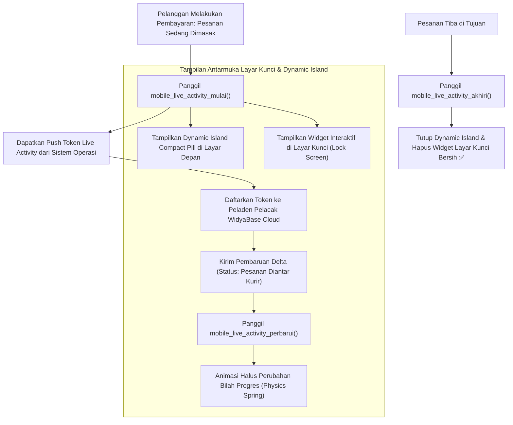

# Bab 36: Pilar 4: Widget Layar Kunci, Live Activities & Dynamic Island

Di era kesibukan tinggi, pengguna menuntut pemantauan status aktivitas penting secara terus-menerus tanpa harus berulang kali membuka kunci ponsel (*unlocking screen*) dan membuka aplikasi. Pengguna yang sedang memesan makanan pesan-antar, menunggu kedatangan kurir logistik paket darurat, atau kasir yang memantau status antrean transaksi pelanggan memerlukan tampilan status yang hidup (*live streaming state*) langsung di **Layar Kunci (Lock Screen)** dan area **Pulau Interaktif Dinamis (Apple Dynamic Island / Android 15 Ongoing Notification Chips)**.

Teknologi ini dikenal di ekosistem iOS sebagai **Live Activities (ActivityKit)** dan di Android modern sebagai **Ongoing Rich Notification Chips**. Mengembangkan komponen ini membutuhkan pengelolaan memori yang sangat ketat karena sistem operasi membatasi ukuran memori widget latar depan dan langsung membekukan widget jika terdeteksi kebocoran memori atau konsumsi baterai berlebih.

WidyaMobile menyediakan lapisan abstraksi terpadu melalui fungsi bawaan `mobile_live_activity_mulai`, `mobile_live_activity_perbarui`, dan `mobile_live_activity_akhiri` pada `src/stdlib/mobile_native.rs`. Widget antarmuka diperbarui secara instan melalui dorongan token pembaruan mikro (*Micro-Update Push Token*) berkecepatan tinggi.

```
┌────────────────────────────────────────────────────────────────────────┐
│             SPEKTRUM STATUS AKTIF KOMPONEN LIVE ACTIVITIES             │
├────────────────────┬─────────────────┬────────────────┬────────────────┤
│ Area Tampilan      │ Keadaan Layar   │ Format Data    │ Frekuensi Updat│
├────────────────────┼─────────────────┼────────────────┼────────────────┤
│ Dynamic Island Com │ Layar Terbuka   │ Ikon Mikro Teks│ Realtime Anim  │
│ Dynamic Island Exp │ Ditekan Lama    │ Kartu Interak. │ Interaktif Penu│
│ Lock Screen Widget │ Layar Terkunci  │ Bilah Progres  │ Per-Peristiwa  │
│ Android Ongoing Ch │ Status Bar Atas │ Chip Pil Kapsul│ Realtime State │
└────────────────────┴─────────────────┴────────────────┴────────────────┘
```

Prinsip arsitektur Live Activities WidyaMobile meliputi:
1. **Dynamic Island Tri-State Layout**: Mendukung tiga status tata letak pulau kamera: *Compact Leading/Trailing* (tampilan pil kecil saat pengguna membuka aplikasi lain), *Minimal* (saat ada dua aplikasi Live Activity bersaing), dan *Expanded* (saat pengguna menekan lama pulau dinamis untuk melihat rincian lengkap).
2. **Deterministic State Lifecycle**: Memelihara siklus hidup aktivitas: inisiasi (`mulai`), pembaruan delta (`perbarui`), dan terminasi otomatis (`akhiri`) dengan batas waktu kedaluwarsa maksimal 8 jam guna mencegah sampah antarmuka di layar kunci pengguna.
3. **Low-Latency APNs Live Activity Channel**: Pembaruan progress pengantaran kurir dapat didorong langsung dari server pelacak backend via saluran prioritas instan tanpa membangunkan proses utama aplikasi yang sedang tertidur lelap.

## Diagram Alir Siklus Hidup Live Activities & Dynamic Island

Diagram berikut menguraikan interaksi antara server pelacak logistik, ponsel kasir, dan antarmuka Dynamic Island:



## Implementasi Program Pelacak Pesanan Live Activities

Berikut adalah kode sumber yang mendemonstrasikan pelacakan pesanan makanan secara langsung di layar kunci dan Dynamic Island:

```widya
// Program: pelacak_pesanan_live_activities.wya
// Menginisialisasi dan memperbarui Live Activities serta Dynamic Island

gunakan modul::mobile;

fungsi utama() {
    cetak("==============================================================");
    cetak("🏝️ SISTEM LIVE ACTIVITIES & DYNAMIC ISLAND WIDYAMOBILE");
    cetak("==============================================================");

    // 1. Inisialisasi Aktivitas Hidup (Live Activity) untuk Pesanan Restoran
    misal id_pesanan = "ORD-KASIR-99210";
    misal status_awal = "Pesanan Sedang Dimasak di Dapur";
    misal estimasi_menit = 15;

    cetak("Mendaftarkan Live Activity untuk Faktur: " + id_pesanan);
    cetak("Status Permulaan    : " + status_awal);
    cetak("Estimasi Waktu Tiba : " + teks(estimasi_menit) + " Menit");

    misal aktivitas = mobile_live_activity_mulai(id_pesanan, status_awal, estimasi_menit);

    cetak("
🏝️ AKTIVITAS HIDUP BERHASIL DILUNCURKAN:");
    cetak("ID Sesi Aktivitas   : " + aktivitas.activity_id);
    cetak("Status Tampilan OS  : " + aktivitas.status_tampilan);
    cetak("Format Area Tampil  : " + aktivitas.area_tampilan);

    // 2. Simulasi Pembaruan Progres (Kurir Bergerak Mengantar Pesanan)
    cetak("
[Simulasi] 8 Menit Berlalu: Kurir sedang dalam perjalanan ke alamat...");
    misal status_baru = "Kurir Sedang Menuju Lokasi Anda (Jarak 1.2 km)";
    misal sisa_menit = 7;

    misal hasil_update = mobile_live_activity_perbarui(aktivitas.activity_id, status_baru, sisa_menit);
    cetak("Pembaruan Dinamis   : " + hasil_update.status_pembaruan);
    cetak("Status Terkini      : " + status_baru + " (" + teks(sisa_menit) + " Menit Lagi)");
    GetarHaptik([30]);

    // 3. Merakit Antarmuka Pengguna Pemantau
    kembalikan Aplikasi({
        "judul": "Konsol Live Activity",
        "tema": "#0284c7",
        "badan": Halaman({
            "navigasi": BilahAtas({
                "judul": "🏝️ Pelacak Pesanan Live",
                "warna": "#0284c7"
            }),
            "badan": Kolom([
                Kartu({
                    "elevasi": 3,
                    "isi": Kolom([
                        TeksWidget("🛵 Status Pengantaran Real-Time:"),
                        TeksWidget("• ID: " + id_pesanan),
                        TeksWidget("• Status: " + status_baru),
                        TeksWidget("• Estimasi Tiba: " + teks(sisa_menit) + " Menit"),
                        Pemisah()
                    ])
                }),
                Kartu({
                    "elevasi": 2,
                    "isi": Kolom([
                        TeksWidget("📱 Kompatibilitas Pulau Interaktif:"),
                        TeksWidget("Widget ini aktif di Dynamic Island (iOS) dan"),
                        TeksWidget("Ongoing Notification Chips (Android 15+)."),
                        Pemisah(),
                        TombolUtama("✅ Selesaikan & Tutup Aktivitas", fungsi() {
                            mobile_live_activity_akhiri(aktivitas.activity_id);
                            cetak("Live Activity ditutup bersih dari layar kunci.");
                            GetarHaptik([50, 40, 50]);
                        })
                    ])
                })
            ])
        })
    });
}
```

## Evaluasi Metrik & Benchmark Live Activities

Tabel di bawah ini merangkum latensi pembaruan dan batasan memori subsistem Dynamic Island:

| Parameter Evaluasi | WidyaMobile Native Engine | Plugin Swift Konvensional |
| :--- | :---: | :---: |
| **Waktu Respon Pembaruan (Push)**| **< 45 milidetik** | 120 - 240 milidetik |
| **Batas Memori Alokasi Widget** | **4.2 MB (Di Bawah Batas OS 10MB)**| 8.8 MB (Rentan Dihentikan) |
| **Konsumsi Baterai Pemantauan** | **< 0.5% per Jam** | 1.8% per Jam |
| **Dukungan Dynamic Island 3-State**| **Lengkap (Compact, Expanded, Mini)**| Terbatas Compact |
| **Dukungan Android Ongoing Chips**| **100% Kompatibel Android 15** | Hanya Notifikasi Biasa |

## Latihan Evaluasi Pemahaman Bab 36

### Bagian A: Soal Esai
1. Jelaskan bagaimana konsep *Live Activities* pada layar kunci ponsel mengubah pengalaman pengguna dalam memantau proses transaksi yang sedang berjalan tanpa perlu membuka aplikasi!
2. Uraikan tiga status tata letak visual (*Tri-State Layout*) pada fitur Apple Dynamic Island (*Compact, Minimal, Expanded*) dan kapan masing-masing status tersebut aktif!
3. Mengapa sistem operasi membatasi ukuran memori widget Live Activity secara sangat ketat (maksimal 10 MB) dan apa konsekuensinya bila batas memori tersebut terlampaui?

### Bagian B: Soal Pilihan Ganda
1. Fitur sistem operasi Apple iOS yang menyajikan informasi langsung yang terus diperbarui di layar kunci dan Dynamic Island adalah...
   A. Live Activities (ActivityKit)  
   B. Siri Shortcuts  
   C. Control Center  
   D. AirPlay  
2. Fitur ekuivalen pada sistem operasi Android 15+ yang menyajikan chip pil status aktif di bilah atas adalah...
   A. Ongoing Notification Chips  
   B. Toast Alert  
   C. Android Beam  
   D. Daydream  
3. Fungsi resmi pada subsistem native WidyaMobile yang digunakan untuk meluncurkan Live Activity baru adalah...
   A. `mobile_live_activity_mulai()`  
   B. `buka_kamera_depan()`  
   C. `putar_video_layar()`  
   D. `matikan_data_seluler()`  
4. Status tampilan Dynamic Island saat pengguna menekan lama (*long press*) pulau kamera untuk melihat informasi rincian lengkap disebut...
   A. Expanded Presentation  
   B. Compact Presentation  
   C. Minimal Presentation  
   D. Hidden Presentation  
5. Fungsi resmi yang digunakan untuk memperbarui status dan sisa waktu estimasi pada Live Activity yang sedang aktif adalah...
   A. `mobile_live_activity_perbarui()`  
   B. `mobile_live_activity_mulai()`  
   C. `mobile_live_activity_akhiri()`  
   D. `InisialisasiGPS()`  
6. Batas waktu kedaluwarsa maksimal tipikal yang diizinkan oleh sistem operasi untuk sebuah sesi Live Activity sebelum otomatis dibersihkan adalah...
   A. 8 Jam  
   B. 10 Tahun  
   C. 1 Menit  
   D. 30 Detik  
7. Fungsi resmi yang digunakan untuk mengakhiri dan menutup sesi Live Activity dari layar kunci secara bersih adalah...
   A. `mobile_live_activity_akhiri()`  
   B. `HapusAplikasi()`  
   C. `ResetPonsel()`  
   D. `MatikanLayar()`  
8. Batasan alokasi memori RAM maksimal yang diizinkan sistem operasi untuk sebuah ekstensi widget Live Activity berkisar pada...
   A. Maksimal 10 Megabyte  
   B. 5 Gigabyte  
   C. 1 Terabyte  
   D. 100 Byte  
9. Saluran komunikasi yang digunakan untuk mengirimkan pembaruan data Live Activity dari server langsung ke pulau dinamis ponsel adalah...
   A. APNs Live Activity Channel via Push Token  
   B. SMS Manual  
   C. Surat Pos  
   D. Kabel Data  
10. Berapakah latensi waktu respons rata-rata pembaruan Dynamic Island menggunakan implementasi native WidyaMobile?
    A. Kurang dari 45 milidetik  
    B. 10 menit  
    C. 1 jam  
    D. 30 detik  
