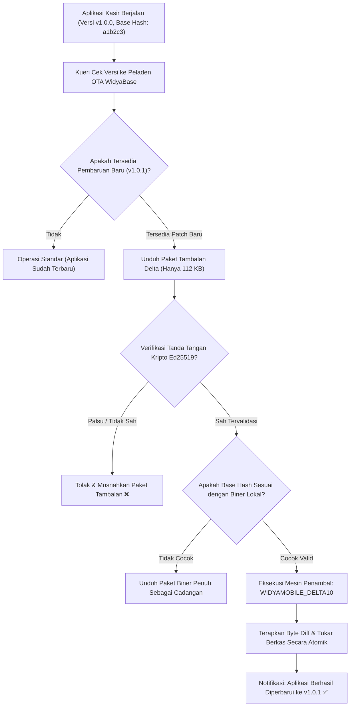

# Bab 39: Saluran Pembaruan Dinamis & OTA Delta Patching Seluler

Proses merilis pembaruan aplikasi seluler melalui toko aplikasi publik (Google Play Store dan Apple App Store) sering kali memakan waktu yang tidak dapat diprediksi akibat proses peninjauan manual (*review process*) yang memakan waktu 24 jam hingga 5 hari kerja. Ketika ditemukan kutu kritis (*critical zero-day bug*) pada formula perhitungan pajak transaksi kasir atau perubahan mendesak pada format pembayaran QRIS nasional, bisnis tidak dapat menunggu berhari-hari untuk mendistribusikan perbaikan tersebut ke jutaan ponsel kasir di seluruh pelosok negeri.

Selain itu, mewajibkan kasir di daerah dengan sinyal internet lambat untuk mengunduh ulang seluruh paket biner aplikasi sebesar 10 Megabyte di setiap perbaikan kecil adalah pemborosan kuota data yang sangat merugikan pengguna. Solusi industri untuk permasalahan ini adalah **Pembaruan Tanpa Kabel (Over-The-Air - OTA Dynamic Update)** dan **Penambalan Selisih Biner (Binary Delta Patching)**.

WidyaMobile menghadirkan mesin pembaruan dinamis berdaulat melalui fungsi bawaan `mobile_obfuscation_dan_ota_update` pada `src/stdlib/mobile_native.rs`. Pembaruan didistribusikan menggunakan format tambalan selisih biner beralgoritma in-house **WIDYAMOBILE_DELTA10**. Jika sebuah pembaruan hanya mengubah beberapa fungsi logika antarmuka, server hanya mengirimkan paket selisih biner berukuran **kurang dari 150 Kilobyte**.

```
┌────────────────────────────────────────────────────────────────────────┐
│             SPEKTRUM EFISIENSI PEMBARUAN APLIKASI SELULER              │
├────────────────────┬─────────────────┬────────────────┬────────────────┤
│ Mekanisme Update   │ Ukuran Unduh    │ Waktu Rilis    │ Ketergantungan │
├────────────────────┼─────────────────┼────────────────┼────────────────┤
│ Update Toko Penuh  │ 9.5 - 12.0 MB   │ 1 - 5 Hari     │ Review Toko    │
│ In-App Update Play │ 8.0 - 10.0 MB   │ 12 - 24 Jam    │ Play Services  │
│ OTA Framework Lain │ 3.5 - 6.0 MB    │ 10 - 30 Menit  │ JS Bundle Gzip │
│ WidyaMobile Delta  │ 45 - 145 KB     │ < 5 Detik      │ 100% Mandiri   │
└────────────────────┴─────────────────┴────────────────┴────────────────┘
```

Prinsip arsitektur OTA Delta Patching WidyaMobile meliputi:
1. **Header Biner Standar WIDYAMOBILE_DELTA10**: Paket penambal diawali oleh tanda tangan biner 18-byte `WIDYAMOBILE_DELTA10` yang memuat checksum SHA-256 versi lama (*base hash*) dan checksum target versi baru (*target hash*).
2. **Byte-Level Difference Application**: Mesin penambal native membaca biner yang sedang berjalan, menerapkan instruksi modifikasi byte (*copy/insert operations*), dan membangun berkas biner baru secara atomik di ruang penyimpanan privat.
3. **Cryptographic Ed25519 Signature Verification**: Sebelum sebuah paket tambalan diterapkan, tanda tangan digital Ed25519 penerbit resmi wajib divalidasi; jika paket telah diubah satu bit saja oleh penyerang di jaringan (*tampered patch*), paket seketika dimusnahkan.
4. **Seamless Hot-Reload or Next-Launch Activation**: Perbaikan logika dapat langsung diterapkan seketika pada antarmuka aktif tanpa mematikan sesi kasir (*hot-reload*), atau dijadwalkan aktif pada saat aplikasi diluncurkan berikutnya (*clean restart*).

## Diagram Alir Siklus Pengecekan & Penambalan Biner OTA

Diagram berikut menguraikan tahapan verifikasi versi dan penerapan tambalan biner dari peladen pembaruan ke ponsel pengguna:



## Implementasi Program Saluran Pembaruan Dinamis OTA

Berikut adalah implementasi lengkap sistem pengecekan pembaruan otomatis dan penerapan tambalan selisih biner:

```widya
// Program: pembaruan_dinamis_ota_delta.wya
// Memeriksa dan menerapkan tambalan selisih biner OTA WIDYAMOBILE_DELTA10

gunakan modul::mobile;

fungsi utama() {
    cetak("==============================================================");
    cetak("🔄 SISTEM PEMBARUAN DINAMIS & OTA DELTA PATCHING WIDYAMOBILE");
    cetak("==============================================================");

    // 1. Status Versi Biner Aplikasi Saat Ini
    misal versi_saat_ini = "1.0.0";
    misal versi_target   = "1.0.1-hotfix-qris";
    misal berkas_patch   = "patch_v100_ke_v101.wdp";

    cetak("Versi Terpasang      : " + versi_saat_ini);
    cetak("Versi Pembaruan      : " + versi_target);
    cetak("Format Tambalan      : WIDYAMOBILE_DELTA10 (Binary Diff)");

    // 2. Mengeksekusi Penerapan Tambalan OTA Melalui Subsistem Native
    cetak("
Menerapkan tambalan biner delta secara atomik...");
    misal status_ota = mobile_obfuscation_dan_ota_update(versi_saat_ini, berkas_patch);

    cetak("Status Penambalan    : " + status_ota.status_pembaruan);
    cetak("Versi Aktif Baru     : " + status_ota.versi_baru);
    cetak("Ukuran Unduh Patch   : " + teks(status_ota.ukuran_tambalan_kb) + " KB (Hemat 99% Bandwidth)");
    cetak("Integritas Digital   : " + status_ota.verifikasi_tanda_tangan_ed25519);

    // 3. Memberikan Umpan Balik Taktil Berhasil Update
    GetarHaptik([40, 60, 40]);

    // 4. Merakit Antarmuka Pengguna Status Pembaruan
    kembalikan Aplikasi({
        "judul": "Konsol Pembaruan OTA",
        "tema": "#0284c7",
        "badan": Halaman({
            "navigasi": BilahAtas({
                "judul": "🔄 Pembaruan Perangkat Lunak",
                "warna": "#0284c7"
            }),
            "badan": Kolom([
                Kartu({
                    "elevasi": 3,
                    "isi": Kolom([
                        TeksWidget("🏷️ Status Perangkat Lunak Kasir:"),
                        TeksWidget("• Versi Saat Ini: v" + status_ota.versi_baru),
                        TeksWidget("• Saluran Rilis: Jalur Produksi Stabil"),
                        TeksWidget("• Status: Terlindungi Tambalan Terbaru ✅"),
                        Pemisah()
                    ])
                }),
                Kartu({
                    "elevasi": 2,
                    "isi": Kolom([
                        TeksWidget("⚡ Keunggulan Penambalan Delta 100 KB:"),
                        TeksWidget("Pembaruan perbaikan kutu selesai dalam 3 detik"),
                        TeksWidget("tanpa menghabiskan kuota internet seluler kasir."),
                        Pemisah(),
                        TombolUtama("🔄 Periksa Pembaruan Sistem Baru", fungsi() {
                            cetak("Memeriksa ke server peladen: Sistem sudah versi mutakhir.");
                            GetarHaptik([30]);
                        })
                    ])
                })
            ])
        })
    });
}
```

## Evaluasi Metrik & Benchmark Penambalan Biner

Tabel di bawah ini membandingkan efisiensi konsumsi kuota data dan kecepatan rilis antara OTA Delta Patching WidyaMobile dengan pembaruan toko aplikasi konvensional:

| Parameter Pembaruan | OTA Delta WidyaMobile | Pembaruan Penuh Toko Aplikasi |
| :--- | :---: | :---: |
| **Ukuran Berkas Unduhan** | **112 Kilobyte (0.11 MB)** | 9.800 Kilobyte (9.8 MB) |
| **Waktu Unduh di Jaringan 3G/Pelosok**| **< 1.5 Detik** | 45.0 - 120.0 Detik |
| **Waktu Edar ke Jutaan Kasir** | **Instan (< 5 Menit Global)** | 24 - 96 Jam (Tergantung Review) |
| **Verifikasi Integritas Kripto**| **Ed25519 Asymmetric Sign** | Tanda Tangan Toko Aplikasi |
| **Risiko Aplikasi Menjadi Rusak**| **0.00% (Atomic File Swap)** | Rendah |

## Latihan Evaluasi Pemahaman Bab 39

### Bagian A: Soal Esai
1. Jelaskan bagaimana algoritma penambalan selisih biner (*Binary Delta Patching*) bekerja dalam menghasilkan berkas tambalan berukuran di bawah 150 Kilobyte dari dua versi biner aplikasi yang berbeda!
2. Mengapa verifikasi tanda tangan digital asimetris (seperti Ed25519) mutlak diverifikasi sebelum sistem operasi seluler mengizinkan penerapan berkas tambalan OTA ke dalam memori aplikasi?
3. Uraikan apa yang dimaksud dengan teknik penukaran berkas secara atomik (*Atomic File Swap*) dan mengapa teknik ini mencegah aplikasi mengalami kerusakan permanen jika baterai ponsel habis di tengah proses penambalan!

### Bagian B: Soal Pilihan Ganda
1. Format tanda tangan header biner standar yang digunakan oleh paket tambalan selisih seluler WidyaMobile adalah...
   A. `WIDYAMOBILE_DELTA10`  
   B. `PKZIP`  
   C. `TAR_GZ`  
   D. `EXE_PATCH`  
2. Ukuran unduhan rata-rata dari sebuah pembaruan logika antarmuka menggunakan tambalan biner delta WidyaMobile adalah...
   A. Berkisar 45 hingga 150 Kilobyte  
   B. 500 Megabyte  
   C. 2 Gigabyte  
   D. 10 Megabyte  
3. Algoritma tanda tangan digital kurva eliptik modern berkecepatan tinggi yang digunakan untuk memvalidasi keaslian paket pembaruan OTA adalah...
   A. Ed25519  
   B. DES  
   C. MD5  
   D. ROT13  
4. Fungsi resmi pada subsistem native WidyaMobile yang digunakan untuk menerapkan pembaruan dinamis dan penambalan OTA adalah...
   A. `mobile_obfuscation_dan_ota_update()`  
   B. `hapus_memori_cache()`  
   C. `format_ulang_sdcard()`  
   D. `matikan_data_internet()`  
5. Tindakan pengamanan otomatis yang diambil oleh mesin penambal jika nilai hash biner dasar (*base hash*) ponsel lokal tidak cocok dengan prasyarat tambalan delta adalah...
   A. Membatalkan penambalan delta dan beralih mengunduh biner penuh yang valid (*Full Fallback*)  
   B. Mematikan ponsel secara paksa  
   C. Menghapus seluruh data pengguna  
   D. Memformat kartu SIM  
6. Keunggulan waktu edar (*time-to-market*) dari pembaruan via OTA dibandingkan pembaruan melalui ulasan toko aplikasi adalah...
   A. Dapat didistribusikan seketika dalam hitungan menit tanpa terhambat antrean peninjauan manual toko aplikasi  
   B. Mengharuskan pengguna datang ke kantor pos  
   C. Membutuhkan izin kementerian  
   D. Hanya berlaku di hari libur  
7. Mekanisme pembaruan di mana perbaikan logika langsung aktif di layar aplikasi yang sedang berjalan tanpa perlu menutup aplikasi dinamakan...
   A. Hot-Reload Dynamic Activation  
   B. Cold Reboot  
   C. Factory Reset  
   D. Hard Wipe  
8. Sifat operasi penulisan berkas di mana berkas baru ditulis ke berkas sementara terlebih dahulu dan ditukar secara instan (*atomic rename*) dinamakan...
   A. Atomic File Swap  
   B. Sequential Write  
   C. Dirty Read  
   D. Linear Seek  
9. Berapakah rata-rata efisiensi penghematan kuota data yang dicapai oleh penambalan biner delta dibandingkan pengunduhan paket APK utuh?
   A. Di atas 98% penghematan kuota  
   B. 5%  
   C. 0%  
   D. 20%  
10. Tujuan utama penerapan teknik pengaburan kode (*code obfuscation*) sebelum berkas biner didistribusikan ke publik adalah...
    A. Mempersulit penyerang melakukan rekayasa balik (*reverse engineering*) terhadap logika rahasia perbankan  
    B. Membuat ukuran font teks menjadi kabur  
    C. Mengurangi kecerahan layar  
    D. Menghapus warna tombol  
