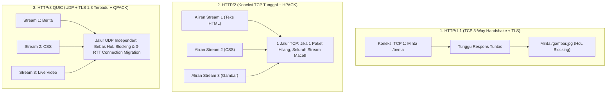

## Bab 2: Anatomi Protokol Web: HTTP/1.1, HTTP/2 & HTTP/3 QUIC

### 2.1 Evolusi Transportasi Web: Dari TCP Menuju UDP QUIC

Komunikasi data antara peramban web klien dan peladen portal berita berlangsung melalui protokol lapisan aplikasi **Hypertext Transfer Protocol (HTTP)**. Memahami evolusi, kelebihan, dan kelemahan dari setiap generasi protokol HTTP sangat krusial bagi arsitek perangkat lunak web skala industri.

WidyaWeb dirancang dengan dukungan multi-protokol native (`pure_http.rs` dan `pure_http3.rs`), mampu melayani klien mulai dari protokol HTTP/1.1 warisan hingga protokol mutakhir **HTTP/3 berbasis QUIC**:
1. **HTTP/1.1 (1997 - TCP Polos)**:
   - *Kelemahan Head-of-Line (HoL) Blocking pada Lapisan Aplikasi*: Klien hanya dapat mengirim satu permintaan per koneksi TCP dalam satu waktu. Jika ada berkas gambar besar yang lambat diunduh, permintaan dokumen lainnya di belakangnya akan tertahan.
   - *Solusi Tambal Sulam*: Membuka 6 koneksi TCP paralel per domain (*domain sharding*), yang memboroskan alokasi memori peladen dan lambat pada fase jabat tangan TCP 3-Way Handshake.
2. **HTTP/2 (2015 - Binary Framing)**:
   - *Multipleksing Biner*: Membagi permintaan dan respons ke dalam frame-frame biner independen yang dialirkan melintasi satu koneksi TCP tunggal.
   - *Kompresi Header HPACK*: Mengurangi beban overhead header berulang (seperti User-Agent, Cookie) hingga 85%.
   - *Kelemahan TCP HoL Blocking*: Meskipun mengatasi HoL pada tingkat aplikasi, jika terjadi satu paket TCP yang hilang (*packet drop*) akibat sinyal seluler buruk, seluruh aliran data HTTP/2 di dalam koneksi tersebut akan membeku menunggu pengiriman ulang paket TCP.
3. **HTTP/3 (2022 - QUIC / UDP Murni)**:
   - *Mengganti TCP dengan QUIC di Atas UDP*: QUIC mengintegrasikan lapisan transportasi (UDP), enkripsi keamanan (TLS 1.3), dan kontrol kongesti ke dalam satu lapisan tunggal.
   - *Bebas Head-of-Line Blocking Mutlak*: Setiap aliran (*stream*) HTTP/3 independen secara fisik. Kehilangan satu paket data pada aliran video tidak akan pernah menghentikan aliran teks berita.
   - *Jabat Tangan Nol Putaran Waktu (0-RTT Handshake)*: Klien yang pernah terhubung sebelumnya dapat mengirimkan data permintaan HTTP seketika pada paket pertama tanpa menunggu jabat tangan selesai (*Zero Round-Trip Time*).
   - *Migrasi Koneksi Mulus (Connection Migration)*: Pengguna ponsel yang beralih dari jaringan Wi-Fi rumah ke jaringan seluler 4G/5G tidak mengalami pemutusan koneksi (*no reconnect*) karena identitas koneksi diikat oleh *Connection ID 64-bit*, bukan kombinasi IP dan Port.



### 2.2 Implementasi Kode Program Utuh

Berikut implementasi konfigurasi dan penanganan peladen multi-protokol HTTP/2 dan HTTP/3 QUIC pada WidyaWeb menggunakan Widya-Lang:

```widya
// Modul Penanganan Protokol HTTP/2 dan HTTP/3 QUIC WidyaWeb
modul penanganan_protokol_web {
    impor ekosistem::widyaweb::{
        WidyaWeb, PeladenMultiProtokol, KonfigurasiQUIC,
        KonfigurasiTLS, VersiProtokol, PermintaanStream
    };

    fungsi jalankan_peladen_http3_berdaulat() -> Hasil<Boolean, Teks> {
        cetak("==================================================================");
        cetak(">>> [HTTP3-QUIC] Mengonfigurasi Peladen Multi-Protokol Berita...");

        // 1. Konfigurasikan Enkripsi TLS 1.3 Wajib untuk HTTP/2 dan HTTP/3
        biar mut tls_config = KonfigurasiTLS::buat();
        tls_config.muat_sertifikat("/etc/widya/ssl/nusantaranews.crt", "/etc/widya/ssl/nusantaranews.key")?;
        tls_config.tetapkan_protokol_alpn(["h3", "h2", "http/1.1"]);

        // 2. Konfigurasikan Parameter Mesin QUIC UDP
        biar mut quic_config = KonfigurasiQUIC::buat();
        quic_config.aktifkan_0rtt(benar); // Mengizinkan Zero Round-Trip Time
        quic_config.tetapkan_waktu_tunggu_detik(30);
        quic_config.tetapkan_maksimal_aliran_bersamaan(256);

        // 3. Bangun Peladen Multi-Protokol pada Port 443 (TCP & UDP)
        biar mut peladen = PeladenMultiProtokol::buat(tls_config, quic_config);
        peladen.ikat_alamat("0.0.0.0", 443)?;

        // 4. Registrasi Handler Aliran Data Independen
        peladen.tangani_aliran(|stream: PermintaanStream| {
            biar versi = stream.versi_protokol();
            biar jalur = stream.jalur_uri();

            cetak(">>> [INCOMING] Jalur: " + jalur + " | Versi: " + versi.nama_teks());

            cocokkan versi {
                VersiProtokol::Http3 => {
                    // Beri header Alt-Svc untuk mengonfirmasi dukungan HTTP/3
                    stream.tulis_header("Alt-Svc", "h3=\":443\"; ma=86400");
                    stream.kirim_respon_teks(200, "Halo dari HTTP/3 QUIC Nusantara! Latensi ultra-rendah.");
                },
                VersiProtokol::Http2 => {
                    stream.tulis_header("Alt-Svc", "h3=\":443\"; ma=86400");
                    stream.kirim_respon_teks(200, "Halo dari HTTP/2 Multiplexed Stream.");
                },
                VersiProtokol::Http11 => {
                    stream.tulis_header("Alt-Svc", "h3=\":443\"; ma=86400");
                    stream.kirim_respon_teks(200, "Halo dari HTTP/1.1 Kompatibilitas Warisan.");
                }
            }
        });

        cetak(">>> [HTTP3] Peladen QUIC aktif mendengarkan di UDP port 443.");
        cetak(">>> [HTTP2] Peladen TCP aktif mendengarkan di TCP port 443.");
        cetak("==================================================================");

        kembalikan Ok(benar);
    }
}
```

### 2.3 Analisis Arsitektur, Metrik & Tabel Spesifikasi

Tabel perbandingan teknis evolusi tiga generasi protokol HTTP pada WidyaWeb:

| Karakteristik Protokol | HTTP/1.1 (RFC 2616) | HTTP/2 (RFC 7540) | HTTP/3 QUIC (RFC 9114) |
| :--- | :--- | :--- | :--- |
| **Protokol Lapisan Transpor** | TCP (Transmission Control) | TCP (Transmission Control) | **UDP (User Datagram Protocol)** |
| **Penyandian Pesan** | Format Teks Karakter Terbuka | Frame Biner (*Binary Framing*) | **Frame Biner Terenkripsi QUIC** |
| **Kompresi Header** | Tidak Ada (Header Mentah) | HPACK (Kamus Statis/Dinamis)| **QPACK (Bebas Hambatan Urutan)** |
| **Multiplexing Permintaan** | Tidak (Perlu Buka Banyak TCP) | Ya (Banyak Stream per TCP) | **Ya (Stream Independen Murni)** |
| **Head-of-Line (HoL) Blocking**| Parah di Lapisan Aplikasi | Parah di Lapisan Paket TCP | **NOL MUTLAK (Bebas Total)** |
| **Waktu Jabat Tangan (RTT)** | 2–3 RTT (TCP + TLS terpisah) | 2–3 RTT (TCP + TLS) | **0-RTT s/d 1-RTT Instan** |
| **Migrasi Jaringan (Wi-Fi/Seluler)**| Koneksi Putus & Buat Ulang | Koneksi Putus & Buat Ulang | **Mulus via Connection ID 64-bit** |

### 2.4 Latihan Soal Esai

1. Terangkan fenomena *Head-of-Line (HoL) Blocking* pada protokol HTTP/1.1 dan bagaimana HTTP/2 mencoba menyelesaikannya! Mengapa solusi HTTP/2 masih menyisakan masalah HoL pada lapisan transportasi TCP?
2. Bagaimana arsitektur protokol QUIC pada HTTP/3 menyatukan lapisan transportasi dan enkripsi keamanan TLS 1.3 sehingga mampu menghasilkan jabat tangan nol putaran waktu (*Zero Round-Trip Time* / 0-RTT)?
3. Jelaskan cara kerja fitur *Connection Migration* pada HTTP/3 ketika seorang pembaca portal berita NusantaraNews berpindah koneksi dari jaringan Wi-Fi kantor ke jaringan seluler 4G di jalan raya tanpa mengulang unduhan berita!

### 2.5 Soal Pilihan Ganda

1. Protokol lapisan transportasi yang digunakan oleh standar protokol HTTP/3 adalah...
   A. UDP (User Datagram Protocol) via QUIC
   B. TCP Polos
   C. ICMP
   D. AppleTalk

2. Algoritma kompresi header yang digunakan secara khusus pada protokol HTTP/3 untuk mencegah hambatan urutan adalah...
   A. QPACK
   B. HPACK
   C. Gzip
   D. MP3

3. Kelemahan paling mendasar dari protokol HTTP/2 saat menghadapi kehilangan paket (*packet loss*) pada jaringan yang tidak stabil adalah...
   A. Terjadinya TCP Head-of-Line Blocking yang membekukan seluruh aliran data di dalam koneksi tunggal
   B. Layar komputer otomatis mati
   C. Data terenkripsi menjadi teks terbaca
   D. Alamat IP pengguna terhapus

4. Fitur pada HTTP/3 yang memungkinkan pengiriman data permintaan pada kontak koneksi pertama tanpa jeda jabat tangan dinamakan...
   A. 0-RTT Handshake (Zero Round-Trip Time)
   B. Slow Start
   C. Half-Duplex
   D. Ping-Pong Delay

5. Header HTTP standar yang dikirimkan oleh peladen untuk memberi tahu peramban bahwa situs tersebut mendukung protokol HTTP/3 pada port tertentu adalah...
   A. `Alt-Svc` (Alternative Services)
   B. `Upgrade-Insecure`
   C. `X-Powered-By`
   D. `Set-Cookie`

6. Pengenal yang digunakan oleh protokol QUIC untuk mempertahankan kelangsungan koneksi saat alamat IP klien berubah adalah...
   A. Connection ID (64-bit)
   B. Nomor KTP
   C. Alamat MAC Kartu Jaringan
   D. Nomor Port Serial

7. Standar enkripsi keamanan minimal yang diwajibkan secara mutlak pada protokol HTTP/3 adalah...
   A. TLS 1.3
   B. SSL 2.0
   C. DES 56-bit
   D. ROT13

8. Pada protokol HTTP/1.1, teknik membuka beberapa koneksi TCP secara bersamaan ke beberapa subdomain yang berbeda dinamakan...
   A. Domain Sharding
   B. Stream Multiplexing
   C. Zero Copy
   D. Frame Packing

9. Karakteristik utama dari format penyandian frame pada protokol HTTP/2 dan HTTP/3 dibandingkan HTTP/1.1 adalah...
   A. Menggunakan format frame biner yang jauh lebih ringkas dan efisien diurai oleh prosesor
   B. Menggunakan huruf cetak tebal
   C. Menghapus seluruh tanda baca
   D. Menyimpan data dalam format gambar

10. Mengapa dukungan protokol HTTP/3 QUIC sangat penting bagi portal berita nasional di Indonesia?
    A. Mengoptimalkan kecepatan akses berita bagi masyarakat di daerah kepulauan dan pelosok dengan kondisi jaringan seluler yang berfluktuasi tinggi
    B. Supaya tidak perlu membayar kuota internet
    C. Menghilangkan kebutuhan server web
    D. Menjadikan berita dapat dibaca tanpa listrik
