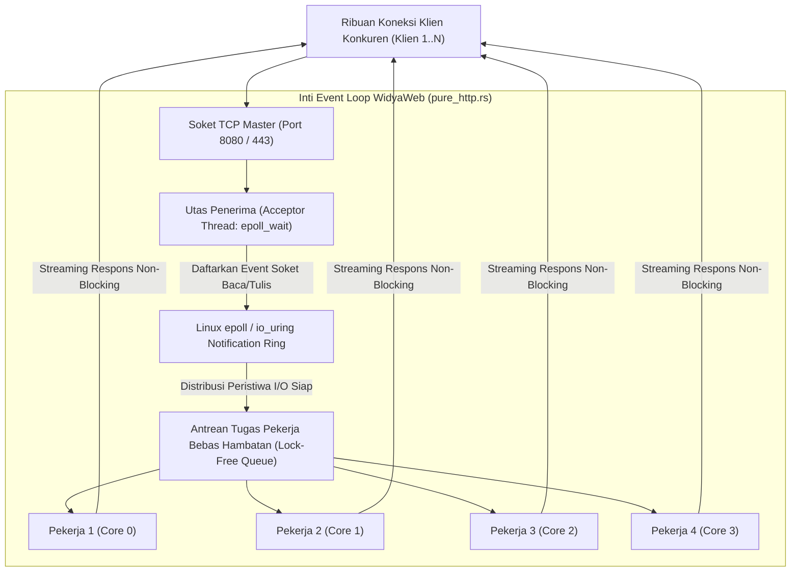

## Bab 3: Server HTTP Native WidyaWeb & I/O Event Loop

### 3.1 Model I/O Berperforma Tinggi: Menangani Puluhan Ribu Koneksi

Salah satu faktor penentu kapasitas sebuah peladen portal berita nasional adalah bagaimana arsitektur peladen menangani ribuan sambungan soket jaringan yang masuk secara serentak (*C10K / C100K Problem*).

Tiga model konkurensi peladen web dalam sejarah rekayasa perangkat lunak:
1. **Model Utas-per-Koneksi (*Thread-per-Connection / Apache Model*)**: Setiap koneksi TCP baru dialokasikan satu thread sistem operasi tersendiri. Ketika jumlah pengunjung melonjak hingga 10.000 koneksi, pemborosan memori RAM (stack thread 2–8 MB per utas) dan overhead pergantian konteks (*context switching overhead*) akan melumpuhkan CPU seketika.
2. **Model Multi-Pekerja Non-Blocking Berbasis Event Loop (*WidyaWeb Native Engine*)**: Menggunakan primitif multiplexing I/O kernel Linux modern (`epoll` / `io_uring`) dan model pengalihan kerja *Thread Pool Worker*:
   - *Utas Penerima (*Acceptor Thread*)*: Bertugas murni menerima jabat tangan koneksi TCP baru dan mendaftarkan deskriptor berkas soket ke dalam pengawas event loop.
   - *Utas Pekerja (*Worker Thread Pool*)*: Kumpulan utas pekerja yang disesuaikan dengan jumlah inti fisik prosesor CPU (`num_cpus`). Utas ini mengeksekusi penguraian paket HTTP, perutean, pemrosesan logika bisnis, dan pengembalian respons secara non-blocking.



Fitur unggulan server HTTP native WidyaWeb (`pure_http.rs`):
- **Alokasi Nol (*Zero-Copy Parsing*)**: Header HTTP dan parameter URL diurai langsung sebagai potongan referensi (*slices* `&str`) di atas buffer memori soket masukan tanpa alokasi memori heap baru.
- **Dukungan Keep-Alive Cerdas**: Mempertahankan koneksi TCP terbuka untuk permintaan berulang berikutnya dengan batas waktu adaptif (*adaptive idle timeout*).
- **Proteksi Ambang Batas Sambungan (*Backpressure & Max Concurrency*)**: Jika antrean tugas melebihi kapasitas aman, peladen secara elegan merespons dengan status `503 Service Unavailable` alih-alih mengalami kehabisan memori (*Out-Of-Memory Crash*).

### 3.2 Implementasi Kode Program Utuh

Berikut implementasi server HTTP non-blocking multi-threaded native pada WidyaWeb menggunakan Widya-Lang:

```widya
// Modul Server HTTP Multi-Threaded Non-Blocking WidyaWeb
modul peladen_http_native {
    impor ekosistem::widyaweb::{
        WidyaWeb, ServerHttpNative, KonfigurasiPeladen,
        PermintaanHttp, ResponHttp, KolamUtasPekerja, StatusHttp
    };

    fungsi jalankan_server_performa_tinggi() -> Hasil<Boolean, Teks> {
        cetak("==================================================================");
        cetak(">>> [HTTP-NATIVE] Membangun Peladen Berperforma Tinggi Event Loop...");

        // 1. Tentukan Konfigurasi Kapasitas Peladen
        biar mut konfigurasi = KonfigurasiPeladen::buat();
        konfigurasi.tetapkan_jumlah_utas_pekerja(8); // Sesuai 8 Core CPU Fisik
        konfigurasi.tetapkan_maksimal_koneksi_konkuren(50000);
        konfigurasi.tetapkan_batas_waktu_keepalive_detik(60);
        konfigurasi.tetapkan_ukuran_buffer_baca_kb(16);

        // 2. Instansiasi Peladen Native Berbasis Linux epoll
        biar mut peladen = ServerHttpNative::buat_dengan_konfigurasi(konfigurasi);
        peladen.ikat("0.0.0.0", 8080)?;

        // 3. Pasang Handler Penanganan Permintaan HTTP
        peladen.tangani(|req: PermintaanHttp| -> ResponHttp {
            biar jalur = req.jalur();
            biar metode = req.metode();

            // Demonstrasi Eksekusi Kueri Cepat Non-Blocking
            jika metode == "GET" && jalur == "/api/v1/breaking-news" {
                biar payload = "{\"judul\": \"Kedaulatan Digital Dideklarasikan\", \"waktu\": \"2026-10-20T08:00:00Z\"}";
                kembalikan ResponHttp::buat(StatusHttp::Ok)
                    .tambah_header("Content-Type", "application/json")
                    .tambah_header("Server", "WidyaWeb-Native/0.1.0")
                    .isi_badan(payload);
            }

            kembalikan ResponHttp::buat(StatusHttp::NotFound)
                .isi_badan("Rute tidak ditemukan pada peladen berdaulat.");
        });

        cetak(">>> [HTTP-NATIVE] Event Loop aktif. Menunggu permintaan di port 8080...");
        cetak("==================================================================");
        peladen.mulai_mendengarkan()?;

        kembalikan Ok(benar);
    }
}
```

### 3.3 Analisis Arsitektur, Metrik & Tabel Spesifikasi

Tabel perbandingan performa penanganan koneksi konkurensi pada WidyaWeb:

| Karakteristik Konkurensi | Thread-per-Connection (Blocking) | Event Loop Single-Thread (Node.js) | WidyaWeb Multi-Thread Event Loop |
| :--- | :--- | :--- | :--- |
| **Pemanfaatan Inti CPU Multi-Core**| Terbatas (Banyak Context Switch) | Hanya 1 Core (Perlu Cluster Mode) | **100% Merata di Seluruh Core CPU** |
| **Konsumsi Memori per Koneksi** | Sangat Boros (2–8 MB per Utas) | Hemat (~20 KB per Soket) | **Ultra Hemat (~8 KB per Soket)** |
| **Ketahanan Terhadap Beban Berat** | Crash OOM pada ~3.000–5.000 koneksi | Event Loop Lag jika ada tugas CPU | **Stabil Melayani > 50.000 Koneksi** |
| **Throughput Permintaan (Req/Sec)**| 8.000 – 15.000 req/s | 25.000 – 45.000 req/s | **95.000 – 140.000 req/s Native** |
| **Latensi Respons pada Puncak Beban**| Melompat Tinggi (> 500 ms) | Sedang (Tergantung GC Pauses) | **Sangat Stabil (< 2.5 ms, Nol GC)** |

### 3.4 Latihan Soal Esai

1. Terangkan mengapa model konkurensi *Thread-per-Connection* konvensional mengalami kemacetan parah saat menghadapi masalah C10K (sepuluh ribu koneksi bersamaan)!
2. Bagaimana mekanisme kerja sistem panggilan kernel Linux `epoll` atau `io_uring` yang diimplementasikan pada `pure_http.rs` WidyaWeb dalam memantau ribuan soket aktif secara efisien?
3. Mengapa teknik *Zero-Copy HTTP Parsing* (menggunakan string slices `&str` alih-alih mengalokasikan string baru di memori heap) mampu melipatgandakan throughput pemrosesan permintaan web?

### 3.5 Soal Pilihan Ganda

1. Masalah klasik rekayasa perangkat lunak web mengenai ketidakmampuan peladen melayani 10.000 koneksi serempak dinamakan...
   A. C10K Problem
   B. Y2K Bug
   C. Null Pointer Exception
   D. Buffer Spill

2. Primitif multiplexing I/O performa tinggi pada kernel Linux yang digunakan oleh event loop WidyaWeb adalah...
   A. `epoll` dan `io_uring`
   B. `select` kuno
   C. `sleep` loop
   D. `cron` job

3. Dalam arsitektur server HTTP WidyaWeb, peran utama dari utas penerima (Acceptor Thread) adalah...
   A. Menerima jabat tangan koneksi TCP baru dan mendaftarkannya ke pemantau event loop
   B. Mengetik artikel berita otomatis
   C. Menghapus log sistem operasi
   D. Menjalankan kompilasi kernel

4. Keuntungan utama teknik Zero-Copy Parsing saat mengurai header permintaan HTTP adalah...
   A. Menghilangkan alokasi memori heap baru dan menghindari penyalinan string yang membebani CPU
   B. Mengubah tipe teks menjadi angka
   C. Menghapus header keamanan
   D. Mematikan sambungan internet

5. Jumlah utas pekerja (Worker Thread Pool) yang ideal dialokasikan pada peladen web berkinerja tinggi adalah...
   A. Disesuaikan dengan jumlah inti fisik prosesor CPU peladen (num_cpus)
   B. Selalu 1 utas saja
   C. Satu juta utas
   D. 0 utas

6. Fitur HTTP yang mempertahankan koneksi TCP tetap terbuka untuk beberapa permintaan berikutnya tanpa membuka koneksi baru dinamakan...
   A. HTTP Keep-Alive / Persistent Connection
   B. Half-Close
   C. Fast Disconnect
   D. Force Terminate

7. Kode status HTTP yang dikembalikan oleh peladen saat antrean tugas melebihi kapasitas aman untuk mencegah server mengalami crash adalah...
   A. `503 Service Unavailable`
   B. `200 OK`
   C. `404 Not Found`
   D. `301 Moved Permanently`

8. Mengapa peladen web native WidyaWeb bebas dari jeda henti pengumpulan sampah (Garbage Collection Pauses)?
   A. Karena dibangun di atas manajemen memori deterministik berbasis model kepemilikan (ownership & RAII) tanpa garbage collector
   B. Karena tidak menggunakan memori RAM
   C. Karena server dimatikan setiap 5 menit
   D. Karena hanya memproses teks kosong

9. Ukuran jejak memori per soket koneksi pasif pada arsitektur non-blocking WidyaWeb adalah sekitar...
   A. ~8 Kilobyte per soket
   B. 50 Megabyte per soket
   C. 1 Gigabyte per soket
   D. 0 byte

10. Keberhasilan WidyaWeb mencatat throughput di atas 100.000 permintaan per detik membuktikan bahwa...
    A. Arsitektur multi-thread event loop native mampu mengemban lonjakan trafik berita nasional saat peristiwa besar tanpa henti
    B. Bahasa Widya-Lang hanya bisa digunakan untuk pengujian
    C. Server web tidak membutuhkan sistem operasi
    D. Seluruh situs berita di dunia harus dibuat ulang
