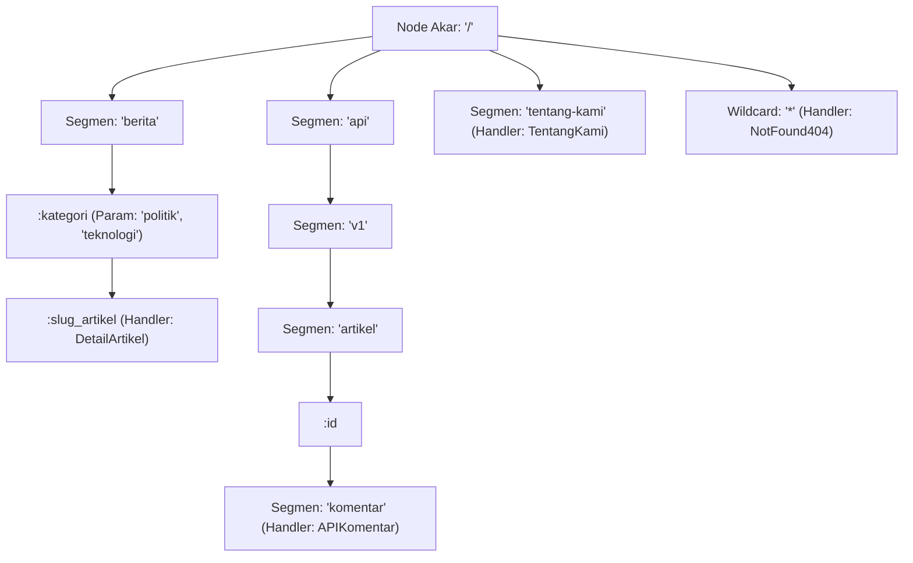

## Bab 4: Router Kecepatan Tinggi Berbasis Trie & Parameter Dinamis

### 4.1 Pencocokan Rute Secepat Kilat: O(K) Bebas Ekspresi Reguler

Dalam aplikasi portal berita modern seperti NusantaraNews, peladen harus memetakan ribuan pola URL yang beragam setiap detiknya:
- Rute statis: `/`, `/tentang-kami`, `/pedoman-media-siber`
- Rute berparameter dinamis: `/berita/:kategori/:slug_artikel`
- Rute berparameter numerik: `/api/v1/artikel/:id/komentar`
- Rute penangkap semua (*Wildcard / Catch-All*): `/arsip/*jalur_lengkap`

Jika sistem router diimplementasikan secara naif menggunakan pencocokan daftar ekspresi reguler linier (*Linear Regex List* seperti pada framework generasi awal):
- Setiap permintaan masuk harus diuji satu per satu terhadap puluhan pola regex ($O(N \times L)$).
- Menghabiskan siklus CPU dan memperlambat latensi perutean seiring bertambahnya jumlah rute aplikasi.

WidyaWeb mengatasi hambatan ini dengan mengimplementasikan **Router Kecepatan Tinggi Berbasis Struktur Data Pohon Trie (*Radix / Trie-Based Router*)** native (`pure_router.rs`):
- **Kompleksitas Waktu Berdasarkan Panjang URL ($O(K)$)**: Waktu pencarian rute hanya bergantung pada kedalaman segmen URL yang diminta ($K$), **sama sekali independen dari berapa ribu rute yang terdaftar** di dalam aplikasi.
- **Dukungan Segmen Dinamis & Ekstraksi Nol-Alokasi**: Segmen bertanda titik dua (`:kategori`) secara otomatis diekstraksi ke dalam kamus parameter rute berbasis pointer string slices tanpa alokasi memori heap baru.
- **Prioritas Resolusi Rute Konflik Deterministik**: Rute statis eksak selalu diprioritaskan terlebih dahulu di atas rute parameter dinamis, dan rute parameter diprioritaskan di atas rute penangkap liar (*Wildcard* `*`).



Fitur utama implementasi Trie Router di WidyaWeb:
1. **Pemisahan Metode HTTP Independen**: Pohon Trie dipisahkan per metode HTTP (`GET`, `POST`, `PUT`, `DELETE`, `PATCH`), mencegah pencarian yang tidak relevan.
2. **Validasi Tipe Data Segmen Inline**: Mendukung batasan tipe parameter langsung pada rute (misal: `/artikel/:id:bulat`), mengembalikan `400 Bad Request` otomatis jika tipe tidak valid.
3. **Peringatan Rute Tumpang Tindih pada Fase Kompilasi**: Jika pengembang mendaftarkan dua rute ambigu yang berpotensi menimbulkan tabrakan pola, router membangkitkan peringatan diagnostik sejak awal.

### 4.2 Implementasi Kode Program Utuh

Berikut implementasi Trie Router dengan penanganan parameter dinamis dan wildcard pada WidyaWeb menggunakan Widya-Lang:

```widya
// Modul Router Trie dan Parameter Dinamis WidyaWeb
modul perute_trie_dinamis {
    impor ekosistem::widyaweb::{
        WidyaWeb, PeruteTrie, PermintaanHttp, ResponHttp,
        KonteksRute, StatusHttp, KontenTipe
    };

    fungsi bangun_pohon_rute_portal_berita() -> PeruteTrie {
        cetak("==================================================================");
        cetak(">>> [ROUTER-TRIE] Membangun Pohon Trie Rute Portal Berita...");

        biar mut router = PeruteTrie::buat();

        // 1. Rute Statis Eksak
        router.daftarkan("GET", "/", |_req: PermintaanHttp, _ctx: KonteksRute| -> ResponHttp {
            kembalikan ResponHttp::ok(KontenTipe::Teks, "Halaman Beranda NusantaraNews");
        });

        // 2. Rute Parameter Dinamis Dua Tingkat (:kategori / :slug)
        router.daftarkan("GET", "/berita/:kategori/:slug", |req: PermintaanHttp, ctx: KonteksRute| -> ResponHttp {
            biar kategori = ctx.ambil_param("kategori").buka();
            biar slug = ctx.ambil_param("slug").buka();

            biar json = "{\"kanal\": \"" + kategori + "\", \"artikel\": \"" + slug + "\", \"views\": 15200}";
            kembalikan ResponHttp::ok(KontenTipe::Json, json);
        });

        // 3. Rute Parameter Numerik API (:id)
        router.daftarkan("GET", "/api/v1/artikel/:id/komentar", |req: PermintaanHttp, ctx: KonteksRute| -> ResponHttp {
            biar id_artikel = ctx.ambil_param("id").buka();
            biar respon = "{\"id_artikel\": " + id_artikel + ", \"total_komentar\": 48}";
            kembalikan ResponHttp::ok(KontenTipe::Json, respon);
        });

        // 4. Rute Penangkap Wildcard Seluruh Jalur Arsip
        router.daftarkan("GET", "/arsip/*jalur", |_req: PermintaanHttp, ctx: KonteksRute| -> ResponHttp {
            biar sisa_jalur = ctx.ambil_param("jalur").buka();
            kembalikan ResponHttp::ok(KontenTipe::Teks, "Menelusuri Arsip Historis: " + sisa_jalur);
        });

        cetak(">>> [ROUTER-TRIE] Struktur pohon rute selesai dikompilasi.");
        kembalikan router;
    }

    fungsi uji_resolusi_pencocokan_rute() -> Hasil<Boolean, Teks> {
        biar router = bangun_pohon_rute_portal_berita();

        // Uji Kasus 1: Akses Artikel Berita Politik
        biar url_1 = "/berita/politik/deklarasi-kemandirian-teknologi-2026";
        cetak(">>> [PENGUJIAN-1] Menyelesaikan rute: " + url_1);
        biar hasil_1 = router.cocokkan("GET", url_1);
        jika biar Ada(pencocokan) = hasil_1 {
            cetak("  ✓ Berhasil dicocokkan ke Handler DetailArtikel!");
            cetak("  ★ Param 'kategori': " + pencocokan.konteks.ambil_param("kategori").buka());
            cetak("  ★ Param 'slug'    : " + pencocokan.konteks.ambil_param("slug").buka());
        }

        // Uji Kasus 2: Akses Wildcard Arsip
        biar url_2 = "/arsip/2026/10/edisi-khusus-kedaulatan";
        cetak(">>> [PENGUJIAN-2] Menyelesaikan rute wildcard: " + url_2);
        biar hasil_2 = router.cocokkan("GET", url_2);
        jika biar Ada(pencocokan) = hasil_2 {
            cetak("  ✓ Berhasil dicocokkan ke Handler Arsip!");
            cetak("  ★ Param 'jalur': " + pencocokan.konteks.ambil_param("jalur").buka());
        }

        cetak("==================================================================");
        kembalikan Ok(benar);
    }
}
```

### 4.3 Analisis Arsitektur, Metrik & Tabel Spesifikasi

Tabel perbandingan algoritma router URL pada framework web:

| Algoritma Router | Kompleksitas Pencarian | Dampak Penambahan 1.000 Rute | Alokasi Memori per Permintaan |
| :--- | :--- | :--- | :--- |
| **Linear Regex Matching** (Express awal)| $O(N \times L)$ (Lambat) | Latensi membengkak linear | Tinggi (Objek regex heap) |
| **Hash Map Table** | $O(1)$ Instan | Tetap $O(1)$ | Tidak mendukung parameter `:id` |
| **Pohon Radix / Trie (WidyaWeb)** | **$O(K)$ Sangat Cepat** | **Nol Dampak (Tetap Stabil)** | **Nol Alokasi (String Slices)** |
| **FSM (Finite State Machine)** | $O(K)$ Cepat | Kompleksitas kompilasi tinggi | Rendah |

### 4.4 Latihan Soal Esai

1. Mengapa struktur data pohon Trie (Radix Tree) jauh lebih unggul dan skalabel daripada daftar ekspresi reguler linier dalam menangani ribuan pola URL portal berita?
2. Bagaimana mekanisme resolusi konflik hierarkis pada router WidyaWeb ketika sebuah URL cocok dengan rute statis (`/berita/terbaru`) sekaligus rute parameter dinamis (`/berita/:kategori`)?
3. Uraikan teknik ekstraksi parameter dinamis tanpa alokasi (*Zero-Allocation Parameter Extraction*) menggunakan pointer irisan string (*string slices*) pada memori kerja router!

### 4.5 Soal Pilihan Ganda

1. Struktur data pohon berkinerja tinggi yang digunakan oleh router WidyaWeb untuk mencocokkan rute dalam waktu O(K) adalah...
   A. Radix Tree / Trie
   B. Binary Search Tree
   C. Red-Black Tree
   D. Linked List

2. Kompleksitas waktu pencarian rute pada Trie Router dengan panjang URL sebesar K karakter adalah...
   A. $O(K)$ independen dari jumlah total rute yang terdaftar
   B. $O(N^2)$
   C. $O(N!)$
   D. $O(1)$ acak

3. Simbol awalan yang digunakan untuk mendefinisikan segmen URL dinamis (seperti `:slug` atau `:id`) adalah...
   A. Simbol titik dua (`:`)
   B. Simbol tanda seru (`!`)
   C. Simbol bintang (`*`)
   D. Simbol pagar (`#`)

4. Simbol yang digunakan untuk mendefinisikan rute penangkap liar (Catch-All / Wildcard) adalah...
   A. Simbol bintang (`*`)
   B. Simbol tanda tanya (`?`)
   C. Simbol persen (`%`)
   D. Simbol ampersand (`&`)

5. Urutan prioritas resolusi rute pada WidyaWeb jika terjadi potensi tabrakan pola rute adalah...
   A. Rute Statis Eksak > Rute Parameter Dinamis (`:param`) > Rute Wildcard (`*`)
   B. Rute Wildcard selalu menang
   C. Tergantung urutan abjad
   D. Dipilih secara acak

6. Keuntungan ekstraksi parameter berbasis irisan string (String Slices `&str`) pada router adalah...
   A. Menghindari alokasi memori heap baru sehingga menghemat siklus CPU peladen
   B. Mengubah tipe string menjadi integer
   C. Memperbesar ukuran memori
   D. Menghapus karakter spasi

7. Apa yang dilakukan oleh Trie Router WidyaWeb jika URL yang diminta klien tidak cocok dengan cabang pohon mana pun?
   A. Mengembalikan respons status `404 Not Found` secara otomatis
   B. Mematikan peladen
   C. Menginstal ulang sistem operasi
   D. Mengirimkan email ke administrator

8. Mengapa pohon Trie pada WidyaWeb dipisahkan per metode HTTP (GET, POST, PUT, DELETE)?
   A. Mencegah penelusuran cabang rute metode lain yang tidak relevan sehingga mempercepat pencocokan
   B. Karena protokol TCP melarang metode ganda
   C. Untuk memperindah tampilan kode
   D. Supaya memori RAM server menjadi dingin

9. Rute seperti `/artikel/:id:bulat` pada router WidyaWeb mengindikasikan fitur...
   A. Validasi batasan tipe data parameter rute secara langsung pada saat pencocokan (Inline Route Constraint)
   B. Kompresi gambar otomatis
   C. Enkripsi password
   D. Penghapusan artikel lama

10. Mengapa performa router Trie tetap konstan meskipun aplikasi portal berita NusantaraNews memiliki lebih dari 5.000 rute kategori dan artikel?
    A. Karena langkah penelusuran pohon hanya mengikuti kedalaman segmen garis miring URL yang diminta, bukan jumlah total rute
    B. Karena semua rute dihapus dari memori
    C. Karena server menggunakan kabel serat optik
    D. Karena basis data menggantikan fungsi router
