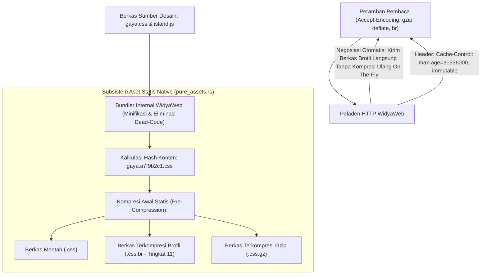

## Bab 8: Pengelolaan Aset Statis, Kompresi Brotli & Bundler Internal

### 8.1 Optimalisasi Jalur Pengiriman: Dari Berkas Mentah Menuju Jaringan Efisien

Dalam operasional harian sebuah portal berita nasional berskala besar, lebih dari 70% volume lalu lintas jaringan (*bandwidth consumption*) dihabiskan untuk melayani pengiriman aset statis—seperti lembar gaya CSS, berkas JavaScript pulau interaktif, ikon SVG, tipografi font web (`.woff2`), serta foto liputan berita (`.webp` dan `.avif`).

Pengelolaan aset statis yang buruk akan mengakibatkan:
- Pemborosan bandwidth data center peladen hingga terabyte per hari.
- Kecepatan pemuatan lambat akibat ketiadaan kompresi biner mutakhir.
- Masalah inkonsistensi tembolok (*Cache Invalidation Bugs*) di mana pembaca melihat tampilan rusak saat situs diperbarui karena peramban masih menyimpan berkas CSS versi lama.

WidyaWeb menghadirkan **Subsistem Pengelolaan Aset Statis & Bundler Internal Nol-Konfigurasi (*Native Static Asset Manager & Compression Engine*)** (`pure_assets.rs`):
1. **Penetapan Sidik Jari Konten (*Content Fingerprinting / Asset Hashing*)**: Setiap berkas aset statis yang dikompilasi secara otomatis disematkan hash konten unik 8-karakter pada nama berkasnya (misal: `gaya.a7f9b2c1.css`).
2. **Kebijakan Tembolok Abadi (*Immutable Caching*)**: Memungkinkan peladen mengirimkan header HTTP `Cache-Control: public, max-age=31536000, immutable`. Peramban klien tidak akan pernah meminta ulang berkas tersebut selama satu tahun penuh kecuali jika konten berkas berubah dan nama berkasnya berganti secara otomatis.
3. **Kompresi Biner Multi-Algoritma (Brotli & Zstandard)**:
   - *Brotli (br)*: Standar industri web modern yang menghasilkan kompresi teks CSS/HTML/JS 20–30% lebih padat dibandingkan algoritma Gzip kuno.
   - *Zstandard (zstd)*: Kompresi throughput tinggi dengan kecepatan dekompresi gigabyte per detik.
4. **ETag Kriptografis Ringkas**: Mendukung negosiasi bersyarat `If-None-Match` yang mengembalikan kode status `304 Not Modified` dalam fraksi mikrodetik tanpa mengirimkan ulang muatan data.



### 8.2 Implementasi Kode Program Utuh

Berikut implementasi peladen berkas statis ber-sidik jari dan negosiasi kompresi Brotli otomatis pada WidyaWeb menggunakan Widya-Lang:

```widya
// Modul Pengelolaan Aset Statis dan Kompresi Brotli WidyaWeb
modul manajemen_aset_statis {
    impor ekosistem::widyaweb::{
        WidyaWeb, ManajerAsetStatis, PermintaanHttp, ResponHttp,
        FormatKompresi, StatusHttp, HeaderHttp
    };

    fungsi inisialisasi_peladen_aset() -> Hasil<Boolean, Teks> {
        cetak("==================================================================");
        cetak(">>> [ASET-STATIS] Mengompilasi dan Mengompresi Aset Portal Berita...");

        // 1. Instansiasi Manajer Aset Statis Native
        biar mut manajer_aset = ManajerAsetStatis::buat();
        manajer_aset.tetapkan_direktori_sumber("/var/www/nusantaranews/public");
        manajer_aset.tetapkan_awalan_url("/_aset/");
        manajer_aset.aktifkan_penomoran_hash_sidik_jari(benar);

        // 2. Lakukan Pra-Kompresi (Pre-Compression) Statis untuk Seluruh Aset CSS/JS
        cetak(">>> [KOMPRESI-BROTLI] Memulai kompresi Brotli tingkat 11 untuk file teks...");
        biar hasil_kompresi = manajer_aset.jalankan_pra_kompresi([FormatKompresi::Brotli, FormatKompresi::Gzip])?;
        cetak(">>> [KOMPRESI] Berhasil memadatkan " + teks(hasil_kompresi.jumlah_berkas) + " berkas.");
        cetak(">>> [PENGHEMATAN] Rata-rata rasio kompresi teks: " + teks(hasil_kompresi.persen_penghematan) + "%");

        // 3. Pasang Handler Penanganan Permintaan Aset Statis dengan Negosiasi Encoding
        manajer_aset.tangani_permintaan(|req: &PermintaanHttp| -> ResponHttp {
            biar jalur_aset = req.jalur();
            biar accept_encoding = req.ambil_header("Accept-Encoding").buka_atau("");

            // Cek Tembolok Klien via ETag
            biar etag_klien = req.ambil_header("If-None-Match");
            biar etag_lokal = manajer_aset.ambil_etag(jalur_aset);

            jika etag_klien.ada() && etag_lokal.ada() && etag_klien.buka() == etag_lokal.buka() {
                // Klien sudah punya versi terbaru di tembolok browser
                kembalikan ResponHttp::buat(StatusHttp::NotModified);
            }

            // Negosiasi Algoritma Kompresi Terbaik
            jika accept_encoding.berisi("br") && manajer_aset.memiliki_varian_brotli(jalur_aset) {
                biar byte_brotli = manajer_aset.ambil_konten_brotli(jalur_aset).buka();
                kembalikan ResponHttp::buat(StatusHttp::Ok)
                    .tambah_header("Content-Encoding", "br")
                    .tambah_header("Content-Type", manajer_aset.ambil_mime_type(jalur_aset))
                    .tambah_header("Cache-Control", "public, max-age=31536000, immutable")
                    .tambah_header("ETag", etag_lokal.buka())
                    .isi_badan_biner(byte_brotli);
            } selain_itu jika accept_encoding.berisi("gzip") && manajer_aset.memiliki_varian_gzip(jalur_aset) {
                biar byte_gzip = manajer_aset.ambil_konten_gzip(jalur_aset).buka();
                kembalikan ResponHttp::buat(StatusHttp::Ok)
                    .tambah_header("Content-Encoding", "gzip")
                    .tambah_header("Content-Type", manajer_aset.ambil_mime_type(jalur_aset))
                    .tambah_header("Cache-Control", "public, max-age=31536000, immutable")
                    .tambah_header("ETag", etag_lokal.buka())
                    .isi_badan_biner(byte_gzip);
            } selain_itu {
                // Format mentah tanpa kompresi
                biar byte_mentah = manajer_aset.ambil_konten_mentah(jalur_aset).buka();
                kembalikan ResponHttp::buat(StatusHttp::Ok)
                    .tambah_header("Content-Type", manajer_aset.ambil_mime_type(jalur_aset))
                    .tambah_header("Cache-Control", "public, max-age=86400")
                    .isi_badan_biner(byte_mentah);
            }
        });

        cetak(">>> [ASET-STATIS] Jalur /_aset/ siap melayani aset berkinerja tinggi.");
        cetak("==================================================================");

        kembalikan Ok(benar);
    }
}
```

### 8.3 Analisis Arsitektur, Metrik & Tabel Spesifikasi

Tabel perbandingan algoritma kompresi data web pada WidyaWeb:

| Algoritma Kompresi | Rasio Kompresi Teks (CSS/JS) | Kecepatan Kompresi Server | Kecepatan Dekompresi Klien | Dukungan Peramban Global |
| :--- | :--- | :--- | :--- | :--- |
| **Gzip (DEFLATE - RFC 1952)** | 60% – 70% Penghematan | Cepat (Standar) | Sangat Cepat | 100% Seluruh Peramban |
| **Brotli (br - RFC 7932)** | **75% – 85% Penghematan (Padat)**| Lambat saat build / Cepat pra-kompresi| **Sangat Cepat & Efisien CPU**| **> 98% Peramban Modern** |
| **Zstandard (zstd - RFC 8878)**| 72% – 80% Penghematan | **Super Cepat di Peladen** | **Super Cepat (> 1.5 GB/s)** | Mulai diadopsi Chromium/Firefox |
| **Tanpa Kompresi (Mentah)** | 0% (Boros Bandwidth) | Instan | Instan | 100% |

### 8.4 Latihan Soal Esai

1. Terangkan konsep *Content Fingerprinting* (penyematan hash konten pada nama berkas aset) dan bagaimana teknik ini memungkinkan penerapan header `Cache-Control: immutable` tanpa risiko pengguna melihat tampilan rusak saat rilis versi baru!
2. Mengapa algoritma kompresi Brotli mampu menghasilkan ukuran berkas teks web (HTML, CSS, JavaScript) yang lebih padat hingga 20% dibandingkan algoritma Gzip tradisional?
3. Uraikan alur negosiasi konten bersyarat menggunakan header `If-None-Match` dan `ETag`! Mengapa kode status `304 Not Modified` sangat menghemat penggunaan kuota internet pembaca portal berita?

### 8.5 Soal Pilihan Ganda

1. Algoritma kompresi web modern berstandar terbuka yang menghasilkan rasio kompresi teks paling padat untuk berkas CSS dan JavaScript adalah...
   A. Brotli (br)
   B. MP3
   C. MPEG-4
   D. JPEG Lossy

2. Header HTTP yang digunakan oleh peramban klien untuk mengumumkan algoritma kompresi apa saja yang didukungnya adalah...
   A. `Accept-Encoding: gzip, deflate, br`
   B. `User-Agent`
   C. `Host`
   D. `Connection`

3. Header HTTP yang dikembalikan oleh peladen untuk memberi tahu peramban mengenai format kompresi yang digunakan pada muatan respons adalah...
   A. `Content-Encoding: br`
   B. `Content-Language`
   C. `X-Powered-By`
   D. `Set-Cookie`

4. Direktif pada header `Cache-Control` yang menyatakan bahwa isi berkas aset dijamin tidak akan pernah berubah selamanya sehingga peramban tidak perlu memvalidasi ulang adalah...
   A. `immutable`
   B. `no-cache`
   C. `no-store`
   D. `must-revalidate`

5. Kode status HTTP yang dikembalikan oleh peladen ketika isi berkas di tembolok peramban masih identik dengan berkas di peladen (berdasarkan ETag) adalah...
   A. `304 Not Modified`
   B. `200 OK`
   C. `404 Not Found`
   D. `500 Server Error`

6. Nilai pengenal unik kriptografis yang merepresentasikan versi isi dari sebuah berkas aset dinamakan...
   A. ETag (Entity Tag)
   B. IP Tag
   C. Port Tag
   D. Root Token

7. Teknik mengompresi seluruh berkas aset statis terlebih dahulu pada saat proses build (sebelum peladen dijalankan) dinamakan...
   A. Pra-Kompresi Statis (Pre-Compression)
   B. Kompresi On-The-Fly Lambat
   C. Runtime Defragmentation
   D. Memory Overclocking

8. Keuntungan utama dari teknik Pra-Kompresi Statis adalah...
   A. Peladen dapat langsung mengalirkan berkas terkompresi tanpa membebani siklus CPU untuk kompresi ulang di setiap permintaan klien
   B. Menghapus kebutuhan media penyimpanan harddisk
   C. Mengubah berkas CSS menjadi gambar
   D. Mematikan sambungan internet

9. Format berkas font web modern terkompresi yang paling efisien dan dianjurkan untuk tipografi portal berita adalah...
   A. WOFF2 (Web Open Font Format 2)
   B. TTF Mentah
   C. EOT Kuno
   D. BMP Font

10. Penerapan strategi aset statis ber-sidik jari dan kompresi Brotli pada portal berita NusantaraNews menghasilkan...
    A. Penghematan biaya lalu lintas data (bandwidth) hingga 80% dan kecepatan pemuatan halaman berita yang instan bagi pembaca
    B. Berita otomatis diterjemahkan ke bahasa asing
    C. Komputer server otomatis berhenti berputar
    D. Menghapus kebutuhan editor bahasa
