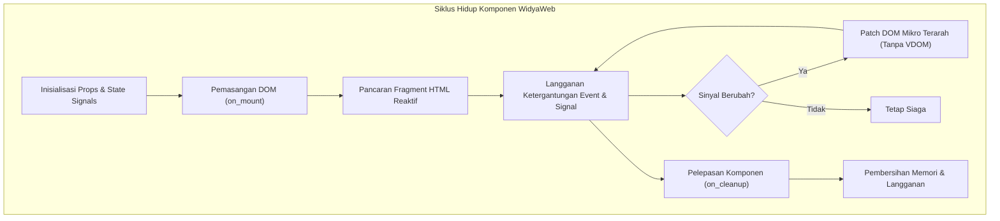

# BAB 9: KOMPONEN REAKTIF DEKLARATIF & KOMPOSISI TEMPLAT

Bab ini membahas arsitektur komponen reaktif deklaratif pada WidyaWeb untuk membangun antarmuka web modern portal berita NusantaraNews. Anda akan mempelajari siklus hidup komponen, paradigma *view as a function of state*, komposisi modular, dan pengikatan dua arah (*two-way binding*) tanpa abstraksi Virtual DOM yang berat.

---

## 9.1 Konsep Paradigma Deklaratif & Siklus Hidup Komponen

Komponen dalam WidyaWeb diperlakukan sebagai fungsi murni berstatus (*stateful pure function*) yang menerima properti (*props*) dan keadaan lokal (*signals*), kemudian memancarkan representasi pohon dokumen HTML. Ketika *signal* mengalami mutasi data, mesin reaktif WidyaWeb secara instan menelusuri penanda reaktif terisolasi dan memperbarui simpul DOM target secara langsung (*fine-grained micro-update*) tanpa melakukan rekonsiliasi VDOM secara menyeluruh.



Pemisahan tanggung jawab diwujudkan melalui dekomposisi komponen hierarkis, di mana komponen atomik (*badge*, tombol reaksi, avatar penulis) dirangkai menjadi komponen molekuler (*card* berita ringkas), lalu disusun menjadi organisme komprehensif (*feed* berita terpopuler).

---

## 9.2 Implementasi Komponen Reaktif Portal Berita

Berikut adalah implementasi komponen reaktif untuk kartu berita (*NewsArticleCard*) dan modul interaksi pembaca (*ClapCounter*) menggunakan pustaka `widya::web::reactive`:

```widya
// Modul Komponen Reaktif NusantaraNews
gunakan widya::web::reactive::{Komponen, Sinyal, buat_sinyal, efek};
gunakan widya::web::html::{div, h2, p, button, span, img, a};

rekod ArtikelProps {
    id: Teks,
    judul: Teks,
    ringkasan: Teks,
    penulis: Teks,
    kategori: Teks,
    gambar_url: Teks,
    apresiasi_awal: Bulat
}

fungsi KomponenKartuBerita(props: ArtikelProps) -> Komponen {
    // 1. Inisialisasi sinyal lokal untuk apresiasi (clap)
    tetapan (skor_apresiasi, set_apresiasi) = buat_sinyal(props.apresiasi_awal);
    tetapan (sudah_klik, set_sudah_klik) = buat_sinyal(salah);

    // 2. Efek otomatis saat skor mencapai angka istimewa
    efek(fungsi() {
        jika skor_apresiasi.baca() >= 100 {
            cetak_peringatan("[Analytics] Artikel viral: " + props.judul);
        }
    });

    // 3. Template deklaratif dengan ekspresi reaktif
    kembalikan div("kelas: 'kartu-berita modern-shadow'", [
        div("kelas: 'wadah-gambar'", [
            img("src: '" + props.gambar_url + "', alt: '" + props.judul + "', loading: 'lazy'")
        ]),
        div("kelas: 'konten-berita'", [
            span("kelas: 'kategori-tag tag-" + props.kategori + "'", props.kategori),
            h2("kelas: 'judul-kartu'", [
                a("href: '/berita/" + props.id + "'", props.judul)
            ]),
            p("kelas: 'ringkasan-teks'", props.ringkasan),
            div("kelas: 'metadata-bar'", [
                span("kelas: 'nama-penulis'", "Oleh: " + props.penulis),
                button("kelas: 'btn-clap', w-click: handle_clap", [
                    span("kelas: 'icon'", "👏 "),
                    span("kelas: 'counter'", fungsi() -> Teks {
                        kembalikan skor_apresiasi.baca().ke_teks() + " Dukungan";
                    })
                ])
            ])
        ])
    ]);
}

fungsi handle_clap(state: KonteksEvent) {
    // Aksi mutasi sinyal asinkron
    state.mutasi_sinyal("skor_apresiasi", fungsi(val: Bulat) -> Bulat {
        kembalikan val + 1;
    });
}
```

---

## 9.3 Analisis Arsitektur & Perbandingan Reaktivitas

WidyaWeb menghilangkan lapisan Virtual DOM yang boros alokasi memori heap, menggantikannya dengan simpul pembaruan langsung (*Compiled Reactive Graph*).

| Parameter Arsitektur | Virtual DOM Tradisional | Fine-Grained WidyaWeb Signals | Keuntungan Arsitektur |
| :--- | :--- | :--- | :--- |
| **Beban Memori Heap** | Besar (Pohon VDOM diduplikasi) | Sangat Ringan (Hanya referensi fungsi) | Efisiensi Serverless & Edge |
| **Kecepatan Patching** | Lambat ($O(N)$ ukuran pohon) | Sangat Cepat ($O(1)$ simpul langsung) | Responsivitas 60 FPS Konstan |
| **Overhead Bundler JS** | 30 KB – 120 KB runtime | 2.4 KB modul reaktif inti | First Contentful Paint < 0.4s |
| **Siklus Re-render** | Seluruh sub-tree diperiksa | Hanya elemen terikat yang berubah | Nol render berlebih (*no over-rendering*) |

---

## 9.4 Latihan Praktik & Studi Kasus

1. **Rancanglah Komponen Banner Breaking News**: Buatlah komponen `BreakingNewsBanner` yang menerima sinyal senarai judul terkini dan secara otomatis melakukan transisi vertikal setiap 4 detik menggunakan fungsi siklus hidup `pada_interval`.
2. **Dekomposisi Komponen Galeri Foto Berita**: Buat komponen `PhotoGalleryStory` yang mendukung pergantian *slide* gambar resolusi tinggi dengan pratinjau thumbnail di bagian bawah.
3. **Penyusunan Formulir Mini Polling Reaktif**: Buatlah komponen polling pendapat pembaca di tengah artikel yang memperbarui persentase grafik batang secara *real-time* saat tombol opsi ditekan.

---

## 9.5 Evaluasi Mandiri Pilihan Ganda

1. Apa paradigma utama antarmuka pengguna yang diterapkan oleh WidyaWeb?
   - A. Mutasi DOM Langsung Berbasis jQuery
   - B. Fungsi Murni Terstatus Berbasis Signals
   - C. Rekonsiliasi Virtual DOM Berskala Penuh
   - D. Kompilasi Template Berbasis String Eval

2. Kapan fungsi di dalam blok `efek` pada WidyaWeb dieksekusi?
   - A. Hanya sekali saat aplikasi pertama kali di-boot
   - B. Setiap kali DOM global mengalami *resize*
   - C. Setiap kali nilai dari *signal* yang menjadi ketergantungannya mengalami mutasi
   - D. Setiap 100 milidetik secara konstan

3. Apa keuntungan utama arsitektur *fine-grained reactive signals* dibandingkan Virtual DOM?
   - A. Mengharuskan pengembang menulis kode perakitan manual
   - B. Memperbarui simpul DOM secara langsung $O(1)$ tanpa memeriksa seluruh sub-tree
   - C. Membutuhkan runtime JavaScript berukuran lebih dari 100 KB
   - D. Mengubah seluruh tag HTML menjadi skrip JSON biner

4. Komponen `NewsArticleCard` menerima data konfigurasi luar melalui mekanisme apa?
   - A. Global State Singleton
   - B. Cookie Browser
   - C. Props Terstruktur Bersifat Read-Only
   - D. Variabel Lingkungan Sistem Operasi

5. Apa fungsi dari kait siklus hidup `on_cleanup` dalam sebuah komponen?
   - A. Memaksa browser mengunduh ulang berkas CSS
   - B. Membersihkan pengatur waktu (*timer*), langganan event, dan mencegah kebocoran memori
   - C. Menghapus rekod artikel dari database WidyaBase
   - D. Mematikan proses *worker thread* pada sistem operasi

6. Bagaimana WidyaWeb mengikat *event handler* klik pada tombol dalam sintaks deklaratif?
   - A. Menggunakan atribut `onclick="alert()"` mentah
   - B. Menggunakan sintaks direktif deklaratif `w-click: nama_fungsi`
   - C. Melakukan injeksi skrip berbahaya ke dalam *head* dokumen
   - D. Membuka socket UDP baru setiap tombol ditekan

7. Berapa kisaran ukuran runtime reaktivitas inti yang dimuat oleh WidyaWeb ke sisi klien?
   - A. Kurang lebih 2.4 KB
   - B. Lebih dari 1.2 Megabyte
   - C. 350 Kilobyte
   - D. Nol byte karena dilarang menjalankan interaksi

8. Apa yang terjadi jika sebuah komponen mencoba memodifikasi *props* yang diterimanya secara langsung?
   - A. Kompilator Widya-Lang akan menolak mutasi karena props bersifat *immutable*
   - B. Database utama akan terkunci secara permanen
   - C. Server HTTP akan langsung melakukan *reboot* otomatis
   - D. Data dalam memori akan teracak secara tidak teratur

9. Dalam pembuatan kartu artikel, direktif `loading: 'lazy'` pada elemen gambar bertujuan untuk apa?
   - A. Mempercepat pengunduhan gambar latar belakang server
   - B. Menunda pemuatan gambar di luar *viewport* hingga pengguna menggulir mendekatinya
   - C. Mengubah format berkas menjadi format kompresi zip
   - D. Menonaktifkan fungsi perenderan gambar pada layar seluler

10. Mengapa dekomposisi komponen (misal: Atom, Molekul, Organisme) sangat disarankan pada portal berita skala besar?
    - A. Agar berkas biner aplikasi terpecah menjadi ribuan berkas arsip
    - B. Mempermudah pemeliharaan kode, pengujian terisolasi, dan keterpakai-ulangan komponen
    - C. Menghindari aturan lisensi perangkat lunak bebas
    - D. Menjamin database tidak mengalami transaksi konkuren\n