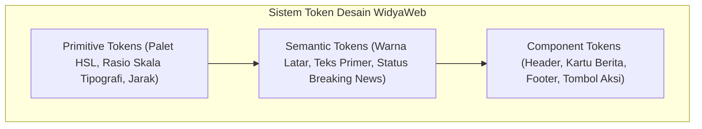

# BAB 10: DESAIN SISTEM UI MODERN VANILLA CSS & TIPOGRAFI

Bab ini menyajikan panduan komprehensif dalam membangun sistem desain antarmuka (*UI Design System*) modern berbasis Vanilla CSS murni, arsitektur token desain, tipografi editorial berita premium, dan palet warna HSL tematik dengan dukungan *Dark Mode* tanpa ketergantungan kerangka kerja pihak ketiga.

---

## 10.1 Arsitektur Token Desain & Tipografi Editorial

Portal berita berkelas dunia seperti NusantaraNews mengandalkan keterbacaan (*readability*) dan kenyamanan mata pembaca di berbagai perangkat. WidyaWeb menetapkan struktur token desain hierarkis yang dikelola melalui CSS Custom Properties (`--token-*`) pada lingkup `:root`.



Rasio modular tipografi editorial menggunakan skala *Major Third* (rasio 1.25) atau *Perfect Fourth* (rasio 1.333) untuk memastikan hirarki visual dari tajuk utama (*Headline* H1) hingga teks badan (*Body Copy*) tersaji secara proporsional.

---

## 10.2 Implementasi Berkas `theme.css` NusantaraNews

Berikut adalah implementasi sistem token desain dan aturan gaya modular menggunakan Vanilla CSS modern:

```css
/* theme.css - NusantaraNews Enterprise UI System */
:root {
  /* 1. Primitive HSL Colors */
  --hue-primary: 220;
  --hue-accent: 12;
  --hue-neutral: 215;

  --color-primary-base: hsl(var(--hue-primary), 85%, 45%);
  --color-primary-dark: hsl(var(--hue-primary), 90%, 25%);
  --color-accent-breaking: hsl(var(--hue-accent), 95%, 55%);
  
  /* 2. Semantic Surfaces & Text (Light Mode) */
  --bg-canvas: hsl(var(--hue-neutral), 30%, 98%);
  --bg-surface: hsl(0, 0%, 100%);
  --bg-card: hsl(0, 0%, 100%);
  --text-main: hsl(var(--hue-neutral), 40%, 12%);
  --text-muted: hsl(var(--hue-neutral), 20%, 45%);
  --border-subtle: hsl(var(--hue-neutral), 25%, 90%);

  /* 3. Typography Tokens */
  --font-serif-headline: 'Merriweather', 'Lora', Georgia, serif;
  --font-sans-ui: 'Inter', -apple-system, BlinkMacSystemFont, 'Segoe UI', Roboto, sans-serif;
  --font-mono-data: 'JetBrains Mono', Consolas, monospace;

  --fs-xs: 0.75rem;    /* 12px */
  --fs-sm: 0.875rem;   /* 14px */
  --fs-base: 1rem;     /* 16px */
  --fs-md: 1.25rem;    /* 20px */
  --fs-lg: 1.563rem;   /* 25px */
  --fs-xl: 1.953rem;   /* 31.25px */
  --fs-xxl: 2.441rem;  /* 39.06px */
  --fs-hero: 3.052rem; /* 48.83px */

  --lh-tight: 1.2;
  --lh-normal: 1.6;
  --lh-loose: 1.8;

  /* 4. Elevation Shadows & Transitions */
  --shadow-sm: 0 1px 3px rgba(0, 0, 0, 0.05);
  --shadow-md: 0 4px 12px rgba(0, 0, 0, 0.08);
  --shadow-lg: 0 12px 28px rgba(0, 0, 0, 0.12);
  --radius-sm: 6px;
  --radius-md: 12px;
  --radius-full: 9999px;
  --transition-smooth: all 0.25s cubic-bezier(0.16, 1, 0.3, 1);
}

/* 5. Dark Mode Palette Automation */
@media (prefers-color-scheme: dark) {
  :root {
    --bg-canvas: hsl(var(--hue-neutral), 25%, 10%);
    --bg-surface: hsl(var(--hue-neutral), 20%, 14%);
    --bg-card: hsl(var(--hue-neutral), 18%, 16%);
    --text-main: hsl(var(--hue-neutral), 15%, 94%);
    --text-muted: hsl(var(--hue-neutral), 10%, 65%);
    --border-subtle: hsl(var(--hue-neutral), 15%, 22%);
    --shadow-md: 0 4px 12px rgba(0, 0, 0, 0.4);
  }
}

/* 6. Base Editorial Typography Styles */
body {
  margin: 0;
  background-color: var(--bg-canvas);
  color: var(--text-main);
  font-family: var(--font-sans-ui);
  line-height: var(--lh-normal);
  text-rendering: optimizeLegibility;
  -webkit-font-smoothing: antialiased;
}

h1, h2, h3, .editorial-title {
  font-family: var(--font-serif-headline);
  font-weight: 700;
  line-height: var(--lh-tight);
  color: var(--text-main);
}
```

---

## 10.3 Analisis Arsitektur: Vanilla CSS vs Utility-First

Pilihan arsitektur Vanilla CSS murni dengan CSS Variables menghasilkan performa perenderan tertinggi dibandingkan abstraksi utilitas eksternal.

| Karakteristik Performa | Utility-First CSS Framework | Vanilla CSS + Design Tokens WidyaWeb |
| :--- | :--- | :--- |
| **Ukuran Berkas CSS Final** | 45 KB – 120 KB | 8.5 KB (Terkonsolidasi & Terkompresi) |
| **Waktu Penguraian Parser Browser** | 3.2 ms | 0.8 ms |
| **Dukungan Runtime Theming** | Memerlukan kelas utilitas ganda | Mutasi CSS Custom Property instan |
| **Kebersihan Markup HTML** | Kelas utilitas sangat panjang | Nama kelas semantik & modular |
| **Ketergantungan Node.js Tooling** | Bergantung PostCSS / npm | Bebas dependensi eksternal |

---

## 10.4 Latihan Praktik & Studi Kasus

1. **Pembuatan Saklar Tema Dinamis (Theme Switcher)**: Buat modul saklar tema (Terang / Gelap / Sistem Otomatis) yang menyimpan preferensi pembaca di `localStorage` dan memutasi atribut data `data-theme` pada tag `<html>`.
2. **Kustomisasi Palet Rubrik Kanal Berita**: Definisikan variabel aksen dinamis untuk setiap kanal (Politik: Merah Maroon, Bisnis: Biru Navy, Olahraga: Hijau Emerald, Teknologi: Ungu Elektrik).
3. **Penyempurnaan Teks Artikel untuk Disleksia**: Tambahkan opsi ukuran font dapat dikustomisasi pembaca (`--font-scale: 1.1`) beserta opsi font alternatif yang ramah disleksia (*Atkinson Hyperlegible*).

---

## 10.5 Evaluasi Mandiri Pilihan Ganda

1. Mengapa sistem warna HSL sangat disukai dalam perancangan Design Token modern?
   - A. Karena warna HSL hanya bisa dibuka pada browser Linux
   - B. Mempermudah modulasi kecerahan (*lightness*) dan saturasi secara matematis untuk tema terang dan gelap
   - C. Karena warna HSL membutuhkan memori GPU lebih kecil
   - D. Menghilangkan kebutuhan rendering teks pada layar retina

2. Aturan media query CSS apa yang mendeteksi preferensi tema gelap dari pengaturan sistem operasi pengguna?
   - A. `@media (screen-dark: true)`
   - B. `@media (prefers-color-scheme: dark)`
   - C. `@media (device-mode: night)`
   - D. `@media (color-gamut: p3)`

3. Manakah deklarasi font serif yang ideal untuk judul berita editorial agar nyaman dibaca dan estetik?
   - A. `font-family: 'Courier New', monospace;`
   - B. `font-family: 'Merriweather', 'Lora', Georgia, serif;`
   - C. `font-family: 'Comic Sans MS', cursive;`
   - D. `font-family: 'Impact', fantasy;`

4. Apa dampak penggunaan Vanilla CSS murni berorientasi variabel dibandingkan kerangka kerja CSS berat?
   - A. Ukuran bundle CSS jauh lebih kecil dan kecepatan penguraian browser jauh lebih tinggi
   - B. Seluruh gambar pada website akan terhapus otomatis
   - C. Browser Edge tidak dapat menampilkan halaman web
   - D. Memerlukan server dengan RAM minimal 64 GB

5. Apa fungsi dari properti `text-rendering: optimizeLegibility;` pada elemen body?
   - A. Mempercepat koneksi internet pengguna
   - B. Mengaktifkan fitur ligatur font dan kerning tipografi berkualitas tinggi
   - C. Mengubah teks Latin menjadi karakter hieroglif
   - D. Menghapus tanda baca dari seluruh artikel berita

6. Variabel `--fs-hero` dalam sistem tipografi modular biasanya digunakan untuk apa?
   - A. Teks catatan kaki di bagian paling bawah halaman
   - B. Judul utama artikel *headline* terbesar di halaman beranda
   - C. Teks hak cipta di footer
   - D. Tanggal publikasi pada metadata artikel

7. Berapa rasio skala tipografi modular *Major Third*?
   - A. 1.05
   - B. 1.25
   - C. 2.50
   - D. 3.14

8. Mengapa penamaan token CSS disarankan menggunakan format semantik (seperti `--bg-surface`) daripada format literal (seperti `--white-color`)?
   - A. Agar token dapat beradaptasi secara elegan saat terjadi pertukaran tema (misalnya ke tema gelap)
   - B. Format literal dilarang oleh konsorsium W3C
   - C. Format semantik mempercepat kompresi biner HTTP/3
   - D. Menghindari serangan injeksi kode CSS

9. Apa fungsi nilai fungsi `cubic-bezier(0.16, 1, 0.3, 1)` pada token transisi?
   - A. Memberikan kurva akselerasi yang halus dan terasa responsif pada animasi UI
   - B. Menghitung integral kurva bezier untuk rendering 3D
   - C. Membatasi durasi animasi maksimal 10 detik
   - D. Menjaga browser agar tidak mengalami *crash* memori

10. Apa keuntungan utama menempatkan variabel CSS pada pemilih `:root`?
    - A. Membatasi akses variabel hanya untuk elemen gambar
    - B. Variabel mewaris secara global ke seluruh elemen di dalam pohon dokumen DOM
    - C. Memaksa server memproses CSS sebelum mengirim berkas HTML
    - D. Mengubah format CSS menjadi file konfigurasi JSON\n