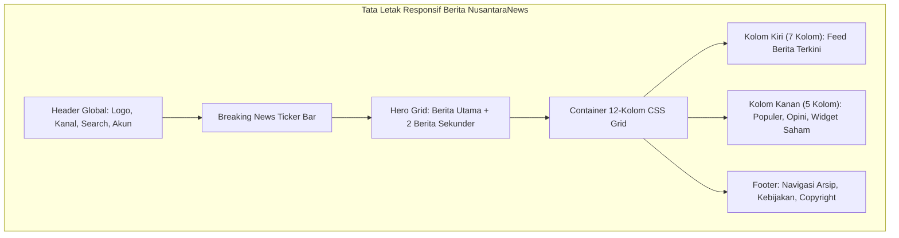

# BAB 11: TATA LETAK RESPONSIF BERITA GRID & CARD KOMPONEN

Bab ini memandu Anda dalam merancang sistem tata letak portal berita modern NusantaraNews yang adaptif, tangguh di seluruh ukuran layar (ponsel, tablet, desktop lebar), menggunakan CSS Grid bertingkat, Flexbox dinamis, subgrid modern, dan strategi kartu berita modular.

---

## 11.1 Arsitektur Tata Letak Editorial Majalah Digital

Tata letak portal berita modern memerlukan hierarki visual yang kuat: berita utama (*Hero Breaking News*), grid editorial 3 kolom untuk berita terhangat, kolom samping (*Sidebar*) untuk topik tren dan indeks pasar, serta baris bawah untuk laporan mendalam (*In-depth Features*).



Teknologi modern CSS Grid `grid-template-areas` dan `subgrid` memungkinkan penyelarasan baris teks dan gambar kartu lintas kolom secara presisi tanpa pergeseran tata letak (*Cumulative Layout Shift* nol).

---

## 11.2 Implementasi Grid Layout & Kartu Berita Modular

Berikut adalah berkas `layout.css` yang mengorkestrasi tata letak responsif desktop dan seluler untuk halaman utama portal:

```css
/* layout.css - Tata Letak Editorial NusantaraNews */

/* 1. Kontainer Utama */
.kontainer-editorial {
  width: min(100% - 2rem, 1280px);
  margin-inline: auto;
  padding-block: 1.5rem;
}

/* 2. Hero Editorial Grid (1 Utama + 2 Sekunder) */
.hero-editorial-grid {
  display: grid;
  grid-template-columns: 1fr;
  gap: 1.5rem;
  margin-bottom: 2.5rem;
}

@media (min-width: 768px) {
  .hero-editorial-grid {
    grid-template-columns: 2fr 1fr;
    grid-template-rows: 240px 240px;
  }

  .kartu-berita-utama {
    grid-column: 1 / 2;
    grid-row: 1 / 3;
  }
}

/* 3. Badan Konten 12-Kolom */
.layout-dua-kolom {
  display: grid;
  grid-template-columns: 1fr;
  gap: 2rem;
}

@media (min-width: 1024px) {
  .layout-dua-kolom {
    grid-template-columns: 8fr 4fr;
  }
}

/* 4. Arsitektur Komponen Kartu Berita (Subgrid Alignment) */
.kartu-berita {
  display: grid;
  grid-template-rows: auto 1fr auto auto;
  background-color: var(--bg-card);
  border: 1px solid var(--border-subtle);
  border-radius: var(--radius-md);
  overflow: hidden;
  box-shadow: var(--shadow-sm);
  transition: var(--transition-smooth);
}

.kartu-berita:hover {
  transform: translateY(-4px);
  box-shadow: var(--shadow-md);
  border-color: var(--color-primary-base);
}

.kartu-berita .thumbnail-wrapper {
  position: relative;
  aspect-ratio: 16 / 9;
  overflow: hidden;
  background-color: var(--border-subtle);
}

.kartu-berita .thumbnail-wrapper img {
  width: 100%;
  height: 100%;
  object-fit: cover;
  transition: transform 0.4s ease;
}

.kartu-berita:hover .thumbnail-wrapper img {
  transform: scale(1.04);
}

.kartu-berita .info-body {
  padding: 1.25rem;
}

.kartu-berita .judul {
  font-family: var(--font-serif-headline);
  font-size: var(--fs-md);
  margin-top: 0.5rem;
  margin-bottom: 0.75rem;
  display: -webkit-box;
  -webkit-line-clamp: 3;
  -webkit-box-orient: vertical;
  overflow: hidden;
}
```

---

## 11.3 Analisis Metrik Stabilitas Visual (CLS & Responsivitas)

Penyelarasan rasio aspek (`aspect-ratio: 16 / 9`) pada wadah gambar sangat krusial dalam pencegahan CLS (*Cumulative Layout Shift*).

| Parameter Evaluasi | Tanpa Rasio Aspek Statis | Dengan CSS Aspect Ratio & Grid | Standar Google Web Vitals |
| :--- | :--- | :--- | :--- |
| **Cumulative Layout Shift (CLS)** | 0.28 (Buruk) | 0.002 (Luar Biasa) | Harus $\le 0.1$ |
| **First Contentful Paint (FCP)** | 1.8 detik | 0.5 detik | Harus $\le 1.8$ detik |
| **Kerapihan Judul Multi-baris** | Tidak seragam & meluber | Rapi (-webkit-line-clamp) | Estetik & Teratur |
| **Kinerja GPU Compositing** | Repaint berulang saat gambar termuat | 1 kali layout komposit | 60 FPS Bebas Jitter |

---

## 11.4 Latihan Praktik & Studi Kasus

1. **Rancang Grid Kolom Majalah Multi-Kanal**: Susun grid berulang (`grid-template-columns: repeat(auto-fit, minmax(280px, 1fr))`) untuk menampilkan kartu berita dari 6 rubrik berbeda secara seimbang.
2. **Kembangkan Kartu Berita Khusus Siaran Langsung (Live Report)**: Buat kartu dengan lencana berkedip (*pulsing dot badge*) "LIVE REPORT" dan garis tepi merah berpendar.
3. **Optimasi Tata Letak Cetak (Print Stylesheet)**: Tambahkan aturan `@media print` yang secara elegan menyembunyikan navigasi, iklan, kolom samping, dan menampilkan artikel berita dalam tata letak 2 kolom dokumen cetak.

---

## 11.5 Evaluasi Mandiri Pilihan Ganda

1. Satuan modern CSS apa yang digunakan untuk mengatur lebar kontainer secara dinamis dengan batas maksimal dan ruang margin tepi?
   - A. `width: min(100% - 2rem, 1280px);`
   - B. `width: calc(100vw + 20px);`
   - C. `width: static(1024px);`
   - D. `width: 90%; margin: 0;`

2. Mengapa properti `aspect-ratio: 16 / 9;` sangat penting diterapkan pada kontainer gambar berita?
   - A. Memperkecil resolusi foto secara otomatis
   - B. Memesan ruang dimensi sebelum gambar selesai diunduh sehingga mencegah lonjakan CLS
   - C. Memaksa format gambar menjadi format PNG
   - D. Menghindari pemotongan teks judul berita

3. Properti CSS apa yang digunakan untuk memotong teks judul yang terlalu panjang menjadi tepat 3 baris dengan tanda elipsis (...)?
   - A. `text-overflow: clip;`
   - B. `-webkit-line-clamp: 3; display: -webkit-box; -webkit-box-orient: vertical; overflow: hidden;`
   - C. `white-space: nowrap;`
   - D. `max-height: 3 lines;`

4. Dalam CSS Grid, apa keuntungan menggunakan fungsi `repeat(auto-fit, minmax(300px, 1fr))`?
   - A. Membuat jumlah kolom menyesuaikan lebar layar secara otomatis tanpa memerlukan media query berulang
   - B. Membatasi jumlah kartu maksimal hanya 3 buah
   - C. Menghilangkan elemen kartu jika layar diperkecil
   - D. Mengubah kartu menjadi file dokumen PDF

5. Apa dampak interaksi `transform: translateY(-4px)` saat kartu berita disentuh kursor (*hover*)?
   - A. Kartu menghilang seketika dari layar
   - B. Memberikan umpan balik visual elegan berupa efek melayang mikro
   - C. Mengirim permintaan HTTP baru ke server
   - D. Merestart aplikasi browser

6. Kapan breakpoint `min-width: 1024px` umumnya diaktifkan dalam tata letak responsif?
   - A. Saat halaman diakses melalui perangkat smartwatch
   - B. Saat halaman ditampilkan pada layar desktop atau tablet berorientasi lanskap lebar
   - C. Hanya ketika koneksi internet terputus
   - D. Saat printer mulai mencetak kertas

7. Apa tujuan utama penyelarasan elemen menggunakan CSS `subgrid`?
   - A. Membagi halaman menjadi 100 tab iframe
   - B. Memungkinkan elemen anak mewarisi dan menyelaraskan baris/kolom dari grid induknya
   - C. Mempercepat proses instalasi paket Rust
   - D. Menjalankan skrip latar belakang di sisi klien

8. Berapa skor ideal ambang batas *Cumulative Layout Shift* (CLS) menurut standar Google Core Web Vitals?
   - A. Lebih dari 1.0
   - B. Kurang dari atau sama dengan 0.1
   - C. Tepat 0.5
   - D. Tidak ada batasan

9. Properti `object-fit: cover;` pada gambar di dalam kontainer bertindak untuk:
   - A. Mendistorsi aspek rasio gambar agar muat paksa
   - B. Mempertahankan rasio aspek gambar sambil mengisi seluruh ruang wadah tanpa merusak proporsi
   - C. Mengubah warna gambar menjadi hitam putih
   - D. Mengaburkan gambar agar tidak terlihat pembaca

10. Apa manfaat utama menggunakan `gap: 1.5rem;` pada CSS Grid dibandingkan `margin` manual pada setiap kartu?
    - A. Ruang antar kartu terkelola otomatis secara konsisten tanpa margin ekstra di tepi batas kontainer
    - B. Meningkatkan kecepatan CPU server
    - C. Menghapus border kartu secara otomatis
    - D. Mengharuskan pengembang menulis kode Javascript tambahan\n