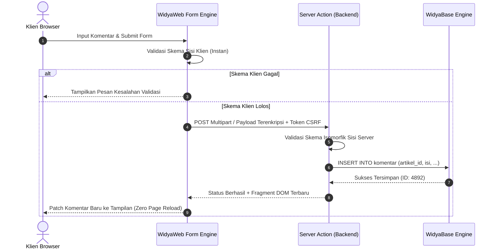

# BAB 12: FORMULIR INTERAKTIF, VALIDASI SKEMA & SERVER ACTIONS

Bab ini membedah mekanisme penanganan formulir interaktif portal berita NusantaraNews: formulir pengiriman rilis pers, pendaftaran langganan newsletter, penulisan komentar interaktif, validasi skema sisi klien dan server secara terpadu (*isomorphic schema validation*), serta eksekusi *Server Actions* bertipe aman (*type-safe*).

---

## 12.1 Arsitektur Server Actions & Validasi Isomorfik

Arsitektur tradisional mengharuskan pengembang membuat rute API terpisah, memvalidasi JSON secara manual, dan menangani state pengiriman di sisi klien. WidyaWeb merevolusi pola ini melalui **Server Actions**: fungsi sisi server yang dapat dipanggil langsung dari atribut formulir deklaratif (`w-action`) dengan jaminan keamanan CSRF dan validasi tipe data otomatis.



---

## 12.2 Implementasi Formulir Komentar & Server Action

Berikut adalah implementasi lengkap formulir pengiriman komentar berita terverifikasi dengan validasi panjang teks, sanitasi sensor kata kasar, dan proteksi anti-spam:

```widya
// Modul Formulir & Server Actions NusantaraNews
gunakan widya::web::formulir::{SkemaForm, Validasi, BidangTeks, BidangAreaTeks};
gunakan widya::web::respon::{ResponAksi, sukses_json, gagal_validasi};
gunakan widya::base::koneksi::{buka_koneksi};

// 1. Definisi Skema Isomorfik
fungsi buat_skema_komentar() -> SkemaForm {
    kembalikan SkemaForm::baru()
        .tambah("nama_pengirim", BidangTeks::baru()
            .wajib("Nama lengkap wajib diisi")
            .panjang_minimal(3, "Nama minimal 3 karakter")
            .panjang_maksimal(50, "Nama maksimal 50 karakter"))
        .tambah("email_pengirim", BidangTeks::baru()
            .wajib("Alamat email wajib diisi")
            .format_email("Format alamat email tidak valid"))
        .tambah("isi_komentar", BidangAreaTeks::baru()
            .wajib("Isi komentar tidak boleh kosong")
            .panjang_minimal(10, "Komentar minimal 10 karakter")
            .panjang_maksimal(1000, "Komentar maksimal 1000 karakter"));
}

// 2. Server Action yang Dieksekusi di Server WidyaWeb
#[server_action]
fungsi simpan_komentar_action(data_mentah: PetaData, ctx: KonteksKeamanan) -> ResponAksi {
    // A. Validasi CSRF otomatis dilakukan oleh runtime
    tetapan skema = buat_skema_komentar();
    tetapan hasil_validasi = skema.periksa(data_mentah);

    jika !hasil_validasi.apakah_valid() {
        kembalikan gagal_validasi(hasil_validasi.ambil_daftar_galat());
    }

    // B. Sanitasi XSS & Penyaringan Kata Terlarang
    tetapan nama = data_mentah.ambil("nama_pengirim").bersihkan_html();
    tetapan email = data_mentah.ambil("email_pengirim").ke_huruf_kecil();
    tetapan isi = data_mentah.ambil("isi_komentar").sensor_kata_kasar();
    tetapan artikel_id = data_mentah.ambil("artikel_id");

    // C. Persistensi ke Database WidyaBase
    tetapan db = buka_koneksi()?;
    db.eksekusi(
        "INSERT INTO komentar (artikel_id, nama, email, konten, dibuat_pada) VALUES ($1, $2, $3, $4, NOW())",
        [artikel_id, nama, email, isi]
    )?;

    kembalikan ResponAksi::berhasil_sisip_dom(
        "#daftar-komentar",
        "awal",
        KomponenKartuKomentar(nama, isi, "Baru saja")
    );
}
```

---

## 12.3 Analisis Ketahanan & Proteksi Keamanan Formulir

Formulir publik adalah target utama eksploitasi peretas (Spam Bot, CSRF, Injeksi XSS). WidyaWeb menyematkan proteksi berlapis secara bawaan.

| Fitur Proteksi | Mekanisme di WidyaWeb | Risiko yang Dimitigasi |
| :--- | :--- | :--- |
| **Token CSRF Terenkripsi** | HMAC-SHA256 terikat sesi cookie *SameSite=Strict* | Serangan Pemalsuan Permintaan Antar Situs |
| **Honeypot Hidden Input** | Input jebakan tak kasat mata bagi pengguna manusia | Penyerbuan Bot Pengisi Formulir Otomatis |
| **Sanitasi HTML Isomorfik** | Konversi otomatis karakter bahaya (`<`, `>`, `&`, `"`) | Serangan Cross-Site Scripting (XSS) |
| **Rate Limit Per IP** | Pembatasan maksimal 3 kiriman per menit per alamat IP | Penolakan Layanan Tingkat Aplikasi (DoS) |

---

## 12.4 Latihan Praktik & Studi Kasus

1. **Rancang Formulir Pengajuan Rilis Pers dengan Unggah File**: Implementasikan formulir pengiriman naskah siaran pers yang mendukung unggahan lampiran dokumen PDF maksimal 5MB dengan verifikasi tipe MIME berkas di server.
2. **Implementasi Validasi Email Real-Time Asinkron**: Tambahkan validasi langsung pada kolom surel pendaftaran akun redaksi untuk mengecek ketersediaan surel di database secara asinkron tanpa menekan tombol submit.
3. **Mekanisme Captcha Mandiri Berbasis Persamaan Matematika**: Buat komponen widget tantangan verifikasi manusia sederhana (misal: "Berapa 7 + 5?") yang dienkripsi menggunakan *nonce* sisi server.

---

## 12.5 Evaluasi Mandiri Pilihan Ganda

1. Apa keunggulan utama pola *Server Actions* pada WidyaWeb?
   - A. Mengharuskan pembuatan berkas rute API REST terpisah secara manual
   - B. Mengintegrasikan pemanggilan fungsi server langsung dari atribut form dengan penanganan state otomatis
   - C. Menghilangkan kebutuhan database pada server
   - D. Menjalankan seluruh logika server di dalam browser pengguna

2. Mengapa validasi skema harus dijalankan di kedua sisi (*isomorphic validation*: klien dan server)?
   - A. Sisi klien memberikan umpan balik cepat pada pengguna, sedangkan sisi server menjamin integritas data dari manipulasi peretas
   - B. Agar data dikompresi dua kali lipat
   - C. Validasi server sebenarnya tidak diperlukan jika browser sudah modern
   - D. Untuk memperlambat waktu respons aplikasi

3. Serangan siber apa yang dicegah melalui penyisipan token terenkripsi pada formulir web?
   - A. Distributed Denial of Service (DDoS)
   - B. Cross-Site Request Forgery (CSRF)
   - C. DNS Spoofing
   - D. Phishing Email Manual

4. Bagaimana teknik *Honeypot* bekerja dalam menangkal bot spam pada formulir web?
   - A. Mengharuskan pengguna membayar biaya pendaftaran
   - B. Menyediakan input tersembunyi dengan CSS yang tidak dilihat manusia namun diisi oleh bot otomatis
   - C. Memblokir seluruh pengguna yang menggunakan ponsel pintar
   - D. Mengubah alamat URL formulir setiap detik

5. Apa fungsi fungsi `.bersihkan_html()` pada pemrosesan input teks pengguna?
   - A. Mengubah format huruf menjadi miring (*italic*)
   - B. Menetralkan tag HTML berbahaya seperti `<script>` untuk mencegah serangan XSS
   - C. Menghapus spasi dari teks artikel
   - D. Mengunggah teks langsung ke media sosial

6. Nilai kembalian `ResponAksi::berhasil_sisip_dom("#daftar-komentar", "awal", ...)` menghasilkan efek apa pada klien?
   - A. Halaman browser di-refresh secara penuh
   - B. Browser menyisipkan fragmen komentar baru secara instan di bagian paling atas kontainer tanpa memuat ulang halaman
   - C. Menutup tab jendela browser secara paksa
   - D. Menghapus seluruh komentar yang sudah ada sebelumnya

7. Atribut cookie apa yang sangat direkomendasikan untuk mencegah kebocoran token sesi pada serangan CSRF?
   - A. `SameSite=Strict; Secure; HttpOnly`
   - B. `AllowAll=True`
   - C. `Domain=public.com`
   - D. `Max-Age=0`

8. Jika formulir gagal memenuhi aturan validasi skema, respons apa yang ideal dikembalikan ke klien?
   - A. Galat server internal kode 500
   - B. Daftar pesan kesalahan validasi terstruktur kode 422 Unprocessable Entity
   - C. Halaman kosong berwarna putih
   - D. Pengalihan paksa ke mesin pencari Google

9. Berapa panjang karakter minimal yang ditetapkan pada skema input nama pengirim komentar di atas?
   - A. 1 karakter
   - B. 3 karakter
   - C. 10 karakter
   - D. 50 karakter

10. Mengapa penyaringan kata kasar (*profanity filtering*) sebaiknya dilakukan di server action sebelum data disimpan ke database?
    - A. Memastikan kualitas dan kepantasan konten editorial yang ditampilkan kepada publik tetap terjaga
    - B. Menghemat kapasitas penyimpanan disk hingga 90%
    - C. Mempercepat proses kompilasi kode biner Widya-Lang
    - D. Memenuhi kewajiban pembayaran pajak perangkat lunak\n