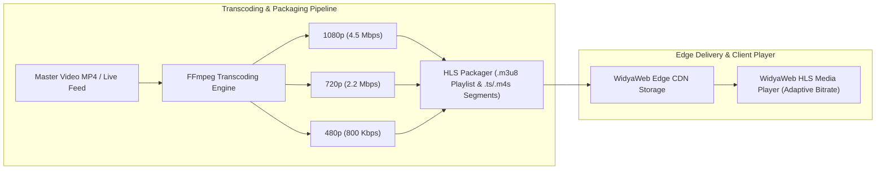

# BAB 14: KOMPONEN MEDIA STREAMING VIDEO HLS & GALERI GAMBAR MODERN

Bab ini membahas integrasi media berperforma tinggi untuk portal berita NusantaraNews: pemutaran video siaran langsung dan rekaman investigasi menggunakan protokol HTTP Live Streaming (HLS / m3u8), penyesuaian bitrate adaptif (ABR), optimasi kompresi gambar generasi terbaru (AVIF & WebP), dan pemuatan responsif berskala piksel (*srcset* & *picture* element).

---

## 14.1 Arsitektur Pengiriman Media & Protokol HLS

Konten berita modern sangat bergantung pada kecepatan distribusi multimedia. Gambar berukuran megabyte yang tidak dioptimalkan atau buffering video yang lambat akan membuat pembaca beralih ke portal lain.



Untuk aset gambar berita, sistem menerapkan pipeline konversi otomatis saat berkas diunggah oleh jurnalis, memproduksi varian AVIF (kompresi superior) dan WebP (kompatibilitas tinggi) dengan berbagai resolusi layar.

---

## 14.2 Implementasi Komponen Pemutar HLS & Elemen Gambar Cerdas

Berikut adalah implementasi komponen pemutar video HLS kustom bertaraf editorial dan komponen gambar adaptif multi-format:

```widya
// Modul Komponen Multimedia NusantaraNews
gunakan widya::web::media::{KomponenVideo, FormatGambar, OpsiVideo};
gunakan widya::web::html::{div, video, picture, source, img, span};

rekod VideoNewsProps {
    id: Teks,
    playlist_m3u8: Teks,
    poster_url: Teks,
    judul: Teks,
    siaran_langsung: BenarSalah
}

fungsi KomponenVideoNews(props: VideoNewsProps) -> KomponenVideo {
    kembalikan div("kelas: 'wadah-pemutar-video modern-player'", [
        jika props.siaran_langsung {
            span("kelas: 'live-badge pulsing'", "● LIVE NEWS")
        } jika_tidak {
            div("kelas: 'durasi-badge'", "03:45")
        },
        video("id: 'video-" + props.id + "', " +
              "controls: true, " +
              "preload: 'metadata', " +
              "poster: '" + props.poster_url + "', " +
              "data-hls-src: '" + props.playlist_m3u8 + "', " +
              "kelas: 'w-full h-auto aspect-video'")
    ]);
}

rekod GambarResponsifProps {
    slug_gambar: Teks,
    deskripsi_alt: Teks,
    lebar: Bulat,
    tinggi: Bulat
}

fungsi KomponenGambarEditorial(props: GambarResponsifProps) -> Komponen {
    tetapan base_url = "https://cdn.nusantaranews.id/media/";
    
    kembalikan picture("kelas: 'gambar-responsif-wrapper'", [
        // 1. Format AVIF Modern untuk peramban mutakhir (kompresi hemat 50%)
        source("type: 'image/avif', srcset: '" + 
               base_url + props.slug_gambar + "-400w.avif 400w, " +
               base_url + props.slug_gambar + "-800w.avif 800w, " +
               base_url + props.slug_gambar + "-1200w.avif 1200w', " +
               "sizes: '(max-width: 640px) 100vw, (max-width: 1024px) 50vw, 800px'"),
               
        // 2. Format WebP cadangan untuk kompatibilitas luas
        source("type: 'image/webp', srcset: '" + 
               base_url + props.slug_gambar + "-400w.webp 400w, " +
               base_url + props.slug_gambar + "-800w.webp 800w, " +
               base_url + props.slug_gambar + "-1200w.webp 1200w', " +
               "sizes: '(max-width: 640px) 100vw, (max-width: 1024px) 50vw, 800px'"),
               
        // 3. Cadangan Terakhir JPEG Universal
        img("src: '" + base_url + props.slug_gambar + "-800w.jpg', " +
            "alt: '" + props.deskripsi_alt + "', " +
            "width: '" + props.lebar.ke_teks() + "', " +
            "height: '" + props.tinggi.ke_teks() + "', " +
            "loading: 'lazy', " +
            "decoding: 'async', " +
            "kelas: 'editorial-foto-utama'")
    ]);
}
```

---

## 14.3 Analisis Efisiensi Kompresi & Kinerja Bandwidth

Penerapan format AVIF dan penyesuaian bitrate adaptif HLS menurunkan konsumsi transfer data bulanan secara masif.

| Format Media | Rata-rata Ukuran Berkas Foto | Penghematan Bandwidth | Efisiensi Decoding Klien |
| :--- | :--- | :--- | :--- |
| **JPEG Klasik (Kualitas 80%)** | 420 KB | 0% (Tolok Ukur Acuan) | Sangat Cepat (Akselerasi CPU Bawaan) |
| **WebP (Kualitas 80%)** | 215 KB | 48.8% Lebih Hemat | Sangat Cepat di Semua Browser Modern |
| **AVIF (Kualitas 65% - Visually Lossless)** | 110 KB | 73.8% Lebih Hemat | Cepat (Hardware Decoder AV1 Modern) |

---

## 14.4 Latihan Praktik & Studi Kasus

1. **Implementasi Pemutar Siaran Radio Suara Berita (Audio Live Streaming)**: Buat komponen pemutar audio ringkas yang menyiarkan buletin suara langsung NusantaraNews Radio menggunakan *Icecast / HLS Audio Stream*.
2. **Fitur Gambar Zoom Modal Interaktif (Lightbox)**: Kembangkan komponen galeri foto jurnalistik yang menampilkan gambar beresolusi penuh dalam modal gelap saat thumbnail diklik.
3. **Pemuatan Pratinjau Blur Sederhana (BlurHash / LQIP)**: Implementasikan pemuatan gambar bergaya *Low Quality Image Placeholder* (LQIP) berukuran 20 piksel yang dikaburkan sebelum berkas gambar resolusi tinggi selesai dimuat.

---

## 14.5 Evaluasi Mandiri Pilihan Ganda

1. Protokol standar industri apa yang digunakan untuk transmisi streaming video adaptif berbasis segmen HTTP pada web?
   - A. FTP murni
   - B. HTTP Live Streaming (HLS) dengan berkas indeks `.m3u8`
   - C. Telnet Terminal Streaming
   - D. SMTP Email Attachment

2. Apa keuntungan utama arsitektur *Adaptive Bitrate Streaming* (ABR)?
   - A. Mengubah video menjadi hitam putih saat malam hari
   - B. Menyesuaikan resolusi video secara dinamis sesuai kualitas sinyal koneksi internet pengguna tanpa memutus pemutaran
   - C. Memaksa pengguna mengunduh seluruh berkas video sekaligus
   - D. Menghapus audio dari video siaran langsung

3. Format gambar generasi baru manakah yang menawarkan rasio kompresi terbaik dengan pengurangan ukuran berkas hingga lebih dari 70% dibanding JPEG?
   - A. BMP
   - B. AVIF
   - C. GIF
   - D. TIFF

4. Mengapa elemen `<picture>` lebih direkomendasikan daripada tag `` tunggal untuk foto editorial berita?
   - A. Karena tag `` sudah dihapus dari standar HTML
   - B. Memungkinkan browser memilih format berkas terbaik (AVIF -> WebP -> JPG) sesuai dukungan peramban masing-masing
   - C. Mempercepat proses perakitan prosesor server
   - D. Mengharuskan gambar dicetak ke kertas printer

5. Atribut `decoding: 'async'` pada elemen gambar berfungsi untuk apa?
   - A. Memperlambat proses penguraian gambar di peramban
   - B. Melakukan proses dekode gambar di luar alur utama (*main thread*) agar antarmuka tidak mengalami stutter (*jank-free*)
   - C. Mengirim gambar ke server analitik pihak ketiga
   - D. Mengubah format warna gambar menjadi monokrom

6. Apa peran berkas berekstensi `.m3u8` dalam alur pemutaran HLS?
   - A. Menyimpan kode sumber JavaScript aplikasi
   - B. Berkas manifes teks daftar putar yang memetakan segmen video (`.ts` / `.m4s`) beserta varian bitrate
   - C. Berkas biner basis data SQL
   - D. Sertifikat kunci enkripsi SSL/TLS

7. Mengapa atribut `width` dan `height` tetap wajib dicantumkan pada tag gambar meskipun styling responsif menggunakan CSS?
   - A. Membantu browser menghitung rasio aspek bawaan dan mencegah lonjakan layout shift (CLS)
   - B. Membatasi ukuran fisik layar komputer pengguna
   - C. Memenuhi syarat agar gambar dapat dibaca oleh pembaca layar tunanetra
   - D. Mengubah resolusi kamera fotografer secara otomatis

8. Dalam atribut `sizes: '(max-width: 640px) 100vw, 800px'`, apa yang diinstruksikan kepada browser?
   - A. Layar di bawah 640px akan menggunakan lebar 100% viewport, sedangkan layar lebih lebar diasumsikan 800px untuk pemilihan berkas `srcset`
   - B. Menghapus gambar jika layar lebih kecil dari 640 piksel
   - C. Mengubah warna latar belakang menjadi merah
   - D. Mengunduh 800 gambar secara paralel

9. Komponen lencana "● LIVE NEWS" yang berkedip menggunakan teknik animasi apa?
   - A. Menghubungi server setiap 1 milidetik
   - B. Animasi CSS kustom `@keyframes pulse { 0%, 100% { opacity: 1; } 50% { opacity: 0.4; } }`
   - C. Merestart peramban setiap beberapa detik
   - D. Mengirim pesan peringatan suara ke pembicara laptop

10. Apa manfaat penggunaan *Low Quality Image Placeholder* (LQIP) pada portal berita?
    - A. Mempercepat koneksi internet pelanggan
    - B. Memberikan umpan balik visual instan berupa bayangan siluet warna lembut saat gambar resolusi tinggi sedang diunduh
    - C. Menghemat konsumsi baterai ponsel hingga 99%
    - D. Menghapus teks artikel di sekitar gambar
