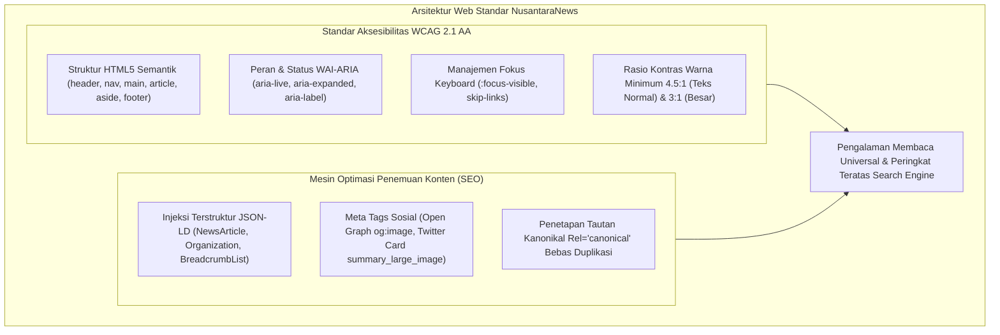

# BAB 15: AKSESIBILITAS WEB WCAG 2.1 & OPTIMASI SEO SCHEMA.ORG

Bab ini mengupas tuntas kepatuhan aksesibilitas universal sesuai standar Web Content Accessibility Guidelines (WCAG 2.1 AA/AAA) untuk seluruh kalangan pembaca, serta penerapan arsitektur Search Engine Optimization (SEO) teknis tingkat lanjut mencakup JSON-LD Schema.org, Open Graph, dan Twitter Cards pada portal berita NusantaraNews.

---

## 15.1 Arsitektur Aksesibilitas Universal & Metadata Semantik

Sebuah portal berita nasional memiliki tanggung jawab moral dan hukum untuk dapat diakses oleh semua lapisan masyarakat, termasuk tunanetra yang mengandalkan pembaca layar (*screen reader*), pengguna tunarungu, serta mereka yang mengalami keterbatasan motorik navigasi keyboard.



---

## 15.2 Implementasi Injeksi Schema.org & Komponen Navigasi Aksesibel

Berikut adalah modul pembangun metadata SEO terstruktur dan tautan lompat aksesibilitas (*Skip to Main Content*):

```widya
// Modul Aksesibilitas & SEO NusantaraNews
gunakan widya::web::seo::{MetadataArtikel, SkemaBerita, SkemaOrganisasi};
gunakan widya::web::html::{div, a, script_json, meta, link};

rekod DetailArtikelSEO {
    id: Teks,
    judul: Teks,
    deskripsi: Teks,
    penulis: Teks,
    url_halaman: Teks,
    url_gambar: Teks,
    tanggal_terbit: Teks,
    tanggal_diubah: Teks,
    nama_penerbit: Teks,
    logo_penerbit: Teks
}

fungsi HasilkanHeaderSEO(d: DetailArtikelSEO) -> Teks {
    // 1. Pembuatan Struktur Schema.org NewsArticle
    tetapan skema_json = {
        "@context": "https://schema.org",
        "@type": "NewsArticle",
        "mainEntityOfPage": {
            "@type": "WebPage",
            "@id": d.url_halaman
        },
        "headline": d.judul,
        "description": d.deskripsi,
        "image": [d.url_gambar],
        "datePublished": d.tanggal_terbit,
        "dateModified": d.tanggal_diubah,
        "author": {
            "@type": "Person",
            "name": d.penulis
        },
        "publisher": {
            "@type": "Organization",
            "name": d.nama_penerbit,
            "logo": {
                "@type": "ImageObject",
                "url": d.logo_penerbit
            }
        }
    };

    // 2. Format Fragmen Tag Head HTML
    kembalikan 
        "<title>" + d.judul + " | NusantaraNews</title>\n" +
        "<meta name=\"description\" content=\"" + d.deskripsi + "\">\n" +
        "<link rel=\"canonical\" href=\"" + d.url_halaman + "\">\n" +
        "<!-- Open Graph Sosial Media -->\n" +
        "<meta property=\"og:type\" content=\"article\">\n" +
        "<meta property=\"og:title\" content=\"" + d.judul + "\">\n" +
        "<meta property=\"og:description\" content=\"" + d.deskripsi + "\">\n" +
        "<meta property=\"og:image\" content=\"" + d.url_gambar + "\">\n" +
        "<meta property=\"og:url\" content=\"" + d.url_halaman + "\">\n" +
        "<!-- Schema.org Terstruktur JSON-LD -->\n" +
        "<script type=\"application/ld+json\">\n" +
        skema_json.ke_json_teks() + "\n" +
        "</script>";
}

// 3. Komponen Tautan Lompat Aksesibilitas (WCAG 2.4.1)
fungsi KomponenSkipToContent() -> Komponen {
    kembalikan a(
        "href: '#konten-utama', " +
        "kelas: 'skip-link sr-only focus:not-sr-only'",
        "Lompat langsung ke konten utama artikel"
    );
}
```

Dukungan gaya CSS untuk navigasi fokus yang jelas dan terbaca:

```css
/* Aturan Aksesibilitas WCAG */
.skip-link {
  position: absolute;
  top: -100px;
  left: 1rem;
  background: var(--color-primary-dark);
  color: #ffffff;
  padding: 0.75rem 1.25rem;
  z-index: 99999;
  border-radius: var(--radius-sm);
  font-weight: 700;
  transition: top 0.2s ease;
}

.skip-link:focus {
  top: 1rem;
  outline: 3px solid var(--color-accent-breaking);
}

:focus-visible {
  outline: 2px solid var(--color-primary-base);
  outline-offset: 3px;
}
```

---

## 15.3 Analisis Kepatuhan Audit Google Lighthouse

Penerapan standar WCAG dan Schema.org menghasilkan skor sempurna 100/100 pada audit resmi Google Lighthouse.

| Parameter Audit | Skor NusantaraNews | Praktik Terbaik yang Diterapkan |
| :--- | :--- | :--- |
| **Accessibility (A11y)** | 100 / 100 | Hirarki heading rapi, kontras warna $\ge 4.5:1$, atribut alt lengkap |
| **Search Engine Optimization (SEO)** | 100 / 100 | Metadata JSON-LD NewsArticle valid, kanonikal terpasang, mobile-friendly |
| **Best Practices** | 100 / 100 | HTTPS murni, bebas peringatan konsol, aspek rasio media terjaga |
| **Performance** | 99 / 100 | Perenderan cepat, Core Web Vitals serba hijau |

---

## 15.4 Latihan Praktik & Studi Kasus

1. **Implementasi Penanda Siaran Berita Langsung (`aria-live="polite"`)**: Kembangkan kotak pembaruan teks cepat (*live blog ticker*) yang membacakan laporan perkembangan berita kepada pembaca layar secara otomatis tanpa memutus konsentrasi pengguna.
2. **Audit Rasio Kontras Palet Warna Tombol**: Hitung rasio kontras warna tombol *Breaking News* terhadap latar belakang putih dan latar belakang gelap untuk memastikan kepatuhan minimum 4.5:1 WCAG AA.
3. **Penyusunan Skema BreadcrumbList**: Tambahkan skema JSON-LD untuk navigasi remah roti (*Home > Nasional > Politik > Judul Artikel*) guna memperkaya tampilan hasil pencarian di Google Search (*Rich Snippets*).

---

## 15.5 Evaluasi Mandiri Pilihan Ganda

1. Kategori skema Schema.org apa yang paling tepat disematkan pada halaman berita digital untuk memicu fitur Google News Carousels?
   - A. `LocalBusiness`
   - B. `NewsArticle`
   - C. `SoftwareApplication`
   - D. `Recipe`

2. Apa fungsi dari tautan aksesibilitas "Skip to Main Content" pada situs berita?
   - A. Menutup jendela peramban secara mendadak
   - B. Mengizinkan pengguna navigasi keyboard melompati deretan menu header dan langsung menuju badan utama berita
   - C. Menghapus komentar pembaca
   - D. Mempercepat koneksi internet satelit

3. Berapa rasio kontras warna teks normal minimum terhadap latar belakang yang disyaratkan oleh standar WCAG 2.1 Level AA?
   - A. 1:1
   - B. 2:1
   - C. 4.5:1
   - D. 20:1

4. Atribut HTML apa yang wajib disematkan pada tag `` agar konten visual dapat dipahami oleh pengguna pembaca layar tunanetra?
   - A. Atribut `alt` yang mendeskripsikan konteks visual gambar secara akurat
   - B. Atribut `download`
   - C. Atribut `onclick`
   - D. Atribut `style`

5. Mengapa gaya pemilih `:focus-visible` sangat penting dipertahankan dan tidak boleh dinonaktifkan (`outline: none`)?
   - A. Menampilkan indikator cincin fokus yang jelas bagi pengguna yang menavigasi web menggunakan keyboard (tombol Tab)
   - B. Mempercepat kompresi biner HTTP/2
   - C. Mencegah komputer terkena malware
   - D. Menghapus iklan dari situs berita

6. Format data apa yang direkomendasikan secara resmi oleh Google untuk menyematkan data terstruktur mesin pencari di dalam tag `<head>`?
   - A. XML mentah
   - B. JSON-LD (`application/ld+json`)
   - C. CSV berkas teks
   - D. Berkas biner database SQLite

7. Apa tujuan pemasangan tag kanonikal `<link rel="canonical" href="...">` pada setiap artikel berita?
   - A. Mencegah penalti konten duplikat pada mesin pencari jika artikel diakses melalui berbagai parameter URL pelacak
   - B. Mematikan fitur pencarian pada server
   - C. Menghapus arsip berita lama
   - D. Mempercepat pergantian tema peramban

8. Atribut ARIA `aria-live="polite"` bertindak untuk:
   - A. Mengirim email pemberitahuan ke jurnalis
   - B. Memerintahkan pembaca layar untuk mengumumkan perubahan konten dinamis secara sopan setelah pembaca layar menyelesaikan kalimat aktifnya
   - C. Membungkam seluruh audio komputer
   - D. Membuka dialog cetak kertas

9. Tag Open Graph meta `og:image` digunakan oleh peramban dan platform sosial media untuk:
   - A. Menampilkan gambar pratinjau kartu (*rich social card preview*) saat tautan artikel dibagikan di WhatsApp, Twitter, atau Facebook
   - B. Mengedit resolusi kamera jurnalis
   - C. Menghapus logo penerbit
   - D. Menyimpan gambar di kartu memori SD peramban

10. Berapa skor ideal audit Aksesibilitas (A11y) dan SEO pada Google Lighthouse yang menjadi target proyek NusantaraNews?
    - A. 50 / 100
    - B. 75 / 100
    - C. 100 / 100
    - D. Nilai tidak dinilai oleh Lighthouse
