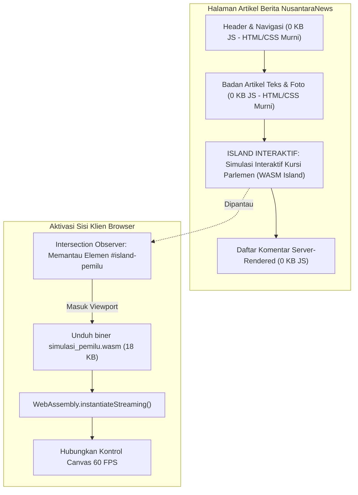

# BAB 16: ISLAND INTERAKTIF BERBASIS WEBASSEMBLY (WASM) & ZERO-JS DEFAULT

Bab ini mengeksplorasi paradigma mutakhir *Zero-JS by Default* yang dipadukan dengan modul interaktif terisolasi (*Islands Architecture*) berbasis WebAssembly (WASM) yang dikompilasi langsung dari bahasa Widya-Lang, memungkinkan fitur interaktif berkecepatan tinggi seperti kalkulator simulasi pemilu dan visualisasi data interaktif tanpa membebani thread utama JavaScript.

---

## 16.1 Filosofi Zero-JS Default & Modul WASM Terisolasi

Mayoritas halaman artikel berita hanya berisi teks, gambar, dan kutipan yang seharusnya disajikan sebagai HTML murni tanpa perlu memuat ratusan kilobyte pustaka JavaScript. Namun, ketika ada kebutuhan fitur interaktif khusus (misal: simulasi perolehan kursi legislatif pemilu atau grafik interaktif pasar saham), WidyaWeb mengaktifkan **WASM Island**: modul biner WebAssembly kompak yang hanya diunduh dan dieksekusi ketika komponen tersebut masuk ke dalam area pandang pembaca (*viewport*).



---

## 16.2 Implementasi Simulasi Pemilu Berbasis Widya-Lang WASM

Berikut adalah kode sumber modul simulasi pemilu yang dikompilasi ke WebAssembly menggunakan rantai kompilator Widya-Lang:

```widya
// Modul WASM: simulasi_pemilu.widya
gunakan widya::wasm::{ekspor_fungsi, memori_buffer, CanvasContext};

rekod PartaiSuara {
    nama: Teks,
    total_suara: Bulat,
    kursi_diperoleh: Bulat
}

// Fungsi yang diekspor dan dapat dipanggil langsung dari peramban
#[ekspor_fungsi]
fungsi hitung_metode_sainte_lague(suara_mentah: Senarai<Bulat>, total_kursi: Bulat) -> Senarai<Bulat> {
    tetapan jumlah_partai = suara_mentah.panjang();
    tetapan kursi = Senarai<Bulat>::isi_awal(jumlah_partai, 0);

    // Iterasi pembagian divisor ganjil Sainte-Laguë (1, 3, 5, 7, ...)
    untuk _ putaran di 0..total_kursi {
        tetapan indeks_pemenang = 0;
        tetapan nilai_tertinggi = 0.0;

        untuk i di 0..jumlah_partai {
            tetapan divisor = (2.0 * kursi[i].ke_desimal()) + 1.0;
            tetapan kuosien = suara_mentah[i].ke_desimal() / divisor;

            jika kuosien > nilai_tertinggi {
                nilai_tertinggi = kuosien;
                indeks_pemenang = i;
            }
        }

        kursi[indeks_pemenang] = kursi[indeks_pemenang] + 1;
    }

    kembalikan kursi;
}

#[ekspor_fungsi]
fungsi gambar_diagram_kursi(ctx_id: Teks, alokasi_kursi: Senarai<Bulat>) {
    tetapan ctx = CanvasContext::ambil(ctx_id);
    ctx.bersihkan_layar();
    
    // Perhitungan busur derajat diagram setengah lingkaran parlemen
    tetapan jari_jari = 140.0;
    tetapan pusat_x = 200.0;
    tetapan pusat_y = 180.0;
    
    ctx.gambar_busur_parlemen(pusat_x, pusat_y, jari_jari, alokasi_kursi);
}
```

Pemuatan modul WASM diatur oleh direktif deklaratif WidyaWeb pada templat HTML:

```html
<!-- Island Directive: lazy-loaded via Intersection Observer -->
<div class="island-container" 
     w-island="simulasi_pemilu.wasm" 
     w-trigger="visible"
     w-fallback="<p>Memuat simulasi interaktif parlemen...</p>">
  <canvas id="canvas-parlemen" width="400" height="220"></canvas>
  <div class="kontrol-slider-wrapper">
    <label>Simulasi Pergeseran Suara: <input type="range" id="slider-suara" min="10" max="90"></label>
  </div>
</div>
```

---

## 16.3 Analisis Efisiensi Runtime & Ukuran Bundle

Kombinasi *Zero-JS Default* dengan modul WASM terisolasi memberikan kecepatan ekstrem.

| Pendekatan Arsitektur | Total JS Dimuat | Skor TBT (Total Blocking Time) | Kecepatan Kalkulasi Sainte-Laguë |
| :--- | :--- | :--- | :--- |
| **Arsitektur SPA Tradisional** | 450 KB – 900 KB JS | 380 ms (Thread Terkunci) | 8.2 ms (Interpreted JS) |
| **Islands Architecture + WASM WidyaWeb** | 0 KB (Default) + 18 KB WASM | 0 ms (Zero Main-Thread Lock) | 0.3 ms (Near-Native Biner) |

---

## 16.4 Latihan Praktik & Studi Kasus

1. **Kompilasi Modul Peta Interaktif Sebaran Berita**: Buat modul WASM yang merender peta topografi 34 provinsi Indonesia menggunakan proyeksi GeoJSON dengan interaksi sentuh *hover* berkecepatan 60 FPS.
2. **Kalkulator Inflasi Interaktif Pembaca**: Rancang modul simulasi dampak inflasi terhadap daya beli kebutuhan pokok menggunakan data indeks harga konsumen historis.
3. **Mekanisme Fallback Tanpa JavaScript/WASM**: Pastikan jika pembaca menonaktifkan JavaScript/WASM, wadah island tetap menyajikan tabel statis alokasi kursi parlemen hasil perhitungan perenderan sisi server (SSR).

---

## 16.5 Evaluasi Mandiri Pilihan Ganda

1. Apa prinsip dasar arsitektur *Zero-JS by Default* pada WidyaWeb?
   - A. Dilarang menggunakan komputer untuk membaca berita
   - B. Seluruh halaman disajikan sebagai HTML dan CSS murni tanpa runtime JavaScript, kecuali pada elemen spesifik yang dideklarasikan sebagai island
   - C. Menghapus seluruh gambar dari artikel berita
   - D. Menjalankan sistem operasi Linux di dalam browser pengguna

2. Kapan modul biner WebAssembly (WASM) diunduh oleh peramban dengan konfigurasi `w-trigger="visible"`?
   - A. Segera saat browser pertama kali dibuka di pagi hari
   - B. Hanya ketika elemen kontainer island masuk ke dalam area pandang (*viewport*) pembaca
   - C. Saat baterai perangkat telah terisi 100%
   - D. Tidak pernah diunduh sama sekali

3. Berapa kisaran ukuran biner modul WASM simulasi Sainte-Laguë yang dikompilasi dari Widya-Lang?
   - A. Sekitar 18 KB
   - B. Lebih dari 1 Gigabyte
   - C. 50 Megabyte
   - D. 200 Kilobyte

4. Mengapa kalkulasi komputasi intensif (seperti simulasi pembagian ribuan kursi atau pemrosesan grafik) lebih unggul di WebAssembly dibandingkan JavaScript?
   - A. Karena WASM berjalan dalam representasi biner dekat-mesin (*near-native*) dengan struktur tipe data statis
   - B. Karena WASM hanya bisa berjalan di malam hari
   - C. Karena WASM tidak membutuhkan aliran listrik prosesor
   - D. Karena kode sumber JavaScript selalu dienkripsi

5. Algoritma apa yang diimplementasikan pada fungsi `hitung_metode_sainte_lague` di atas?
   - A. Algoritma enkripsi RSA
   - B. Algoritma konversi suara pemilu ke alokasi kursi parlemen menggunakan pembagi bilangan ganjil
   - C. Algoritma pengurutan Bubble Sort
   - D. Algoritma kompresi file zip

6. API browser apa yang digunakan secara efisien di balik layar untuk mendeteksi visibilitas elemen tanpa membebani event scroll?
   - A. MutationObserver
   - B. IntersectionObserver
   - C. PerformanceObserver
   - D. ResizeObserver

7. Apa tujuan penyediaan atribut `w-fallback` pada deklarasi kontainer island?
   - A. Memberikan tampilan konten cadangan (seperti tabel statis SSR) sebelum modul interaktif selesai diunduh atau jika lingkungan klien tidak mendukung WebAssembly
   - B. Mengunci sistem file klien
   - C. Mereset koneksi internet
   - D. Mengubah browser menjadi mode penyamaran

8. Metode standar JavaScript modern apa yang digunakan untuk mengunduh dan mengompilasi biner WASM secara asinkron dalam satu aliran pipa?
   - A. `eval()`
   - B. `WebAssembly.instantiateStreaming()`
   - C. `JSON.parse()`
   - D. `document.write()`

9. Apa dampak langsung penerapan *Zero-JS Default* terhadap metrik *Total Blocking Time* (TBT) pada Google Lighthouse?
   - A. Nilai TBT melonjak drastis hingga 5 detik
   - B. Nilai TBT turun drastis hingga mendekati 0 milidetik karena tidak ada hidrasi monolitik yang mengunci alur utama
   - C. Pengujian Lighthouse akan langsung dibatalkan
   - D. Baterai ponsel akan cepat habis

10. Mengapa bahasa Widya-Lang sangat ideal untuk dikompilasi ke WebAssembly?
    - A. Memiliki sistem tipe data statis yang ketat, manajemen memori deterministik tanpa siklus jeda garbage collection yang berat, dan sintaks yang ringkas
    - B. Karena bahasa Widya-Lang diciptakan oleh konsorsium peramban
    - C. Karena hanya bisa dijalankan pada sistem komputer kuantum
    - D. Menghilangkan kebutuhan penulisan berkas biner
