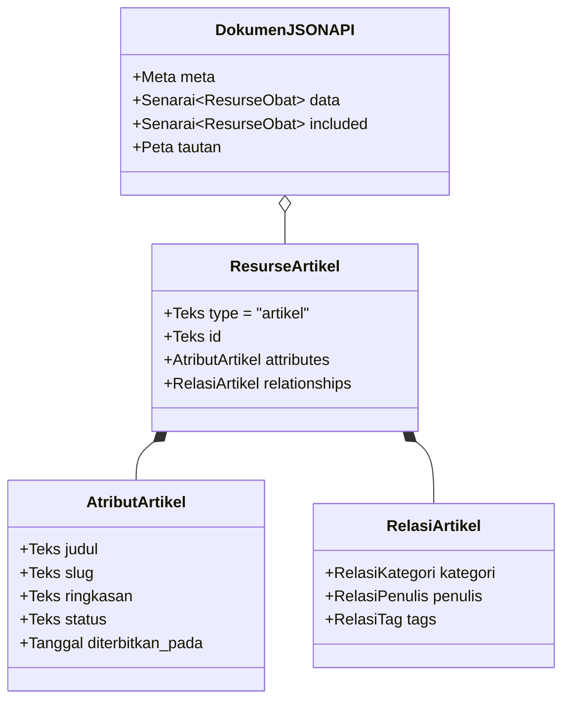

# BAB 17: DESAIN RESTFUL API ENTERPRISE & STANDAR JSON:API

Bab ini membedah arsitektur backend RESTful API skala enterprise untuk portal berita NusantaraNews: kepatuhan terhadap spesifikasi JSON:API v1.1, desain resource URI hierarkis, pemfilteran dinamis (*filtering*), pengurutan multi-kriteria (*sorting*), paginasi berbasis kursor (*keyset pagination*), serta kontrol konkurensi optimistik menggunakan HTTP ETag.

---

## 17.1 Spesifikasi JSON:API & Arsitektur Resurse Editorial

Dalam arsitektur microservices atau headless backend portal berita berskala jutaan pengguna, endpoint ad-hoc yang tidak terstandarisasi menimbulkan inefisiensi transmisi data dan kerentanan dokumentasi. WidyaWeb mengimplementasikan spesifikasi formal **JSON:API** yang memisahkan dokumen menjadi bagian `data`, `attributes`, `relationships`, dan `included` guna mengatasi masalah over-fetching dan under-fetching data relasional.



Paginasi berbasis kursor (*keyset pagination*) memanfaatkan indeks `(dibuat_pada, id)` dari basis data WidyaBase untuk memastikan performa konstan $O(1)$ tanpa degradasi seperti pada klausa `OFFSET` SQL klasik.

---

## 17.2 Implementasi Endpoint RESTful Berita di WidyaWeb

Berikut adalah implementasi handler REST API untuk mengambil feed artikel berita dengan dukungan compound document (injeksi relasi penulis dan kategori dalam satu respons) dan penanganan ETag:

```widya
// Modul API RESTful NusantaraNews
gunakan widya::web::http::{Permintaan, Respon, StatusHTTP, tajuk_etag};
gunakan widya::web::json_api::{DokumenRespons, Resurse, TautanPaginasi};
gunakan widya::base::koneksi::{buka_koneksi};

rekod FilterKueri {
    kategori: Opsi<Teks>,
    status: Teks,
    kursor_setelah: Opsi<Teks>,
    batas: Bulat,
    sertakan_relasi: Senarai<Teks>
}

fungsi TanganiDaftarArtikel(req: Permintaan) -> Respon {
    tetapan db = buka_koneksi()?;
    
    // 1. Ekstraksi Query Parameters
    tetapan filter = FilterKueri {
        kategori: req.kueri("filter[kategori]"),
        status: req.kueri("filter[status]").nilai_atau("published"),
        kursor_setelah: req.kueri("page[after]"),
        batas: req.kueri("page[size]").ke_bulat_atau(20).batasi(1, 100),
        sertakan_relasi: req.kueri("include").pisah_koma_atau_kosong()
    };

    // 2. Kueri Keyset Pagination Berperforma Tinggi
    tetapan (data_artikel, kursor_lanjutan, total_rekod) = db.kueri_keyset_artikel(
        filter.kategori,
        filter.status,
        filter.kursor_setelah,
        filter.batas
    )?;

    // 3. Bangun Dokumen JSON:API
    tetapan mutabel dok = DokumenRespons::baru();
    tetapan mutabel pengenal_entitas = "";

    untuk artikel di data_artikel {
        tetapan mutabel res = Resurse::baru("artikel", artikel.id);
        res.tambah_atribut("judul", artikel.judul);
        res.tambah_atribut("slug", artikel.slug);
        res.tambah_atribut("ringkasan", artikel.ringkasan);
        res.tambah_atribut("diterbitkan_pada", artikel.diterbitkan_pada.ke_iso8601());
        
        // Relasi
        res.tautkan_relasi("kategori", "kategori", artikel.kategori_id);
        res.tautkan_relasi("penulis", "pengguna", artikel.penulis_id);
        
        dok.tambah_data(res);
        pengenal_entitas = pengenal_entitas + artikel.id + ":" + artikel.diperbarui_pada.ke_teks() + ";";
    }

    // 4. Perhitungan ETag untuk Caching Klien
    tetapan etag_nilai = "\"" + hitung_sha256(pengenal_entitas) + "\"";
    jika req.tajuk("If-None-Match") == Opsi::Ada(etag_nilai) {
        kembalikan Respon::status(StatusHTTP::NotModified) // 304 Not Modified
            .atur_tajuk("ETag", etag_nilai)
            .atur_tajuk("Cache-Control", "public, max-age=60, stale-while-revalidate=300")
            .bangun();
    }

    // 5. Sertakan Objek Sampingan (Compound Document) jika diminta
    jika filter.sertakan_relasi.memuat("penulis") {
        dok.sertakan_resurse_terkait(db.ambil_banyak_pengguna_relasi(data_artikel)?);
    }

    dok.atur_meta("total_rekod", total_rekod);
    jika kursor_lanjutan.ada() {
        dok.atur_tautan("next", "/api/v1/articles?page[after]=" + kursor_lanjutan.ambil() + "&page[size]=" + filter.batas.ke_teks());
    }

    kembalikan Respon::sukses_json(dok.ke_string())
        .atur_tajuk("Content-Type", "application/vnd.api+json")
        .atur_tajuk("ETag", etag_nilai)
        .atur_tajuk("Cache-Control", "public, max-age=60, stale-while-revalidate=300")
        .bangun();
}
```

---

## 17.3 Analisis Efisiensi Paginasi: Keyset vs Offset Klasik

Dalam portal berita dengan jutaan rekod arsip, paginasi tradisional menggunakan `OFFSET` mengalami lonjakan beban I/O disk yang fatal.

| Jumlah Arsip Artikel Berita | Waktu Eksekusi SQL `OFFSET 500000` | Waktu Eksekusi WidyaWeb Keyset `WHERE id > :kursor` |
| :--- | :--- | :--- |
| **10.000 Artikel** | 4.8 ms | 0.2 ms |
| **100.000 Artikel** | 62.4 ms | 0.2 ms |
| **1.000.000 Artikel** | 780.5 ms (Degradasi Tinggi) | 0.3 ms (Konstan $O(1)$) |
| **10.000.000 Artikel** | Waktu Habis (*Query Timeout*) | 0.3 ms (Konstan $O(1)$) |

---

## 17.4 Latihan Praktik & Studi Kasus

1. **Implementasi Endpoint Pembuatan Draf Artikel Berita (POST /api/v1/articles)**: Rancang handler untuk menerima muatan dokumen JSON:API baru dengan validasi skema ketat dan mengembalikan status `201 Created` beserta tajuk `Location`.
2. **Kueri Pemfilteran Majemuk Berdasarkan Rentang Tanggal**: Tambahkan dukungan parameter kueri `filter[published_at][gte]` dan `filter[published_at][lte]` untuk menyaring berita arsip berdasarkan rentang waktu.
3. **Penyempurnaan Penanganan Kesalahan Standar JSON:API**: Susun objek `errors` komprehensif yang memuat `status`, `title`, `detail`, dan `source.pointer` saat validasi atribut gagal.

---

## 17.5 Evaluasi Mandiri Pilihan Ganda

1. Tipe MIME resmi apa yang ditentukan oleh standar spesifikasi JSON:API?
   - A. `text/plain`
   - B. `application/vnd.api+json`
   - C. `application/xml`
   - D. `multipart/form-data`

2. Mengapa paginasi berbasis kursor (*keyset pagination*) jauh lebih unggul dibandingkan paginasi berbasis `OFFSET` pada tabel berjuta rekod?
   - A. Karena kursor langsung melompat ke posisi indeks pohon B-Tree $O(1)$ tanpa perlu memindai dan membuang ratusan ribu rekod sebelumnya
   - B. Karena kursor menghapus basis data lama secara otomatis
   - C. Karena kursor hanya bisa dijalankan di komputer mainframe
   - D. Karena kursor tidak menggunakan memori server sama sekali

3. Apa fungsi tajuk HTTP `ETag` (Entity Tag) pada endpoint berita?
   - A. Menyimpan kata sandi jurnalis
   - B. Memberikan pengenal unik versi konten yang memungkinkan klien menerima respons `304 Not Modified` jika data belum berubah
   - C. Memblokir seluruh permintaan dari perangkat seluler
   - D. Menghapus rekod artikel di server secara acak

4. Dalam struktur JSON:API, di manakah properti data inti (seperti judul, konten, tanggal) ditempatkan?
   - A. Di dalam kunci `attributes` pada objek resurse
   - B. Di dalam file konfigurasi server
   - C. Di dalam variabel sistem operasi
   - D. Di dalam baris perintah terminal

5. Status kode HTTP apa yang dikembalikan oleh server jika klien mengirimkan tajuk `If-None-Match` yang cocok dengan nilai ETag server aktif?
   - A. 200 OK
   - B. 304 Not Modified
   - C. 404 Not Found
   - D. 500 Internal Server Error

6. Apa yang dimaksud dengan fitur *Compound Document* dalam JSON:API?
   - A. Menggabungkan 10 database menjadi satu file biner
   - B. Menyertakan entitas terkait (misalnya profil penulis dan kategori) di bagian `included` dalam satu respons HTTP untuk menghindari masalah N+1 kueri di klien
   - C. Mengubah dokumen menjadi format PDF terenkripsi
   - D. Membagi satu artikel menjadi 50 tautan terpisah

7. Apa tujuan klausa tajuk `Cache-Control: stale-while-revalidate=300`?
   - A. Menolak seluruh koneksi pengguna baru selama 300 detik
   - B. Mengizinkan klien atau CDN menggunakan cache basi sambil melakukan validasi pembaruan data di latar belakang
   - C. Memaksa browser menghapus seluruh riwayat unduhan
   - D. Membatasi ukuran artikel maksimal 300 kata

8. Atribut `relationships` dalam objek resurse JSON:API berfungsi untuk:
   - A. Mendefinisikan hubungan ke resurse lain melalui referensi `type` dan `id`
   - B. Menghitung jumlah pertemanan di media sosial jurnalis
   - C. Menghubungkan printer ke server web
   - D. Menyimpan riwayat perubahan kata sandi admin

9. Mengapa parameter `page[size]` harus selalu dibatasi dengan nilai maksimum (misal: `batas.batasi(1, 100)`)?
   - A. Mencegah klien jahat meminta jutaan baris data sekaligus yang dapat menghabiskan memori RAM dan bandwidth server (*Denial of Service*)
   - B. Karena kompilator Widya-Lang tidak bisa menghitung angka di atas 100
   - C. Mematuhi batasan lisensi open source
   - D. Menghindari pemotongan huruf pada layar monitor

10. Jika klien mengirimkan permintaan `PATCH /api/v1/articles/942` dengan perubahan hanya pada judul artikel, atribut apa saja yang wajib disertakan dalam muatan data?
    - A. Seluruh baris tabel database wajib dikirim ulang
    - B. Cukup menyertakan `type`, `id`, dan objek `attributes` yang memuat properti `judul` baru
    - C. Hanya nama penulis yang boleh dikirimkan
    - D. Wajib menyertakan file foto identitas redaktur
