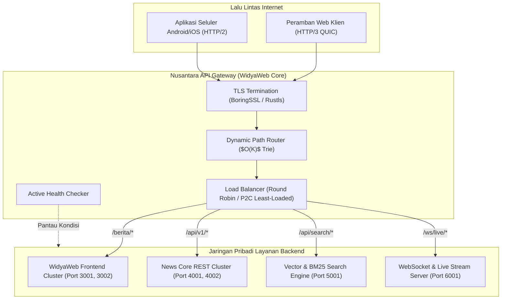

# BAB 18: API GATEWAY NUSANTARA: REVERSE PROXY, LOAD BALANCING & TLS TERMINATION

Bab ini mengulas pembangunan gerbang API terpadu (*Unified API Gateway*) NusantaraNews: peran sebagai proksi pembalik (*reverse proxy*), penghentian enkripsi TLS/HTTPS modern (*TLS termination* dengan sertifikat otomatis ACME/Let's Encrypt), algoritma penyeimbangan beban (*load balancing*), serta perutean dinamis ke klaster layanan backend dan layanan frontend.

---

## 18.1 Arsitektur Gateway Terdistribusi & Topologi Jaringan

Dalam arsitektur berkinerja tinggi, klien peramban dan aplikasi seluler tidak terhubung langsung ke mikro-layanan internal (seperti Layanan Konten, Layanan Komentar, Layanan Autentikasi, Layanan Pencarian Vektor). Semua lalu lintas masuk (*ingress traffic*) melalui **API Gateway Nusantara** yang bertindak sebagai pos pemeriksaan sentral untuk keamanan, kompresi, perutean jalur (*path routing*), dan metrik.



---

## 18.2 Implementasi API Gateway Reverse Proxy di WidyaWeb

Berikut adalah konfigurasi dan kode peladen gateway cerdas yang mengimplementasikan penyeimbangan beban *Power of Two Choices* (P2C) dan proksi pembalik non-blocking:

```widya
// Modul Nusantara API Gateway
gunakan widya::web::gateway::{GerbangAPI, RuteProksi, AlgoritmaBalancing, TargetUpstream};
gunakan widya::web::tls::{KonfigurasiTLS, SertifikatOtomatisACME};

rekod UpstreamNode {
    url: Teks,
    koneksi_aktif: Bulat,
    apakah_sehat: BenarSalah
}

fungsi JalankanGatewayNusantara() {
    // 1. Inisialisasi Sertifikat TLS ACME Otomatis
    tetapan tls_cfg = KonfigurasiTLS::baru()
        .domain("nusantaranews.id")
        .email_admin("keamanan@nusantaranews.id")
        .gunakan_acme_letsencrypt()
        .protokol_minimum_tls13()
        .aktifkan_http3_alpn();

    // 2. Definisi Pool Klaster Backend
    tetapan pool_frontend = [
        TargetUpstream::baru("http://10.0.1.10:3000", 1),
        TargetUpstream::baru("http://10.0.1.11:3000", 1)
    ];

    tetapan pool_api = [
        TargetUpstream::baru("http://10.0.2.10:4000", 1),
        TargetUpstream::baru("http://10.0.2.11:4000", 1),
        TargetUpstream::baru("http://10.0.2.12:4000", 2) // Bobot lebih besar
    ];

    // 3. Konfigurasi Gerbang API
    tetapan mutabel gateway = GerbangAPI::baru(80, 443)
        .terapkan_tls(tls_cfg)
        .atur_timeout_koneksi_ms(5000)
        .atur_buffer_badan_maksimal_mb(10);

    // 4. Perutean Jalur Proksi Pembalik
    gateway.rute("/api/v1/search/*", RuteProksi::ke("http://10.0.3.10:5000")
        .hapus_awalan("/api/v1/search"));

    gateway.rute("/api/v1/*", RuteProksi::ke_pool(pool_api)
        .algoritma(AlgoritmaBalancing::PowerOfTwoChoices)
        .pemeriksaan_kesehatan("/healthz", 3)); // Periksa setiap 3 detik

    gateway.rute("/ws/*", RuteProksi::ke("http://10.0.4.10:6000")
        .dukung_peningkatan_websocket());

    // Rute Bawaan: Arahkan ke Klaster SSR Frontend
    gateway.rute_bawaan(RuteProksi::ke_pool(pool_frontend)
        .algoritma(AlgoritmaBalancing::RoundRobin)
        .sisipkan_tajuk("X-Forwarded-For", "$remote_addr")
        .sisipkan_tajuk("X-Gateway-Nusantara", "WidyaWeb-Edge/2.0"));

    cetak_log("Nusantara API Gateway aktif pada port 80 (HTTP) dan 443 (HTTPS/QUIC)");
    gateway.dengarkan();
}
```

---

## 18.3 Analisis Algoritma Penyeimbangan Beban (Load Balancing)

Pemilihan algoritma penyeimbangan beban menentukan kestabilan latensi klaster saat terjadi lonjakan trafik berita mendadak (*traffic spike*).

| Algoritma Balancing | Distribusi Beban | Penanganan Node Lambat | Kompleksitas Waktu |
| :--- | :--- | :--- | :--- |
| **Round Robin Sederhana** | Merata secara sekuensial | Buruk (Dapat membanjiri node yang tersendat) | $O(1)$ |
| **Weighted Round Robin** | Berdasarkan rasio bobot statis | Sedang (Tidak tanggap lonjakan beban dinamis) | $O(1)$ |
| **Least Connections** | Memilih node koneksi terminimal | Baik (Memerlukan sinkronisasi atomik global) | $O(N)$ pemindaian |
| **Power of Two Choices (P2C)** | Memilih 2 node acak, pilih yang terminimal | Luar Biasa (Mencegah kawanan thundering herd) | $O(1)$ Konstan |

---

## 18.4 Latihan Praktik & Studi Kasus

1. **Implementasi Pemeriksaan Kesehatan Pasif (Passive Health Checking)**: Tambahkan logika pada gateway yang secara otomatis menandai sebuah upstream node sebagai "tidak sehat" jika mengalami 3 kali kegagalan koneksi berturut-turut atau kode respons 502 Bad Gateway.
2. **Kustomisasi Pembersihan Tajuk Berbahaya**: Konfigurasikan pemfilteran tajuk masuk pada gateway untuk menghapus tajuk internal berbahaya seperti `X-Internal-User-Role` sebelum permintaan diteruskan ke klaster API.
3. **Pengalihan Otomatis HTTP ke HTTPS**: Rancang handler pada port 80 yang mengembalikan kode status permanen `301 Moved Permanently` ke alamat ekuivalen `https://` dengan tajuk `Strict-Transport-Security` (HSTS).

---

## 18.5 Evaluasi Mandiri Pilihan Ganda

1. Apa tanggung jawab utama dari *Reverse Proxy* dalam arsitektur aplikasi web modern?
   - A. Menjadi jembatan perantara yang menerima permintaan dari klien luar dan meneruskannya ke layanan backend yang sesuai di jaringan internal
   - B. Mematikan seluruh komputer di jaringan kantor
   - C. Mengunduh musik tanpa izin hak cipta
   - D. Menghapus kode program dari repositori Git

2. Apa yang dimaksud dengan *TLS Termination* pada API Gateway?
   - A. Menghentikan seluruh koneksi aman agar pengguna tidak bisa masuk
   - B. Proses di mana gateway mendekripsi lalu lintas HTTPS terenkripsi dari internet publik dan meneruskan lalu lintas plain di dalam jaringan privat berkecepatan tinggi
   - C. Menghapus sertifikat SSL dari server
   - D. Mengubah sertifikat keamanan menjadi berkas gambar JPEG

3. Protokol otomatisasi apa yang digunakan oleh Let's Encrypt untuk penerbitan dan pembaruan sertifikat SSL/TLS gratis secara terprogram?
   - A. Protokol ACME (Automated Certificate Management Environment)
   - B. Protokol FTP
   - C. Protokol POP3
   - D. Protokol SNMP

4. Mengapa algoritma *Power of Two Choices* (P2C) sering dianggap lebih unggul daripada *Least Connections* klasik pada sistem berskala masif?
   - A. Menghindari pemindaian seluruh node ($O(N)$) dan menghindari masalah *thundering herd* dengan memilih 2 kandidat acak dan mengambil yang berbeban terkecil secara efisien $O(1)$
   - B. Membatasi jumlah node backend maksimal 2 komputer saja
   - C. Mengurangi biaya listrik server hingga 80%
   - D. Mengharuskan pengembang menulis kode dalam dua bahasa pemrograman

5. Tajuk HTTP standar apa yang wajib disematkan oleh Reverse Proxy untuk menginformasikan alamat IP asli klien kepada layanan backend?
   - A. `X-Powered-By`
   - B. `X-Forwarded-For`
   - C. `Content-Type`
   - D. `User-Agent`

6. Kode status HTTP apa yang harus dikembalikan oleh API Gateway jika server upstream backend di belakangnya mati atau tidak merespons?
   - A. 200 OK
   - B. 404 Not Found
   - C. 502 Bad Gateway
   - D. 301 Moved Permanently

7. Fitur ALPN (Application-Layer Protocol Negotiation) dalam jabat tangan TLS berguna untuk apa?
   - A. Menegosiasikan protokol aplikasi (seperti HTTP/1.1, HTTP/2, atau HTTP/3) antara peramban dan server selama jabat tangan TLS berlangsung
   - B. Mengunci keyboard komputer pengguna
   - C. Mengubah warna ikon peramban
   - D. Memeriksa kapasitas memori flash drive

8. Berapa durasi interval waktu yang diatur untuk pemeriksaan kesehatan upstream API pada kode implementasi di atas?
   - A. 1 milidetik
   - B. 3 detik
   - C. 1 jam
   - D. 24 jam

9. Apa yang terjadi jika permintaan dengan URL `/ws/live/comments` masuk ke gerbang API Nusantara?
   - A. Permintaan akan ditolak dengan galat 403 Forbidden
   - B. Gateway mengenali rute awalan `/ws/*` dan meneruskan koneksi serta mengizinkan peningkatan protokol (*Protocol Upgrade*) ke WebSocket pada port 6000
   - C. Gateway mematikan koneksi internet pengguna
   - D. Permintaan dialihkan ke halaman pencarian Google

10. Mengapa pemisahan beban antara klaster Web SSR dan klaster REST API sangat dianjurkan pada portal berita berskala nasional?
    - A. Memastikan lonjakan konsumsi pembaca umum pada halaman statis/SSR tidak membebani transaksi pembaruan data editorial pada API inti
    - B. Menghilangkan kebutuhan sistem basis data
    - C. Mengurangi kapasitas RAM server hingga nol byte
    - D. Membatasi jurnalis agar tidak bisa menulis berita di akhir pekan
