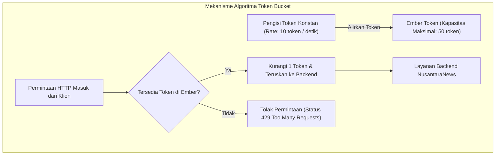

# BAB 19: RATE LIMITING TOKEN BUCKET & MITIGASI DDOS

Bab ini mengupas tuntas pertahanan tepi (*edge defense*) portal berita NusantaraNews: penerapan algoritma pembatasan laju (*Rate Limiting*) berbasis Token Bucket dan Sliding Window, mitigasi serangan Denial of Service (DoS/DDoS), perlindungan scraper konten ilegal, dan isolasi lalu lintas menggunakan protokol terdistribusi WidyaBase KV.

---

## 19.1 Teori Rate Limiting & Arsitektur Token Bucket

Lonjakan lalu lintas tak wajar pada portal berita dapat bersumber dari serangan distributed botnet, perayap web liar (*malicious web scrapers*) yang menyedot artikel, atau lonjakan pemilih jajak pendapat. Algoritma **Token Bucket** menyediakan keseimbangan sempurna antara pembatasan kapasitas rata-rata dan toleransi lonjakan sesaat (*burst capacity*).



Secara matematis, jika ember memiliki kapasitas maksimum $C$ dan tingkat pengisian $r$ token/detik, maka durasi lonjakan maksimum $T_{burst}$ yang dapat dilayani adalah:
$$T_{burst} = \frac{C}{M - r}$$
di mana $M$ adalah laju kedatangan permintaan maksimum dari klien.

---

## 19.2 Implementasi Middleware Rate Limiter di WidyaWeb

Berikut adalah implementasi middleware rate limiter berbasis alamat IP dan kunci API menggunakan penyimpanan status atomik terdistribusi:

```widya
// Modul Rate Limiter Terdistribusi NusantaraNews
gunakan widya::web::middleware::{Middleware, KonteksMiddleware, HasilMiddleware};
gunakan widya::web::http::{Respon, StatusHTTP};
gunakan widya::base::kv::{KlienKV};

rekod AturanLimit {
    kapasitas_maksimal: Bulat,
    laju_isi_per_detik: Bulat,
    jendela_waktu_detik: Bulat
}

fungsi MiddlewareRateLimiter(kv: KlienKV) -> Middleware {
    kembalikan fungsi(ctx: KonteksMiddleware, berikutnya: FungsiLanjut) -> Respon {
        tetapan ip_klien = ctx.permintaan().alamat_ip_klien();
        tetapan api_key = ctx.permintaan().tajuk("X-Api-Key");
        
        // 1. Tentukan Identitas & Kebijakan Kuota
        tetapan (kunci_identitas, aturan) = jika api_key.ada() {
            ("ratelimit:key:" + api_key.ambil(), AturanLimit { kapasitas_maksimal: 500, laju_isi_per_detik: 50, jendela_waktu_detik: 1 })
        } jika_tidak {
            ("ratelimit:ip:" + ip_klien, AturanLimit { kapasitas_maksimal: 30, laju_isi_per_detik: 5, jendela_waktu_detik: 1 })
        };

        // 2. Eksekusi Script Token Bucket Atomik di WidyaBase KV
        tetapan sekarang_detik = ambil_waktu_unix_detik();
        tetapan hasil_evaluasi = kv.evaluasi_token_bucket(
            kunci_identitas,
            aturan.kapasitas_maksimal,
            aturan.laju_isi_per_detik,
            sekarang_detik
        )?;

        // 3. Pasang Tajuk Standar IETF RateLimit
        tetapan sisa_token = hasil_evaluasi.sisa_token;
        tetapan waktu_reset = hasil_evaluasi.detik_hingga_reset;

        jika !hasil_evaluasi.apakah_diizinkan {
            kembalikan Respon::status(StatusHTTP::TooManyRequests) // 429
                .atur_tajuk("Retry-After", waktu_reset.ke_teks())
                .atur_tajuk("X-RateLimit-Limit", aturan.kapasitas_maksimal.ke_teks())
                .atur_tajuk("X-RateLimit-Remaining", "0")
                .atur_tajuk("X-RateLimit-Reset", waktu_reset.ke_teks())
                .atur_badan_json({
                    "error": "Terlalu Banyak Permintaan",
                    "pesan": "Batas kuota akses Anda terlampaui. Silakan coba kembali dalam " + waktu_reset.ke_teks() + " detik."
                })
                .bangun();
        }

        // Lanjutkan permintaan dengan menyematkan sisa kuota
        tetapan mutabel respon = berikutnya(ctx);
        respon.atur_tajuk("X-RateLimit-Limit", aturan.kapasitas_maksimal.ke_teks());
        respon.atur_tajuk("X-RateLimit-Remaining", sisa_token.ke_teks());
        respon.atur_tajuk("X-RateLimit-Reset", waktu_reset.ke_teks());
        kembalikan respon;
    };
}
```

---

## 19.3 Analisis Perbandingan Algoritma Rate Limiting

Pemilihan algoritma pembatasan laju harus mempertimbangkan efisiensi memori dan keadilan alokasi trafik.

| Algoritma | Penggunaan Memori | Keakuratan Batas Tepi | Toleransi Lonjakan (*Burst*) |
| :--- | :--- | :--- | :--- |
| **Fixed Window Counter** | Sangat Rendah ($O(1)$) | Buruk (Lonjakan $2\times$ di batas jendela) | Tidak Ada |
| **Sliding Window Log** | Sangat Tinggi ($O(N)$ stempel waktu) | Sangat Presisi | Rendah |
| **Sliding Window Counter** | Rendah (Kombinasi 2 counter) | Sangat Baik (Aproksimasi 99%) | Terbatas |
| **Token Bucket (WidyaWeb)** | Sangat Rendah (2 bilangan float/klien) | Sempurna | Sangat Baik & Terkendali |

---

## 19.4 Latihan Praktik & Studi Kasus

1. **Implementasi White-listing untuk Bot Mesin Pencari Terverifikasi**: Kembangkan aturan pengecualian rate limit untuk bot resmi mesin pencari (seperti Googlebot dan Bingbot) melalui verifikasi pencocokan DNS terbalik (*Reverse DNS lookup*).
2. **Penalti Eskalasi Waktu Blokir (Tarpitting / Exponential Backoff)**: Rancang mekanisme di mana klien yang melanggar batas rate limit lebih dari 5 kali berturut-turut akan diblokir selama durasi eksponensial (1 menit, 5 menit, 1 jam).
3. **Pemberian Kuota Berbeda Berdasarkan Rubrik Berita**: Buat pemisahan batas kuota di mana endpoint pencarian teks dan komentar memiliki batas yang lebih ketat dibandingkan endpoint membaca artikel umum.

---

## 19.5 Evaluasi Mandiri Pilihan Ganda

1. Apa kode status HTTP resmi yang dikembalikan oleh peladen ketika klien melebihi kuota pembatasan laju (*rate limit*)?
   - A. 200 OK
   - B. 401 Unauthorized
   - C. 429 Too Many Requests
   - D. 503 Service Unavailable

2. Tajuk HTTP standar apa yang memberi petunjuk kepada klien berapa detik mereka harus menunggu sebelum mencoba kembali permintaannya?
   - A. `Retry-After`
   - B. `Accept-Language`
   - C. `Content-Length`
   - D. `User-Agent`

3. Mengapa algoritma *Token Bucket* menjadi standar industri dalam perancangan API gateway modern?
   - A. Karena dapat mentoleransi lonjakan lalu lintas sesaat (*bursting*) secara mulus sambil menjaga batas laju rata-rata tetap aman
   - B. Karena menghapus database pengguna secara otomatis
   - C. Karena hanya bisa ditulis dalam bahasa C++
   - D. Karena tidak memerlukan sambungan listrik

4. Pada kode implementasi di atas, berapa kapasitas ember maksimal yang dialokasikan untuk pengguna publik tanpa API Key?
   - A. 1 token
   - B. 30 token
   - C. 500 token
   - D. Tak terbatas

5. Kelemahan fatal apa yang terjadi jika kita menggunakan algoritma *Fixed Window Counter* klasik?
   - A. Server akan langsung mati jika tanggal berganti
   - B. Memungkinkan lalu lintas menembus batas hingga dua kali lipat ($2\times$) tepat di antara peralihan batas jendela waktu
   - C. Tidak bisa mencatat alamat IP
   - D. Mengharuskan penggunaan memori sebesar 10 Gigabyte per pengguna

6. Mengapa status rate limit harus disimpan dalam basis data terdistribusi (seperti WidyaBase KV) dan bukan sekadar variabel lokal memori di satu server gateway?
   - A. Agar seluruh instans peladen gateway di dalam klaster memiliki pandangan kuota yang konsisten dan tersinkronisasi terhadap klien yang sama
   - B. Agar data rate limit dapat dicetak di koran
   - C. Mempercepat proses kompilasi kode Rust
   - D. Menghindari pembacaan cookie oleh peramban

7. Apa tujuan utama dari penyematan tajuk respons `X-RateLimit-Remaining`?
   - A. Menginformasikan kepada klien sisa kuota permintaan yang masih dapat mereka lakukan pada jendela waktu aktif
   - B. Menghitung jumlah kata dalam artikel berita
   - C. Menutup koneksi TCP seketika
   - D. Mengubah alamat IP server

8. Apa bahaya utama jika endpoint pengiriman komentar tidak dilindungi oleh middleware pembatasan laju?
   - A. Komentar akan terhapus otomatis setelah 1 menit
   - B. Rentan terhadap serangan spamming bot otomatis yang membanjiri basis data dan menjatuhkan server (*Resource Exhaustion*)
   - C. Gambar profil pembaca akan berubah menjadi warna hitam
   - D. Server akan dipaksa mengunduh pembaruan Windows

9. Dalam rumus durasi lonjakan $T_{burst} = C / (M - r)$, variabel $C$ merepresentasikan apa?
   - A. Kapasitas maksimum ember (*bucket capacity*)
   - B. Jumlah inti CPU server
   - C. Kecepatan kipas pendingin komputer
   - D. Biaya tagihan cloud bulanan

10. Mengapa pengguna dengan API Key terautentikasi diberikan kuota kapasitas maksimal yang jauh lebih tinggi (500 token)?
    - A. Karena mereka adalah mitra atau aplikasi seluler resmi yang identitasnya telah terverifikasi dan dapat dilacak
    - B. Karena mereka membayar denda kepada pengembang
    - C. Kompilator memberikan perlakuan khusus
    - D. Menghilangkan kewajiban membaca berita
