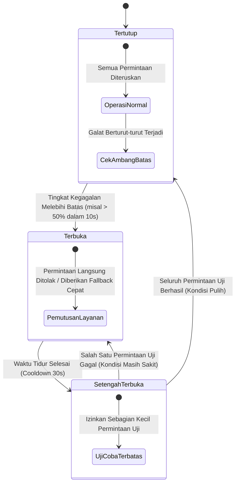

# BAB 20: CIRCUIT BREAKER & POLA RESILIENSI SISTEM

Bab ini mendalami rekayasa keandalan sistem (*reliability engineering*) pada portal berita NusantaraNews: implementasi pola *Circuit Breaker* tiga status (Tertutup, Terbuka, Setengah Terbuka), *Retry Policy* dengan *Exponential Backoff* dan *Jitter*, mekanisme isolasi kegagalan (*Bulkheading*), serta penyajian konten degradasi anggun (*graceful degradation / fallback*).

---

## 20.1 Teori Resiliensi & Pola Mesin Status Circuit Breaker

Ketika layanan backend dependensi (misal: mesin rekomendasi artikel berbasis AI atau gateway pembayaran langganan) mengalami kelambatan ekstrem (*hanging*) atau kegagalan berulang, kegagalan tersebut dapat menjalar ke seluruh sistem (*cascading failure*) dan menghabiskan seluruh thread pekerja peladen web. Pola **Circuit Breaker** bertindak sebagai sekering pengaman otomatis yang memutus koneksi sementara ke layanan yang bermasalah.



---

## 20.2 Implementasi Circuit Breaker di WidyaWeb

Berikut adalah implementasi pustaka resiliensi `CircuitBreaker` yang melindungi pemanggilan layanan rekomendasi AI eksternal:

```widya
// Modul Resiliensi NusantaraNews
gunakan widya::web::resiliensi::{StatusCircuit, OpsiCircuitBreaker, HasilResiliensi};
gunakan widya::koleksi::{Senarai};

rekod KonfigurasiResiliensi {
    ambang_kegagalan_persen: Desimal,
    minimal_permintaan_sampel: Bulat,
    durasi_tidur_ms: Bulat,
    timeout_eksekusi_ms: Bulat
}

struktur CircuitBreakerBerita {
    status: StatusCircuit,
    total_percobaan: Bulat,
    total_gagal: Bulat,
    waktu_buka_terakhir_ms: Bulat,
    cfg: KonfigurasiResiliensi
}

implementasi CircuitBreakerBerita {
    fungsi baru(cfg: KonfigurasiResiliensi) -> CircuitBreakerBerita {
        kembalikan CircuitBreakerBerita {
            status: StatusCircuit::Tertutup,
            total_percobaan: 0,
            total_gagal: 0,
            waktu_buka_terakhir_ms: 0,
            cfg: cfg
        };
    }

    fungsi eksekusi<T>(mutabel self, aksi: Fungsi() -> Hasil<T, Galat>, fallback: Fungsi() -> T) -> T {
        tetapan waktu_sekarang = ambil_waktu_unix_ms();

        // 1. Evaluasi Transisi dari Terbuka ke Setengah Terbuka
        jika self.status == StatusCircuit::Terbuka {
            jika waktu_sekarang - self.waktu_buka_terakhir_ms >= self.cfg.durasi_tidur_ms {
                self.status = StatusCircuit::SetengahTerbuka;
                cetak_log("[CircuitBreaker] Berpindah ke status SETENGAH TERBUKA untuk pengujian pemulihan.");
            } jika_tidak {
                // Sirkuit masih terbuka, langsung eksekusi fallback instan
                kembalikan fallback();
            }
        }

        // 2. Eksekusi Aksi Utama dengan Batas Waktu (Timeout)
        self.total_percobaan = self.total_percobaan + 1;
        tetapan hasil_eksekusi = jalankan_dengan_timeout(aksi, self.cfg.timeout_eksekusi_ms);

        pilih hasil_eksekusi {
            Hasil::Sukses(data) => {
                jika self.status == StatusCircuit::SetengahTerbuka {
                    // Berhasil dalam masa uji coba, pulihkan sirkuit ke Tertutup
                    self.reset_ke_tertutup();
                    cetak_log("[CircuitBreaker] Layanan pulih. Sirkuit kembali TERTUTUP.");
                }
                kembalikan data;
            },
            Hasil::Gagal(galat) => {
                self.total_gagal = self.total_gagal + 1;
                cetak_peringatan("[CircuitBreaker] Kegagalan tercatat: " + galat.pesan());

                jika self.status == StatusCircuit::SetengahTerbuka {
                    // Gagal saat masa uji coba, segera buka kembali sirkuit
                    self.buka_sirkuit(waktu_sekarang);
                } jika_tidak {
                    // Periksa persentase kegagalan pada status Tertutup
                    jika self.total_percobaan >= self.cfg.minimal_permintaan_sampel {
                        tetapan rasio_gagal = (self.total_gagal.ke_desimal() / self.total_percobaan.ke_desimal()) * 100.0;
                        jika rasio_gagal >= self.cfg.ambang_kegagalan_persen {
                            self.buka_sirkuit(waktu_sekarang);
                        }
                    }
                }
                kembalikan fallback();
            }
        }
    }

    fungsi buka_sirkuit(mutabel self, waktu_ms: Bulat) {
        self.status = StatusCircuit::Terbuka;
        self.waktu_buka_terakhir_ms = waktu_ms;
        cetak_peringatan("[CircuitBreaker] BAHAYA: Ambang batas terlampaui. Sirkuit diputus ke TERBUKA.");
    }

    fungsi reset_ke_tertutup(mutabel self) {
        self.status = StatusCircuit::Tertutup;
        self.total_percobaan = 0;
        self.total_gagal = 0;
    }
}
```

---

## 20.3 Analisis Efektivitas Pola Resiliensi Komprehensif

Penerapan kombinasi Circuit Breaker, Timeout, dan Exponential Backoff dengan Jitter menjamin stabilitas ketersediaan layanan (*high availability*).

| Ancaman Gangguan Layanan | Perilaku Tanpa Pola Resiliensi | Perilaku dengan WidyaWeb Circuit Breaker |
| :--- | :--- | :--- |
| **Layanan AI Eksternal Hang 30 Detik** | Seluruh thread gateway habis terblokir, portal mati | Timeout 800ms memutus aksi, fallback ke berita terpopuler |
| **Database Mengalami Failover 15 Detik** | Ratusan permintaan gagal dengan galat 500 berulang | Sirkuit terbuka setelah 10 kegagalan, menyajikan artikel dari cache CDN |
| **Jaringan Flapping (Putus-Nyambung)** | Retry storm memperburuk kemacetan jaringan | Backoff eksponensial + Jitter menyebarkan beban secara acak |

---

## 20.4 Latihan Praktik & Studi Kasus

1. **Implementasi Fallback Berita Terkait Berbasis Aturan Lokal**: Rancang fungsi fallback elegan yang mengembalikan daftar 5 berita terpopuler hari ini dari cache jika layanan rekomendasi AI mengalami kegagalan.
2. **Kalkulasi Exponential Backoff dengan Jitter Acak**: Tulis algoritma penundaan percobaan ulang:
   $$t_{delay} = \min(t_{max}, t_{base} \times 2^{percobaan}) + \text{acak}(0, \text{jitter})$$
   guna mencegah fenomena thundering herd saat layanan hilir pulih.
3. **Penerapan Pola Bulkhead untuk Pemisahan Kolam Thread**: Konfigurasikan pemisahan alokasi worker thread antara penanganan artikel berita gratis (90 thread) dan pendaftaran pelanggan berbayar (30 thread terisolasi).

---

## 20.5 Evaluasi Mandiri Pilihan Ganda

1. Apa tujuan mendasar dari penerapan pola *Circuit Breaker* dalam sistem terdistribusi?
   - A. Mencegah satu kegagalan lokal pada layanan bawahan merembet menjadi kegagalan fatal pada seluruh sistem (*cascading failure*)
   - B. Mematikan listrik ruang data center saat suhu naik
   - C. Menghentikan program kompilasi secara permanen
   - D. Menghapus kode yang memiliki bug secara otomatis

2. Apa perilaku sistem ketika status Circuit Breaker berada dalam kondisi **Terbuka (Open)**?
   - A. Sistem mengizinkan ribuan permintaan masuk sekaligus ke layanan yang rusak
   - B. Sirkuit memutus aliran koneksi dan langsung mengembalikan respons cepat atau fungsi cadangan (*fallback*) tanpa membebani layanan yang sedang bermasalah
   - C. Server memformat ulang hard drive
   - D. Mematikan koneksi internet di seluruh kota

3. Kapan status sirkuit bertransisi dari status **Terbuka** menuju **Setengah Terbuka (Half-Open)**?
   - A. Setelah masa jeda istirahat (*cooldown sleep window*) terlampaui untuk memberikan kesempatan uji coba pemulihan pada layanan
   - B. Hanya saat pengguna menekan tombol F5 di browser
   - C. Tepat jam 12 malam setiap hari
   - D. Saat sistem kehabisan memori RAM

4. Apa fungsi dari strategi *Graceful Degradation* (Degradasi Anggun)?
   - A. Memastikan aplikasi tetap memberikan fungsionalitas parsial yang bermanfaat bagi pengguna (misal: menyajikan berita terpopuler statis) saat fitur canggih (seperti AI) tidak tersedia
   - B. Menghapus antarmuka CSS portal berita
   - C. Mengubah warna tulisan menjadi transparan
   - D. Memaksa pembaca menutup tab browser mereka

5. Mengapa penambahan faktor keacakan (*Jitter*) sangat krusial dalam algoritma *Exponential Backoff* saat melakukan percobaan ulang (*retry*)?
   - A. Mencegah seluruh klien yang gagal mencoba ulang secara serentak di detik yang sama persis sehingga tidak memicu gelombang badai trafik baru (*thundering herd storm*)
   - B. Menghemat baterai ponsel jurnalis
   - C. Karena angka acak diwajibkan oleh protokol TCP
   - D. Menghapus log sistem

6. Pola resiliensi apa yang mengisolasi kolam sumber daya (seperti alokasi memori atau thread) antarlayanan agar kegagalan di satu modul tidak menguras modul lainnya, mirip dengan sekat kompartemen kedap air pada lambung kapal?
   - A. Pola Bulkhead
   - B. Pola Polling
   - C. Pola Monolith
   - D. Pola Single Thread

7. Apa yang terjadi jika salah satu permintaan uji coba pada status **Setengah Terbuka** mengalami kegagalan?
   - A. Status sirkuit langsung beralih kembali ke status **Terbuka** untuk melindungi layanan
   - B. Sistem menghapus tabel database
   - C. Server melakukan instalasi ulang sistem operasi
   - D. Pengguna diblokir dari portal

8. Nilai parameter `timeout_eksekusi_ms` pada implementasi Circuit Breaker berfungsi untuk apa?
   - A. Membatasi durasi maksimal toleransi waktu tunggu panggilan layanan sebelum dianggap gagal
   - B. Mengatur waktu tidur siang pengembang
   - C. Menghitung lama artikel dibaca oleh pembaca
   - D. Membatasi masa aktif lisensi software

9. Berapa ambang persentase kegagalan minimum yang memicu pembukaan sirkuit pada konfigurasi di atas?
   - A. 0%
   - B. Sesuai nilai konfigurasi `ambang_kegagalan_persen` (misalnya 50%)
   - C. Tepat 100%
   - D. Tidak pernah terbuka

10. Mengapa pemanggilan layanan dependensi eksternal tanpa batasan *timeout* dianggap sebagai dosa besar arsitektur (*anti-pattern*)?
    - A. Karena dapat menyebabkan thread peladen tersandera menunggu tanpa batas waktu hingga seluruh sumber daya server habis dan peladen berhenti merespons permintaan lain
    - B. Karena melanggar hak cipta pengembang lain
    - C. Karena membuat ukuran berkas biner bertambah besar
    - D. Karena browser akan menolak menampilkan warna merah
