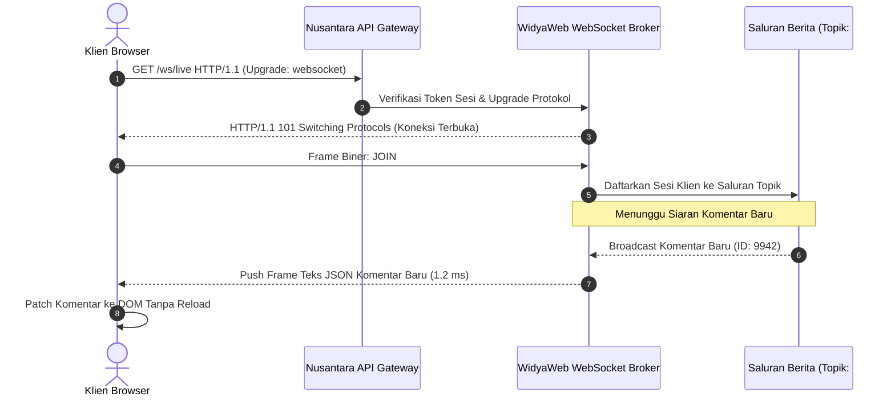

# BAB 21: KOMUNIKASI REAL-TIME WEBSOCKETS RFC 6455 & KANAL KOMENTAR

Bab ini mengupas tuntas arsitektur komunikasi dua arah berlatensi ultra-rendah (*full-duplex low-latency communication*) menggunakan standar WebSockets RFC 6455 pada WidyaWeb untuk menghidupkan kanal diskusi interaktif pembaca, polling pemilu langsung, serta siaran teks langsung (*live blogging*) pada portal berita NusantaraNews.

---

## 21.1 Protokol WebSockets & Topologi Kanal Topik (Pub/Sub)

Berbeda dengan pola polling HTTP klasik yang membebani server dengan jabat tangan TCP berulang kali, protokol WebSocket memanfaatkan koneksi TCP persisten tunggal setelah jabat tangan peningkatan protokol (*Protocol Upgrade* `HTTP/1.1 101 Switching Protocols`). 



WidyaWeb menyematkan mesin broker multi-utas tanpa kunci (*lock-free broadcast hub*) yang mampu menyiarkan pesan ke 100.000 koneksi simultan hanya dalam beberapa milidetik dengan alokasi memori nol (*zero allocation framing*).

---

## 21.2 Implementasi WebSocket Server Kanal Berita

Berikut adalah implementasi handler peladen WebSocket untuk ruang diskusi interaktif artikel berita:

```widya
// Modul Real-Time WebSocket NusantaraNews
gunakan widya::web::websocket::{PeladenWebSocket, SesiWS, FramePesan, JenisFrame};
gunakan widya::web::broadcast::{HubSiaran, SaluranTopik};
gunakan widya::sinkronisasi::{KunciBacaTulis};

rekod PesanKomentarRealtime {
    artikel_id: Teks,
    nama_pengirim: Teks,
    isi_pesan: Teks,
    waktu_kirim: Teks
}

fungsi InisialisasiHubKomentar() -> HubSiaran {
    tetapan hub = HubSiaran::baru();

    // 1. Registrasi Handler Sambungan Klien Baru
    hub.pada_sambung(fungsi(sesi: SesiWS) {
        cetak_log("[WebSocket] Klien terhubung: " + sesi.id());
    });

    // 2. Registrasi Handler Pesan Masuk (Pub/Sub)
    hub.pada_pesan(fungsi(sesi: SesiWS, frame: FramePesan) {
        jika frame.tipe() == JenisFrame::Teks {
            tetapan payload = frame.ke_json();
            tetapan aksi = payload.ambil("aksi");

            pilih aksi {
                "gabung_topik" => {
                    tetapan artikel_id = payload.ambil("artikel_id");
                    hub.langgan_saluran("artikel:" + artikel_id, sesi);
                    sesi.kirim_teks("{\"status\": \"terhubung_ke_topik\", \"topik\": \"" + artikel_id + "\"}");
                },
                "kirim_komentar" => {
                    tetapan artikel_id = payload.ambil("artikel_id");
                    tetapan nama = sesi.atribut_sesi("nama_pengguna").nilai_atau("Pembaca Nusantara");
                    tetapan isi = payload.ambil("isi").sensor_kata_kasar();

                    // Format Pesan Siaran
                    tetapan data_siar = {
                        "tipe": "komentar_baru",
                        "artikel_id": artikel_id,
                        "nama": nama,
                        "isi": isi,
                        "waktu": ambil_waktu_iso8601()
                    };

                    // Siarkan ke seluruh pembaca yang melanggan artikel ini
                    hub.siarkan_ke_saluran("artikel:" + artikel_id, data_siar.ke_json_teks());
                },
                _ => {
                    sesi.kirim_teks("{\"error\": \"Aksi tidak dikenali\"}");
                }
            }
        }
    });

    // 3. Handler Pemutusan Sambungan
    hub.pada_putus(fungsi(sesi: SesiWS, alasan: Teks) {
        cetak_log("[WebSocket] Klien terputus: " + sesi.id() + " - Alasan: " + alasan);
        hub.lepaskan_semua_langganan(sesi);
    });

    kembalikan hub;
}
```

---

## 21.3 Analisis Efisiensi Jaringan: WebSockets vs Long Polling

Penggunaan WebSocket menurunkan konsumsi bandwidth dan latensi transmisi pesan secara dramatis pada skenario ruang obrolan padat.

| Metrik Evaluasi | HTTP Short Polling (1s) | HTTP Long Polling | WidyaWeb WebSockets (RFC 6455) |
| :--- | :--- | :--- | :--- |
| **Overhead Tajuk per Pesan** | ~800 Byte (Tajuk HTTP Berulang) | ~800 Byte per Respons | 2 – 10 Byte (Frame Masked) |
| **Latensi Pengiriman Pesan** | 500 ms – 1000 ms | 50 ms – 150 ms | 1.2 ms – 5 ms (Real-Time Murni) |
| **Jumlah Jabat Tangan TCP** | 60 koneksi baru per menit | 10 – 30 koneksi per menit | 1 Koneksi Persisten Tunggal |
| **Beban Server per 10k Pengguna** | 10.000 req/detik (Server Jebol) | Menghabiskan Worker Thread | 10.000 Socket Epoll (~25 MB RAM) |

---

## 21.4 Latihan Praktik & Studi Kasus

1. **Implementasi Detak Jantung Koneksi (Heartbeat Ping/Pong)**: Rancang mekanisme pengiriman frame kontrol `Ping` setiap 30 detik untuk mendeteksi klien yang mengalami putus koneksi diam-diam (*silent drop/zombie connection*).
2. **Kanal Siaran Skor Pertandingan Olahraga (Live Match Score)**: Bangun saluran topik `#skor-liga` yang memancarkan perubahan skor pertandingan sepak bola beserta menit gol secara instan kepada penonton.
3. **Pembatasan Laju Pesan per Pengguna (Spam Flood Protection)**: Tambahkan aturan pada tingkat sesi agar seorang pengguna maksimal hanya dapat mengirimkan 1 komentar setiap 5 detik ke saluran artikel.

---

## 21.5 Evaluasi Mandiri Pilihan Ganda

1. Standar spesifikasi IETF RFC nomor berapakah yang mengatur protokol WebSocket?
   - A. RFC 2616
   - B. RFC 6455
   - C. RFC 7540
   - D. RFC 9114

2. Kode status HTTP apa yang menandakan persetujuan server untuk melakukan peningkatan protokol (*Protocol Upgrade*) ke WebSocket?
   - A. 200 OK
   - B. 301 Moved Permanently
   - C. 101 Switching Protocols
   - D. 400 Bad Request

3. Mengapa overhead data per pesan pada protokol WebSocket jauh lebih hemat (hanya 2–10 byte) dibandingkan permintaan HTTP tradisional (~800 byte)?
   - A. Karena WebSocket tidak menyertakan tajuk-tajuk teks HTTP (seperti Cookie, User-Agent) pada setiap pertukaran bingkai data setelah koneksi terhubung
   - B. Karena WebSocket menghapus huruf vokal dari pesan
   - C. Karena WebSocket hanya mentransmisikan angka nol
   - D. Karena WebSocket dilarang membawa muatan JSON

4. Apa peran dari arsitektur *Pub/Sub (Publish/Subscribe)* pada implementasi ruang obrolan artikel berita?
   - A. Menghubungkan printer kantor berita ke internet
   - B. Memungkinkan pembaca melanggan topik artikel tertentu dan menerima pesan siaran hanya dari topik yang diikutinya tanpa membebani topik lain
   - C. Menghapus akun pembaca yang tidak aktif
   - D. Membatasi ukuran font peramban

5. Frame kontrol apa yang dikirimkan oleh server untuk memastikan klien masih hidup dan mendeteksi pemutusan koneksi internet secara sepihak?
   - A. Frame `Ping` dan respons `Pong`
   - B. Frame `GET`
   - C. Frame `POST`
   - D. Frame `HEAD`

6. Bagaimana WidyaWeb mengelola 100.000 koneksi WebSocket simultan dengan efisien tanpa kehabisan thread sistem operasi?
   - A. Menggunakan multiplexing non-blocking I/O event loop (berbasis `epoll` di Linux / `kqueue` di BSD/macOS)
   - B. Membuat satu proses sistem operasi terpisah untuk setiap pengunjung
   - C. Mengurangi kapasitas RAM server
   - D. Meminta seluruh pengunjung menutup peramban mereka

7. Frame tipe apa yang digunakan untuk mengirimkan data terstruktur JSON pada protokol WebSocket?
   - A. Frame Teks (*Text Frame*) berkode UTF-8
   - B. Frame Biner Citra Raw
   - C. Frame Suara WAV
   - D. Frame Kosong

8. Apa fungsi dari pemanggilan fungsi `hub.lepaskan_semua_langganan(sesi)` saat klien terputus?
   - A. Membersihkan referensi sesi dari seluruh daftar topik aktif guna mencegah kebocoran memori (*memory leak*)
   - B. Menghapus rekod pengguna dari tabel database
   - C. Mematikan listrik router internet
   - D. Menghapus artikel berita dari situs

9. Berapa overhead latensi pengiriman pesan siaran pada implementasi broker WidyaWeb?
   - A. Sekitar 1.2 hingga 5 milidetik
   - B. Tepat 1 menit
   - C. Setengah jam
   - D. 10 detik

10. Mengapa data masukan komentar pengguna (`payload.ambil("isi")`) tetap wajib disanitasi sebelum disiarkan ke pengguna lain?
    - A. Mencegah serangan *Stored / Reflected Cross-Site Scripting* (XSS) pada seluruh peramban pembaca yang menerima siaran komentar tersebut
    - B. Menghemat memori hard disk hingga 90%
    - C. Mempercepat proses kompresi berkas CSS
    - D. Memenuhi syarat agar peramban tidak meminta kata sandi
