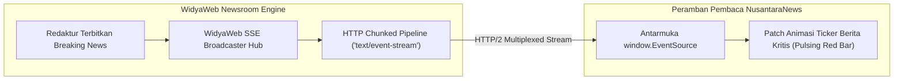

# BAB 22: SERVER-SENT EVENTS (SSE) & HTTP STREAMING BREAKING NEWS TICKER

Bab ini membahas implementasi teknologi transmisi satu arah dari server ke klien (*unidirectional server-to-client push*) menggunakan Server-Sent Events (SSE) standar W3C dan HTTP Streaming untuk mengalirkan tajuk berita terkini (*Breaking News Ticker*), pembaruan data harga pasar modal, dan laporan pandangan mata redaksi secara hemat daya baterai.

---

## 22.1 Konsep Server-Sent Events & Format Data `text/event-stream`

Ketika kebutuhan sistem hanya bersifat satu arah—di mana klien hanya perlu mendengarkan siaran langsung pembaruan dari redaksi tanpa perlu mengirimkan pesan balik terus menerus—Server-Sent Events (SSE) adalah pilihan arsitektur yang jauh lebih sederhana, ringan, dan ramah infrastruktur daripada WebSockets. SSE berjalan di atas HTTP standar (`Content-Type: text/event-stream`), secara alami melewati firewall/proxy perusahaan, dan memiliki mekanisme penyambungan ulang otomatis (*auto-reconnect*) bawaan peramban melalui antarmuka `EventSource`.



Format data SSE sangat terstruktur dan berbasis baris teks:
```http
event: breaking_news
id: evt-89421
retry: 5000
data: {"judul": "Gempa Magnitudo 5.8 Guncang Wilayah Selatan Jawa", "kategori": "Bencana", "waktu": "14:02 WIB"}

```

---

## 22.2 Implementasi Endpoint SSE Breaking News

Berikut adalah implementasi endpoint peladen streaming berita mendesak dan komponen pendengar di sisi klien:

```widya
// Modul SSE NusantaraNews
gunakan widya::web::streaming::{SaluranSSE, ResponStreaming, AcaraSSE};
gunakan widya::web::http::{Permintaan, Respon, StatusHTTP};
gunakan widya::sinkronisasi::{Kanal};

fungsi TanganiAliranBreakingNews(req: Permintaan) -> Respon {
    // 1. Validasi Dukungan Klien
    tetapan id_acara_terakhir = req.tajuk("Last-Event-ID").nilai_atau("0");

    // 2. Buat Saluran Aliran Asinkron
    tetapan (pengirim, penerima) = Kanal::tak_terbatas::<AcaraSSE>();
    
    // Daftarkan saluran ke Registry Pusat Berita Mendesak
    tetapan id_langganan = PusatBreakingNews::daftar_pendengar(pengirim, id_acara_terakhir.ke_bulat());

    // 3. Konfigurasi Respons Streaming HTTP
    kembalikan ResponStreaming::baru(penerima)
        .atur_tajuk("Content-Type", "text/event-stream")
        .atur_tajuk("Cache-Control", "no-cache, no-transform")
        .atur_tajuk("Connection", "keep-alive")
        .atur_tajuk("X-Accel-Buffering", "no") // Mencegah Nginx/Proxy menahan buffer
        .pada_koneksi_putus(fungsi() {
            PusatBreakingNews::hapus_pendengar(id_langganan);
            cetak_log("[SSE] Koneksi pendengar " + id_langganan.ke_teks() + " ditutup.");
        })
        .bangun();
}

// Komponen Pengiriman Acara dari Redaksi
fungsi SiarkanBeritaMendesak(judul: Teks, kategori: Teks, url: Teks) {
    tetapan acara = AcaraSSE::baru()
        .tipe_acara("breaking_news")
        .id(ambil_stempel_waktu_unik())
        .jeda_sambung_ulang_ms(3000)
        .muatan_json({
            "judul": judul,
            "kategori": kategori,
            "url": url,
            "stempel": ambil_waktu_iso8601()
        });

    PusatBreakingNews::siarkan_semua(acara);
}
```

Implementasi di sisi peramban klien menggunakan JavaScript/Widya-Lang Klien:

```javascript
// news-ticker-client.js
const sumberBerita = new EventSource("/api/v1/news/stream/breaking");

sumberBerita.addEventListener("breaking_news", (event) => {
  const berita = JSON.parse(event.data);
  const tickerBar = document.getElementById("breaking-news-bar");
  
  // Tampilkan notifikasi pita merah di bagian atas halaman
  tickerBar.innerHTML = `<span class="badge-urgent">BREAKING:</span> <a href="${berita.url}">${berita.judul}</a>`;
  tickerBar.classList.add("visible", "flash-animation");
});

sumberBerita.onerror = (err) => {
  console.warn("Koneksi SSE terputus, browser akan mencoba sambung ulang otomatis...");
};
```

---

## 22.3 Analisis Efisiensi: SSE vs WebSockets untuk Siaran Satu Arah

Pemilihan SSE untuk portal berita memberikan keuntungan operasional yang masif dibandingkan WebSockets.

| Kriteria Arsitektur | WebSockets (RFC 6455) | Server-Sent Events (SSE) | Keunggulan SSE untuk Berita |
| :--- | :--- | :--- | :--- |
| **Arah Komunikasi** | Dua Arah (*Bi-directional*) | Satu Arah (*Server-to-Client*) | Sempurna untuk Model Berita/Ticker |
| **Dukungan Protokol HTTP/2 & 3** | Kompleks (Perlu RFC 8441) | Bawaan (*Native Multiplexing*) | Hemat Koneksi TCP (1 Koneksi Semua Rute) |
| **Dukungan Proxy & Firewall** | Sering Diblokir Corporate Proxy | 100% Lolos (HTTP Standar) | Keterjangkauan Pengguna Universal |
| **Penanganan Sambung Ulang** | Harus Diprogram Manual di Klien | Bawaan Peramban (*Auto Retry*) | Bebas Kerumitan Kode Klien |
| **Konsumsi Baterai Mobile** | Lebih Boros karena Heartbeat Manual | Sangat Efisien (Diatur Radio Seluler) | Ramah Pembaca Ponsel |

---

## 22.4 Latihan Praktik & Studi Kasus

1. **Implementasi Pemulihan Riwayat dengan Tajuk `Last-Event-ID`**: Kembangkan logika pada peladen untuk mengirimkan daftar 3 berita breaking news terakhir yang terlewat jika klien menyambung kembali dengan membawa `Last-Event-ID`.
2. **Kanal Aliran Nilai Tukar Mata Uang & Indeks Saham (IHSG)**: Buat endpoint SSE terpisah `/api/v1/stream/finance` yang memancarkan pembaruan kurs mata uang setiap kali ada fluktuasi pasar finansial.
3. **Pemberitahuan Khusus Redaksi Masuk (Editorial Push Notification)**: Buat saluran SSE khusus di halaman admin jurnalis yang memberi peringatan suara instan saat artikel investigasi mereka disetujui untuk terbit oleh Pemimpin Redaksi.

---

## 22.5 Evaluasi Mandiri Pilihan Ganda

1. Nilai tajuk `Content-Type` resmi apa yang menandai aliran Server-Sent Events (SSE)?
   - A. `application/json`
   - B. `text/event-stream`
   - C. `multipart/form-data`
   - D. `text/html`

2. Mengapa SSE sering kali lebih disukai daripada WebSockets untuk fitur siaran berita mendesak (*breaking news*)?
   - A. Karena berita hanya membutuhkan komunikasi satu arah dari redaksi ke pembaca, mendukung multiplexing HTTP/2 bawaan, dan memiliki fitur sambung ulang otomatis
   - B. Karena SSE mengharuskan browser diinstal ulang
   - C. Karena SSE tidak dapat mentransmisikan teks
   - D. Karena SSE mematikan koneksi internet pengguna

3. Objek JavaScript standar peramban apa yang digunakan untuk mendengarkan aliran data SSE?
   - A. `XMLHttpRequest`
   - B. `EventSource`
   - C. `WebSocket`
   - D. `AudioContext`

4. Apa fungsi dari tajuk `Last-Event-ID` yang dikirimkan oleh peramban saat menyambung kembali setelah koneksi terputus?
   - A. Memberi tahu server ID pesan terakhir yang berhasil diterima sehingga server dapat mengirimkan pesan-pesan yang terlewat
   - B. Menghapus riwayat cache peramban
   - C. Menyetel kata sandi baru untuk pengguna
   - D. Mengubah alamat email pelanggan

5. Baris teks dalam muatan SSE yang menentukan durasi tunggu peramban (dalam milidetik) sebelum mencoba menyambung ulang otomatis jika koneksi terputus adalah:
   - A. `data:`
   - B. `retry:`
   - C. `id:`
   - D. `event:`

6. Mengapa tajuk `X-Accel-Buffering: no` sering disertakan dalam respons SSE saat berjalan di belakang reverse proxy Nginx?
   - A. Mencegah proxy menahan buffer data dan memaksa setiap potongan peristiwa teks dikirimkan langsung ke klien secara seketika
   - B. Mematikan fitur caching gambar
   - C. Mengubah warna tema Nginx
   - D. Mengizinkan unduhan file sebesar 10 Gigabyte

7. Nilai `Cache-Control` apa yang wajib disematkan pada endpoint SSE agar respons tidak disimpan secara statis oleh perantara jaringan?
   - A. `public, max-age=3600`
   - B. `no-cache, no-transform`
   - C. `immutable`
   - D. `only-if-cached`

8. Karakter pemisah apa yang menandakan akhir dari satu blok peristiwa (*event block*) lengkap dalam spesifikasi teks SSE?
   - A. Tanda titik koma ganda (`;;`)
   - B. Dua karakter baris baru berurutan (`\n\n`)
   - C. Tanda kurung kurawal tutup (`}`)
   - D. Karakter EOF biner

9. Berapa jeda waktu sambung ulang bawaan yang ditetapkan pada modul `AcaraSSE` di atas?
   - A. 3000 milidetik (3 detik)
   - B. 1 jam
   - C. Nol milidetik
   - D. 24 jam

10. Apakah koneksi SSE dapat berjalan di atas protokol HTTPS yang aman?
    - A. Ya, SSE beroperasi penuh di atas HTTP/1.1 TLS, HTTP/2 TLS, dan HTTP/3 QUIC secara transparan
    - B. Tidak, SSE hanya boleh menggunakan koneksi HTTP terbuka tanpa enkripsi
    - C. Hanya jika sistem operasi klien adalah Windows XP
    - D. Memerlukan kabel jaringan khusus
