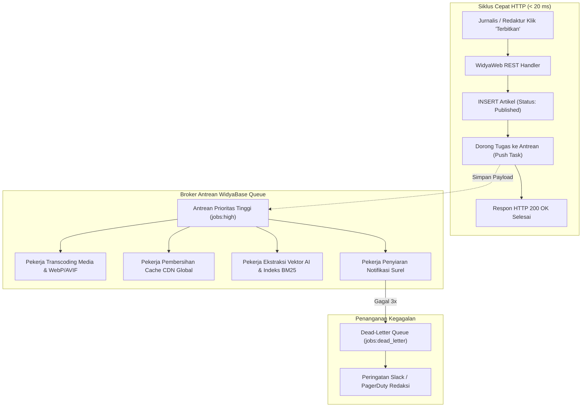

# BAB 23: ANTREAN TUGAS LATAR BELAKANG ASINKRON (ASYNC JOB QUEUE)

Bab ini membedah arsitektur pemrosesan tugas latar belakang asinkron (*asynchronous background job processing*) pada portal berita NusantaraNews: transisi pekerjaan lambat keluar dari siklus permintaan-respons HTTP, implementasi sistem antrean berorientasi pesan (*message-driven task queue*), penanganan kegagalan (*Dead-Letter Queue / DLQ*), dan orkestrasi pemrosesan transisi gambar resolusi tinggi serta pengiriman jutaan buletin surel.

---

## 23.1 Teori Pemrosesan Latar Belakang & Pola Producer-Consumer

Ketika jurnalis menekan tombol "Terbitkan Artikel", sistem tidak boleh membiarkan peramban menunggu puluhan detik hingga proses pengubahan ukuran 10 gambar resolusi tinggi, inferensi semantik kecerdasan buatan, pembersihan cache CDN global, dan pengiriman 200.000 notifikasi buletin email selesai. Sistem harus langsung merespons dalam hitungan milidetik, sementara komputasi berat didelegasikan ke pekerja latar belakang (*Worker Pool*).



---

## 23.2 Implementasi Job Producer & Worker Pool di WidyaWeb

Berikut adalah implementasi modul antrean tugas asinkron yang memanfaatkan persistensi transaksi ACID basis data WidyaBase:

```widya
// Modul Antrean Tugas NusantaraNews
gunakan widya::web::antrean::{AntreanTugas, Tugas, Prioritas, HasilTugas};
gunakan widya::base::koneksi::{buka_koneksi};

rekod PayloadArtikelTerbit {
    artikel_id: Teks,
    judul: Teks,
    jalur_gambar_asli: Teks,
    daftar_email_distribusi: Senarai<Teks>
}

// 1. Fungsi Produsen (Dijalankan di HTTP Handler)
fungsi JadwalkanTugasPublikasi(artikel_id: Teks, judul: Teks, jalur_gambar: Teks) {
    tetapan antrean = AntreanTugas::ambil("nusantara_jobs");

    // Enqueue Tugas Kompresi Gambar
    antrean.dorong(Tugas::baru("proses_media_artikel", {
        "artikel_id": artikel_id,
        "jalur_gambar": jalur_gambar
    })
    .prioritas(Prioritas::Tinggi)
    .maksimal_percobaan(3)
    .timeout_detik(60));

    // Enqueue Tugas Buletin Surel Masal
    antrean.dorong(Tugas::baru("siarkan_buletin_pembaca", {
        "artikel_id": artikel_id,
        "judul": judul
    })
    .prioritas(Prioritas::Sedang)
    .tunda_detik(5) // Berikan jeda 5 detik agar CDN siap
    .maksimal_percobaan(5));
}

// 2. Fungsi Konsumen / Worker Daemon
fungsi JalankanWorkerMedia() {
    tetapan antrean = AntreanTugas::ambil("nusantara_jobs");
    cetak_log("[Worker Media] Memulai pemantauan antrean tugas...");

    ulang {
        // Ambil tugas dengan pemblokiran aman (BRPOP atomik)
        tetapan tugas = antrean.ambil_tugas_berikutnya(["proses_media_artikel"], 5); // Timeout 5s
        
        jika tugas.ada() {
            tetapan t = tugas.ambil();
            cetak_log("[Worker Media] Memproses tugas: " + t.id());

            tetapan hasil = ProsesVarianGambar(t.payload().ambil("jalur_gambar"));
            
            pilih hasil {
                Hasil::Sukses(_) => {
                    t.tandai_selesai();
                    cetak_log("[Worker Media] Sukses menyelesaikan tugas " + t.id());
                },
                Hasil::Gagal(err) => {
                    cetak_peringatan("[Worker Media] Gagal: " + err.pesan());
                    t.catat_kegagalan_dan_coba_ulang(); // Masuk DLQ otomatis jika kuota habis
                }
            }
        }
    }
}
```

---

## 23.3 Analisis Ketahanan & Manajemen Dead-Letter Queue (DLQ)

Arsitektur antrean tugas yang andal harus tahan terhadap kegagalan perangkat keras, pemadaman listrik, dan kehabisan memori.

| Komponen Arsitektur | Risiko Masalah | Solusi Implementasi WidyaWeb |
| :--- | :--- | :--- |
| **Worker Mati Mendadak (SIGKILL)** | Tugas hilang di tengah pemrosesan | Pola *Two-Phase Acknowledgment* (Tugas dikembalikan ke antrean jika visibilitas habis) |
| **Pihak Ketiga (SMTP / CDN) Down** | Siklus kegagalan terus menerus | *Exponential Backoff* penundaan percobaan ulang (1m, 5m, 15m) |
| **Muatan Korup (*Poison Pill*)** | Memacetkan worker secara abadi | Pindahkan ke *Dead-Letter Queue* setelah 3 kali gagal untuk dianalisis tim SRE |
| **Lonjakan Berita Viral Masif** | Antrean membengkak hingga jutaan tugas | Skalabilitas horizontal pekerja (*Worker Horizontal Autoscaling*) |

---

## 23.4 Latihan Praktik & Studi Kasus

1. **Implementasi Pengiriman Surel Masal Berbasis Batch (Batch Chunker)**: Rancang tugas latar belakang yang memecah 50.000 alamat email penerima buletin menjadi kumpulan paket 100 surel untuk menghindari pembatasan batas laju peladen SMTP.
2. **Pembersihan Berkas Media Sampah Terjadwal (Cron Job)**: Buat tugas terjadwal yang berjalan setiap pukul 02:00 dini hari untuk menghapus berkas gambar sementara (*temp upload*) yang tidak pernah diterbitkan dalam tempo 24 jam.
3. **Penyusunan Dasbor Metrik Pemantauan Antrean**: Buat endpoint metrik `/api/admin/queues` yang melaporkan jumlah tugas yang sedang berjalan, tugas tertunda, dan tugas di dalam DLQ untuk diekspor ke Prometheus.

---

## 23.5 Evaluasi Mandiri Pilihan Ganda

1. Mengapa tugas berat seperti pengolahan video atau pengiriman ribuan email tidak boleh dijalankan langsung di dalam siklus permintaan HTTP?
   - A. Menghindari peramban pengguna mengalami timeout, membebaskan thread peladen web, dan meningkatkan responsivitas pengguna secara instan
   - B. Karena email dilarang dikirim melalui protokol HTTP
   - C. Karena ukuran teks artikel akan mengecil secara otomatis
   - D. Menghindari pemotongan honorarium jurnalis

2. Apa yang dimaksud dengan *Dead-Letter Queue* (DLQ) dalam sistem antrean pesan?
   - A. Antrean khusus penampungan tugas-tugas yang telah gagal dieksekusi berkali-kali hingga batas maksimal percobaan habis, untuk diisolasi dan dianalisis tanpa memacetkan sistem utama
   - B. Tempat pembuangan sampah fisik di kantor berita
   - C. Folder penyimpanan berkas teks yang sudah kedaluwarsa
   - D. Antrean email yang dikirim ke alamat yang sudah meninggal dunia

3. Pola arsitektur apa yang digunakan pada sistem antrean tugas di mana ada pihak yang memproduksi tugas dan pihak lain yang mengeksekusinya?
   - A. Pola Producer-Consumer
   - B. Pola Client-Server murni
   - C. Pola P2P Tanpa Peladen
   - D. Pola Single Threaded Loop

4. Mengapa mekanisme *Two-Phase Acknowledgment* sangat krusial dalam keandalan sistem antrean?
   - A. Memastikan sebuah tugas hanya dihapus permanen dari antrean setelah pekerja berhasil menyelesaikannya secara sukses dan mengirimkan konfirmasi (*ACK*)
   - B. Memaksa pengembang menekan tombol konfirmasi dua kali di keyboard
   - C. Mempercepat proses kompresi video hingga dua kali lipat
   - D. Menghapus tugas secara otomatis begitu diambil oleh pekerja

5. Nilai parameter `tunda_detik(5)` pada tugas buletin surel di atas bertujuan untuk apa?
   - A. Menunda eksekusi tugas selama 5 detik agar aset gambar dan artikel sudah selesai terunggah dan tersebar di cache CDN sebelum tautan dibuka pembaca
   - B. Memberikan waktu istirahat pada prosesor komputer
   - C. Menunggu server memuat ulang kernel Linux
   - D. Mengubah format huruf menjadi miring

6. Operasi basis data apa yang idealnya digunakan untuk mengambil tugas berikutnya secara atomik dan efisien tanpa menimbulkan kondisi balapan (*race condition*) antar pekerja?
   - A. `SELECT * FROM tugas` tanpa penguncian
   - B. `BRPOP` atomik atau `SELECT ... FOR UPDATE SKIP LOCKED`
   - C. Menghapus seluruh tabel tugas
   - D. Menyalin seluruh isi basis data ke berkas CSV

7. Apa bahaya utama dari fenomena *Poison Pill* dalam antrean pesan?
   - A. Pesan tugas yang rusak atau memiliki muatan cacat yang selalu menyebabkan pekerja crash setiap kali diproses, berpotensi mematikan seluruh kolam pekerja jika tidak dibatasi
   - B. Komputer terbakar karena panas berlebih
   - C. Virus komputer yang menghapus seluruh foto jurnalis
   - D. Kipas komputer mati mendadak

8. Berapa jumlah maksimal percobaan ulang (*max retries*) yang dikonfigurasikan untuk tugas proses media pada implementasi di atas?
   - A. 1 kali
   - B. 3 kali
   - C. 100 kali
   - D. Tak terbatas

9. Bagaimana strategi penskalaan terbaik jika jumlah tugas publikasi melonjak 10 kali lipat saat pemilihan umum nasional?
   - A. Mematikan peladen web
   - B. Menambah jumlah instans proses pekerja (*Worker Nodes*) secara horizontal untuk membagi konsumsi antrean secara paralel
   - C. Menghapus antrean tugas
   - D. Melarang redaktur menerbitkan berita baru

10. Apa keuntungan menetapkan prioritas tugas (seperti `Prioritas::Tinggi` dan `Prioritas::Sedang`)?
    - A. Memastikan tugas mendesak yang berdampak langsung pada pengalaman pengguna (seperti optimasi gambar artikel) diproses lebih dahulu daripada tugas massal berlatensi santai (seperti buletin email)
    - B. Menghemat kuota listrik bulanan
    - C. Mengurangi ukuran berkas PDF
    - D. Membatasi jumlah jurnalis yang aktif
