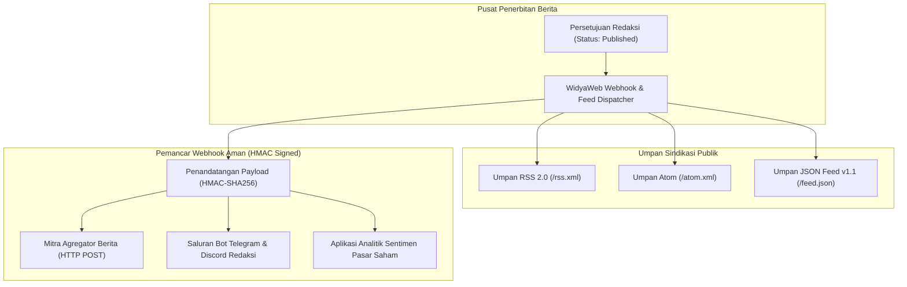

# BAB 24: INTEGRASI WEBHOOK & SINDIKASI BERITA MULTI-PLATFORM

Bab ini menyajikan panduan komprehensif dalam membangun sistem distribusi berita multi-kanal portal NusantaraNews: implementasi mesin pemancar *Outbound Webhook* dengan penandatanganan kriptografis HMAC-SHA256, penanganan *Inbound Webhook* dari kantor berita mitra, serta penyediaan umpan sindikasi otomatis berbasis RSS 2.0, Atom, dan JSON Feed.

---

## 24.1 Arsitektur Distribusi Berita & Keamanan Webhook

Dalam ekosistem media modern, artikel berita yang terbit di NusantaraNews harus secara otomatis didistribusikan ke berbagai agregator konten mitra, saluran media sosial, aplikasi mitra finansial, serta pembaca setia yang menggunakan aplikasi pembaca berita (*Feed Reader*). 



Untuk menjamin integritas dan keaslian muatan data webhook, setiap pengiriman paket HTTP disertai dengan tanda tangan kriptografis pada tajuk `X-Nusantara-Signature` yang dihasilkan menggunakan kunci rahasia bersama (*shared secret*).

---

## 24.2 Implementasi Pemancar Webhook & Generator Feed

Berikut adalah implementasi modul pemancar webhook aman dengan pengiriman ulang otomatis dan generator umpan sindikasi RSS 2.0:

```widya
// Modul Sindikasi & Webhook NusantaraNews
gunakan widya::web::kripto::{hmac_sha256_hex};
gunakan widya::web::klien_http::{KlienHTTP, TajukPermintaan};
gunakan widya::web::sindikasi::{UmpanRSS, ItemRSS};

rekod LanggananWebhook {
    id: Teks,
    url_target: Teks,
    kunci_rahasia: Teks,
    acara_diikuti: Senarai<Teks>
}

// 1. Pemancar Webhook Aman
fungsi PancarkanWebhookArtikel(langganan: LanggananWebhook, tipe_acara: Teks, data_artikel: PetaData) -> Hasil<(), Galat> {
    tetapan klien = KlienHTTP::baru();
    tetapan stempel_waktu = ambil_waktu_unix_detik().ke_teks();
    
    // Bangun Payload JSON
    tetapan muatan = {
        "event": tipe_acara,
        "timestamp": stempel_waktu,
        "data": data_artikel
    }.ke_json_teks();

    // Hitung Tanda Tangan Kriptografis HMAC-SHA256 (Pencegah Replay Attack & Tampering)
    tetapan data_tanda_tangan = stempel_waktu + "." + muatan;
    tetapan tanda_tangan = hmac_sha256_hex(langganan.kunci_rahasia, data_tanda_tangan);

    // Kirim Permintaan POST ke Server Mitra
    tetapan respon = klien.pos(langganan.url_target)
        .atur_tajuk("Content-Type", "application/json")
        .atur_tajuk("User-Agent", "NusantaraNews-Webhook-Dispatcher/2.0")
        .atur_tajuk("X-Nusantara-Signature", "t=" + stempel_waktu + ",v1=" + tanda_tangan)
        .atur_timeout_ms(5000)
        .badan_teks(muatan)
        .kirim()?;

    jika respon.kode_status() >= 200 && respon.kode_status() < 300 {
        cetak_log("[Webhook] Sukses terkirim ke " + langganan.url_target);
        kembalikan Hasil::Sukses(());
    } jika_tidak {
        cetak_peringatan("[Webhook] Mitra merespon status galat: " + respon.kode_status().ke_teks());
        kembalikan Hasil::Gagal(Galat::baru("Mitra menolak webhook"));
    }
}

// 2. Generator Umpan Sindikasi RSS 2.0
fungsi HasilkanUmpanRSS(daftar_artikel: Senarai<Artikel>) -> Teks {
    tetapan mutabel rss = UmpanRSS::baru(
        "NusantaraNews Terkini",
        "https://nusantaranews.id",
        "Pemberitaan Terpercaya, Aktual, dan Mendalam dari Seluruh Penjuru Nusantara"
    )
    .bahasa("id-ID")
    .hak_cipta("Hak Cipta © 2026 PT Nusantara Media Multimedia");

    untuk a di daftar_artikel {
        rss.tambah_item(ItemRSS::baru(a.judul)
            .tautan("https://nusantaranews.id/berita/" + a.slug)
            .deskripsi(a.ringkasan)
            .penulis(a.nama_penulis)
            .kategori(a.kategori)
            .guid("nusantara-berita-" + a.id)
            .tanggal_publikasi(a.diterbitkan_pada.ke_rfc822()));
    }

    kembalikan rss.ke_xml();
}
```

---

## 24.3 Analisis Spesifikasi Umpan Sindikasi Modern

Pemilihan format sindikasi konten harus mendukung ekosistem aplikasi pembaca berita global dan pengindeks konten.

| Parameter Format | RSS 2.0 (XML) | Atom 1.0 (XML) | JSON Feed v1.1 |
| :--- | :--- | :--- | :--- |
| **Format Serialisasi** | Dokumen XML Tradisional | Dokumen XML Terstandarisasi IETF | Dokumen JSON Modern |
| **Kekuatan Spesifikasi** | Longgar & Fleksibel | Ketat & Sangat Presisi (RFC 4287) | Sangat Bersih & Ringkas |
| **Dukungan Pembaca Berita** | 100% Universal | 98% Agregator Modern | Pembaca Berita Modern & Pengembang Web |
| **Kemudahan Parsing di Web** | Memerlukan XML DOM Parser | Memerlukan XML DOM Parser | `JSON.parse()` Bawaan Sangat Cepat |

---

## 24.4 Latihan Praktik & Studi Kasus

1. **Implementasi Verifikasi Tanda Tangan Webhook Masuk (Inbound Webhook Verification)**: Bangun middleware penerima webhook yang memvalidasi keabsahan tajuk `X-Mitra-Signature` dari kantor berita luar sebelum memasukkan naskah berita mitra ke dalam ruang redaksi.
2. **Mitigasi Serangan Pengulangan (Replay Attack Prevention)**: Tambahkan validasi batas toleransi stempel waktu maksimal 5 menit (`|waktu_sekarang - stempel_waktu| <= 300 detik`) agar paket webhook lama yang dicegat peretas tidak dapat dikirimkan ulang.
3. **Penyusunan Endpoint JSON Feed v1.1**: Rancang endpoint `/api/feed.json` yang menyajikan 30 berita terhangat sesuai spesifikasi resmi `https://jsonfeed.org/version/1.1`.

---

## 24.5 Evaluasi Mandiri Pilihan Ganda

1. Algoritma kriptografis standar apa yang digunakan untuk menghasilkan tanda tangan otentikasi pada tajuk `X-Nusantara-Signature`?
   - A. MD5 sederhana
   - B. HMAC-SHA256
   - C. ROT13
   - D. Base64 encoding polos tanpa kunci

2. Bagaimana cara mitra penerima memverifikasi keaslian muatan webhook yang mereka terima?
   - A. Menghitung kembali nilai HMAC-SHA256 dari muatan JSON menggunakan kunci rahasia bersama (*shared secret*) dan mencocokkannya dengan tanda tangan pada tajuk HTTP
   - B. Menelepon nomor telepon kantor redaksi
   - C. Mengirimkan surat pos fisik ke kantor redaksi
   - D. Mengubah format berkas menjadi file zip

3. Format tanggal dan waktu standar apa yang diwajibkan dalam spesifikasi umpan sindikasi RSS 2.0?
   - A. RFC 822 (misal: `Tue, 10 Jun 2026 04:00:00 GMT`)
   - B. Waktu lokal Indonesia Barat (WIB) tanpa zona waktu
   - C. Tanggal Jawa kuno
   - D. Jumlah hari sejak tahun 2000

4. Mengapa penyertaan stempel waktu (`timestamp`) di dalam perhitungan tanda tangan webhook sangat krusial?
   - A. Mencegah serangan pengulangan (*Replay Attack*) di mana penyerang mencegat permintaan lama dan mengirimkannya kembali untuk memicu aksi berulang
   - B. Menghemat memori RAM komputer mitra
   - C. Mempercepat koneksi internet pelanggan
   - D. Membatasi ukuran font peramban

5. Apa perbedaan mendasar antara model polling sindikasi (RSS/Atom) dan model transmisi Webhook?
   - A. RSS/Atom ditarik oleh klien secara berkala (*Pull model*), sedangkan Webhook didorong langsung oleh server penerbit ke mitra saat peristiwa terjadi (*Push model*)
   - B. RSS hanya bisa dibaca di malam hari
   - C. Webhook tidak memerlukan jaringan internet
   - D. RSS dilarang membawa teks berita

6. Format sindikasi umpan berita modern apa yang berbasis notasi JSON murni sebagai alternatif dokumen XML?
   - A. JSON Feed (versi 1.1)
   - B. YAML Document
   - C. CSV Table
   - D. SQLite Dump

7. Apa tujuan penetapan batas waktu (*timeout*) sebesar 5000ms pada pengiriman webhook ke mitra?
   - A. Mencegah thread pengirim tersandera menunggu terlalu lama jika peladen mitra mengalami hang atau gangguan jaringan
   - B. Mengurangi kapasitas baterai laptop
   - C. Memaksa mitra membeli server baru
   - D. Menghapus rekod berita dari database

8. Unsur unik apa di dalam item RSS yang menjamin pembaca berita tidak memunculkan artikel yang sama secara ganda?
   - A. Elemen `<guid>` (Globally Unique Identifier)
   - B. Tag `<font>`
   - C. Tag `<b>`
   - D. Gambar header

9. Tipe status kode HTTP apa yang menandakan bahwa mitra berhasil menerima dan memproses paket webhook?
   - A. Status sukses seri 2xx (misal: 200 OK atau 204 No Content)
   - B. Status 404 Not Found
   - C. Status 500 Internal Server Error
   - D. Status 403 Forbidden

10. Mengapa pengiriman webhook ke banyak mitra sebaiknya dijalankan melalui antrean tugas latar belakang (*Background Job Queue*)?
    - A. Memastikan proses penerbitan berita utama tidak terhambat oleh keterlambatan atau kegagalan koneksi di peladen mitra eksternal
    - B. Menghilangkan kebutuhan sertifikat SSL
    - C. Mengurangi biaya langganan internet kantor
    - D. Membatasi jumlah artikel maksimal 5 buah per hari
