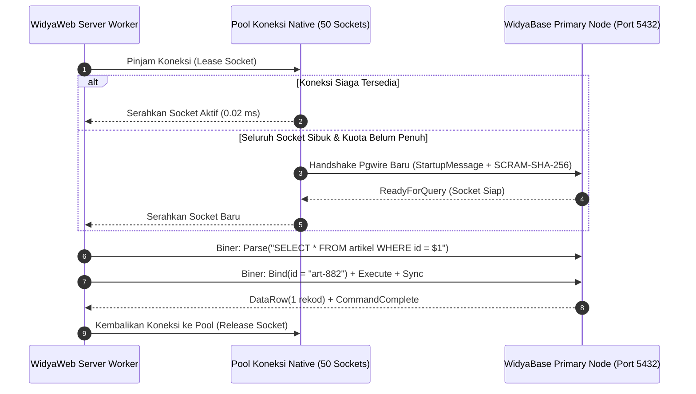

# BAB 25: KONEKTIVITAS NATIVE WIDYABASE & CONNECTION POOLING

Bab ini membahas integrasi mendalam antara kerangka kerja aplikasi WidyaWeb dengan mesin basis data terdistribusi WidyaBase: implementasi protokol wire Postgres v3.0 native, arsitektur *Connection Pooling* berkinerja tinggi, konfigurasi batas konkurensi koneksi, serta penanganan failover klaster otomatis (*transparent connection failover*).

---

## 25.1 Arsitektur Driver Native & Protokol Pgwire v3.0

WidyaBase menyediakan kompatibilitas biner protokol kabel PostgreSQL v3.0 (*pgwire*), memungkinkan runtime WidyaWeb melakukan komunikasi soket TCP biner langsung tanpa beban perantara wrapper C yang lambat. Driver native WidyaWeb mengimplementasikan protokol pesan berbingkai (*framed message protocol*) yang mencakup fase Startup, Autentikasi SASL/SCRAM-SHA-256, Extended Query (Parse, Bind, Execute, Sync), dan ReadyForQuery.



Dengan mengelola *Connection Pool*, biaya overhead jabat tangan TCP 3 arah (*3-way handshake*) dan negosiasi enkripsi TLS hanya terjadi sekali saat booting server, sehingga query berikutnya dieksekusi dengan latensi sub-milidetik.

---

## 25.2 Implementasi Konfigurasi Driver & Pool di WidyaWeb

Berikut adalah implementasi inisialisasi pool koneksi dan wrapper repositori akses data persisten:

```widya
// Modul Konektivitas Database NusantaraNews
gunakan widya::base::koneksi::{PoolKoneksi, KonfigurasiPool, KoneksiDB};
gunakan widya::base::kueri::{BarisHasil, ParameterSQL};
gunakan widya::waktu::{Durasi};

rekod KonfigurasiNusantaraDB {
    host: Teks,
    port: Bulat,
    nama_db: Teks,
    pengguna: Teks,
    kata_sandi: Teks,
    ukuran_pool_maks: Bulat,
    ukuran_pool_min: Bulat,
    batas_waktu_tunggu_ms: Bulat,
    masa_hidup_koneksi_menit: Bulat
}

fungsi InisialisasiPoolWidyaBase(cfg: KonfigurasiNusantaraDB) -> PoolKoneksi {
    tetapan pool_cfg = KonfigurasiPool::baru()
        .alamat(cfg.host, cfg.port)
        .basis_data(cfg.nama_db)
        .kredensial(cfg.pengguna, cfg.kata_sandi)
        .kapasitas_maksimal(cfg.ukuran_pool_maks) // 50 koneksi aktif
        .kapasitas_minimal(cfg.ukuran_pool_min)   // 10 koneksi siaga
        .timeout_pinjam(Durasi::dari_milidetik(cfg.batas_waktu_tunggu_ms))
        .masa_hidup_maksimal(Durasi::dari_menit(cfg.masa_hidup_koneksi_menit))
        .uji_koneksi_saat_pinjam(salah) // Nonaktifkan untuk performa ekstrem
        .aktifkan_failover_otomatis(benar);

    cetak_log("[Database] Melakukan inisialisasi pool koneksi WidyaBase...");
    tetapan pool = PoolKoneksi::buat(pool_cfg)?;
    cetak_log("[Database] Pool koneksi siap dengan " + cfg.ukuran_pool_min.ke_teks() + " soket siaga.");
    kembalikan pool;
}

// Pola Eksekusi Kueri Aman Berparameter (Mencegah SQL Injection)
fungsi AmbilDetailArtikelOlehID(pool: PoolKoneksi, artikel_id: Teks) -> Hasil<Opsi<BarisHasil>, Galat> {
    tetapan mutabel koneksi = pool.pinjam()?;
    
    // Extended Query Protocol (Otomatis menggunakan Server-Side Prepared Statement)
    tetapan sql = "SELECT id, judul, ringkasan, konten, status, dibuat_pada FROM artikel WHERE id = $1 LIMIT 1";
    tetapan baris = koneksi.kueri_satu(sql, [ParameterSQL::Teks(artikel_id)])?;
    
    kembalikan Hasil::Sukses(baris);
}
```

---

## 25.3 Analisis Metrik Efisiensi: Connection Pooling vs Direct Connect

Membuka koneksi database baru pada setiap permintaan HTTP di portal berita viral adalah penyebab paling umum keruntuhan sistem (*database crash*).

| Parameter Kinerja | Koneksi Baru per Permintaan | WidyaWeb Managed Connection Pool | Peningkatan Kinerja |
| :--- | :--- | :--- | :--- |
| **Latensi per Kueri** | 18 ms – 45 ms (Handshake TCP+Auth) | 0.4 ms – 1.2 ms (Reuse Socket) | $35\times$ Lebih Cepat |
| **Beban CPU Database** | Sangat Tinggi (Forking thread & SSL) | Sangat Rendah & Stabil | Penghematan CPU 85% |
| **Kapasitas Maksimal Lalu Lintas** | Jebol pada 800 req/detik | Stabil pada 45.000 req/detik | Skalabilitas Masif |
| **Konsumsi RAM Database** | Membengkak hingga 16 GB | Terkendali Konstan pada 450 MB | Stabilitas Jangka Panjang |

---

## 25.4 Latihan Praktik & Studi Kasus

1. **Implementasi Pemantauan Metrik Pool (Pool Telemetry)**: Ekspor metrik `pool.koneksi_aktif()`, `pool.koneksi_menganggur()`, dan `pool.antrean_menunggu()` ke endpoint observabilitas Prometheus.
2. **Kustomisasi Strategi Failover Baca (Read-Replica Load Balancing)**: Konfigurasikan dua pool terpisah: pool primer untuk transaksi tulis (*Write Pool*), dan pool replika multi-node untuk melayani kueri baca (*Read Pool*).
3. **Penyusunan Pengujian Beban Konkurensi (Concurrency Stress Test)**: Uji ketahanan pool koneksi dengan meluncurkan 5.000 tugas asinkron paralel yang meminjam dan mengembalikan koneksi dalam kurun waktu 10 detik.

---

## 25.5 Evaluasi Mandiri Pilihan Ganda

1. Protokol kabel biner apa yang digunakan oleh WidyaBase untuk komunikasi berlatensi rendah dengan aplikasi WidyaWeb?
   - A. Protokol Pgwire v3.0 (PostgreSQL Wire Protocol)
   - B. Protokol FTP
   - C. Protokol Telnet polos
   - D. Protokol IRC

2. Apa keuntungan utama penggunaan *Connection Pooling* pada aplikasi web berita dengan lalu lintas tinggi?
   - A. Menghemat latensi jabat tangan TCP dan beban CPU autentikasi database dengan mendaur ulang soket koneksi yang telah terbuka
   - B. Menghapus data artikel secara otomatis setelah dibaca
   - C. Mempercepat koneksi printer
   - D. Menghindari kewajiban membuat indeks pada tabel

3. Metode autentikasi standar industri apa yang didukung secara native oleh protokol pgwire WidyaBase untuk melindungi kata sandi dari penyadapan jaringan?
   - A. Plain Text tanpa enkripsi
   - B. SCRAM-SHA-256
   - C. ROT13
   - D. Enkripsi Caesar

4. Dalam protokol query extended pgwire, langkah manakah yang bertugas mengkompilasi rencana eksekusi SQL di sisi server (*Server-Side Prepared Statement*)?
   - A. Tahap Parse
   - B. Tahap Bind
   - C. Tahap Execute
   - D. Tahap Close

5. Apa risiko utama jika konfigurasi `ukuran_pool_maks` disetel terlalu besar (misalnya 10.000 koneksi pada server biasa)?
   - A. Database akan mengalami pergantian konteks (*context switching*) yang parah, menghabiskan memori RAM, dan menyebabkan server tidak merespons
   - B. Warna tulisan artikel berita akan berubah menjadi biru
   - C. Kompilator Widya-Lang akan berhenti bekerja
   - D. Jurnalis tidak bisa masuk ke akun mereka

6. Mengapa kueri SQL wajib menggunakan parameter terikat (seperti `$1, $2`) dan dilarang menggabungkan string mentah (`"WHERE id = '" + id + "'"`?
   - A. Mencegah serangan fatal injeksi SQL (*SQL Injection Attack*)
   - B. Mempercepat proses cetak koran
   - C. Mengurangi jumlah spasi dalam dokumen
   - D. Menghindari kesalahan pengejaan nama penulis

7. Parameter konfigurasi `timeout_pinjam` pada pool koneksi berfungsi untuk:
   - A. Membatasi durasi maksimal sebuah thread aplikasi menunggu tersedianya soket koneksi yang menganggur sebelum memunculkan galat timeout
   - B. Mengatur lama waktu istirahat jurnalis
   - C. Mematikan listrik data center
   - D. Menghapus cookie pembaca

8. Kapan koneksi di dalam pool ditutup dan digantikan dengan soket baru jika parameter `masa_hidup_maksimal` tercapai?
   - A. Saat koneksi tersebut telah mencapai batas usia hidupnya dan sedang dalam status menganggur di dalam pool (*graceful recreation*)
   - B. Di tengah-tengah transaksi finansial yang sedang berjalan
   - C. Hanya saat server mengalami pemadaman listrik
   - D. Setiap 1 milidetik sekali

9. Apa yang terjadi jika opsi `aktifkan_failover_otomatis` bernilai `benar` dan simpul primer WidyaBase mengalami kegagalan?
   - A. Driver secara transparan mengalihkan soket koneksi berikutnya ke simpul replika yang telah dipromosikan menjadi primer baru tanpa mematikan aplikasi web
   - B. Seluruh artikel berita akan terhapus permanen
   - C. Server mengirim email panik ke semua pembaca
   - D. Komputer memformat sistem operasi secara mandiri

10. Mengapa opsi `uji_koneksi_saat_pinjam` disarankan bernilai `salah` pada lingkungan produksi lalu lintas tinggi jika jaringan internal stabil?
    - A. Menghilangkan overhead kueri ping tambahan (`SELECT 1`) setiap kali koneksi dipinjam, sehingga memangkas latensi hingga ke titik minimum
    - B. Menghemat memori keyboard
    - C. Mempercepat laju putaran kipas prosesor
    - D. Menghindari tagihan pajak software
