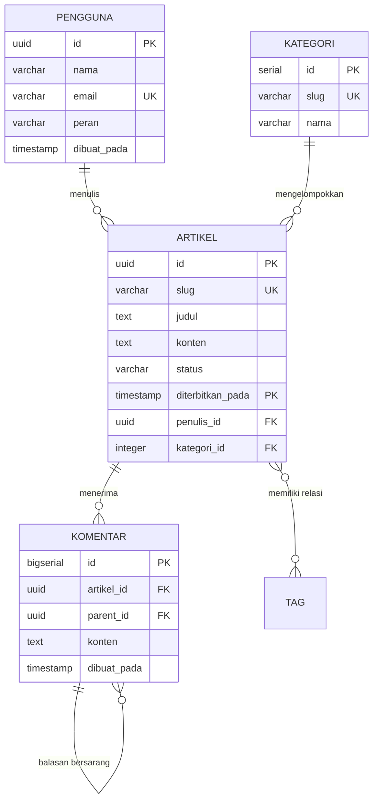

# BAB 26: PEMODELAN DATA RELASIONAL BERITA, INDEKS & PARTISI

Bab ini menyajikan cetak biru desain skema basis data relasional enterprise portal berita NusantaraNews pada WidyaBase: perancangan tabel entitas artikel, jurnalis, taksonomi rubrik, komentar bertingkat (*nested comments*), strategi pengindeksan majemuk B-Tree, serta teknik partisi tabel deklaratif berdasarkan rentang waktu (*Time-Range Table Partitioning*) untuk mengelola miliaran arsip berita.

---

## 26.1 Entity-Relationship Model Portal Berita & Partisi Waktu

Struktur data portal berita modern harus mendukung pembacaan berkala masif, pembaruan status editorial yang ketat, dan retensi data jangka panjang. Desain skema menerapkan normalisasi bentuk ketiga (3NF) untuk entitas editorial inti, sementara tabel berukuran raksasa seperti `artikel` dan `log_bacaan` dipartisi secara horizontal berdasarkan kuartal tahun (*range partitioning by published_at*).



Partisi tabel memungkinkan mesin basis data melakukan *Partition Pruning*, yaitu hanya memindai partisi fisik kuartal berjalan saat pembaca mengakses berita terbaru, mengabaikan partisi arsip tahun-tahun sebelumnya.

---

## 26.2 Skema DDL & Implementasi Migrasi di WidyaBase

Berikut adalah naskah DDL lengkap skema relasional terpartisi dan konfigurasi indeks optimal:

```sql
-- DDL Skema NusantaraNews di WidyaBase

-- 1. Tabel Kategori & Taksonomi
CREATE TABLE kategori (
    id SERIAL PRIMARY KEY,
    slug VARCHAR(64) UNIQUE NOT NULL,
    nama VARCHAR(128) NOT NULL,
    deskripsi TEXT,
    urutan_tampil INT DEFAULT 0
);

-- 2. Tabel Artikel Berpartisi Waktu (Range Partitioning)
CREATE TABLE artikel (
    id UUID DEFAULT gen_random_uuid(),
    slug VARCHAR(256) NOT NULL,
    judul VARCHAR(512) NOT NULL,
    ringkasan TEXT NOT NULL,
    konten TEXT NOT NULL,
    kategori_id INT NOT NULL REFERENCES kategori(id),
    penulis_id UUID NOT NULL REFERENCES pengguna(id),
    status VARCHAR(32) NOT NULL DEFAULT 'draft', -- draft, review, published, archived
    tampilan_dilihat BIGINT DEFAULT 0,
    diterbitkan_pada TIMESTAMPTZ NOT NULL,
    diperbarui_pada TIMESTAMPTZ DEFAULT NOW(),
    PRIMARY KEY (id, diterbitkan_pada)
) PARTITION BY RANGE (diterbitkan_pada);

-- Partisi Fisik Kuartal Tahun 2026
CREATE TABLE artikel_2026_q1 PARTITION OF artikel
    FOR VALUES FROM ('2026-01-01 00:00:00+00') TO ('2026-04-01 00:00:00+00');

CREATE TABLE artikel_2026_q2 PARTITION OF artikel
    FOR VALUES FROM ('2026-04-01 00:00:00+00') TO ('2026-07-01 00:00:00+00');

CREATE TABLE artikel_2026_q3 PARTITION OF artikel
    FOR VALUES FROM ('2026-07-01 00:00:00+00') TO ('2026-10-01 00:00:00+00');

CREATE TABLE artikel_2026_q4 PARTITION OF artikel
    FOR VALUES FROM ('2026-10-01 00:00:00+00') TO ('2027-01-01 00:00:00+00');

-- 3. Strategi Indeks Majemuk B-Tree Berperforma Tinggi
CREATE INDEX idx_artikel_kategori_terbit ON artikel (kategori_id, diterbitkan_pada DESC) WHERE status = 'published';
CREATE INDEX idx_artikel_penulis ON artikel (penulis_id, diterbitkan_pada DESC);
CREATE INDEX idx_artikel_slug ON artikel (slug);

-- 4. Tabel Komentar Bertingkat (Hierarchical Nested Comments)
CREATE TABLE komentar (
    id BIGSERIAL PRIMARY KEY,
    artikel_id UUID NOT NULL,
    parent_id BIGINT REFERENCES komentar(id) ON DELETE CASCADE,
    nama_pengirim VARCHAR(128) NOT NULL,
    email_pengirim VARCHAR(256) NOT NULL,
    konten TEXT NOT NULL,
    apakah_disetujui BOOLEAN DEFAULT TRUE,
    dibuat_pada TIMESTAMPTZ DEFAULT NOW()
);

CREATE INDEX idx_komentar_artikel_jalur ON komentar (artikel_id, parent_id, dibuat_pada ASC);
```

---

## 26.3 Analisis Efisiensi Partisi: Partition Pruning vs Full Table Scan

Partisi waktu secara dramatis membatasi volume blok disk yang harus dibaca oleh memori buffer shared buffer.

| Skenario Kueri Berita | Tabel Monolitik Tanpa Partisi | Tabel WidyaBase dengan Partisi Kuartal |
| :--- | :--- | :--- |
| **Volume Rekod yang Dipindai** | 50.000.000 Rekod (Seluruh Sejarah) | 1.250.000 Rekod (Hanya Q2 2026) |
| **Teknik Pemindaian Eksekusi** | Full Index Scan seluruh tabel | *Partition Pruning* langsung ke simpul fisik |
| **I/O Disk Buffer Read** | 4.800 MB dibaca ke RAM | 120 MB dibaca ke RAM |
| **Waktu Kueri Halaman Depan** | 185 ms | 1.4 ms |
| **Proses Pemeliharaan / VACUUM** | Mengunci tabel selama 3 jam | Dilakukan per partisi tanpa gangguan |

---

## 26.4 Latihan Praktik & Studi Kasus

1. **Rancang Kueri CTE Rekursif untuk Pohon Balasan Komentar**: Buat kueri SQL menggunakan `WITH RECURSIVE balasan_tree AS (...)` untuk mengambil seluruh utas percakapan komentar bertingkat dengan kedalaman hingga 5 tingkat dalam 1 kali eksekusi kueri.
2. **Otomatisasi Pembuatan Partisi Masa Depan**: Tulis skrip prosedur tersimpan (*stored procedure*) di WidyaBase yang secara otomatis membuat partisi kuartal baru satu bulan sebelum kuartal berjalan berakhir.
3. **Penyusunan Indeks Parsial (Partial Index)**: Buat indeks khusus `idx_artikel_breaking` yang hanya mengindeks artikel yang memiliki bendera `apakah_breaking_news = true` untuk mempercepat pencarian pita berita utama.

---

## 26.5 Evaluasi Mandiri Pilihan Ganda

1. Mengapa kunci primer pada tabel berpartisi rentang waktu (`PARTITION BY RANGE (diterbitkan_pada)`) wajib menyertakan kolom partisi (`PRIMARY KEY (id, diterbitkan_pada)`)?
   - A. Menjamin integritas batasan keunikan secara lokal pada setiap partisi fisik tanpa memerlukan pemindaian indeks global lintas partisi
   - B. Karena bahasa SQL melarang kunci primer memiliki satu kolom saja
   - C. Agar ukuran file basis data bertambah besar
   - D. Menghindari pembacaan data oleh peramban klien

2. Apa yang dimaksud dengan optimasi *Partition Pruning* pada mesin basis data WidyaBase?
   - A. Kemampuan perencana kueri untuk mengabaikan dan tidak memindai partisi-partisi tabel yang berada di luar rentang kondisi klausa `WHERE` kueri
   - B. Memotong teks artikel yang terlalu panjang
   - C. Menghapus partisi secara permanen saat server dinyalakan
   - D. Mengubah format tanggal menjadi waktu Greenwich

3. Indeks B-Tree majemuk `idx_artikel_kategori_terbit ON artikel (kategori_id, diterbitkan_pada DESC) WHERE status = 'published'` dirancang khusus untuk mempercepat kueri apa?
   - A. Pengambilan feed daftar artikel terbit terbaru per kategori/rubrik secara berurut
   - B. Pencarian nomor telepon jurnalis
   - C. Menghitung total kata dalam kamus bahasa Indonesia
   - D. Proses instalasi server web

4. Mengapa klausul `ON DELETE CASCADE` diterapkan pada relasi kunci asing `parent_id` di tabel komentar?
   - A. Jika komentar induk dihapus oleh moderator, seluruh komentar balasan bersarang di bawahnya akan otomatis ikut terhapus secara bersih
   - B. Menghapus seluruh akun jurnalis di redaksi
   - C. Mematikan database WidyaBase
   - D. Mengubah teks komentar menjadi bahasa Inggris

5. Apa keuntungan menggunakan tipe data `UUID` dibanding `INTEGER SERIAL` untuk kolom `id` artikel berita?
   - A. Nilai pengenal dapat dibangkitkan secara aman di sisi aplikasi tanpa tabrakan id lintas klaster terdistribusi, serta tidak membocorkan volume total artikel kepada pesaing
   - B. UUID hanya membutuhkan 1 byte memori
   - C. UUID tidak bisa disimpan di hard disk
   - D. UUID membatasi panjang judul artikel

6. Dalam pemodelan komentar bertingkat (*nested comments*), teknik relasi ke tabel itu sendiri (*Self-Referencing Foreign Key*) dihubungkan melalui kolom apa?
   - A. `parent_id` yang merujuk kembali ke `id` pada tabel `komentar` yang sama
   - B. Kolom `status`
   - C. Kolom nama jurnalis
   - D. Alamat IP pembaca

7. Mengapa pengindeksan parsial (*Partial Index*) dengan klausa `WHERE status = 'published'` sangat hemat sumber daya?
   - A. Pohon indeks B-Tree tidak perlu menyimpan jutaan baris draf, artikel sampah, atau arsip yang tidak pernah ditampilkan ke publik
   - B. Mengubah format indeks menjadi gambar JPEG
   - C. Menghapus kebutuhan memori RAM pada server
   - D. Menghilangkan fungsi pencarian artikel

8. Kapan partisi kuartal `artikel_2026_q2` menampung data artikel?
   - A. Mulai dari tanggal 1 April 2026 pukul 00:00:00 hingga sebelum tanggal 1 Juli 2026 pukul 00:00:00
   - B. Selama 24 jam penuh di hari Minggu
   - C. Hanya saat libur nasional
   - D. Sepanjang tahun tanpa batasan

9. Apa keuntungan utama partisi tabel saat tim basis data harus menghapus arsip berita usang berusia 10 tahun lalu?
   - A. Partisi dapat langsung dibuang dalam hitungan milidetik menggunakan perintah `DROP TABLE artikel_2016_q1` tanpa membebani transaksi aktif atau menghasilkan jutaan log WAL
   - B. Mengharuskan server diinstal ulang
   - C. Mematikan listrik kantor berita
   - D. Menghapus seluruh tabel kategori

10. Normalisasi bentuk ketiga (3NF) pada skema editorial di atas mencegah fenomena buruk apa?
    - A. Anomali penyisipan, pembaruan, dan penghapusan data akibat redundansi data yang tidak terstruktur
    - B. Komputer terbakar
    - C. Kenaikan harga lisensi basis data
    - D. Menghindari pembacaan berita oleh ponsel cerdas
