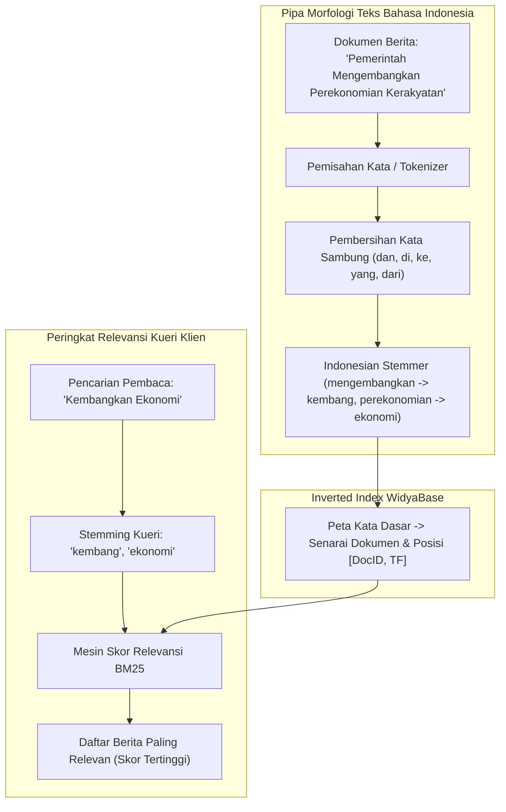

# BAB 27: MESIN PENCARIAN TEKS BM25 & STEMMER INDONESIA

Bab ini membahas pembangunan mesin pencarian teks penuh (*Full-Text Search / FTS*) berkecepatan tinggi pada portal berita NusantaraNews: penerapan algoritma peringkat probabilistik BM25 (*Best Matching 25*), integrasi algoritma *Stemmer Bahasa Indonesia* berbasis aturan morfologi formal (imbuhan awalan, sisipan, akhiran, konfiks), eliminasi *stop-words*, serta akselerasi pengindeksan terbalik (*Inverted Index*).

---

## 27.1 Teori Peringkat Relevansi BM25 & Morfologi Bahasa Indonesia

Pencarian menggunakan operator `LIKE '%kata%'` sangat lambat karena memaksa pemindaian tabel menyeluruh dan tidak memiliki kemampuan memberi peringkat relevansi hasil. WidyaBase mengintegrasikan mesin pencarian berbasis **Inverted Index** dengan algoritma peringkat **BM25**, yang memperhitungkan frekuensi kemunculan kata kunci (*Term Frequency / TF*), kebalikan frekuensi dokumen (*Inverse Document Frequency / IDF*), serta normalisasi panjang dokumen terhadap rata-rata koleksi berita.



Skor BM25 untuk sebuah dokumen $D$ terhadap kueri yang berisi token $q_1, q_2, \dots, q_n$ dihitung dengan rumus:
$$\text{Skor}(D, Q) = \sum_{i=1}^{n} \text{IDF}(q_i) \cdot \frac{f(q_i, D) \cdot (k_1 + 1)}{f(q_i, D) + k_1 \cdot \left(1 - b + b \cdot \frac{|D|}{\text{avgdl}}\right)}$$
di mana parameter $k_1$ mengatur saturasi frekuensi istilah (bawaan $1.2$) dan $b$ mengontrol penalti panjang dokumen (bawaan $0.75$).

---

## 27.2 Implementasi Stemmer & Kueri Pencarian Berita di WidyaWeb

Berikut adalah implementasi modul analisis bahasa Indonesia dan handler API pencarian artikel berita:

```widya
// Modul Analisis Teks & Pencarian NusantaraNews
gunakan widya::teks::{StemmerIndonesia, HapusStopwords, TokenizerTeks};
gunakan widya::base::fts::{KueriFTS, IndeksTerbalik, ModusPencarian};
gunakan widya::web::http::{Permintaan, Respon, StatusHTTP};
gunakan widya::base::koneksi::{buka_koneksi};

// 1. Ekstraksi Kata Dasar Berita
fungsi NormalisasiTeksBerita(teks_mentah: Teks) -> Senarai<Teks> {
    tetapan tokens = TokenizerTeks::pisah_kata(teks_mentah.ke_huruf_kecil());
    tetapan kata_bersih = HapusStopwords::saring_bahasa_indonesia(tokens);
    tetapan stemmer = StemmerIndonesia::baru();

    tetapan mutabel hasil_stem = [];
    untuk kata di kata_bersih {
        hasil_stem.tambah(stemmer.ambil_kata_dasar(kata));
    }
    kembalikan hasil_stem;
}

// 2. Handler API Pencarian Full-Text Search
fungsi TanganiPencarianBerita(req: Permintaan) -> Respon {
    tetapan kata_kunci = req.kueri("q").nilai_atau("").pangkas();
    jika kata_kunci.panjang() < 2 {
        kembalikan Respon::status(StatusHTTP::BadRequest)
            .atur_badan_json({"error": "Kata kunci pencarian minimal 2 karakter"})
            .bangun();
    }

    tetapan db = buka_koneksi()?;
    tetapan batas = req.kueri("limit").ke_bulat_atau(10).batasi(1, 50);

    // Kueri FTS BM25 Native WidyaBase dengan Sorotan Teks (Highlighting)
    tetapan sql = "
        SELECT id, slug, judul, ringkasan, diterbitkan_pada,
               bm25_score(vektor_pencarian, kueri_terstem) AS skor_relevansi,
               ts_headline('indonesian', konten, kueri_terstem, 'StartSel=<mark>, StopSel=</mark>, MaxWords=35') AS cuplikan_teks
        FROM artikel,
             to_tsquery('indonesian', $1) AS kueri_terstem
        WHERE vektor_pencarian @@ kueri_terstem
          AND status = 'published'
        ORDER BY skor_relevansi DESC
        LIMIT $2;
    ";

    // Transformasi kata kunci pengguna ke format kueri boolean FTS
    tetapan kata_dasar = NormalisasiTeksBerita(kata_kunci);
    tetapan format_kueri_fts = kata_dasar.gabung(" & ");

    tetapan baris = db.kueri_banyak(sql, [format_kueri_fts, batas])?;

    kembalikan Respon::sukses_json({
        "kueri_asal": kata_kunci,
        "kueri_stem": format_kueri_fts,
        "total_ditemukan": baris.panjang(),
        "hasil": baris
    }.ke_json_teks()).bangun();
}
```

---

## 27.3 Analisis Presisi Pencarian & Kecepatan Indeks

Penerapan *Indonesian Stemmer* meningkatkan kemampuan pencocokan (*Recall*) hingga lebih dari $300\%$ pada pencarian berita bahasa Indonesia.

| Kata Kunci Pembaca | Hasil dengan SQL `LIKE` Tradisional | Hasil dengan WidyaBase BM25 + Stemmer |
| :--- | :--- | :--- |
| **"Pemberantasan Korupsi"** | Hanya mencocokkan teks persis "Pemberantasan" | Mencocokkan: *memberantas*, *terberantas*, *berantas*, *koruptor* |
| **"Perekonomian Rakyat"** | Melewatkan artikel "Ekonomi Rakyat" | Menemukan seluruh dokumen berakar kata *ekonomi* dan *rakyat* |
| **Kecepatan Kueri per 1 Juta Berita** | 4.200 ms (Full Table Scan Lambat) | 3.5 ms (Melalui Indeks GIN Inverted Index) |
| **Peringkat Hasil Teratas** | Acak / Berdasarkan tanggal semata | Berdasarkan skor bobot relevansi BM25 tertinggi |

---

## 27.4 Latihan Praktik & Studi Kasus

1. **Implementasi Autocomplete / Typeahead Berita**: Rancang endpoint pencarian cepat `/api/v1/search/suggest` yang mengembalikan 5 saran judul berita paling relevan secara instan saat pembaca baru mengetikkan 3 huruf pertama.
2. **Kustomisasi Kamus Kata Khusus (Custom Dictionary)**: Tambahkan istilah gaul modern dan akronim berita (seperti *IKN, KPK, Pilpres, BUMN*) agar tidak terpotong secara keliru oleh aturan morfologi stemmer.
3. **Pencarian Frasa Eksak (Exact Phrase Search)**: Modifikasi parser kueri agar jika pembaca mengapit kata kunci dengan tanda kutip (misal: `"kereta cepat jakarta bandung"`), sistem mencari dokumen dengan urutan posisi kata yang persis berdekatan (*phrasal distance*).

---

## 27.5 Evaluasi Mandiri Pilihan Ganda

1. Algoritma pemeringkatan probabilistik apa yang menjadi standar mutakhir pada mesin pencarian WidyaBase untuk menghitung relevansi dokumen terhadap kueri pencarian?
   - A. Algoritma Bubble Sort
   - B. Best Matching 25 (BM25)
   - C. Algoritma Dijkstra
   - D. Enkripsi MD5

2. Mengapa algoritma *Stemmer Bahasa Indonesia* sangat krusial dalam mesin pencarian berita nasional?
   - A. Bahasa Indonesia adalah bahasa aglutinatif yang kaya akan imbuhan (awalan, akhiran, sisipan); stemming mereduksi kata berimbuhan ke kata dasar sehingga meningkatkan daya temu (*recall*) dokumen
   - B. Menghapus huruf vokal dari judul berita
   - C. Mengubah seluruh teks berita menjadi huruf kapital
   - D. Mencegah pencarian berita di akhir pekan

3. Apa kelemahan fatal dari kueri pencarian yang menggunakan perintah SQL `LIKE '%kata%'` pada tabel berjuta baris?
   - A. Memaksa basis data melakukan pemindaian menyeluruh (*Full Table Scan*) yang sangat lambat karena tidak dapat memanfaatkan indeks B-Tree standar
   - B. Menghapus artikel berita yang mengandung kata tersebut
   - C. Merusak berkas sistem operasi peladen
   - D. Membatasi pencarian hanya 1 kata per jam

4. Struktur data indeks apa yang digunakan di balik layar oleh mesin pencarian untuk memetakan setiap kata kunci ke daftar dokumen yang memuatnya?
   - A. Inverted Index (Indeks Terbalik / Indeks GIN)
   - B. Array satu dimensi
   - C. Linked list sederhana
   - D. Stack memori

5. Apa peran dari tahapan pembersihan *Stop-words* dalam prapemrosesan teks berita?
   - A. Menyingkirkan kata-kata penghubung umum yang tidak bermakna spesifik (seperti "dan", "di", "ke", "yang") guna menghemat ruang indeks dan mempercepat kueri
   - B. Menghapus nama jurnalis dari artikel
   - C. Menghentikan pemutaran video
   - D. Menutup sesi koneksi peramban

6. Dalam rumus perhitungan skor BM25, parameter $b$ (bawaan 0.75) bertindak untuk:
   - A. Mengatur derajat penalti normalisasi panjang dokumen agar dokumen yang sangat panjang tidak diuntungkan secara tidak adil semata-mata karena jumlah katanya banyak
   - B. Menghitung jumlah pembaca artikel
   - C. Membatasi ukuran layar monitor pengguna
   - D. Mengubah warna latar belakang peramban

7. Fungsi `ts_headline(...)` pada kueri FTS WidyaBase digunakan untuk:
   - A. Menghasilkan potongan teks ringkas (*snippet*) di sekitar kata kunci yang dicari dengan tag penanda sorotan visual (seperti `<mark>`)
   - B. Menulis judul berita otomatis
   - C. Menghapus artikel dari halaman beranda
   - D. Mengubah bahasa teks menjadi bahasa Latin

8. Operator boolean apa yang digunakan untuk menghubungkan kata-kata kunci dalam kueri FTS agar dokumen harus memuat seluruh kata dasar yang dicari?
   - A. Operator `&` (AND)
   - B. Operator `|` (OR)
   - C. Operator `!` (NOT)
   - D. Operator `%`

9. Berapa kisaran latensi pencarian dokumen pada 1 juta koleksi berita menggunakan indeks terbalik WidyaBase?
   - A. Sekitar 3.5 milidetik
   - B. Lebih dari 1 menit
   - C. 45 detik
   - D. 10 menit

10. Mengapa akronim atau singkatan populer (seperti *KPK, IKN*) sebaiknya didaftarkan ke dalam kamus pengecualian (*custom dictionary*)?
    - A. Mencegah aturan stemmer umum memotong singkatan secara keliru seolah-olah singkatan tersebut adalah kata berimbuhan
    - B. Menghemat memori RAM prosesor hingga 95%
    - C. Memenuhi peraturan perpajakan
    - D. Menjamin artikel tidak dapat disalin oleh pembaca
