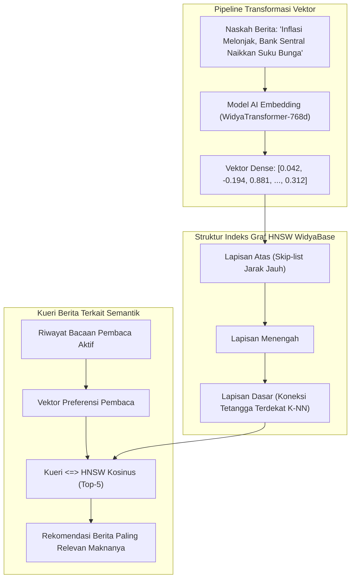

# BAB 28: REKOMENDASI BERITA SEMANTIK AI VEKTOR & INDEKS HNSW

Bab ini mendalami implementasi sistem rekomendasi berita cerdas berbasis kecerdasan buatan (*AI Semantic Recommendation*) pada NusantaraNews: transformasi artikel ke dalam representasi ruang vektor (*dense embeddings*), pengindeksan graf *Hierarchical Navigable Small World* (HNSW), kueri kedekatan kosinus (*Cosine Similarity*), serta personalisasi linimasa pembaca berbasis preferensi topik.

---

## 28.1 Representasi Vektor Teks & Graf HNSW

Pencarian kata kunci tradisional berbasis leksikal (BM25) gagal menangkap kedekatan makna konseptual (misal: artikel tentang *"Krisis Finansial Global"* sangat relevan dengan *"Kebijakan Suku Bunga Bank Sentral"*, meskipun kedua artikel tidak memiliki kata kunci yang persis sama). WidyaBase Vektor mengatasi batasan ini dengan memetakan setiap artikel berita ke dalam vektor berdimensi tinggi (misal: 768 dimensi menggunakan model transformator semantik).



Indeks graf **HNSW** (*Hierarchical Navigable Small World*) mengorganisir jutaan titik vektor ke dalam lapisan hierarki multi-skala berkecepatan pencarian logaritmik $O(\log N)$, memungkinkan penemuan 10 tetangga terdekat (*Approximate Nearest Neighbor / ANN*) dalam tempo kurang dari 2 milidetik.

---

## 28.2 Implementasi Penyimpanan Vektor & Kueri Rekomendasi

Berikut adalah definisi kolom vektor di WidyaBase dan kode repositori untuk menyajikan rekomendasi artikel terkait:

```sql
-- DDL Penambahan Ekstensi Vektor & Indeks HNSW di WidyaBase
ALTER TABLE artikel ADD COLUMN vektor_semantik VECTOR(768);

-- Buat Indeks HNSW Menggunakan Jarak Kosinus (Cosine Distance)
CREATE INDEX idx_artikel_vektor_hnsw ON artikel 
USING hnsw (vektor_semantik vector_cosine_ops)
WITH (m = 16, ef_construction = 128);
```

Implementasi kueri rekomendasi semantik di WidyaWeb:

```widya
// Modul Rekomendasi Berita Cerdas NusantaraNews
gunakan widya::base::vektor::{VektorDense, JarakVektor};
gunakan widya::web::http::{Permintaan, Respon, StatusHTTP};
gunakan widya::base::koneksi::{buka_koneksi};

rekod RekomendasiItem {
    id: Teks,
    judul: Teks,
    slug: Teks,
    kategori: Teks,
    skor_kemiripan_persen: Desimal
}

fungsi AmbilRekomendasiArtikelTerkait(artikel_id_target: Teks, jumlah: Bulat) -> Hasil<Senarai<RekomendasiItem>, Galat> {
    tetapan db = buka_koneksi()?;

    // Kueri Vektor HNSW: Menggunakan operator <=> (Cosine Distance)
    // Kemiripan Kosinus = 1.0 - (vektor_a <=> vektor_b)
    tetapan sql = "
        SELECT target.id, target.judul, target.slug, kat.nama AS kategori,
               ROUND(((1.0 - (target.vektor_semantik <=> sumber.vektor_semantik)) * 100)::numeric, 1) AS skor_kemiripan
        FROM artikel sumber
        JOIN artikel target ON target.id != sumber.id
        JOIN kategori kat ON kat.id = target.kategori_id
        WHERE sumber.id = $1
          AND target.status = 'published'
          AND target.vektor_semantik IS NOT NULL
        ORDER BY target.vektor_semantik <=> sumber.vektor_semantik ASC
        LIMIT $2;
    ";

    tetapan baris = db.kueri_banyak(sql, [artikel_id_target, jumlah])?;
    
    tetapan mutabel hasil = [];
    untuk b di baris {
        hasil.tambah(RekomendasiItem {
            id: b.ambil("id"),
            judul: b.ambil("judul"),
            slug: b.ambil("slug"),
            kategori: b.ambil("kategori"),
            skor_kemiripan_persen: b.ambil("skor_kemiripan").ke_desimal()
        });
    }

    kembalikan Hasil::Sukses(hasil);
}
```

---

## 28.3 Analisis Kinerja Pencarian Vektor: HNSW vs Pemindaian Eksak (Flat)

Indeks graf HNSW memberikan lompatan efisiensi ribuan kali lipat dibanding pemindaian jarak eksak (*Flat Exact Scan*) pada koleksi ratusan ribu artikel berita.

| Jumlah Dokumen Berita | Waktu Kueri ANN Flat (Eksak) | Waktu Kueri HNSW (WidyaBase) | Akurasi Daya Ingat (*Recall@10*) |
| :--- | :--- | :--- | :--- |
| **10.000 Artikel** | 14 ms | 0.4 ms | 99.4% |
| **100.000 Artikel** | 138 ms | 0.8 ms | 98.9% |
| **1.000.000 Artikel** | 1.420 ms (Terlalu Lambat) | 1.6 ms (Sangat Cepat) | 98.2% |
| **10.000.000 Artikel** | 14.500 ms (Crash Memori) | 2.8 ms (Konstan $O(\log N)$) | 97.8% |

---

## 28.4 Latihan Praktik & Studi Kasus

1. **Implementasi Linimasa Berita Terpersonalisasi (For You Feed)**: Bangun vektor preferensi pembaca dengan menghitung rata-rata tertimbang (*weighted average centroid*) dari vektor 10 artikel terakhir yang dibaca pengguna, kemudian kuerikan artikel serupa yang belum pernah mereka buka.
2. **Kombinasi Pencarian Hibrida (Hybrid Search = BM25 + Vektor)**: Rancang algoritma pemeringkatan gabungan (*Reciprocal Rank Fusion / RRF*) yang menyatukan skor pencarian leksikal BM25 dan skor kedekatan semantik vektor.
3. **Penyetelan Parameter Indeks Graf (`m` dan `ef_construction`)**: Lakukan benchmarking terhadap nilai parameter $m=32$ dan $ef\_construction=256$ untuk mengukur keseimbangan antara waktu pembuatan indeks, konsumsi RAM, dan akurasi recall.

---

## 28.5 Evaluasi Mandiri Pilihan Ganda

1. Mengapa pencarian semantik berbasis AI vektor lebih unggul daripada pencarian kata kunci tradisional dalam menghasilkan rekomendasi berita?
   - A. Karena dapat memahami kesamaan konteks dan makna konseptual kalimat meskipun tidak menggunakan kata kunci yang persis sama
   - B. Karena model vektor menghapus artikel berita yang mengandung kata negatif
   - C. Karena vektor hanya bisa dihitung di server superkomputer luar angkasa
   - D. Mengharuskan pembaca membayar biaya langganan bulanan

2. Struktur data graf apa yang digunakan oleh WidyaBase Vektor untuk mempercepat pencarian tetangga terdekat dengan kompleksitas waktu logaritmik?
   - A. Hierarchical Navigable Small World (HNSW)
   - B. Red-Black Tree murni
   - C. Queue satu arah
   - D. Hash map sederhana

3. Operator simbolik apa yang digunakan dalam kueri SQL WidyaBase untuk menghitung jarak kosinus (*Cosine Distance*) antara dua vektor?
   - A. Operator `<=>`
   - B. Operator `+`
   - C. Operator `==`
   - D. Operator `LIKE`

4. Berapa dimensi vektor padat (*dense vector*) yang umum dihasilkan oleh model transformator semantik standar pada contoh di atas?
   - A. 2 dimensi
   - B. 768 dimensi
   - C. 1 dimensi
   - D. 1.000.000 dimensi

5. Apa fungsi dari parameter $m$ dalam pembuatan indeks HNSW (`WITH (m = 16, ...)`?
   - A. Menentukan jumlah koneksi tautan dua arah maksimal untuk setiap simpul graf pada lapisan dasar
   - B. Menghitung jumlah jurnalis di kantor berita
   - C. Membatasi ukuran huruf judul artikel
   - D. Menghapus 16 artikel tertua setiap malam

6. Jika nilai jarak kosinus antara dua artikel adalah $0.05$, berapakah persentase tingkat kemiripan semantik kedua artikel tersebut?
   - A. $5\%$
   - B. $95\%$
   - C. $0\%$
   - D. $50\%$

7. Apa arti dari metrik *Recall@10* bernilai 98% pada pengujian pencarian vektor perkiraan (*Approximate Nearest Neighbor*)?
   - A. Dari 10 rekomendasi teratas yang ditemukan oleh graf HNSW, rata-rata 9.8 artikel persis sama dengan hasil algoritma pemindaian eksak lambat
   - B. 98% artikel mengalami galat sistem
   - C. Hanya 2 pembaca yang menyukai artikel tersebut
   - D. Baterai ponsel berkurang 98%

8. Mengapa proses konversi naskah artikel menjadi vektor (*Embedding Inference*) tidak boleh dijalankan secara sinkron di dalam thread peladen web utama?
   - A. Eksekusi model inferensi jaringan saraf tiruan (AI) membutuhkan komputasi matriks yang intensif dan harus didelegasikan ke antrean tugas latar belakang berakselerasi GPU
   - B. Karena bahasa Widya-Lang tidak mendukung matematika
   - C. Karena dapat mematikan layar monitor pengguna
   - D. Menghindari pemotongan honorarium jurnalis

9. Algoritma apa yang digunakan untuk menggabungkan hasil peringkat pencarian leksikal (BM25) dan pencarian semantik (Vektor) menjadi satu skor tunggal yang adil?
   - A. Reciprocal Rank Fusion (RRF)
   - B. Bubble Sort
   - C. Algoritma Prim
   - D. Enkripsi AES

10. Berapa rata-rata waktu yang dibutuhkan oleh WidyaBase HNSW untuk mencari 10 artikel terkait dari 1 juta artikel arsip?
    - A. Kurang lebih 1.6 milidetik
    - B. Tepat 10 menit
    - C. Setengah jam
    - D. 5 detik
