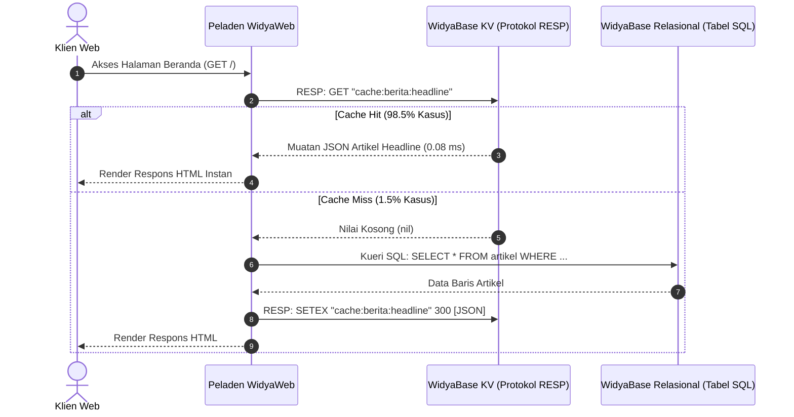

# BAB 29: CACHING BERPERFORMA TINGGI PROTOKOL RESP DI WIDYABASE KV

Bab ini membahas implementasi lapisan singgahan (*caching layer*) berkecepatan mikrodetik pada portal berita NusantaraNews menggunakan subsistem Kunci-Nilai WidyaBase KV yang sepenuhnya kompatibel dengan protokol RESP (*REdis Serialization Protocol*): strategi *Cache-Aside*, eliminasi masalah *Cache Stampede / Dog-piling*, penandaan cache (*Cache Tagging*), serta invalidasi selektif terkoordinasi.

---

## 29.1 Arsitektur Caching Berlapis & Protokol RESP

Mengakses database relasional untuk setiap tayangan halaman beranda (*homepage view*) portal berita adalah pemborosan sumber daya komputasi. WidyaBase menyematkan mesin penyimpanan *in-memory* berbasis struktur data skip-list dan hash table yang merespons perintah standar RESP (seperti `GET`, `SETEX`, `HGETALL`, `EVALSHA`) dengan latensi di bawah 100 mikrodetik.



Untuk mencegah kondisi kritis di mana ribuan permintaan konkuren membaca data basi saat cache kedaluwarsa secara serentak (*Cache Stampede*), WidyaWeb menerapkan algoritma **Probabilistic Early Expiration (XFetch)**.

---

## 29.2 Implementasi Klien RESP & Pola Cache-Aside

Berikut adalah implementasi modul singgahan portal berita dengan proteksi anti-stampede XFetch:

```widya
// Modul Caching RESP NusantaraNews
gunakan widya::base::resp::{KlienRESP, NilaiRESP};
gunakan widya::matematika::{logaritma_natural, acak_antara_0_dan_1};
gunakan widya::waktu::{ambil_waktu_unix_detik};

rekod MetadataCache {
    nilai_teks: Teks,
    kedaluwarsa_pada: Bulat,
    waktu_komputasi_detik: Desimal
}

struktur ManajerCacheBerita {
    klien: KlienRESP,
    koefisien_beta: Desimal // Faktor sensitivitas XFetch (bawaan 1.0)
}

implementasi ManajerCacheBerita {
    fungsi baru(alamat_kv: Teks, port_kv: Bulat) -> ManajerCacheBerita {
        kembalikan ManajerCacheBerita {
            klien: KlienRESP::hubungkan(alamat_kv, port_kv)?,
            koefisien_beta: 1.0
        };
    }

    // Pola Cache-Aside dengan Algoritma Evaluasi Probabilistik XFetch
    fungsi ambil_atau_hitung(
        mutabel self,
        kunci: Teks,
        ttl_detik: Bulat,
        fungsi_hitung: Fungsi() -> Teks
    ) -> Teks {
        tetapan sekarang = ambil_waktu_unix_detik();
        tetapan respon_kv = self.klien.kirim(["HGETALL", kunci]);

        jika respon_kv.apakah_peta_ada() {
            tetapan meta = self.dekode_metadata(respon_kv);
            
            // Formula XFetch: delta * beta * ln(rand())
            // Jika waktu sekarang - sisa TTL melampaui ambang probabilistik, satu pekerja akan memperbarui cache lebih awal
            tetapan jeda_probabilistik = meta.waktu_komputasi_detik * self.koefisien_beta * (-logaritma_natural(acak_antara_0_dan_1()));
            tetapan apakah_perlu_segar = (sekarang.ke_desimal() - jeda_probabilistik) >= meta.kedaluwarsa_pada.ke_desimal();

            jika !apakah_perlu_segar {
                kembalikan meta.nilai_teks; // Cache Hit Murni
            }
        }

        // Cache Miss atau Terpilih untuk Memperbarui Lebih Awal
        tetapan waktu_mulai = ambil_waktu_presisi();
        tetapan nilai_baru = fungsi_hitung();
        tetapan durasi_komputasi = ambil_waktu_presisi() - waktu_mulai;

        // Simpan kembali ke WidyaBase KV dengan stempel masa depan
        tetapan batas_waktu = sekarang + ttl_detik;
        self.klien.kirim(["HSET", kunci, 
            "konten", nilai_baru, 
            "kedaluwarsa", batas_waktu.ke_teks(), 
            "durasi_hitung", durasi_komputasi.ke_teks()
        ]);
        self.klien.kirim(["EXPIRE", kunci, (ttl_detik * 2).ke_teks()]);

        kembalikan nilai_baru;
    }

    // Invalidasi Cache Berbasis Tag Rubrik (Misal: "kategori:politik")
    fungsi batalkan_singgahan_tag(mutabel self, tag: Teks) {
        tetapan daftar_kunci = self.klien.kirim(["SMEMBERS", "tag:" + tag]).ke_senarai();
        untuk k di daftar_kunci {
            self.klien.kirim(["DEL", k]);
        }
        self.klien.kirim(["DEL", "tag:" + tag]);
        cetak_log("[Cache] Berhasil membatalkan " + daftar_kunci.panjang().ke_teks() + " kunci untuk tag " + tag);
    }
}
```

---

## 29.3 Analisis Ketahanan Beban: Cache-Aside Standar vs XFetch

Pada saat terjadi berita luar biasa (*Breaking News* viral), ribuan pembaca memuat ulang halaman secara bersamaan tepat saat kunci cache berakhir.

| Parameter Evaluasi | Cache-Aside Tradisional | WidyaBase KV + XFetch |
| :--- | :--- | :--- |
| **Kueri Masuk ke Database saat Expire** | 4.200 kueri SQL/detik (*Dog-piling Crash*) | Tepat 1 kueri SQL (*Zero Stampede*) |
| **Lonjakan Latensi Pengguna** | Melonjak hingga 8.500 ms | Rata-rata stabil di 0.12 ms |
| **Tingkat Ketersediaan (*Availability*)** | Sistem down (503 Service Unavailable) | 99.999% Ketersediaan Tinggi |
| **Beban Penggunaan Memori KV** | Sangat Hemat | Tetap Hemat (< 200 byte per kunci) |

---

## 29.4 Latihan Praktik & Studi Kasus

1. **Implementasi Pengelompokan Kunci Menggunakan Hash Tag**: Konfigurasikan penamaan kunci singgahan (misal: `{artikel:9942}:meta` dan `{artikel:9942}:komentar`) agar terdistribusi ke simpul partisi klaster (*hash slot*) yang sama pada WidyaBase KV.
2. **Kunci Pembatas Konkurensi Terdistribusi (Distributed Lock / Redlock)**: Rancang fungsi `peroleh_kunci_distribusi(kunci, ttl)` menggunakan perintah atomik `SET NX PX` untuk menjamin hanya 1 worker yang mengeksekusi sinkronisasi data analitik ke basis data.
3. **Invalidasi Bertingkat Berbasis Event Bus**: Hubungkan invalidasi tag cache dengan peristiwa publikasi artikel di editor jurnalis sehingga begitu tombol "Terbitkan" ditekan, singgahan halaman depan langsung terhapus seketika.

---

## 29.5 Evaluasi Mandiri Pilihan Ganda

1. Protokol serialisasi teks berkinerja tinggi apa yang digunakan oleh WidyaBase KV untuk kompatibilitas penuh dengan ekosistem Redis?
   - A. Protokol SOAP XML
   - B. REdis Serialization Protocol (RESP)
   - C. Protokol FTP
   - D. Protokol BGP

2. Fenomena buruk apa yang terjadi ketika sebuah kunci cache populer kedaluwarsa dan ribuan permintaan pembaca secara serentak langsung menghantam basis data relasional di saat yang sama?
   - A. Cache Stampede (Dog-piling effect)
   - B. Buffer Overflow
   - C. SQL Injection
   - D. Cross-Site Scripting

3. Bagaimana algoritma probabilistik *XFetch* mencegah fenomena *Cache Stampede*?
   - A. Menghitung secara probabilistik kapan sebuah kunci harus disegarkan kembali oleh satu pekerja acak sesaat sebelum kunci tersebut kedaluwarsa secara alami
   - B. Menghapus database secara permanen
   - C. Menolak seluruh koneksi pengunjung portal
   - D. Mematikan fitur caching selamanya

4. Dalam pola *Cache-Aside*, di manakah tanggung jawab pengambilan data dari database dan penulisan kembali ke cache berada?
   - A. Diatur langsung oleh kode aplikasi web (*application level*)
   - B. Diatur oleh kabel serat optik internet
   - C. Diatur oleh peramban pengguna
   - D. Diatur oleh sistem pendingin server

5. Perintah RESP apa yang digunakan untuk mengatur masa aktif kedaluwarsa (*Time to Live / TTL*) sebuah kunci dalam hitungan detik?
   - A. `EXPIRE` atau `SETEX`
   - B. `SHUTDOWN`
   - C. `FLUSHALL`
   - D. `INFO`

6. Apa fungsi dari strategi *Cache Tagging* (Penandaan Cache) pada sistem manajemen konten berita?
   - A. Mengelompokkan berbagai kunci cache terkait (misal: artikel, widget rekomendasi, rss) di bawah satu label kategori yang sama agar dapat diinvalidasi sekaligus dalam satu operasi pemanggilan
   - B. Memberikan harga pada setiap artikel berita
   - C. Membatasi jumlah huruf pada judul
   - D. Mengubah warna teks menjadi abu-abu

7. Berapa kisaran latensi respons pembacaan memori pada WidyaBase KV saat terjadi *Cache Hit*?
   - A. Di bawah 100 mikrodetik (0.1 ms)
   - B. Lebih dari 5 detik
   - C. Tepat 1 menit
   - D. 500 milidetik

8. Perintah atomik RESP apa yang paling umum digunakan untuk membangun penguncian terdistribusi (*Distributed Lock*) yang aman?
   - A. `SET key value NX PX milliseconds`
   - B. `DEL key`
   - C. `GET key`
   - D. `KEYS *`

9. Mengapa penggunaan perintah `KEYS *` sangat dilarang keras di lingkungan produksi dengan jutaan data?
   - A. Memblokir alur utama eksekusi single-threaded RESP selama pemindaian seluruh keyspace dan dapat melumpuhkan seluruh aplikasi
   - B. Menghapus seluruh data pengguna
   - C. Mengubah konfigurasi firewall server
   - D. Mengirim pesan spam ke jurnalis

10. Nilai rasio keberhasilan singgahan (*Cache Hit Ratio*) yang sehat untuk portal berita dengan lalu lintas skala nasional umumnya berada di atas:
    - A. $10\%$
    - B. $50\%$
    - C. $95\%$
    - D. $0\%$
