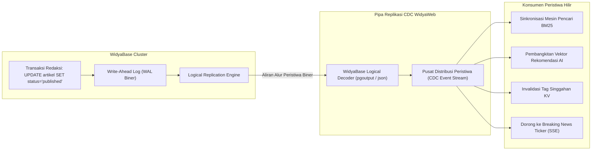

# BAB 30: REPLIKASI TERDISTRIBUSI & CHANGE DATA CAPTURE (CDC)

Bab ini membahas arsitektur sinkronisasi data real-time pada NusantaraNews: streaming log transaksi biner (*Write-Ahead Logging / WAL*), implementasi mesin *Change Data Capture* (CDC) berbasis replikasi logikal WidyaBase, pemancaran mutasi baris data (INSERT, UPDATE, DELETE) ke antrean peristiwa, serta pembaruan otomatis indeks mesin pencari dan feed linimasa editorial secara instan.

---

## 30.1 Teori Replikasi Logikal & Arsitektur CDC

Dalam sistem skala besar, memperbarui berbagai sistem turunan (mesin pencarian BM25, indeks graf vektor HNSW, cache memori KV, dan analitik data lake) melalui kueri ganda di kode backend adalah sumber utama inkonsistensi data (*dual-write problem*). Arsitektur **Change Data Capture (CDC)** mengalirkan setiap perubahan baris data secara langsung dari jurnal transaksi basis data (*WAL / Transaction Log*) secara asinkron tanpa membebani thread transaksi utama.



---

## 30.2 Implementasi Pendengar CDC di WidyaWeb

Berikut adalah implementasi modul konsumsi aliran replikasi logikal WidyaBase untuk mendeteksi perubahan status artikel secara real-time:

```widya
// Modul Replikasi Logikal & CDC NusantaraNews
gunakan widya::base::cdc::{AliranReplikasi, PesanCDC, TipeAksiCDC, KonfigurasiSlot};
gunakan widya::web::streaming::{SiarkanEventGlobal};

rekod PerubahanArtikel {
    aksi: Teks,
    id: Teks,
    judul: Teks,
    status_baru: Teks,
    status_lama: Opsi<Teks>
}

fungsi MulaiPemantauCDCReplikasi() {
    tetapan cfg_slot = KonfigurasiSlot::baru()
        .nama_slot("nusantara_cdc_portal")
        .nama_publikasi("pub_artikel_seluruh")
        .format_keluaran("json")
        .posisi_wal_awal("terbaru");

    cetak_log("[CDC] Membuka koneksi replikasi logikal ke WidyaBase...");
    tetapan mutabel aliran = AliranReplikasi::hubungkan(cfg_slot)?;
    cetak_log("[CDC] Saluran terhubung. Mendengarkan mutasi logikal WAL...");

    ulang {
        // Ambil paket perubahan biner berikutnya
        tetapan paket = aliran.baca_pesan_berikutnya()?;
        
        pilih paket.aksi() {
            TipeAksiCDC::Sisip(baris) => {
                tetapan tabel = paket.nama_tabel();
                jika tabel == "artikel" {
                    tetapan id = baris.ambil("id");
                    tetapan judul = baris.ambil("judul");
                    tetapan status = baris.ambil("status");

                    jika status == "published" {
                        cetak_log("[CDC Event] Berita baru terbit: " + judul);
                        TanganiArtikelTerbit(id, judul, baris);
                    }
                }
            },
            TipeAksiCDC::Perbarui(baris_baru, baris_lama) => {
                tetapan tabel = paket.nama_tabel();
                jika tabel == "artikel" {
                    tetapan status_baru = baris_baru.ambil("status");
                    tetapan status_lama = baris_lama.ambil("status");

                    // Deteksi transisi dari review ke published
                    jika status_lama != "published" && status_baru == "published" {
                        tetapan id = baris_baru.ambil("id");
                        tetapan judul = baris_baru.ambil("judul");
                        TanganiArtikelTerbit(id, judul, baris_baru);
                    }
                }
            },
            TipeAksiCDC::Hapus(identitas_lama) => {
                cetak_log("[CDC Event] Data artikel dihapus: " + identitas_lama.ke_teks());
                // Bersihkan indeks pencarian & singgahan
                HapusIndeksPencarian(identitas_lama.ambil("id"));
            }
        }

        // Kirim konfirmasi LSN (Log Sequence Number) ke server basis data
        aliran.konfirmasi_lsn(paket.posisi_lsn());
    }
}

fungsi TanganiArtikelTerbit(id: Teks, judul: Teks, data: PetaData) {
    // 1. Perbarui Mesin Pencari & Vektor
    JadwalkanIndeksFTS(id, data);

    // 2. Batalkan Singgahan Halaman Depan
    ManajerCache::batalkan_tag("kategori:" + data.ambil("kategori_slug"));

    // 3. Dorong Siaran ke Pembaca Aktif melalui SSE
    SiarkanEventGlobal("breaking_news", {
        "id": id,
        "judul": judul,
        "url": "/berita/" + data.ambil("slug")
    });
}
```

---

## 30.3 Analisis Efektivitas: Pola CDC vs Dual-Write Aplikasi

Menggantikan pola penulisan ganda (*dual-write*) di lapisan aplikasi dengan CDC menjamin konsistensi data mutlak (*eventual consistency guaranteed*).

| Masalah Arsitektur | Penulisan Ganda di Aplikasi (*Dual-Write*) | Change Data Capture (CDC WidyaBase) |
| :--- | :--- | :--- |
| **Aplikasi Crash di Tengah Eksekusi** | Database tersimpan, namun Search Engine tidak terupdate (Inkonsisten) | Log WAL tetap tercatat; CDC melanjutkan streaming setelah restart |
| **Kinerja Transaksi HTTP Utama** | Lambat (Harus menunggu 4 sistem hilir selesai) | Sangat Cepat (Aplikasi hanya menulis ke DB lokal, CDC bekerja asinkron) |
| **Urutan Peristiwa (*Event Ordering*)** | Berantakan akibat balapan konkurensi HTTP worker | Terurut secara linier sesuai stempel LSN di Write-Ahead Log |
| **Overhead Sumber Daya Database** | Banyak kueri polling `SELECT WHERE updated_at` | Nol polling; transmisi streaming murni berbasis dorongan peristiwa (*push*) |

---

## 30.4 Latihan Praktik & Studi Kasus

1. **Konfigurasi Slot Replikasi Logikal di WidyaBase**: Eksekusi perintah DDL `CREATE PUBLICATION pub_nusantara FOR TABLE artikel, komentar;` dan buat *logical replication slot* menggunakan ekstensi pgoutput.
2. **Penanganan Aliran Data Balik (CDC Backpressure)**: Implementasikan mekanisme kontrol laju konsumsi pada pendengar CDC agar tidak mengalami kehabisan memori jika terjadi migrasi data massal sebanyak 500.000 baris sekaligus.
3. **Penyusunan Jejak Audit Riwayat Sunting Berita (Audit Trail)**: Rancang konsumen CDC khusus yang menyimpan riwayat setiap kali seorang jurnalis merevisi teks naskah berita ke dalam tabel arsip perubahan permanen.

---

## 30.5 Evaluasi Mandiri Pilihan Ganda

1. Apa kepanjangan dari singkatan CDC dalam arsitektur data terdistribusi modern?
   - A. Change Data Capture
   - B. Central Data Center
   - C. Continuous Delivery Cloud
   - D. Computer Data Compression

2. Berkas jurnal biner apa pada mesin basis data yang menjadi sumber utama pembacaan mutasi baris data oleh mesin CDC?
   - A. Write-Ahead Log (WAL)
   - B. Berkas konfigurasi teks `widya.conf`
   - C. File log web server Apache
   - D. Berkas gambar favicon

3. Masalah arsitektur fatal apa yang dieliminasi dengan menggunakan pola CDC dibandingkan memperbarui Search Engine dan Cache langsung dari kode controller HTTP?
   - A. Dual-Write Problem (Kondisi inkonsistensi saat salah satu sistem berhasil dan sistem lain gagal ditulis)
   - B. Biaya tagihan domain internet
   - C. Memori hard disk habis
   - D. Keharusan jurnalis mengetik judul berita

4. Apa peran dari *Log Sequence Number* (LSN) dalam aliran replikasi logikal?
   - A. Pengenal integer 64-bit unik yang menandai posisi urutan linier dari setiap rekod perubahan pada jurnal transaksi WAL
   - B. Nomor telepon kantor redaksi
   - C. Kode lisensi perangkat lunak
   - D. Jumlah pembaca artikel per hari

5. Mengapa pengiriman konfirmasi LSN (*Acknowledgment*) sangat penting dikirimkan kembali oleh klien pendengar CDC ke peladen basis data?
   - A. Memberi tahu basis data bahwa segmen WAL sebelum posisi LSN tersebut telah aman diproses sehingga berkas fisik WAL lama di disk dapat didaur ulang/dihapus
   - B. Mematikan komputer basis data
   - C. Menghapus akun jurnalis
   - D. Mengubah warna teks terminal

6. Tipe mutasi data apa saja yang ditangkap dan dipancarkan oleh mesin replikasi logikal WidyaBase?
   - A. Operasi `INSERT`, `UPDATE`, dan `DELETE`
   - B. Hanya perintah `SELECT`
   - C. Hanya penambahan komentar kode program
   - D. Perintah mematikan komputer

7. Apa bahaya jika slot replikasi logikal dibuat di basis data tetapi tidak pernah ada proses konsumen yang membaca dan mengonfirmasi LSN-nya?
   - A. Basis data akan terus mempertahankan seluruh berkas WAL di disk tanpa pernah menghapusnya hingga ruang penyimpanan hard disk habis (*Disk Full Outage*)
   - B. Komputer akan meledak
   - C. Kecepatan internet akan meningkat drastis
   - D. Seluruh tabel akan berubah nama menjadi huruf besar

8. Dalam skenario di atas, apa yang memicu pemancaran notifikasi breaking news ke pembaca melalui SSE?
   - A. Deteksi perubahan kolom status artikel dari draf menjadi "published" pada peristiwa `UPDATE` atau `INSERT` yang tertangkap oleh CDC
   - B. Peramban pengguna dibuka di pagi hari
   - C. Jurnalis menekan tombol restart laptop
   - D. Server kehabisan kuota bandwidth

9. Mengapa pendekatan CDC jauh lebih hemat beban database dibandingkan pendekatan *polling* berkala (`SELECT * WHERE updated_at > ...`)?
   - A. Menghilangkan kebutuhan eksekusi kueri berulang yang membebani CPU dan indeks tabel, menggantikannya dengan aliran stream log biner pasif
   - B. Karena CDC hanya berjalan di server gratis
   - C. Karena CDC tidak menggunakan memori komputer
   - D. Membatasi ukuran artikel berita

10. Apakah urutan penerimaan peristiwa (*event ordering*) pada sistem CDC terjamin konsisten?
    - A. Ya, urutan dijamin mutlak linier dan berurutan sesuai dengan urutan transaksi yang berhasil di-*commit* ke dalam jurnal WAL
    - B. Tidak, urutannya selalu acak
    - C. Hanya terurut pada hari libur
    - D. Tergantung arah tiupan angin
