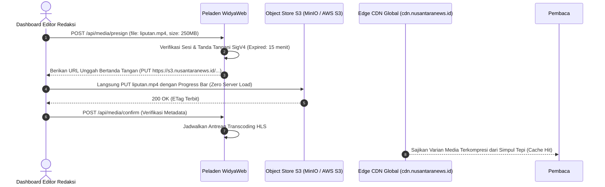

# BAB 31: OBJECT STORE S3-COMPATIBLE & DISTRIBUSI MEDIA BESAR

Bab ini mengupas tuntas arsitektur penyimpanan dan distribusi aset multimedia (foto beresolusi ultra-tinggi, infografis interaktif, rekaman video investigasi, dan rekaman podcast audio) pada NusantaraNews: integrasi penyimpanan objek kompatibel protokol S3 API, mekanisme unggahan langsung dari peramban menggunakan *Presigned URLs*, penandatanganan AWS Signature Version 4 (SigV4), serta integrasi jaringan pengiriman konten (*Content Delivery Network / CDN*).

---

## 31.1 Arsitektur Penyimpanan Objek Terdistribusi & Presigned URL

Menyalurkan unggahan berkas video sebesar ratusan megabyte melalui peladen aplikasi backend WidyaWeb akan menyandera soket koneksi dan menghabiskan memori RAM peladen. Arsitektur media modern menerapkan pola **Direct-to-Storage Upload via Presigned URL**: peramban jurnalis meminta izin unggah berbatas waktu ke backend, kemudian langsung mentransfer berkas biner ke Object Store (seperti MinIO atau Amazon S3) tanpa menyentuh peladen aplikasi.



---

## 31.2 Implementasi Penandatanganan S3 Presigned URL di WidyaWeb

Berikut adalah implementasi pembangkitan URL unggah langsung bertanda tangan aman menggunakan pustaka native WidyaWeb:

```widya
// Modul Penyimpanan Objek S3 NusantaraNews
gunakan widya::web::s3::{KlienS3, OpsiPresign, MetodeHTTP};
gunakan widya::web::http::{Permintaan, Respon, StatusHTTP};
gunakan widya::kripto::{uuid_v4};

rekod KonfigurasiS3News {
    wilayah: Teks,
    nama_bucket: Teks,
    titik_akhir: Teks,
    kunci_akses: Teks,
    kunci_rahasia: Teks
}

// 1. Handler Permintaan Presigned Upload URL
fungsi TanganiMintaPresignedUpload(req: Permintaan) -> Respon {
    tetapan pengguna = req.konteks_keamanan().pengguna_terautentikasi()?;
    tetapan payload = req.badan_json()?;
    
    tetapan nama_berkas_asli = payload.ambil("nama_berkas");
    tetapan tipe_mime = payload.ambil("tipe_mime");
    tetapan ukuran_byte = payload.ambil("ukuran_byte").ke_bulat();

    // Validasi Tipe Berkas Media yang Diizinkan
    tetapan ekstensi = DapatkanEkstensi(nama_berkas_asli);
    jika !apakah_ekstensi_media_sah(ekstensi, tipe_mime) {
        kembalikan Respon::status(StatusHTTP::BadRequest)
            .atur_badan_json({"error": "Format berkas media tidak didukung redaksi"})
            .bangun();
    }

    // Batasi Ukuran Berkas Maksimal 500 MB
    jika ukuran_byte > (500 * 1024 * 1024) {
        kembalikan Respon::status(StatusHTTP::PayloadTooLarge)
            .atur_badan_json({"error": "Ukuran berkas melebihi batas 500 MB"})
            .bangun();
    }

    // Bangun Kunci Objek Unik Berdasarkan Tanggal & UUID
    tetapan kunci_objek = "raw-uploads/" + ambil_format_tahun_bulan() + "/" + uuid_v4() + "." + ekstensi;

    // Inisialisasi Klien S3
    tetapan klien_s3 = KlienS3::baru(
        "nusantara-media-storage",
        "https://s3.nusantaranews.id",
        "id-jkt-1",
        "AKIA_NUSANTARA_KEY",
        "SECRET_NUSANTARA_KEY"
    );

    // Hasilkan Presigned URL untuk Metode HTTP PUT (Berlaku 15 Menit)
    tetapan url_presigned = klien_s3.buat_presigned_url(
        MetodeHTTP::PUT,
        kunci_objek,
        tipe_mime,
        Durasi::dari_menit(15)
    )?;

    kembalikan Respon::sukses_json({
        "url_unggah": url_presigned,
        "kunci_objek": kunci_objek,
        "url_akses_cdn": "https://cdn.nusantaranews.id/" + kunci_objek,
        "kedaluwarsa_detik": 900
    }.ke_json_teks()).bangun();
}
```

---

## 31.3 Analisis Efisiensi Jaringan: Server Proxy vs Direct S3 Upload

Menghilangkan peladen aplikasi dari alur transfer data media memberikan penghematan infrastruktur yang luar biasa.

| Parameter Evaluasi | Unggah Tradisional Melalui Server Web | Unggah Langsung Menggunakan S3 Presigned URL |
| :--- | :--- | :--- |
| **Beban Memori RAM Peladen** | Membengkak sebanding dengan ukuran berkas | Konstan mendekati 0 Byte |
| **Kapasitas Unggah Konkuren** | Terbatas (Server kehabisan thread koneksi) | Tak Terbatas (Ditangani langsung oleh klaster S3) |
| **Latensi Pengunggahan** | $2\times$ Lebih Lambat (Klien $\to$ Server $\to$ S3) | Kecepatan Penuh Garis Jaringan Klien $\to$ S3 |
| **Ketahanan Putus Koneksi** | Seluruh data harus diunggah ulang dari nol | Didukung *S3 Multipart Upload* (Dapat dilanjutkan) |

---

## 31.4 Latihan Praktik & Studi Kasus

1. **Implementasi Multipart Upload untuk Berkas di Atas 100 MB**: Rancang alur pengunggahan berkas video besar yang dipecah menjadi beberapa bagian (misal: potongan 10 MB per part) dengan penandatanganan presigned URL untuk setiap segmen secara paralel.
2. **Kustomisasi Kebijakan Siklus Hidup Bucket (Lifecycle Policy)**: Konfigurasikan aturan pada bucket S3 agar berkas master mentah (`raw-uploads/*`) secara otomatis dipindahkan ke kelas penyimpanan dingin (*Cold Archive Storage*) setelah 30 hari.
3. **Penyematan Tajuk Cache-Control Imutabel pada CDN**: Pastikan setiap kali objek media terunggah, sistem menyematkan metadata tajuk `Cache-Control: public, max-age=31536000, immutable` guna memaksimalkan rasio hit singgahan pada jaringan edge CDN.

---

## 31.5 Evaluasi Mandiri Pilihan Ganda

1. Protokol API penyimpanan awan standar industri apa yang didukung oleh berbagai penyedia object store modern (seperti MinIO, Ceph, AWS S3)?
   - A. S3 API (Simple Storage Service REST API)
   - B. Protokol POP3
   - C. Protokol SSH murni
   - D. Protokol Telnet

2. Apa keuntungan terbesar dari arsitektur *Direct-to-Storage Upload* menggunakan *Presigned URL*?
   - A. Beban transfer data biner berukuran ratusan megabyte tidak membebani memori dan jaringan peladen web backend, melainkan ditransfer langsung dari peramban ke klaster penyimpanan objek
   - B. Mengubah video menjadi teks secara otomatis
   - C. Menghapus rekod pengguna dari database
   - D. Mematikan sistem pendingin server

3. Standar algoritma penandatanganan kriptografis apa yang digunakan dalam pembuatan presigned URL pada ekosistem S3?
   - A. AWS Signature Version 4 (SigV4)
   - B. Enkripsi ROT13
   - C. Algoritma Base64 sederhana tanpa stempel waktu
   - D. Kode morse

4. Berapa durasi masa aktif kedaluwarsa (*Expiration Time*) yang diatur untuk presigned URL pada implementasi di atas?
   - A. 15 menit (900 detik)
   - B. 10 tahun
   - C. 1 detik
   - D. Tidak pernah kedaluwarsa

5. Metode HTTP apa yang digunakan oleh peramban klien saat mentransfer berkas biner ke URL presigned object store?
   - A. Metode HTTP `PUT` atau `POST`
   - B. Metode HTTP `DELETE`
   - C. Metode HTTP `TRACE`
   - D. Metode HTTP `OPTIONS`

6. Apa tujuan validasi tipe MIME dan ekstensi berkas di sisi peladen sebelum menerbitkan presigned URL?
   - A. Memastikan hanya berkas multimedia yang sah yang diizinkan untuk diunggah serta mencegah penyusupan berkas skrip berbahaya (seperti `.exe` atau skrip shell)
   - B. Menghemat memori flash drive pengguna
   - C. Mengubah resolusi kamera jurnalis
   - D. Menghapus watermark foto

7. Mengapa kunci objek (*Object Key*) sebaiknya menyertakan stempel tanggal dan identitas unik UUID (seperti `raw-uploads/2026-06/uuid.mp4`)?
   - A. Mencegah tabrakan nama berkas jika beberapa jurnalis mengunggah foto dengan nama yang sama (misal: `foto.jpg`), serta mempermudah partisi penyimpanan
   - B. Mengharuskan pembaca menebak alamat berkas
   - C. Mengurangi biaya listrik bulanan
   - D. Mematikan fitur pencarian berkas

8. Fitur S3 apa yang digunakan untuk mengunggah berkas video raksasa (hingga beberapa gigabyte) secara terpecah berkeping-keping secara paralel dan tangguh terhadap gangguan koneksi?
   - A. S3 Multipart Upload
   - B. Single Thread Loop
   - C. Text Stream
   - D. File Copy

9. Nilai tajuk respons `Cache-Control` apa yang ideal disematkan untuk aset gambar berita yang memiliki nama berkas unik dan tidak pernah berubah kontennya?
   - A. `public, max-age=31536000, immutable`
   - B. `no-cache, no-store`
   - C. `private, max-age=0`
   - D. `must-revalidate`

10. Apa peran Edge CDN (seperti `cdn.nusantaranews.id`) dalam distribusi berkas media berita?
    - A. Menyimpan salinan media di puluhan pusat data terdekat dengan lokasi geografis pembaca di seluruh Indonesia guna memangkas latensi dan menghemat biaya bandwidth object store
    - B. Mengedit foto jurnalis secara otomatis
    - C. Menghapus komentar pembaca
    - D. Mematikan router internet pelanggan
