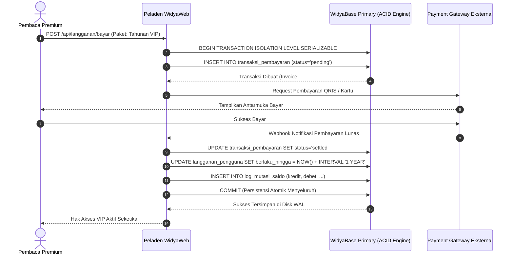

# BAB 32: TRANSAKSI ACID FINANSIAL & PAYWALL BERLANGGANAN PEMBACA

Bab ini membedah arsitektur monetisasi konten digital editorial pada NusantaraNews: implementasi sistem dinding berbayar (*Paywall* terintegrasi: *Metered Paywall* dan *Hard Paywall*), pemrosesan transaksi pembayaran langganan dengan jaminan ketat ACID (*Atomicity, Consistency, Isolation, Durability*), mitigasi manipulasi token akses, serta isolasi tingkat serial (*Serializable Transaction Isolation*).

---

## 32.1 Arsitektur Paywall Editorial & Jaminan Transaksi Finansial

Model bisnis jurnalisme investigasi berkualitas bergantung pada konversi pembaca gratis menjadi pelanggan premium berbayar. Sistem memadukan dua strategi: **Metered Paywall** (memberikan jatah 3 artikel investigasi gratis per bulan yang dilacak menggunakan token terenkripsi) dan **Hard Paywall** (menuntut verifikasi hak akses aktif sebelum fragmen naskah lengkap dikirimkan dari server).



Seluruh mutasi status langganan dan pencatatan faktur keuangan wajib dibungkus dalam blok transaksi ACID dengan tingkat isolasi **Serializable** untuk menolak kondisi balapan (*Race Condition*) seperti pemalsuan langganan ganda (*Double Spending*).

---

## 32.2 Implementasi Paywall Guard & Transaksi Finansial di WidyaWeb

Berikut adalah implementasi middleware pengawal paywall dan prosedur transaksi finansial atomik:

```widya
// Modul Monetisasi & Transaksi NusantaraNews
gunakan widya::base::transaksi::{TingkatIsolasi, BlokTransaksi};
gunakan widya::web::middleware::{KonteksMiddleware, Respon};
gunakan widya::base::koneksi::{buka_koneksi};
gunakan widya::waktu::{ambil_waktu_sekarang};

// 1. Middleware Pengawal Konten Eksklusif (Paywall Guard)
fungsi MiddlewarePaywallVIP(ctx: KonteksMiddleware, berikutnya: FungsiLanjut) -> Respon {
    tetapan artikel_id = ctx.parameter_rute("id");
    tetapan db = buka_koneksi()?;

    // Periksa apakah artikel bersifat eksklusif VIP
    tetapan apakah_eksklusif = db.kueri_nilai_boolean(
        "SELECT apakah_konten_vip FROM artikel WHERE id = $1", 
        [artikel_id]
    )?;

    jika !apakah_eksklusif {
        kembalikan berikutnya(ctx); // Artikel gratis publik
    }

    // Periksa status otentikasi & hak langganan pengguna aktif
    tetapan auth_user = ctx.pengguna_terotentikasi();
    jika !auth_user.ada() {
        kembalikan RenderFragmenPaywallLogin();
    }

    tetapan user_id = auth_user.ambil().id;
    tetapan langganan_aktif = db.kueri_nilai_boolean("
        SELECT EXISTS (
            SELECT 1 FROM langganan_pengguna 
            WHERE pengguna_id = $1 
              AND status = 'aktif' 
              AND berlaku_hingga > NOW()
        );
    ", [user_id])?;

    jika !langganan_aktif {
        kembalikan RenderFragmenAjakanBerlangganan();
    }

    // Pengguna berhak membaca naskah penuh
    kembalikan berikutnya(ctx);
}

// 2. Prosedur Transaksi ACID Pemrosesan Pembayaran Langganan
fungsi SelesaikanPembayaranLangganan(
    nomor_invoice: Teks, 
    id_pengguna: Teks, 
    paket_hari: Bulat, 
    jumlah_bayar: Desimal
) -> Hasil<(), Galat> {
    tetapan mutabel koneksi = buka_koneksi()?;

    // Mulai Transaksi dengan Isolasi Tertinggi (Serializable)
    koneksi.mulai_transaksi(TingkatIsolasi::Serializable)?;

    coba {
        // A. Verifikasi Status Invoice Tidak Boleh Terbayar Ganda
        tetapan status_invoice = koneksi.kueri_satu(
            "SELECT status FROM transaksi_pembayaran WHERE invoice = $1 FOR UPDATE", 
            [nomor_invoice]
        )?;

        jika status_invoice.ambil("status") != "pending" {
            koneksi.batalkan_transaksi()?; // Rollback
            kembalikan Hasil::Gagal(Galat::baru("Invoice tidak dalam status menunggu pembayaran"));
        }

        // B. Mutasi Status Pembayaran
        koneksi.eksekusi(
            "UPDATE transaksi_pembayaran SET status = 'settled', dibayar_pada = NOW() WHERE invoice = $1", 
            [nomor_invoice]
        )?;

        // C. Perpanjang / Aktifkan Hak Langganan Pengguna
        koneksi.eksekusi("
            INSERT INTO langganan_pengguna (pengguna_id, status, berlaku_hingga, diperbarui_pada)
            VALUES ($1, 'aktif', NOW() + make_interval(days => $2), NOW())
            ON CONFLICT (pengguna_id) DO UPDATE SET
                status = 'aktif',
                berlaku_hingga = GREATEST(langganan_pengguna.berlaku_hingga, NOW()) + make_interval(days => $2),
                diperbarui_pada = NOW();
        ", [id_pengguna, paket_hari])?;

        // D. Catat Entri Buku Besar Akuntansi (General Ledger)
        koneksi.eksekusi("
            INSERT INTO buku_besar_keuangan (pengguna_id, tipe_mutasi, jumlah, referensi_invoice, dibuat_pada)
            VALUES ($1, 'KREDIT', $2, $3, NOW());
        ", [id_pengguna, jumlah_bayar, nomor_invoice])?;

        // E. Komit Transaksi ACID Menyeluruh
        koneksi.komit_transaksi()?;
        cetak_log("[Monetisasi] Transaksi berhasil dikomit untuk invoice: " + nomor_invoice);
        kembalikan Hasil::Sukses(());
    } tangkap(err) {
        koneksi.batalkan_transaksi()?; // Rollback otomatis saat terjadi galat
        cetak_peringatan("[Monetisasi] Transaksi dibatalkan (Rollback): " + err.pesan());
        kembalikan Hasil::Gagal(err);
    }
}
```

---

## 32.3 Analisis Kepatuhan Properti ACID

Pemberlakuan transaksi ACID melindungi reputasi hukum dan finansial portal berita dari selisih saldo dan pembobolan hak akses.

| Properti ACID | Ancaman Tanpa Jaminan ACID | Implementasi di WidyaBase |
| :--- | :--- | :--- |
| **Atomicity (Atomisitas)** | Saldo terdebet namun langganan gagal aktif (Data setengah jadi) | Prinsip *All-or-Nothing*: Seluruh tabel termutasi atau dibatalkan total (*Rollback*) |
| **Consistency (Konsistensi)** | Total mutasi debet tidak sama dengan kredit di buku besar | Validasi batasan integritas skema (*Constraints & Foreign Keys*) |
| **Isolation (Isolasi)** | Dua permintaan paralel memicu penambahan masa aktif ganda | `TingkatIsolasi::Serializable` + `SELECT FOR UPDATE` penguncian baris ketat |
| **Durability (Ketahanan)** | Pemadaman listrik setelah respons sukses menghilangkan status VIP | Setiap komit tersinkronisasi (*fsync*) ke disk jurnal WAL fisik |

---

## 32.4 Latihan Praktik & Studi Kasus

1. **Implementasi Metered Paywall dengan Kuota Baca 3 Artikel**: Rancang middleware yang melacak ID artikel yang dibaca pengguna anonim melalui cookie terenkripsi HMAC dan memunculkan pop-up langganan pada artikel keempat.
2. **Penanganan Idempotensi Webhook Pembayaran (Idempotency Key)**: Pastikan jika payment gateway mengirimkan webhook notifikasi yang sama sebanyak 3 kali karena *network retry*, sistem hanya memproses mutasi saldo tepat 1 kali (*exactly-once execution*).
3. **Penyusunan Laporan Penjualan Harian Terkonsolidasi**: Tulis kueri SQL analitik keuangan yang menghitung total pendapatan kotor (*Gross Revenue*), pemotongan pajak PPN 11%, dan jumlah pelanggan baru per kategori paket langganan.

---

## 32.5 Evaluasi Mandiri Pilihan Ganda

1. Tingkat isolasi transaksi tertinggi apa pada WidyaBase yang menjamin eksekusi transaksi konkuren menghasilkan efek yang sama persis seperti jika transaksi dieksekusi secara berurutan (*serial*)?
   - A. Read Uncommitted
   - B. Read Committed
   - C. Repeatable Read
   - D. Serializable

2. Apa yang dimaksud dengan prinsip *Atomicity* (Semua atau Tidak Sama Sekali) dalam transaksi keuangan langganan berita?
   - A. Jika terjadi kegagalan sistem di tengah proses (misal: pencatatan buku besar gagal), seluruh perubahan sebelumnya (seperti aktivasi masa aktif) harus dibatalkan total (*Rollback*)
   - B. Transaksi harus diselesaikan dalam waktu 1 detik
   - C. Seluruh transaksi wajib dicetak di kertas
   - D. Hanya berlaku untuk mata uang dolar

3. Klausa SQL apa yang digunakan untuk mengunci baris rekod secara eksklusif agar tidak dimodifikasi oleh transaksi paralel lain hingga transaksi aktif selesai?
   - A. `FOR UPDATE`
   - B. `ORDER BY`
   - C. `GROUP BY`
   - D. `DROP TABLE`

4. Mengapa artikel eksklusif VIP tidak boleh dikirimkan secara utuh ke peramban jika pengguna belum berlangganan, meskipun artikel disembunyikan menggunakan CSS (`display: none`)?
   - A. Pengguna cerdas dapat dengan mudah melihat naskah lengkap melalui fitur *Inspect Element* peramban jika HTML-nya bocor dari server (*Client-side Bypass*)
   - B. Karena CSS tidak bisa menyembunyikan teks
   - C. Karena warna teks akan memudar
   - D. Melanggar lisensi open source

5. Perintah transaksi apa yang digunakan untuk membatalkan seluruh operasi yang sempat dijalankan jika terjadi kesalahan di tengah eksekusi?
   - A. `COMMIT`
   - B. `ROLLBACK`
   - C. `EXECUTE`
   - D. `TRUNCATE`

6. Apa tujuan fungsi `GREATEST(langganan_pengguna.berlaku_hingga, NOW())` pada kueri pembaruan masa aktif langganan?
   - A. Memastikan jika pelanggan memperpanjang langganan sebelum masa aktif lamanya habis, durasi baru akan ditambahkan dari tanggal akhir lama dan bukan di-reset dari hari ini
   - B. Menghitung usia pengguna
   - C. Membatasi tanggal maksimal tahun 2050
   - D. Mengubah zona waktu ke London

7. Mengapa kunci idempoten (*Idempotency Key*) sangat penting diterapkan pada endpoint penerima webhook pembayaran?
   - A. Menjamin paket notifikasi pembayaran yang terkirim berulang kali oleh gateway pembayaran tidak menyebabkan perpanjangan langganan berlebih secara keliru
   - B. Menghemat memori RAM server
   - C. Mempercepat koneksi internet pelanggan
   - D. Mengubah kata sandi pengguna

8. Apa jaminan dari properti *Durability* pada sistem basis data WidyaBase?
   - A. Sekali sebuah transaksi berhasil dikomit, data tersebut dijamin tersimpan permanen di media penyimpanan non-volatile (WAL fisik di disk) dan tidak akan hilang meskipun terjadi mati listrik mendadak
   - B. Data tidak dapat dihapus selamanya oleh siapapun
   - C. Mengharuskan server menggunakan baterai cadangan
   - D. Membatasi ukuran database maksimal 1 Gigabyte

9. Dalam model *Metered Paywall*, apa yang umumnya diberikan kepada pembaca non-berlangganan?
   - A. Hak membaca sejumlah kecil artikel gratis (misal: 3 artikel per bulan) sebelum diwajibkan membeli paket langganan
   - B. Larangan membuka situs selamanya
   - C. Seluruh artikel gratis selamanya tanpa iklan
   - D. Hanya boleh membaca judul tanpa foto

10. Mengapa entri pencatatan buku besar (*General Ledger*) wajib menggunakan pola mutasi berpasangan (kredit dan debet)?
    - A. Memenuhi standar audit akuntansi keuangan resmi dan memastikan setiap penerimaan dana memiliki riwayat pertanggungjawaban yang seimbang dan dapat dilacak
    - B. Mengurangi kapasitas file biner basis data
    - C. Menghindari pembuatan akun oleh robot
    - D. Mempercepat waktu kompilasi kode Widya-Lang
