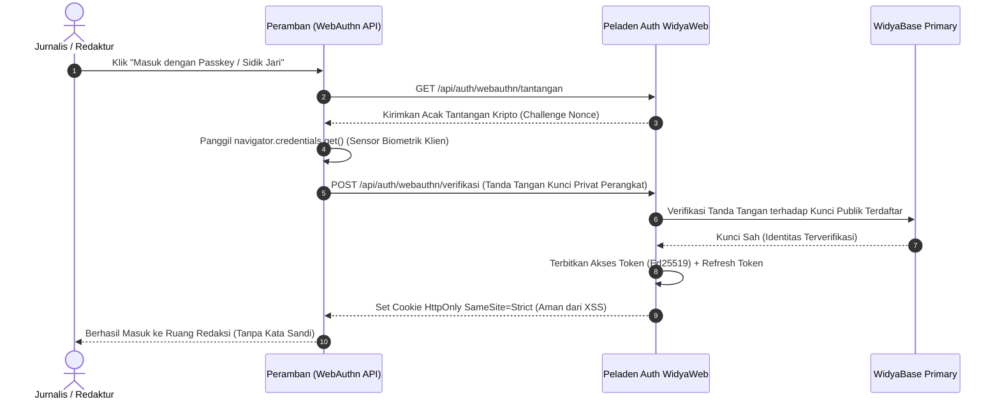

# BAB 33: AUTENTIKASI JWT ED25519 & WEBAUTHN / PASSKEYS

Bab ini menyajikan arsitektur autentikasi modern tanpa kata sandi (*Passwordless Authentication*) dan berbasis token kriptografi asimetris pada NusantaraNews: penandatanganan JSON Web Token (JWT) menggunakan kurva Edwards Ed25519, rotasi token penyegar (*Refresh Token Rotation*), mitigasi pencurian token, serta integrasi standar W3C WebAuthn (Passkeys / Biometrik).

---

## 33.1 Arsitektur Kriptografi Asimetris Ed25519 & Standar WebAuthn

Penggunaan algoritma kunci simetris (seperti HS256) mengharuskan kunci rahasia yang sama dibagikan ke seluruh layanan mikro, sehingga meningkatkan risiko kebocoran. WidyaWeb menerapkan **Ed25519 (EdDSA)**, standar kriptografi kunci publik berkecepatan tinggi dengan ukuran kunci ringkas (kunci publik 32-byte) yang tahan terhadap serangan *side-channel*. Layanan autentikasi menandatangani token dengan Kunci Privat, sementara API Gateway dan layanan lain memverifikasi tanda tangan menggunakan Kunci Publik secara independen tanpa membebani basis data.



---

## 33.2 Implementasi Penandatanganan JWT Ed25519 di WidyaWeb

Berikut adalah implementasi modul penerbitan dan verifikasi klaim JWT Ed25519 serta middleware pengaman rute:

```widya
// Modul Autentikasi Ed25519 NusantaraNews
gunakan widya::kripto::{Ed25519KunciPrivat, Ed25519KunciPublik, TandatanganDigital};
gunakan widya::web::jwt::{KlaimJWT, BuilderJWT, VerifikatorJWT};
gunakan widya::web::http::{Permintaan, Respon, StatusHTTP};
gunakan widya::waktu::{ambil_waktu_unix_detik};

rekod KlaimRedaksi {
    sub: Teks,       // ID Pengguna
    nama: Teks,      // Nama Lengkap
    peran: Teks,     // admin, redaktur, jurnalis, subscriber
    email: Teks,     // Alamat Surel
    exp: Bulat,      // Waktu Kedaluwarsa Unix
    iss: Teks        // Penerbit Token
}

// 1. Pembangkitan Token Akses Berbasis Ed25519
fungsi TerbitkanTokenAkses(pengguna_id: Teks, nama: Teks, peran: Teks, email: Teks, kunci_privat: Ed25519KunciPrivat) -> Teks {
    tetapan sekarang = ambil_waktu_unix_detik();
    tetapan kedaluwarsa = sekarang + (15 * 60); // Masa aktif 15 menit

    tetapan klaim = KlaimJWT::baru()
        .atur_subjek(pengguna_id)
        .atur_penerbit("https://auth.nusantaranews.id")
        .atur_kedaluwarsa(kedaluwarsa)
        .atur_klaim_kustom("nama", nama)
        .atur_klaim_kustom("peran", peran)
        .atur_klaim_kustom("email", email);

    // Tandatangani dengan kurva Ed25519
    kembalikan klaim.tandatangani_ed25519(kunci_privat)?;
}

// 2. Verifikasi Token di Sisi Gateway / Middleware (Hanya Membutuhkan Kunci Publik)
fungsi VerifikasiTokenAkses(token_mentah: Teks, kunci_publik: Ed25519KunciPublik) -> Hasil<KlaimRedaksi, Galat> {
    tetapan verifikator = VerifikatorJWT::baru(kunci_publik)
        .wajib_penerbit("https://auth.nusantaranews.id")
        .toleransi_waktu_detik(30);

    tetapan hasil_klaim = verifikator.periksa(token_mentah)?;
    
    kembalikan Hasil::Sukses(KlaimRedaksi {
        sub: hasil_klaim.ambil_subjek(),
        nama: hasil_klaim.ambil_klaim_kustom("nama"),
        peran: hasil_klaim.ambil_klaim_kustom("peran"),
        email: hasil_klaim.ambil_klaim_kustom("email"),
        exp: hasil_klaim.ambil_kedaluwarsa(),
        iss: hasil_klaim.ambil_penerbit()
    });
}
```

---

## 33.3 Analisis Efisiensi & Keamanan Algoritma JWT

Kurva Ed25519 menawarkan kombinasi keamanan militer dan kecepatan verifikasi tertinggi dibanding RSA dan ECDSA.

| Algoritma Tanda Tangan | Ukuran Kunci Publik | Ukuran Signature | Kecepatan Verifikasi | Ketahanan Terhadap Serangan Kripto |
| :--- | :--- | :--- | :--- | :--- |
| **RSA-2048** | 256 Byte | 256 Byte | 0.42 ms | Rentan jika pembangkit acak lemah |
| **ECDSA (P-256)** | 64 Byte | 64 Byte | 0.18 ms | Rentan terhadap kebocoran nonce |
| **Ed25519 (WidyaWeb)** | 32 Byte (Sangat Ringkas) | 64 Byte | 0.04 ms ($10\times$ Lebih Cepat) | Sangat Kuat (Deterministik Bebas Nonce) |

---

## 33.4 Latihan Praktik & Studi Kasus

1. **Implementasi Refresh Token Rotation dengan Deteksi Penggunaan Ganda**: Bangun mekanisme di mana setiap kali refresh token digunakan, token tersebut langsung digantikan dengan token baru di dalam transaksi database; jika token lama dicoba digunakan kembali, seluruh sesi pengguna langsung dicabut karena dicurigai terjadi pencurian sesi (*Token Reuse Detection*).
2. **Registrasi Kredensial WebAuthn (Passkeys Registration)**: Tulis handler untuk memproses registrasi autentikasi sidik jari baru menggunakan API peramban `navigator.credentials.create()`.
3. **Penyimpanan Akses Token Aman di Cookie HttpOnly**: Konfigurasikan peladen agar token JWT dikirimkan ke peramban dalam cookie dengan atribut `HttpOnly; Secure; SameSite=Strict` untuk memitigasi serangan pencurian token melalui celah Cross-Site Scripting (XSS).

---

## 33.5 Evaluasi Mandiri Pilihan Ganda

1. Algoritma tanda tangan kurva eliptis modern apa yang digunakan oleh WidyaWeb untuk penerbitan token JWT berkecepatan tinggi dan berukuran kunci ringkas?
   - A. Ed25519 (EdDSA)
   - B. DES 56-bit
   - C. MD5
   - D. ROT13

2. Mengapa algoritma kunci asimetris (seperti Ed25519) lebih aman dalam arsitektur banyak microservice dibanding kunci simetris (seperti HS256)?
   - A. Layanan backend verifikator hanya perlu memegang Kunci Publik, sehingga kebocoran satu layanan tidak mengekspos Kunci Privat yang bertugas menandatangani token
   - B. Karena kunci asimetris menghapus kata sandi pengguna
   - C. Karena kuncinya dicetak di atas kertas sertifikat
   - D. Mengharuskan pengguna membayar biaya royalti kripto

3. Standar W3C modern apa yang memungkinkan pengguna masuk ke portal web menggunakan sensor biometrik perangkat (sidik jari, FaceID) atau kunci fisik USB tanpa perlu mengetik kata sandi?
   - A. WebAuthn (FIDO2 / Passkeys)
   - B. Flash Player
   - C. ActiveX Controls
   - D. Silverlight

4. Berapa durasi masa aktif yang direkomendasikan untuk Access Token JWT jangka pendek pada implementasi di atas?
   - A. 15 menit
   - B. 10 tahun
   - C. 24 jam
   - D. Tidak pernah kedaluwarsa

5. Apa tujuan utama dari teknik *Refresh Token Rotation*?
   - A. Setiap kali refresh token dipakai untuk meminta access token baru, refresh token lama segera dibatalkan dan diganti dengan yang baru guna mendeteksi serta menggagalkan aksi pencurian token
   - B. Mengubah peran pengguna menjadi administrator secara acak
   - C. Menghapus akun email jurnalis
   - D. Mengubah warna tombol login peramban

6. Atribut cookie apa yang menjamin bahwa token autentikasi tidak dapat dibaca atau dicuri oleh kode JavaScript di sisi peramban (misal saat terjadi serangan XSS)?
   - A. `HttpOnly`
   - B. `Domain`
   - C. `Path`
   - D. `Max-Age`

7. Klaim standar `sub` (Subject) dalam muatan payload JWT digunakan untuk menyimpan informasi apa?
   - A. Pengenal unik identitas pengguna (User ID)
   - B. Judul artikel berita yang sedang dibaca
   - C. Alamat IP kantor redaksi
   - D. Nomor kartu kredit

8. Berapa ukuran fisik kunci publik Ed25519?
   - A. 32 Byte
   - B. 2048 Byte
   - C. 1 Megabyte
   - D. 4 Kilobyte

9. Dalam protokol WebAuthn, di manakah Kunci Privat autentikasi biometrik disimpan secara aman?
   - A. Di dalam chip perangkat keras aman milik pengguna (seperti TPM, Secure Enclave ponsel, atau YubiKey) dan tidak pernah keluar ke jaringan internet
   - B. Di basis data server pusat
   - C. Di berkas teks komputer jurnalis
   - D. Di media sosial

10. Apa risiko utama jika Access Token JWT memiliki masa kedaluwarsa yang terlampau panjang (misalnya 30 hari)?
    - A. Jika token dicuri oleh peretas, token tersebut akan terus berlaku dan tidak dapat dicabut dengan mudah tanpa mekanisme daftar hitam token (*Token Blacklist*) yang rumit
    - B. Komputer akan kehabisan memori RAM
    - C. Kecepatan koneksi internet akan berkurang drastis
    - D. Peramban akan menolak menampilkan gambar
