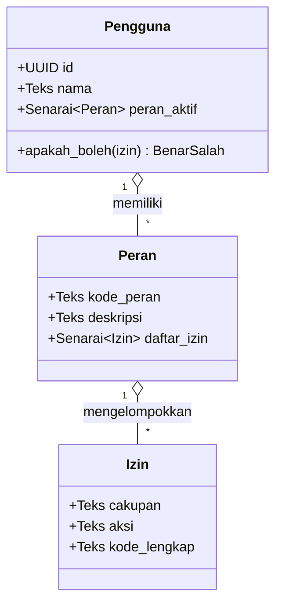

# BAB 34: KONTROL AKSES RBAC REDAKSI & MATRIKS IZIN

Bab ini membahas perancangan dan implementasi sistem Kontrol Akses Berbasis Peran (*Role-Based Access Control / RBAC*) pada portal berita NusantaraNews: pemisahan hak istimewa redaksi (Pemimpin Redaksi, Editor Rubrik, Jurnalis Penulis, Moderator Komentar, Pembaca VIP), evaluasi izin berbasis tindakan (*Action-Based Permission Engine*), serta pengamanan berlapis pada antarmuka manajemen redaksi (*CMS Dashboard*).

---

## 34.1 Teori Otorisasi RBAC & Matriks Hak Istimewa Redaksi

Manajemen penerbitan media nasional menuntut pemisahan wewenang (*Separation of Duties*) yang ketat guna mencegah penerbitan berita palsu, kebocoran draf investigasi, atau manipulasi iklan. RBAC memisahkan pengguna dari hak istimewa dengan memperkenalkan lapisan perantara berupa **Peran (Roles)** dan sekumpulan **Izin (Permissions)** atomik.



Matriks Izin Baku Ruang Redaksi NusantaraNews:

| Peran Redaksi | Tulis Draf (`article:create`) | Edit Naskah Sendiri (`article:edit_own`) | Sunting Semua Naskah (`article:edit_all`) | Terbitkan Berita (`article:publish`) | Hapus Berita (`article:delete`) | Moderasi Komentar (`comment:moderate`) |
| :--- | :---: | :---: | :---: | :---: | :---: | :---: |
| **Jurnalis** | Ya | Ya | Tidak | Tidak | Tidak | Tidak |
| **Editor Rubrik** | Ya | Ya | Ya (Rubrik) | Ya | Tidak | Tidak |
| **Pemimpin Redaksi** | Ya | Ya | Ya | Ya | Ya | Ya |
| **Moderator Komentar** | Tidak | Tidak | Tidak | Tidak | Tidak | Ya |

---

## 34.2 Implementasi Mesin Evaluasi Izin di WidyaWeb

Berikut adalah implementasi pustaka kontrol izin deklaratif dan middleware pengaman rute CMS:

```widya
// Modul RBAC & Izin NusantaraNews
gunakan widya::web::rbac::{PohonIzin, PeranRedaksi, PenegakKebijakan};
gunakan widya::web::http::{Permintaan, Respon, StatusHTTP};
gunakan widya::base::koneksi::{buka_koneksi};

// 1. Matriks Izin Statis
fungsi BangunMatriksIzinRedaksi() -> PenegakKebijakan {
    tetapan mutabel penegak = PenegakKebijakan::baru();

    // Daftarkan Peran & Izin Atomik
    penegak.tambah_peran("jurnalis", [
        "article:create", 
        "article:edit_own", 
        "media:upload"
    ]);

    penegak.tambah_peran("editor_rubrik", [
        "article:create", 
        "article:edit_own", 
        "article:edit_rubrik", 
        "article:publish_rubrik", 
        "media:upload"
    ]);

    penegak.tambah_peran("pemimpin_redaksi", [
        "article:*", 
        "comment:*", 
        "user:manage", 
        "system:settings"
    ]);

    penegak.tambah_peran("moderator", [
        "comment:view", 
        "comment:approve", 
        "comment:delete"
    ]);

    kembalikan penegak;
}

// 2. Middleware Pengecekan Izin Spesifik
fungsi WajibIzin(kode_izin: Teks) -> Middleware {
    kembalikan fungsi(ctx: KonteksMiddleware, berikutnya: FungsiLanjut) -> Respon {
        tetapan pengguna_opsi = ctx.pengguna_terautentikasi();
        jika !pengguna_opsi.ada() {
            kembalikan Respon::status(StatusHTTP::Unauthorized)
                .atur_badan_json({"error": "Sesi autentikasi diperlukan"})
                .bangun();
        }

        tetapan pengguna = pengguna_opsi.ambil();
        tetapan penegak = BangunMatriksIzinRedaksi();

        // Evaluasi apakah pengguna memiliki hak akses (mendukung wildcard '*')
        jika !penegak.apakah_diizinkan(pengguna.peran, kode_izin) {
            cetak_peringatan("[RBAC] Akses ditolak: Pengguna " + pengguna.id + " (" + pengguna.peran + ") mencoba aksi " + kode_izin);
            kembalikan Respon::status(StatusHTTP::Forbidden)
                .atur_badan_json({"error": "Akses Ditolak: Anda tidak memiliki wewenang untuk tindakan ini"})
                .bangun();
        }

        kembalikan berikutnya(ctx);
    };
}
```

Penerapan pada pendaftaran rute deklaratif WidyaWeb:

```widya
// Rute Ruang Redaksi yang Dilindungi
router.pos("/api/admin/articles/publish", WajibIzin("article:publish_rubrik"), TanganiPublikasiArtikel);
router.hapus("/api/admin/articles/:id", WajibIzin("article:delete"), TanganiHapusArtikel);
router.pos("/api/admin/comments/:id/reject", WajibIzin("comment:delete"), TanganiTolakKomentar);
```

---

## 34.3 Analisis Ketahanan Keamanan: RBAC vs ABAC

Pemilihan model RBAC terpadu memberikan kepastian audit kepatuhan redaksi jurnalistik secara transparan.

| Karakteristik Kontrol Akses | RBAC Klasik (Role-Based) | ABAC Kompleks (Attribute-Based) | Model Hibrida WidyaWeb |
| :--- | :--- | :--- | :--- |
| **Kompleksitas Evaluasi** | Sangat Rendah ($O(1)$ Hash Set) | Tinggi (Evaluasi logika aturan runtime) | Instan $O(1)$ + Validasi Pemilik Objek |
| **Kemudahan Audit Kepatuhan** | Sangat Mudah (Daftar peran jelas) | Sulit (Kondisi dinamis terpecah) | Transparan & Siap Audit Dewan Pers |
| **Overhead Memori** | Ringan (Hanya senarai string izin) | Berat (Engine inferensi kebijakan) | Minimal (< 50 KB Memori Cache) |

---

## 34.4 Latihan Praktik & Studi Kasus

1. **Implementasi Validasi Kepemilikan Dokumen (Ownership Guard)**: Tambahkan pemeriksaan di mana pengguna dengan peran `jurnalis` hanya diizinkan menyunting artikel jika `artikel.penulis_id == pengguna.id` (*Discretionary Access Check*).
2. **Pendelegasian Peran Sementara (Temporary Role Delegation)**: Rancang fitur di mana Pemimpin Redaksi dapat melimpahkan hak wewenang penerbitan kepada Wakil Pemimpin Redaksi selama masa cuti dengan batas kedaluwarsa otomatis 7 hari.
3. **Pencatatan Log Akses Tertolak (Audit Trail Enforcement)**: Simpan setiap percobaan akses tanpa hak ke dalam tabel `log_keamanan_redaksi` lengkap dengan alamat IP, stempel waktu, URL target, dan identitas pengguna.

---

## 34.5 Evaluasi Mandiri Pilihan Ganda

1. Apa singkatan dari prinsip RBAC dalam rekayasa keamanan perangkat lunak?
   - A. Role-Based Access Control
   - B. Real-time Binary Access Code
   - C. Redundant Backup Array Controller
   - D. Route-Based Application Configuration

2. Kode status HTTP resmi apa yang harus dikembalikan oleh peladen ketika pengguna sudah terautentikasi (login) namun tidak memiliki izin yang cukup untuk mengakses resurse tertentu?
   - A. 200 OK
   - B. 401 Unauthorized
   - C. 403 Forbidden
   - D. 404 Not Found

3. Apa keuntungan menggunakan izin atomik berbasis tindakan (seperti `article:publish`) dibanding memeriksa nama peran secara langsung (`if role == 'editor'`) di dalam kode?
   - A. Kode lebih fleksibel dan mudah dipelihara; penambahan peran baru atau perubahan wewenang cukup dikonfigurasi pada matriks izin tanpa perlu mengubah kode logika bisnis
   - B. Menghilangkan kebutuhan database
   - C. Mempercepat proses cetak koran
   - D. Mengubah format huruf menjadi tebal

4. Simbol *wildcard* apa yang umumnya digunakan pada matriks izin untuk mewakili seluruh tindakan dalam suatu cakupan (misal: seluruh aksi pada artikel)?
   - A. Tanda bintang (`*`)
   - B. Tanda tanya (`?`)
   - C. Tanda seru (`!`)
   - D. Tanda pagar (`#`)

5. Peran redaksi manakah yang menurut matriks izin di atas memiliki wewenang untuk menghapus rekod artikel berita secara permanen?
   - A. Pemimpin Redaksi
   - B. Jurnalis Penulis
   - C. Moderator Komentar
   - D. Pembaca VIP

6. Mengapa jurnalis penulis umumnya dibatasi izinnya hanya untuk `article:edit_own` dan dilarang memiliki `article:edit_all`?
   - A. Mencegah seorang jurnalis mengubah atau merusak draf investigasi milik rekan jurnalis lainnya tanpa sepengetahuan penulis aslinya
   - B. Karena laptop jurnalis berukuran kecil
   - C. Mengurangi biaya listrik kantor
   - D. Menghindari pembacaan artikel di malam hari

7. Apa tujuan dari prinsip pemisahan wewenang (*Separation of Duties*) dalam organisasi media berita digital?
   - A. Memastikan suatu keputusan kritis (seperti penerbitan berita ke publik) memerlukan persetujuan dan verifikasi dari pihak yang berbeda (editor), mencegah kesalahan fatal atau bias personal jurnalis
   - B. Membagi gaji karyawan secara merata
   - C. Memaksa jurnalis bekerja dari rumah
   - D. Menghapus arsip berita lama

8. Kapan middleware `WajibIzin("comment:delete")` dieksekusi dalam siklus permintaan HTTP?
   - A. Sebelum handler utama controller penghapusan komentar dijalankan
   - B. Setelah respons HTTP selesai dikirimkan ke peramban
   - C. Hanya saat basis data dimatikan
   - D. Saat komputer dinyalakan pertama kali

9. Apa perbedaan esensial antara kode HTTP `401 Unauthorized` dan `403 Forbidden`?
   - A. 401 berarti identitas pengguna belum diketahui (perlu login), sedangkan 403 berarti identitas sudah diketahui tetapi pengguna dilarang mengakses resurse tersebut
   - B. 401 adalah status sukses, 403 adalah status galat
   - C. 401 khusus untuk sistem operasi Linux, 403 untuk Windows
   - D. Tidak ada perbedaan sama sekali

10. Mengapa setiap kegagalan otorisasi (`403 Forbidden`) wajib dicatat ke dalam log keamanan (*Security Audit Trail*)?
    - A. Membantu tim analis keamanan mendeteksi upaya penetrasi, eskalasi hak istimewa (*Privilege Escalation*), atau akun staf yang disusupi pihak luar
    - B. Mempercepat proses kompresi berkas HTML
    - C. Mengurangi ukuran basis data
    - D. Menjamin peramban tidak menampilkan pesan galat
