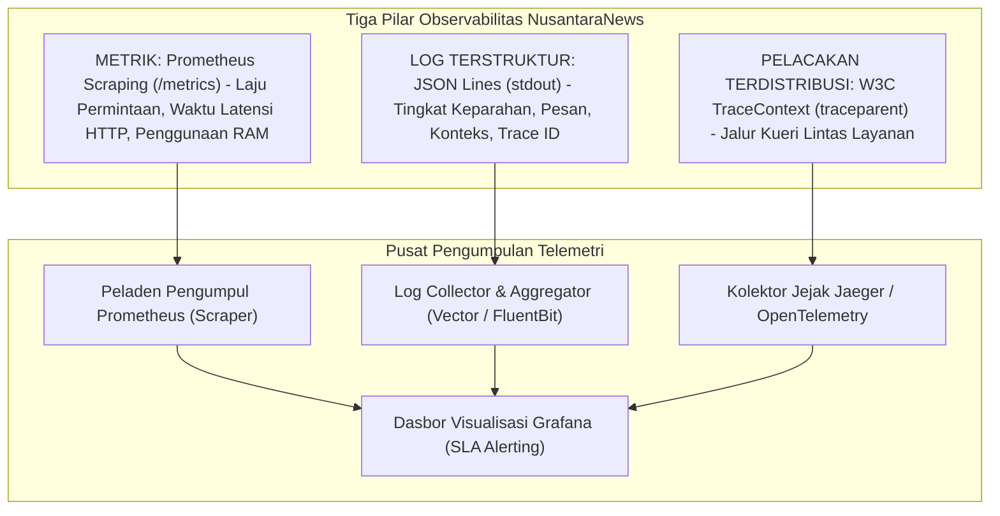

# BAB 36: OBSERVABILITAS SISTEM: METRIK PROMETHEUS & LOGGING

Bab ini menyajikan implementasi observabilitas komprehensif (*Observability & Telemetry*) pada portal berita skala industri NusantaraNews: instrumentasi metrik sistem berbasis standar OpenMetrics / Prometheus, pencatatan log terstruktur berformat JSON (*Structured Logging*), korelasi pelacakan terdistribusi (*Distributed Tracing Trace ID*), serta penyusunan dasbor pemantauan kinerja peladen web secara real-time.

---

## 36.1 Tiga Pilar Observabilitas & Standar OpenMetrics

Mengoperasikan portal berita nasional tanpa instrumen telemetri ibarat menerbangkan pesawat dalam kabut pekat tanpa radar. Tiga pilar observabilitas—**Metrik (Metrics)**, **Log (Logs)**, dan **Pelacakan (Traces)**—memberikan visibilitas holistik terhadap kesehatan klaster backend, lonjakan latensi, dan titik kemacetan (*bottlenecks*).



---

## 36.2 Implementasi Kolektor Metrik & Structured Logging di WidyaWeb

Berikut adalah implementasi modul instrumentasi metrik Prometheus dan pencatatan log terstruktur berbasis konteks:

```widya
// Modul Observabilitas NusantaraNews
gunakan widya::web::observabilitas::{RegistriMetrik, Counter, Histogram, Gauge};
gunakan widya::web::http::{Permintaan, Respon, StatusHTTP};
gunakan widya::waktu::{ambil_waktu_presisi, ambil_waktu_iso8601};

rekod LogEntryJSON {
    timestamp: Teks,
    level: Teks,
    trace_id: Teks,
    metode: Teks,
    jalur: Teks,
    status: Bulat,
    latensi_ms: Desimal,
    pesan: Teks
}

// 1. Registrasi Metrik Global
struktur MetrikPortal {
    total_permintaan_http: Counter,
    durasi_latensi_http: Histogram,
    koneksi_aktif_websocket: Gauge,
    koneksi_pool_db_digunakan: Gauge
}

fungsi InisialisasiMetrikPortal() -> MetrikPortal {
    tetapan reg = RegistriMetrik::ambil_global();

    kembalikan MetrikPortal {
        total_permintaan_http: reg.buat_counter(
            "nusantara_http_requests_total",
            "Total seluruh permintaan HTTP yang masuk ke portal berita",
            ["metode", "jalur", "status"]
        ),
        durasi_latensi_http: reg.buat_histogram(
            "nusantara_http_request_duration_seconds",
            "Distribusi waktu latensi pemrosesan permintaan HTTP dalam detik",
            ["metode", "jalur"],
            [0.005, 0.01, 0.025, 0.05, 0.1, 0.25, 0.5, 1.0, 2.5] // Bucket latensi
        ),
        koneksi_aktif_websocket: reg.buat_gauge(
            "nusantara_websocket_active_connections",
            "Jumlah koneksi real-time WebSocket yang sedang aktif"
        ),
        koneksi_pool_db_digunakan: reg.buat_gauge(
            "nusantara_database_pool_active_connections",
            "Jumlah koneksi basis data yang sedang sibuk dipinjam"
        )
    };
}

// 2. Middleware Telemetri & Pencatatan Log JSON
fungsi MiddlewareObservabilitas(metrik: MetrikPortal) -> Middleware {
    kembalikan fungsi(ctx: KonteksMiddleware, berikutnya: FungsiLanjut) -> Respon {
        tetapan waktu_mulai = ambil_waktu_presisi();
        tetapan trace_id = ctx.tajuk("X-Trace-Id").nilai_atau(hasilkan_trace_id_acak());
        ctx.simpan_konteks("trace_id", trace_id);

        // Eksekusi rute berikutnya
        tetapan respon = berikutnya(ctx);

        tetapan durasi_detik = ambil_waktu_presisi() - waktu_mulai;
        tetapan durasi_ms = durasi_detik * 1000.0;
        tetapan status_str = respon.kode_status().ke_teks();
        tetapan metode = ctx.permintaan().metode().ke_teks();
        tetapan rute_pola = ctx.rute_pola(); // Misal: "/berita/:id"

        // Catat Metrik Prometheus
        metrik.total_permintaan_http.tambah_label([metode, rute_pola, status_str]).tambah(1);
        metrik.durasi_latensi_http.tambah_label([metode, rute_pola]).amati(durasi_detik);

        // Terbitkan Log Terstruktur JSON ke stdout
        tetapan entri_log = LogEntryJSON {
            timestamp: ambil_waktu_iso8601(),
            level: jika respon.kode_status() >= 500 { "ERROR" } jika_tidak { "INFO" },
            trace_id: trace_id,
            metode: metode,
            jalur: ctx.permintaan().jalur(),
            status: respon.kode_status(),
            latensi_ms: durasi_ms.bulatkan(2),
            pesan: "Permintaan HTTP selesai diproses"
        };

        cetak_ke_stdout(entri_log.ke_json_satu_baris());
        respon.atur_tajuk("X-Trace-Id", trace_id);

        kembalikan respon;
    };
}
```

---

## 36.3 Analisis Metrik Standar Google Golden Signals

Pengawasan kesehatan portal berita NusantaraNews difokuskan pada *Four Golden Signals* dari Google SRE Handbook.

| Sinyal Emas (Golden Signal) | Metrik Pengukuran di WidyaWeb | Ambang Peringatan Bahaya (Alerting Threshold) |
| :--- | :--- | :--- |
| **Latensi (Latency)** | `nusantara_http_request_duration_seconds` (Persentil 99 / p99) | p99 $> 300\text{ ms}$ selama 3 menit berturut-turut |
| **Lalu Lintas (Traffic)** | Laju perubahan `rate(nusantara_http_requests_total[1m])` | Lonjakan tak wajar $> 300\%$ (Potensi DDoS) |
| **Tingkat Galat (Errors)** | Rasio status 5xx: `sum(rate(status=~"5..")) / sum(rate(all))` | Rasio galat internal $> 1.0\%$ dari seluruh trafik |
| **Saturasi (Saturation)** | `nusantara_database_pool_active_connections / max_pool` | Utilisasi kolam koneksi database $> 85\%$ |

---

## 36.4 Latihan Praktik & Studi Kasus

1. **Penyusunan Endpoint Ekspor Metrik (`GET /metrics`)**: Buat rute khusus yang menyajikan seluruh metrik aktif dalam format baris teks baku OpenMetrics untuk ditarik secara periodik oleh peladen Prometheus.
2. **Kustomisasi Pelacakan Konteks Database (DB Query Tracing)**: Tambahkan penyematan `trace_id` pada setiap kueri SQL dalam bentuk komentar metadata (misal: `/* trace_id=89ab... */ SELECT ...`) agar kueri lambat dapat dicocokkan dengan log permintaan pengguna di log PostgreSQL WidyaBase.
3. **Penyusunan Aturan Peringatan PagerDuty (Alerting Rules)**: Tulis konfigurasi Prometheus Alertmanager yang secara otomatis mengirimkan peringatan darurat ke tim SRE jika tingkat galat 500 melampaui ambang 2% selama 2 menit.

---

## 36.5 Evaluasi Mandiri Pilihan Ganda

1. Tiga pilar utama dalam disiplin observabilitas sistem modern adalah:
   - A. Metrik, Log Terstruktur, dan Pelacakan Terdistribusi (Traces)
   - B. CPU, RAM, dan Hard Disk
   - C. HTML, CSS, dan JavaScript
   - D. Mouse, Keyboard, dan Monitor

2. Endpoint standar apa yang umumnya disediakan oleh aplikasi web untuk ditarik (*scraped*) datanya oleh peladen Prometheus?
   - A. `/metrics`
   - B. `/login`
   - C. `/admin`
   - D. `/download`

3. Tipe metrik Prometheus apa yang nilainya hanya bisa bertambah naik secara monotonik (seperti total hitungan permintaan HTTP) dan di-reset ke nol saat aplikasi restart?
   - A. Counter
   - B. Gauge
   - C. Histogram
   - D. Summary

4. Tipe metrik apa yang nilainya dapat naik dan turun sewaktu-waktu (seperti jumlah koneksi WebSocket yang sedang aktif atau penggunaan memori)?
   - A. Gauge
   - B. Counter
   - C. Untyped
   - D. Boolean

5. Mengapa pencatatan log disarankan menggunakan format JSON terstruktur (*Structured Logging*) satu baris dibanding format teks bebas tak beraturan?
   - A. Mempermudah mesin pengumpul log (seperti Vector, FluentBit, Elastic) menguraikan, memfilter, mengindeks, dan mengkueri atribut log secara otomatis
   - B. Menghilangkan kebutuhan ruang penyimpanan disk
   - C. Menghapus teks peringatan galat
   - D. Mengharuskan pengguna mengunduh berkas log

6. Apa peran dari *Trace ID* (Pengenal Jejak) dalam sistem terdistribusi mikro-layanan?
   - A. Pengenal unik yang diteruskan lintas jaringan dari permintaan peramban ke gateway hingga ke basis data, memungkinkan penelusuran seluruh siklus perjalanan satu permintaan secara utuh
   - B. Menghitung jumlah klik mouse pengguna
   - C. Mengubah warna ikon peramban
   - D. Membatasi ukuran layar monitor

7. Metrik persentil 99 (p99 latency) merepresentasikan apa dalam analisis kinerja sistem?
   - A. Waktu latensi di mana 99% pengguna merasakan kecepatan yang lebih baik atau sama dengan nilai tersebut, sementara 1% pengguna mengalami latensi terburuk
   - B. Rata-rata aritmatika seluruh pengguna
   - C. Persentase baterai ponsel pengguna
   - D. Jumlah pengunjung yang berusia di bawah 99 tahun

8. Mengapa pelabelan metrik Prometheus dilarang keras menggunakan nilai dengan kardinalitas tinggi (*High Cardinality* seperti User ID atau Alamat IP)?
   - A. Dapat menyebabkan ledakan kombinasi metrik (*Metric Explosion*) yang memakan habis memori RAM dan ruang penyimpanan peladen Prometheus
   - B. Mematikan sistem pendingin server
   - C. Melanggar undang-undang hak cipta
   - D. Menghapus akun admin

9. Empat Sinyal Emas (*Four Golden Signals*) yang wajib dipantau menurut panduan resmi Google Site Reliability Engineering (SRE) adalah:
   - A. Latensi, Lalu Lintas, Tingkat Galat, dan Saturasi
   - B. Biaya, Waktu, Lokasi, dan Kualitas
   - C. Keyboard, Mouse, Layar, dan Speaker
   - D. Baterai, Sinyal, Kuota, dan Pulsa

10. Apa keuntungan menggunakan *Histogram* dibanding sekadar menghitung rata-rata matematika untuk pengukuran waktu latensi HTTP?
    - A. Nilai rata-rata sering menyembunyikan masalah kinerja parah (*masking outliers*), sedangkan histogram memetakan distribusi sebaran waktu ke dalam berbagai ember batas (*buckets*) secara akurat
    - B. Histogram berukuran lebih kecil dari 1 byte
    - C. Histogram tidak memerlukan prosesor komputer
    - D. Menghindari pembuatan grafik di dasbor
