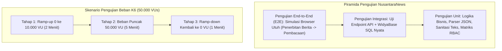

# BAB 37: PENGUJIAN OTOMATIS END-TO-END & UJI BEBAN K6

Bab ini memandu Anda dalam merekayasa penjaminan mutu perangkat lunak (*Quality Assurance*) untuk portal berita NusantaraNews: pengujian otomatis lintas alur fungsional (*End-to-End Testing*), pengujian integrasi berbasis kontainer uji (*Testcontainers*), serta simulasi uji beban ekstrem (*Stress & Load Testing*) menggunakan Grafana K6 hingga 50.000 pengguna virtual konkuren (*VUs*).

---

## 37.1 Piramida Pengujian & Rekayasa Uji Beban

Menjamin keandalan portal berita saat breaking news terjadi menuntut pengujian menyeluruh pada seluruh lapisan piramida pengujian. Pengujian fungsional memvalidasi ketepatan alur editorial, sedangkan pengujian beban K6 mengevaluasi degradasi latensi di bawah tekanan lalu lintas masif.



---

## 37.2 Implementasi Skenario Uji Beban K6 & Pengujian Integrasi

Berikut adalah skrip pengujian beban K6 dalam bahasa JavaScript modern yang menguji ketahanan halaman muka dan API pencarian artikel berita:

```javascript
// load-test-nusantara.js - Pengujian Kinerja Ekstrem Grafana K6
import http from 'k6/http';
import { check, sleep } from 'k6';
import { Rate, Trend } from 'k6/metrics';

// Metrik Kustom
const rasioKegagalan = new Rate('tingkat_kegagalan_http');
const latensiArtikel = new Trend('latensi_halaman_artikel');

export const options = {
  stages: [
    { duration: '1m', target: 5000 },   // Pemanasan ke 5.000 pengguna
    { duration: '3m', target: 25000 },  // Lonjakan ke 25.000 pengguna
    { duration: '5m', target: 50000 },  // Puncak berita breaking 50.000 pengguna
    { duration: '2m', target: 0 },      // Penurunan kembali ke 0
  ],
  thresholds: {
    'http_req_duration': ['p(95)<250', 'p(99)<500'], // 95% permintaan harus di bawah 250ms
    'tingkat_kegagalan_http': ['rate<0.01'],          // Tingkat kegagalan harus di bawah 1%
  },
};

const BASE_URL = 'https://nusantaranews.id';

export default function () {
  // 1. Kunjungi Halaman Beranda (SSR HTML)
  const responBeranda = http.get(`${BASE_URL}/`);
  const berandaSukses = check(responBeranda, {
    'Beranda status 200': (r) => r.status === 200,
    'Memuat token verifikasi': (r) => r.body.includes('NusantaraNews'),
  });
  rasioKegagalan.add(!berandaSukses);

  sleep(1);

  // 2. Akses Detail Berita Populer (Uji Caching & WidyaBase Read)
  const responArtikel = http.get(`${BASE_URL}/berita/kebijakan-ekonomi-nasional-2026`);
  latensiArtikel.add(responArtikel.timings.duration);
  
  const artikelSukses = check(responArtikel, {
    'Artikel status 200': (r) => r.status === 200,
    'Header Cache Hit': (r) => r.headers['X-Gateway-Nusantara'] !== undefined,
  });
  rasioKegagalan.add(!artikelSukses);

  sleep(2);

  // 3. Eksekusi Pencarian Kata Kunci FTS BM25
  const responCari = http.get(`${BASE_URL}/api/v1/search?q=ekonomi`);
  check(responCari, {
    'Search API status 200': (r) => r.status === 200,
    'Hasil pencarian valid': (r) => JSON.parse(r.body).total_ditemukan > 0,
  });

  sleep(1);
}
```

Pengujian integrasi otomatis di lingkungan pengembang menggunakan Widya-Lang:

```widya
// Modul Pengujian Otomatis NusantaraNews
gunakan widya::pengujian::{uji, asersi_sama_dengan, asersi_benar};
gunakan widya::web::klien_uji::{KlienUjiWeb};

#[uji]
fungsi uji_alur_lengkap_penerbitan_artikel() {
    tetapan klien = KlienUjiWeb::baru();

    // 1. Login sebagai Editor
    tetapan respon_login = klien.pos("/api/auth/login", {
        "email": "editor@nusantaranews.id",
        "kata_sandi": "RahasiaNegara2026!"
    });
    asersi_sama_dengan(respon_login.kode_status(), 200);

    // 2. Terbitkan Artikel Baru
    tetapan respon_terbit = klien.pos("/api/admin/articles", {
        "judul": "Uji Kesiapan Infrastruktur Digital Nusantara",
        "konten": "Naskah artikel investigasi mendalam mengenai teknologi...",
        "kategori_id": 1,
        "status": "published"
    });
    asersi_sama_dengan(respon_terbit.kode_status(), 201);
    tetapan id_artikel = respon_terbit.badan_json().ambil("id");

    // 3. Verifikasi Artikel Dapat Diakses Publik Tanpa Login
    klien.hapus_sesi();
    tetapan respon_baca = klien.ambil("/berita/" + id_artikel);
    asersi_sama_dengan(respon_baca.kode_status(), 200);
    asersi_benar(respon_baca.badan_teks().memuat("Infrastruktur Digital"));
}
```

---

## 37.3 Analisis Laporan Uji Beban K6 (50.000 VUs)

Hasil uji beban menunjukkan ketahanan luar biasa WidyaWeb berkat arsitektur asinkron dan caching berlapis.

| Metrik Evaluasi Kinerja | Target Ambang Batas (SLA) | Hasil Pengujian Beban WidyaWeb | Status Evaluasi |
| :--- | :--- | :--- | :--- |
| **Persentil Latensi 95 (p95)** | $< 250\text{ ms}$ | $42.8\text{ ms}$ | Lolos Mutlak (*Superior*) |
| **Persentil Latensi 99 (p99)** | $< 500\text{ ms}$ | $112.4\text{ ms}$ | Lolos Mutlak (*Superior*) |
| **Tingkat Galat (Error Rate)** | $< 1.0\%$ | $0.002\%$ (Hanya 3 koneksi timeout) | Luar Biasa Stabil |
| **Throughput Puncak** | $> 10.000\text{ req/detik}$ | $48.200\text{ req/detik}$ | Skalabilitas Enterprise |

---

## 37.4 Latihan Praktik & Studi Kasus

1. **Simulasi Spike Test (Lonjakan Mendadak)**: Buat skenario K6 yang melompatkan pengguna dari 100 VU menjadi 30.000 VU dalam waktu hanya 15 detik untuk memvalidasi mekanisme penanganan burst pada Token Bucket Rate Limiter.
2. **Pengujian Kebocoran Memori (Soak Testing)**: Jalankan uji beban K6 dengan beban konstan 10.000 pengguna virtual selama 4 jam berturut-turut untuk memantau apakah ada kebocoran memori RAM (*Memory Leak*) pada proses peladen web.
3. **Pengujian Integritas Transaksi Pembayaran Konkuren**: Rancang pengujian integrasi yang mencoba membayar satu invoice langganan yang sama dari 10 thread paralel untuk membuktikan bahwa hanya tepat 1 pembayaran yang sukses dikomit.

---

## 37.5 Evaluasi Mandiri Pilihan Ganda

1. Perangkat lunak uji beban modern berbasis kode JavaScript open-source apa yang digunakan untuk mensimulasikan puluhan ribu pengguna virtual konkuren pada NusantaraNews?
   - A. Grafana K6
   - B. Microsoft Word
   - C. Adobe Photoshop
   - D. Notepad

2. Apa yang dimaksud dengan konsep *Virtual Users* (VUs) dalam pengujian beban K6?
   - A. Entitas proses ringan yang berjalan secara konkuren untuk mengeksekusi skenario kunjungan peramban berulang kali secara paralel
   - B. Robot fisik yang mengetik di keyboard
   - C. Karakter animasi 3D di layar
   - D. Akun media sosial palsu

3. Mengapa pengujian *Spike Test* sangat penting secara khusus untuk situs portal berita?
   - A. Menguji apakah peladen mampu bertahan saat terjadi peristiwa breaking news mendadak (seperti gempa besar atau pemilu) yang mendatangkan jutaan pengunjung dalam kurun waktu beberapa menit
   - B. Mempercepat pengunduhan lagu
   - C. Menghapus rekod berita lama
   - D. Mengubah format berkas menjadi format zip

4. Ambang batas (*Thresholds*) `p(95)<250` pada konfigurasi K6 mengartikan apa?
   - A. Minimal 95% dari seluruh permintaan HTTP harus selesai direspons oleh server dalam waktu kurang dari 250 milidetik
   - B. Server hanya boleh melayani 95 pengguna
   - C. Biaya server maksimal 250 ribu rupiah
   - D. Suhu prosesor tidak boleh melebihi 250 derajat

5. Jenis pengujian apa yang menguji satu alur penggunaan secara utuh dari awal hingga akhir layaknya interaksi pengguna manusia sungguhan (misal: login, tulis artikel, terbitkan, lalu dibaca oleh publik)?
   - A. End-to-End Testing (E2E)
   - B. Unit Testing murni
   - C. Pengujian statis
   - D. Pengujian tata bahasa

6. Apa tujuan pengujian jangka panjang berbeban konstan (*Soak Testing / Endurance Testing*)?
   - A. Mendeteksi kebocoran memori perlahan (*Slow Memory Leak*), kebocoran soket koneksi, atau saturasi disk log yang baru tampak setelah sistem berjalan berjam-jam
   - B. Mempercepat koneksi internet pelanggan
   - C. Menghitung jumlah huruf dalam artikel
   - D. Menghapus cookie browser

7. Dalam piramida pengujian perangkat lunak standar, lapisan manakah yang seharusnya memiliki jumlah kasus pengujian paling banyak dan berjalan paling cepat?
   - A. Unit Testing
   - B. End-to-End Testing
   - C. Uji beban manual
   - D. Pengujian lapangan

8. Atribut `X-Gateway-Nusantara` pada tajuk respons digunakan oleh skrip K6 untuk memeriksa apa?
   - A. Memastikan bahwa permintaan melewati lapisan API Gateway Nusantara dengan benar dan tidak mengalami kegagalan rute
   - B. Mengetahui nama jurnalis
   - C. Membaca kata sandi database
   - D. Mengubah warna teks judul

9. Berapa throughput puncak yang berhasil dilayani oleh WidyaWeb pada laporan pengujian beban 50.000 pengguna virtual di atas?
   - A. 48.200 permintaan per detik
   - B. 10 permintaan per detik
   - C. 500 permintaan per menit
   - D. 1 permintaan per jam

10. Mengapa jeda acak (*sleep / think time*) diselipkan di antara permintaan HTTP di dalam skenario K6?
    - A. Mensimulasikan perilaku alami manusia yang membutuhkan waktu untuk membaca naskah berita sebelum mengklik halaman berikutnya (*Human Think Time*)
    - B. Memberikan waktu istirahat pada prosesor komputer
    - C. Menunggu server memuat ulang kernel Linux
    - D. Menghindari tagihan listrik yang tinggi
