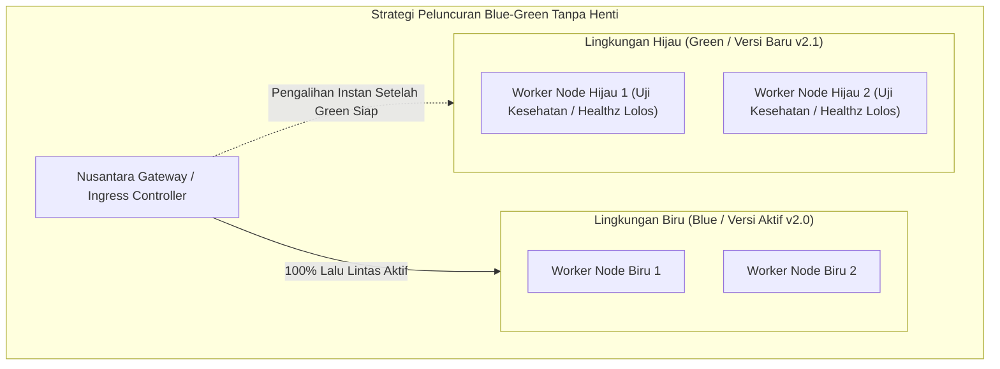

# BAB 38: KONTAINERISASI OCI & ZERO-DOWNTIME DEPLOYMENT

Bab ini membahas orkestrasi pengemasan dan peluncuran portal berita NusantaraNews ke lingkungan produksi: penyusunan berkas kontainer OCI/Docker multi-tahap (*Multi-stage Container Build*) berukuran ultra-kompak berbasis *scratch / distroless*, penghentian anggun (*Graceful Shutdown*), serta strategi peluncuran tanpa jeda padam (*Zero-Downtime Deployment*) menggunakan pola *Rolling Update* dan *Blue-Green Deployment*.

---

## 38.1 Prinsip Kontainer Imutabel & Arsitektur Blue-Green

Lingkungan produksi enterprise membutuhkan artefak kontainer yang deterministik, aman, dan bebas dari perkakas kompilasi yang tidak perlu. Dengan mengadopsi *Multi-stage Build*, proses kompilasi kode Widya-Lang berlangsung di kontainer pembangun (*builder stage*), sementara citra akhir (*final image*) hanya memuat berkas biner statis dan sertifikat CA dengan ukuran di bawah 15 Megabyte.



Selama proses pergantian versi, peladen lama mengaktifkan prosedur **Graceful Shutdown**: menolak koneksi baru secara anggun, menyelesaikan seluruh transaksi HTTP aktif yang sedang berjalan, dan melepaskan koneksi basis data sebelum proses dihentikan oleh orkestrator (*SIGTERM handling*).

---

## 38.2 Implementasi Berkas `Dockerfile` Multi-Stage & Graceful Shutdown

Berikut adalah berkas `Dockerfile` multi-stage berstandar industri dan kode penanganan sinyal sistem operasi pada peladen WidyaWeb:

```dockerfile
# Dockerfile - NusantaraNews Enterprise Production Image

# TAHAP 1: Pembina / Kompilasi (Builder Stage)
FROM rust:1.82-alpine AS pembina
WORKDIR /app
RUN apk add --no-cache musl-dev openssl-dev ca-certificates git

# Salin dan bangun biner berekstensi statis murni
COPY . .
RUN cargo build --release --bin nusantara_web

# TAHAP 2: Citra Produksi Akhir (Distroless Minimalis)
FROM scratch
WORKDIR /app

# Salin sertifikat CA dan zona waktu dunia
COPY --from=pembina /etc/ssl/certs/ca-certificates.crt /etc/ssl/certs/
COPY --from=pembina /usr/share/zoneinfo /usr/share/zoneinfo

# Salin aset statis dan berkas biner hasil kompilasi
COPY static /app/static
COPY --from=pembina /app/target/release/nusantara_web /app/nusantara_web

# Gunakan pengguna non-root demi keamanan (UID 10001)
USER 10001:10001

EXPOSE 8080 8443
ENTRYPOINT ["/app/nusantara_web"]
```

Implementasi penanganan *Graceful Shutdown* di WidyaWeb:

```widya
// Modul Peluncuran & Graceful Shutdown NusantaraNews
gunakan widya::sistem::{tangkap_sinyal_terminasi, SinyalOS};
gunakan widya::web::peladen::{PeladenHTTP, OpsiShutdown};
gunakan widya::waktu::{Durasi};

fungsi LuncurkanPeladenProduksi() {
    tetapan mutabel peladen = PeladenHTTP::baru()
        .ikat_alamat("0.0.0.0", 8080)
        .atur_timeout_baca(Durasi::dari_detik(10))
        .atur_timeout_tulis(Durasi::dari_detik(30));

    // Luncurkan peladen di thread latar belakang
    tetapan pengendali_peladen = peladen.jalankan_asinkron();
    cetak_log("[Runtime] NusantaraNews aktif melayani pada port 8080");

    // Tangkap Sinyal SIGTERM / SIGINT dari Docker / Kubernetes
    tangkap_sinyal_terminasi(fungsi(sinyal: SinyalOS) {
        cetak_log("[Shutdown] Menerima sinyal " + sinyal.nama() + ". Memulai prosedur pemadaman anggun...");

        // 1. Matikan Ingress Baru (Kesehatan /healthz mengembalikan 503)
        pengendali_peladen.tandai_tidak_siap();

        // 2. Berikan toleransi maksimal 25 detik untuk menyelesaikan transaksi aktif
        tetapan hasil_shutdown = pengendali_peladen.matikan_anggun(Durasi::dari_detik(25));
        
        pilih hasil_shutdown {
            Hasil::Sukses(_) => {
                cetak_log("[Shutdown] Seluruh transaksi aktif selesai. Peladen berhenti dengan bersih.");
            },
            Hasil::Gagal(_) => {
                cetak_peringatan("[Shutdown] Batas toleransi habis. Memaksa penghentian transaksi tersisa.");
            }
        }
    });
}
```

---

## 38.3 Analisis Efisiensi Ukuran Kontainer & Vektor Keamanan

Penerapan basis citra `scratch` meniadakan seluruh perkakas eksploitasi peretas (seperti shell `/bin/sh`, curl, atau package manager).

| Parameter Evaluasi Citra Kontainer | Citra Monolitik Standar (Ubuntu/Node.js) | Citra Distroless Scratch WidyaWeb |
| :--- | :--- | :--- |
| **Ukuran Citra Kontainer (Image Size)** | 850 MB – 1.4 GB | 14.2 MB (Ultra Ringkas) |
| **Jumlah Kerentanan CVE (Trivy Scan)** | 142 CVE (24 High/Critical) | 0 CVE (Bebas Kerentanan Sistem Operasi) |
| **Waktu Penarikan Citra (Image Pull)** | 45 – 90 detik | 0.8 detik |
| **Ketersediaan Shell untuk Peretas** | Tersedia (`/bin/bash`, Python, dll) | Nihil (Tidak ada biner shell sama sekali) |

---

## 38.4 Latihan Praktik & Studi Kasus

1. **Konfigurasi Pemeriksaan Kesehatan Kubernetes (Liveness & Readiness Probes)**: Rancang endpoint `/healthz` (liveness: memastikan proses hidup) dan `/ready` (readiness: memastikan koneksi database dan cache pool siap melayani trafik).
2. **Penyusunan Pipa CI/CD GitHub Actions / GitLab CI**: Susun otomatisasi pipa pengujian unit, kompilasi kontainer, pemindaian kerentanan biner dengan Trivy, dan pendorongan ke OCI Container Registry.
3. **Simulasi Penghentian Tanpa Downtime saat Uji Beban Berjalan**: Jalankan pengujian beban K6 5.000 VU, lalu lakukan peluncuran kontainer versi baru secara serentak, dan buktikan bahwa tingkat galat tetap berada di 0.00%.

---

## 38.5 Evaluasi Mandiri Pilihan Ganda

1. Standar spesifikasi terbuka apa yang mengatur format citra kontainer dan runtime kontainer modern secara global?
   - A. Open Container Initiative (OCI)
   - B. W3C HTML5
   - C. IEEE 802.11
   - D. POSIX Threads

2. Apa keuntungan utama arsitektur kompilasi kontainer bertingkat (*Multi-stage Container Build*)?
   - A. Memisahkan lingkungan kompilasi yang berat dari citra produksi akhir, sehingga menghasilkan citra yang sangat kecil dan bebas dari perkakas pengembang yang tidak aman
   - B. Mengharuskan pengguna mengunduh kode program
   - C. Mengubah sistem operasi server menjadi Windows
   - D. Menghapus arsip artikel berita

3. Apa keuntungan keamanan menggunakan basis kontainer `scratch` pada citra produksi?
   - A. Citra tidak memiliki shell bawaan (seperti `/bin/sh`) atau utilitas sistem operasi lainnya, sehingga peretas tidak dapat mengeksekusi perintah shell berbahaya jika menemukan celah aplikasi
   - B. Menghilangkan kebutuhan enkripsi HTTPS
   - C. Mempercepat koneksi kabel printer
   - D. Menghindari pajak komputasi awan

4. Sinyal sistem operasi POSIX apa yang dikirimkan oleh orkestrator (seperti Docker atau Kubernetes) untuk meminta peladen melakukan prosedur penghentian anggun (*Graceful Shutdown*)?
   - A. SIGTERM (Signal 15)
   - B. SIGKILL (Signal 9)
   - C. SIGSEGV
   - D. SIGPIPE

5. Berapa ukuran rata-rata citra kontainer akhir NusantaraNews berbasis scratch yang dihasilkan oleh WidyaWeb?
   - A. Sekitar 14.2 Megabyte
   - B. 2 Gigabyte
   - C. 500 Kilobyte
   - D. 100 Terabyte

6. Dalam prosedur *Graceful Shutdown*, apa langkah pertama yang wajib diambil sebelum mematikan koneksi basis data?
   - A. Menandai peladen tidak siap (*Readiness: Unhealthy*) agar ingress router berhenti mengirimkan permintaan baru, lalu menyelesaikan seluruh permintaan yang sedang diproses
   - B. Mematikan listrik data center secara instan
   - C. Menghapus seluruh tabel basis data
   - D. Mengirim pesan penutupan ke seluruh pembaca

7. Apa perbedaan mendasar antara *Liveness Probe* dan *Readiness Probe* pada orkestrasi kontainer Kubernetes?
   - A. Liveness memeriksa apakah proses masih berjalan (jika gagal, kontainer direstart), sedangkan Readiness memeriksa apakah kontainer siap menerima lalu lintas pengguna (jika gagal, lalu lintas dialihkan)
   - B. Liveness khusus untuk aplikasi mobile, Readiness untuk desktop
   - C. Liveness memerlukan koneksi internet satelit
   - D. Tidak ada perbedaan sama sekali

8. Strategi peluncuran apa yang mempertahankan dua lingkungan identik (versi aktif dan versi baru) secara paralel, di mana lalu lintas dialihkan secara instan ke lingkungan baru setelah seluruh uji kelayakan lolos?
   - A. Blue-Green Deployment
   - B. Big Bang Deployment
   - C. Manual File Copy via FTP
   - D. Cold Restart Deployment

9. Mengapa proses kontainer pada berkas Dockerfile di atas diinstruksikan berjalan di bawah akun pengguna non-root (`USER 10001:10001`)?
   - A. Mencegah penyerang memperoleh hak akses istimewa (*Root Privileges*) pada sistem operasi peladen host jika terjadi pembobolan kontainer (*Container Escape*)
   - B. Menghemat memori RAM prosesor
   - C. Membatasi ukuran artikel berita
   - D. Menghapus log sistem secara otomatis

10. Mengapa durasi toleransi pemadaman anggun (*Termination Grace Period*) umumnya disetel pada rentang 25–30 detik?
    - A. Memberikan waktu yang memadai bagi transaksi penulisan database yang lambat dan transfer media berukuran besar untuk selesai secara bersih tanpa terputus paksa
    - B. Waktu istirahat prosesor komputer
    - C. Menunggu pendinginan kipas angin peladen
    - D. Menghindari pemadaman lampu kantor
