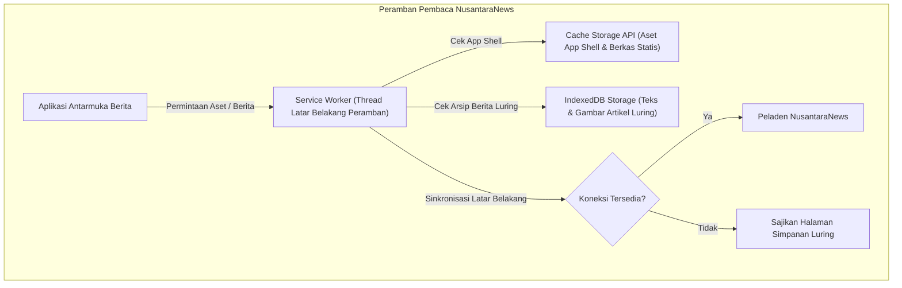

# BAB 39: ARSITEKTUR OFFLINE-FIRST PWA & SERVICE WORKERS

Bab ini mendalami implementasi aplikasi web progresif (*Progressive Web App / PWA*) berorientasi *Offline-First* pada portal berita NusantaraNews: arsitektur Service Worker terintegrasi, strategi singgahan peramban (*Stale-While-Revalidate*, *Cache-First*, *Network-First*), sinkronisasi data latar belakang (*Background Sync*), serta persistensi artikel luring menggunakan IndexedDB.

---

## 39.1 Filosofi Offline-First & Arsitektur Service Worker

Pembaca portal berita sering kali berada dalam kondisi konektivitas buruk atau tanpa sinyal sama sekali (misal: saat berada di dalam terowongan kereta bawah tanah atau di pedalaman nusantara). Arsitektur **Offline-First** memastikan aplikasi web NusantaraNews tetap terbuka instan dan menyajikan artikel yang telah disimpan sebelumnya tanpa menampilkan pesan galat "Tidak Ada Koneksi Internet".



---

## 39.2 Implementasi Service Worker & Penyimpanan Artikel IndexedDB

Berikut adalah implementasi berkas `service-worker.js` NusantaraNews yang mengadopsi strategi singgahan terpadu dan penanganan sinkronisasi latar belakang:

```javascript
// service-worker.js - NusantaraNews Offline-First Engine
const NAMA_CACHE_STATIS = 'nusantara-static-v2';
const NAMA_CACHE_BERITA = 'nusantara-news-articles-v2';

const ASET_APP_SHELL = [
  '/',
  '/offline.html',
  '/static/css/theme.css',
  '/static/css/layout.css',
  '/static/img/logo-nusantara.svg',
  '/static/fonts/inter.woff2'
];

// 1. Fase Pemasangan (Install Event): Unduh App Shell ke Cache
self.addEventListener('install', (event) => {
  event.waitUntil(
    caches.open(NAMA_CACHE_STATIS).then((cache) => {
      console.log('[ServiceWorker] Menyimpan App Shell ke cache...');
      return cache.addAll(ASET_APP_SHELL);
    }).then(() => self.skipWaiting())
  );
});

// 2. Fase Aktivasi (Activate Event): Pembersihan Cache Usang
self.addEventListener('activate', (event) => {
  event.waitUntil(
    caches.keys().then((daftarKunci) => {
      return Promise.all(
        daftarKunci.map((kunci) => {
          if (kunci !== NAMA_CACHE_STATIS && kunci !== NAMA_CACHE_BERITA) {
            console.log('[ServiceWorker] Menghapus cache versi lama:', kunci);
            return caches.delete(kunci);
          }
        })
      );
    }).then(() => self.clients.claim())
  );
});

// 3. Fase Intersepsi Jaringan (Fetch Event)
self.addEventListener('fetch', (event) => {
  const url = new URL(event.request.url);

  // A. Aset Statis (CSS, JS, Font): Strategi Cache-First
  if (url.pathname.startsWith('/static/')) {
    event.respondWith(
      caches.match(event.request).then((responCache) => {
        return responCache || fetch(event.request);
      })
    );
    return;
  }

  // B. Halaman Artikel Berita: Strategi Stale-While-Revalidate
  if (url.pathname.startsWith('/berita/')) {
    event.respondWith(
      caches.open(NAMA_CACHE_BERITA).then(async (cache) => {
        const responCache = await cache.match(event.request);
        
        // Ambil versi terbaru di latar belakang
        const janjiJaringan = fetch(event.request).then((responJaringan) => {
          if (responJaringan.status === 200) {
            cache.put(event.request, responJaringan.clone());
          }
          return responJaringan;
        }).catch(() => {
          // Jika koneksi internet putus dan cache ada, kembalikan cache
          if (responCache) return responCache;
          return caches.match('/offline.html');
        });

        // Kembalikan versi cache instan jika ada, atau tunggu jaringan
        return responCache || janjiJaringan;
      })
    );
    return;
  }

  // C. Permintaan Lain: Standar Network-First dengan Fallback
  event.respondWith(
    fetch(event.request).catch(() => caches.match('/offline.html'))
  );
});
```

Penyimpanan artikel lengkap untuk dibaca nanti (*Save for Offline Reading*) menggunakan IndexedDB di peramban:

```widya
// Modul Sisi Klien: Penyimpanan Berita Luring NusantaraNews
gunakan widya::web::indexed_db::{DatabaseIDB, TokoObjek};

rekod BeritaLuring {
    id: Teks,
    judul: Teks,
    slug: Teks,
    konten_lengkap: Teks,
    foto_base64: Teks,
    disimpan_pada: Teks
}

fungsi SimpanArtikelUntukDibacaLuring(berita: BeritaLuring) {
    tetapan idb = DatabaseIDB::buka("nusantara_offline_db", 1, fungsi(skema) {
        skema.buat_toko_objek("artikel_tersimpan", "id");
    })?;

    tetapan mutabel transaksi = idb.transaksi_tulis(["artikel_tersimpan"])?;
    tetapan toko = transaksi.ambil_toko("artikel_tersimpan");
    
    toko.masukkan(berita.id, berita.ke_json());
    transaksi.komit()?;
    cetak_log("[Offline] Artikel berhasil disimpan ke IndexedDB: " + berita.judul);
}
```

---

## 39.3 Analisis Strategi Caching Service Worker

Pemilihan strategi singgahan yang tepat menjamin keseimbangan antara kecepatan pemuatan instan dan kesegaran konten berita.

| Strategi Caching | Perilaku Eksekusi | Kasus Penggunaan Ideal | Kinerja saat Tanpa Internet |
| :--- | :--- | :--- | :--- |
| **Cache-First** | Mengambil dari cache lokal; hanya ke jaringan jika nihil | Aset statis imutabel (Font, Gambar logo, CSS inti) | 100% Berfungsi Instan (< 5 ms) |
| **Network-First** | Mengutamakan jaringan; jatuh ke cache jika putus koneksi | Halaman profil akun, data tagihan pembayaran VIP | Mengembalikan data simpanan terakhir |
| **Stale-While-Revalidate** | Langsung menyajikan cache basi, lalu memperbarui di latar belakang | Feed daftar berita terkini & halaman detail artikel | Instan dari cache, lalu diperbarui mulus |

---

## 39.4 Latihan Praktik & Studi Kasus

1. **Pembuatan Berkas `manifest.json` Lengkap**: Rancang manifes aplikasi web yang memuat `name`, `short_name`, `theme_color: #1a365d`, `display: standalone`, dan ikon maskable multi-ukuran (192px dan 512px) untuk memenuhi syarat instalasi peramban (*Add to Home Screen*).
2. **Implementasi Pengiriman Komentar Offline (Background Sync API)**: Rancang antrean komentar yang ditulis pembaca saat koneksi terputus ke dalam IndexedDB, lalu daftarkan peristiwa `sync: 'kirim-komentar-tertunda'` agar otomatis terkirim saat internet kembali terhubung.
3. **Pemberitahuan Dorong Berita Terkini (Web Push Notification)**: Integrasikan Service Worker dengan *Push API* untuk menampilkan notifikasi breaking news di layar perangkat pengguna meskipun peramban web sedang ditutup.

---

## 39.5 Evaluasi Mandiri Pilihan Ganda

1. Arsitektur apa yang memungkinkan sebuah situs web diinstal di perangkat pengguna layaknya aplikasi native dan dapat dibuka dalam kondisi tanpa koneksi internet?
   - A. Progressive Web App (PWA)
   - B. Desktop Widget
   - C. ActiveX
   - D. Flash Player

2. Komponen perangkat lunak peramban apa yang bertindak sebagai proksi jaringan yang berjalan di thread latar belakang untuk mengintersepsi permintaan HTTP dan mengelola singgahan luring?
   - A. Service Worker
   - B. WebGL Shader
   - C. Audio Decoder
   - D. CSS Preprocessor

3. Strategi singgahan (*caching strategy*) apa yang paling ideal untuk halaman artikel berita di mana pembaca langsung disajikan data lokal secara instan sambil peramban memperbarui data terbaru di latar belakang?
   - A. Stale-While-Revalidate
   - B. Network-Only
   - C. No-Cache
   - D. Cache-Only

4. Basis data peramban terstruktur apa yang mampu menyimpan data teks naskah dan gambar biner dalam jumlah besar di sisi klien untuk keperluan pembacaan luring?
   - A. IndexedDB
   - B. Cookie (terbatas 4 KB)
   - C. SessionStorage
   - D. URL Query Parameters

5. Peristiwa (*Event*) apa di dalam siklus hidup Service Worker yang menjadi tempat terbaik untuk mengunduh dan menyimpan berkas App Shell (CSS, logo, font)?
   - A. Peristiwa `install`
   - B. Peristiwa `click`
   - C. Peristiwa `unload`
   - D. Peristiwa `resize`

6. Apa peran berkas `manifest.json` pada Progressive Web App?
   - A. Berkas metadata JSON yang memberi tahu peramban perihal nama aplikasi, warna tema bilah status, orientasi layar, dan ikon untuk pemasangan di layar utama (*Home Screen*)
   - B. Menyimpan kata sandi jurnalis
   - C. Menghapus arsip artikel lama
   - D. Mengubah resolusi video

7. Kapan metode `caches.delete(kunci)` dieksekusi di dalam penanganan peristiwa `activate`?
   - A. Saat versi baru Service Worker aktif, untuk membersihkan singgahan aset dari versi lama yang sudah usang agar tidak memenuhi ruang memori perangkat
   - B. Saat baterai ponsel habis
   - C. Setiap kali pengguna mengklik tautan berita
   - D. Saat sistem operasi mengalami crash

8. API web modern apa yang digunakan untuk mengirimkan komentar pembaca yang tersimpan secara lokal ke peladen saat koneksi internet kembali terhubung secara otomatis di latar belakang?
   - A. Background Sync API
   - B. Web Bluetooth API
   - C. Screen Capture API
   - D. Gamepad API

9. Nilai `display: "standalone"` pada berkas manifes PWA menghasilkan efek visual apa bagi pembaca?
   - A. Aplikasi terbuka di jendela tersendiri tanpa bilah alamat URL peramban (*address bar*), memberikan kesan pengalaman visual aplikasi native yang mendalam
   - B. Menghapus gambar artikel
   - C. Mengubah warna tulisan menjadi putih
   - D. Mematikan fitur layar sentuh ponsel

10. Mengapa koneksi HTTPS yang aman menjadi syarat mutlak yang diwajibkan oleh seluruh peramban modern untuk mengizinkan pendaftaran Service Worker?
    - A. Mencegah serangan *Man-in-the-Middle* (MitM) yang dapat memalsukan atau membajak Service Worker untuk menyusupkan skrip jahat ke seluruh lalu lintas web pengguna
    - B. Menghabiskan anggaran kantor berita
    - C. Mengurangi kecepatan internet pengguna
    - D. Mengharuskan jurnalis memiliki sertifikat keamanan
