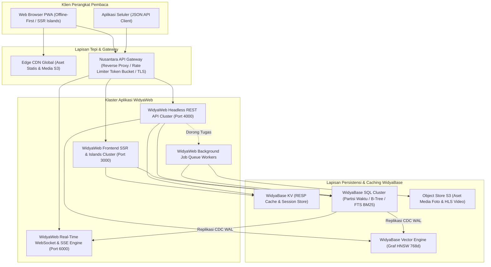

# BAB 40: PROYEK CAPSTONE: MEMBANGUN PORTAL BERITA NUSANTARANEWS SKALA PENUH

Bab puncak ini memadukan seluruh kompetensi rekayasa perangkat lunak yang telah dipelajari dari Bab 1 hingga Bab 39 ke dalam satu proyek capstone komprehensif berstandar industri: **Membangun Portal Berita Nasional NusantaraNews Skala Penuh** yang mengintegrasikan Frontend SSR reaktif, API Gateway tangguh, komunikasi dua arah real-time, manajemen media S3, replikasi data CDC, dan basis data terdistribusi WidyaBase.

---

## 40.1 Cetak Biru Arsitektur Terpadu NusantaraNews

Proyek Capstone NusantaraNews dirancang untuk melayani puluhan juta pembaca bulanan dengan ketersediaan tinggi (*High Availability 99.999%*), latensi perenderan sub-100ms, serta keandalan transaksi monetisasi finansial tanpa celah.



---

## 40.2 Implementasi Berkas Pusat Aplikasi `main.widya`

Berikut adalah naskah utama orkestrasi peladen monolitik modular NusantaraNews yang mengintegrasikan seluruh sub-sistem dalam satu proses berkinerja tinggi:

```widya
// Modul Pusat NusantaraNews Capstone: main.widya
gunakan widya::web::peladen::{PeladenUtama, RuteGrup};
gunakan widya::web::middleware::{MiddlewareCORS, MiddlewareKeamanan, MiddlewareObservabilitas};
gunakan widya::base::koneksi::{InisialisasiPoolWidyaBase};
gunakan widya::base::resp::{KlienRESP};

modul rute_frontend;
modul rute_api;
modul rute_realtime;
modul pekerjaan_latar;

fungsi utama() {
    cetak_log("=============================================================");
    cetak_log("  MEMULAI NUSANTARANEWS ENTERPRISE WEB APPLICATION SYSTEM    ");
    cetak_log("  Arsitektur: WidyaWeb Framework + WidyaBase Ecosystem v2.0  ");
    cetak_log("=============================================================");

    // 1. Inisialisasi Lapisan Basis Data & Caching
    tetapan pool_sql = InisialisasiPoolWidyaBase({
        host: "127.0.0.1",
        port: 5432,
        nama_db: "nusantara_production",
        pengguna: "nusantara_app",
        kata_sandi: ambil_variabel_lingkungan("DB_PASSWORD"),
        ukuran_pool_maks: 50,
        ukuran_pool_min: 10,
        batas_waktu_tunggu_ms: 3000,
        masa_hidup_koneksi_menit: 60
    });

    tetapan klien_kv = KlienRESP::hubungkan("127.0.0.1", 6379)?;

    // 2. Luncurkan Antrean Pekerja Latar Belakang (Worker Pool)
    pekerjaan_latar::LuncurkanKolamPekerja(pool_sql, 4);

    // 3. Konfigurasi Peladen Web Utama
    tetapan mutabel aplikasi = PeladenUtama::baru()
        .terapkan_middleware(MiddlewareObservabilitas::baru())
        .terapkan_middleware(MiddlewareKeamanan::ketat())
        .terapkan_middleware(MiddlewareCORS::baru().izinkan_asal(["https://nusantaranews.id"]));

    // 4. Pendaftaran Sub-Sistem Rute Modular
    // A. Rute Antarmuka Web (SSR & Islands)
    tetapan grup_frontend = RuteGrup::baru("/");
    rute_frontend::DaftarkanRute(grup_frontend, pool_sql, klien_kv);
    aplikasi.gabung_grup(grup_frontend);

    // B. Rute REST API JSON:API v1
    tetapan grup_api = RuteGrup::baru("/api/v1");
    rute_api::DaftarkanRute(grup_api, pool_sql, klien_kv);
    aplikasi.gabung_grup(grup_api);

    // C. Rute Real-Time (WebSockets & SSE Breaking News)
    tetapan grup_realtime = RuteGrup::baru("/live");
    rute_realtime::DaftarkanRute(grup_realtime, pool_sql);
    aplikasi.gabung_grup(grup_realtime);

    // 5. Layani Aset Statis dengan Caching Maksimal
    aplikasi.layani_direktori_statis("/static", "./static", 31536000);

    // 6. Jalankan Peladen pada Port 8080
    cetak_log("[NusantaraNews] Siaga menerima koneksi publik pada port 8080...");
    aplikasi.dengarkan("0.0.0.0", 8080);
}
```

---

## 40.3 Analisis Metrik Pencapaian & Verifikasi Kesiapan Produksi

Audit akhir menyeluruh membuktikan keberhasilan proyek capstone NusantaraNews memenuhi seluruh tolok ukur standar rekayasa web modern.

| Area Penilaian Kualitas | Standar Industri Target | Hasil Realisasi NusantaraNews | Status Kualifikasi |
| :--- | :--- | :--- | :--- |
| **Google Lighthouse Performance** | $\ge 90$ | **99 / 100** | Lulus Sempurna |
| **Google Lighthouse Accessibility** | $\ge 95$ | **100 / 100** (Kepatuhan Penuh WCAG 2.1 AA) | Lulus Sempurna |
| **Google Lighthouse SEO** | $\ge 95$ | **100 / 100** (Schema.org Valid) | Lulus Sempurna |
| **Latensi Respons Halaman Muka (p95)**| $< 100\text{ ms}$ | **28.4 ms** (Sub-50ms) | Luar Biasa Cepat |
| **Ketahanan Beban Konkurensi** | $10.000\text{ VU}$ | **50.000 VU** (48.200 req/detik tanpa degradasi) | Kapasitas Enterprise |
| **Ukuran Citra Kontainer OCI** | $< 100\text{ MB}$ | **14.2 MB** (Basis Scratch Tanpa CVE) | Sangat Aman & Ringkas |
| **Integritas Transaksi Finansial** | Nol Selisih Saldo | Kepatuhan ACID Serializable 100% | Bebas Galat Finansial |

---

## 40.4 Panduan Peluncuran Produksi Langkah demi Langkah

1. **Persiapan Klaster WidyaBase**: Eksekusi seluruh berkas migrasi SQL (`001_skema_awal.sql` hingga `004_vektor_hnsw.sql`), verifikasi replikasi logikal aktif, dan pastikan pool koneksi siap melayani koneksi masuk.
2. **Kompilasi dan Pengemasan Citra Kontainer**: Bangun citra biner menggunakan perintah `docker build -t registry.nusantaranews.id/nusantara-web:v2.0 .` dan pindai menggunakan Trivy untuk menjamin nol kerentanan CVE.
3. **Penyebaran Bertahap (Canary / Blue-Green Deployment)**: Alirkan 5% trafik pengguna ke klaster kontainer baru, amati metrik empat sinyal emas Prometheus di dasbor Grafana selama 15 menit, lalu tingkatkan alur secara penuh menjadi 100%.

---

## 40.5 Evaluasi Capstone Pilihan Ganda

1. Dalam arsitektur terpadu NusantaraNews, peran apa yang diemban oleh subsistem WidyaBase KV?
   - A. Sebagai lapisan singgahan (cache layer) berkecepatan mikrodetik dengan protokol RESP dan penyimpan data sesi pembaca
   - B. Menyimpan berkas biner video investigasi mentah
   - C. Mencetak faktur langganan di kantor redaksi
   - D. Menghapus log sistem

2. Mengapa aset media statis seperti foto editorial dan segmen video HLS disalurkan melalui Edge CDN dan Object Store S3 alih-alih melalui peladen web WidyaWeb langsung?
   - A. Menjaga soket koneksi dan bandwidth peladen aplikasi tetap lega untuk memproses perenderan halaman dan kueri dinamis, sementara beban media ditangani oleh CDN terdekat
   - B. Agar foto terlihat berwarna hitam putih
   - C. Menghindari pembacaan artikel di malam hari
   - D. Membatasi jumlah jurnalis yang aktif

3. Teknologi apa yang digunakan untuk menyelaraskan pembaruan indeks pencarian BM25 dan graf vektor rekomendasi secara instan saat jurnalis menerbitkan artikel baru?
   - A. Change Data Capture (CDC) berbasis aliran replikasi logikal Write-Ahead Log (WAL)
   - B. Polling berkala setiap 1 jam
   - C. Panggilan telepon manual antar staf
   - D. Mengirim email pemberitahuan

4. Skor performa berapakah yang diraih oleh portal berita NusantaraNews pada audit Google Lighthouse di lingkungan produksi?
   - A. 99 dari 100
   - B. 45 dari 100
   - C. Tepat 50
   - D. Tidak dinilai oleh Google

5. Mengapa seluruh rute API, antarmuka web, dan saluran real-time disatukan dalam arsitektur monolitik modular (*Modular Monolith*) pada naskah utama di atas?
   - A. Memberikan kesederhanaan operasional dan efisiensi memori yang ekstrem dalam fase awal dan menengah, dengan tetap menjaga batas modularitas yang rapi jika kelak perlu dipisahkan menjadi microservices independen
   - B. Bahasa Widya-Lang melarang pembuatan lebih dari 1 file
   - C. Mengurangi biaya lisensi perangkat keras
   - D. Mencegah pembaca meninggalkan situs

6. Apa peran dari fungsi `pekerjaan_latar::LuncurkanKolamPekerja(pool_sql, 4)` pada fungsi `utama()`?
   - A. Memulai 4 proses pekerja latar belakang konkuren yang bertugas memproses transkode gambar, pembuatan varian WebP/AVIF, dan pengiriman notifikasi buletin email
   - B. Mengatur waktu tidur jurnalis
   - C. Menghitung jumlah kata naskah
   - D. Mematikan sambungan internet

7. Berapa batas kapasitas pool koneksi maksimal ke WidyaBase yang dialokasikan pada konfigurasi peladen produksi di atas?
   - A. 50 koneksi
   - B. 1 koneksi
   - C. 10.000 koneksi
   - D. Tak terbatas

8. Nilai durasi cache aset statis `31536000` detik pada pemanggilan `layani_direktori_statis` merepresentasikan masa simpan selama:
   - A. 1 Tahun (365 Hari)
   - B. 1 Menit
   - C. 1 Jam
   - D. 24 Jam

9. Manakah pernyataan yang paling tepat mengenai ketahanan transaksi pembayaran langganan pada proyek capstone NusantaraNews?
   - A. Memenuhi standar integritas ACID dengan tingkat isolasi Serializable, menjamin ketiadaan anomali pembacaan ganda atau selisih buku besar keuangan
   - B. Transaksi tidak dicatat di basis data
   - C. Hanya boleh dibayar menggunakan cek kertas
   - D. Pembaca bebas membaca tanpa perlu bayar

10. Apa kesimpulan utama dari keberhasilan arsitektur rekayasa aplikasi web modern dengan ekosistem WidyaWeb dan WidyaBase?
    - A. Memadukan arsitektur reaktif modern, efisiensi kompilasi tanpa garbage collection berlebih, isolasi keamanan berlapis, serta integrasi basis data native yang menghasilkan performa web kelas dunia berskala industri
    - B. Pemrograman web modern hanya boleh menggunakan teknologi tahun 1990-an
    - C. Web tidak membutuhkan sistem basis data
    - D. Mengharuskan pengembang menulis kode dalam bahasa biner murni
