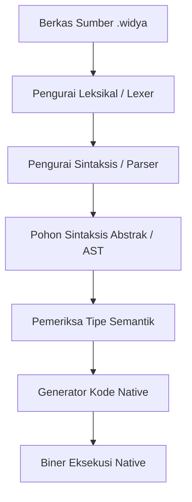
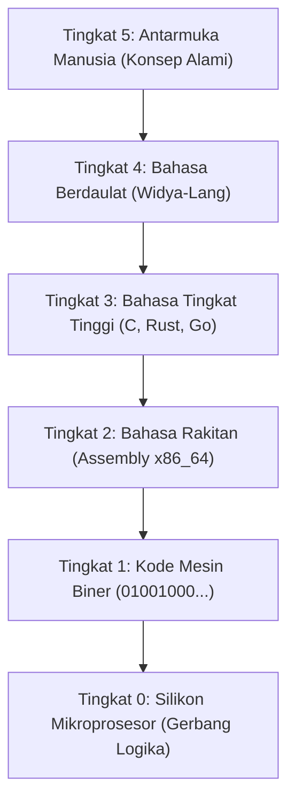
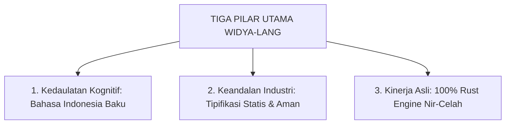
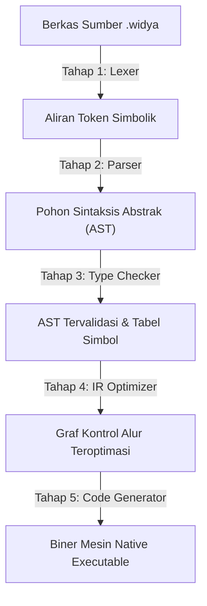

## Bab 1: Pengantar Pemrograman dan Filosofi Bahasa Widya

### 1.1 Hakikat Pemrograman Komputer dan Komputasi Modern



Pemrograman komputer pada dasarnya adalah proses formulasi instruksi presisi agar mesin komputasi mampu memproses data mentah menjadi informasi yang bernilai guna bagi peradaban. Unit pemroses pusat (*Central Processing Unit* atau CPU) pada hakikatnya hanyalah sebuah sirkuit elektronik raksasa yang terdiri atas miliaran transistor semikonduktor. Komputer tidak memahami perasaan, nuansa bahasa manusia, atau konteks sosial; ia hanya mengenal ada tidaknya arus listrik, yang disimbolkan secara biner sebagai angka `1` (tegangan tinggi) dan angka `0` (tegangan rendah).

Menulis jutaan bit `0` dan `1` secara langsung (*Machine Code*) sangat lambat, melelahkan otak manusia, dan memiliki probabilitas kesalahan yang teramat tinggi. Untuk menjembatani jurang komunikasi antara akal budi manusia dengan sirkuit silikon komputer, lahirlah **Bahasa Pemrograman Tingkat Tinggi** (*High-Level Programming Language*). Melalui bahasa tingkat tinggi, manusia dapat mengekspresikan logika matematika, perulangan, dan pengambilan keputusan dalam format teks terstruktur yang mudah dipahami nalar, yang kemudian diterjemahkan oleh **Kompilator** (*Compiler*) menjadi biner mesin fisik.



### 1.2 Urgensi Kedaulatan Digital dan Bahasa Berdaulat Nusantara
Selama lebih dari enam dekade sejak era awal komputasi modern, mayoritas bahasa pemrograman komersial dunia diciptakan dengan basis kosakata bahasa Inggris (*Anglo-American Centric*). Ketergantungan ini memunculkan dua tantangan krusial:
1. **Rintangan Kognitif Pemula (*Cognitive Friction*)**: Generasi muda dan pelajar di pelosok nusantara yang baru pertama kali mempelajari logika komputasi harus menanggung beban kognitif ganda (*double cognitive load*): mereka harus memahami konsep abstraksi logika komputasi yang rumit, sekaligus menerjemahkan istilah asing yang asing bagi keseharian mereka.
2. **Kemandirian Rantai Pasok Teknologi**: Di era globalisasi yang sarat ketegangan geopolitik, ketergantungan 100% pada ekosistem perangkat lunak pihak luar menempatkan infrastruktur nasional—mulai dari perbankan, telekomunikasi, ketahanan pangan, hingga sistem pertahanan—dalam risiko kerentanan backdoor, lisensi sepihak, dan embargo teknologi mendadak.

**Widya-Lang** hadir sebagai wujud kemandirian dan kebangkitan teknologi nasional. Dirancang dengan mesin kompilator native modern berbasis Rust murni tanpa celah memori, Widya-Lang menggabungkan kosakata bahasa Indonesia baku yang anggun dengan ketangguhan performa kelas dunia yang siap bersaing di kancah industri global.



### 1.3 Perbandingan Paradigma Bahasa
Untuk memetakan keunggulan komparatif Widya-Lang terhadap bahasa-bahasa mapan lainnya di dunia industri, perhatikan matriks evaluasi berikut:

| Dimensi Rekayasa | Widya-Lang | C / C++ | Rust | Python 3 | Go (Golang) |
| :--- | :--- | :--- | :--- | :--- | :--- |
| **Kosakata Inti** | Bahasa Indonesia | Bahasa Inggris | Bahasa Inggris | Bahasa Inggris | Bahasa Inggris |
| **Model Eksekusi** | Kompilasi Cepat & JIT | AOT Native | AOT Native | Interpretasi VM | AOT Native |
| **Pengelolaan Memori**| Kepemilikan Nir-GC | Manual Pointer | Peminjaman / Linear| Garbage Collector | Garbage Collector |
| **Keamanan Tipe** | Kuat & Statis | Lemah / Fleksibel | Sangat Kuat | Dinamis / Runtime | Kuat & Statis |
| **Jeda GC (Stop-World)**| Nol (Nir-Jeda) | Nol | Nol | Ada (Fluktuatif) | Ada (Minimal) |

### 1.4 Arsitektur Kompilator Widya-Lang
Kompilator Widya-Lang mengadopsi arsitektur multi-lintasan (*multi-pass compiler*) modern yang membagi proses transformasi kode sumber menjadi lima tahapan terpisah:



1. **Pengurai Leksikal (*Lexer*)**: Membaca naskah mentah karakter demi karakter, membuang spasi kosong dan komentar, lalu mengelompokkannya menjadi aliran token simbolik.
2. **Pengurai Sintaksis (*Parser*)**: Memvalidasi apakah urutan token mematuhi tata bahasa formal Widya-Lang, kemudian menyusunnya menjadi Pohon Sintaksis Abstrak (*Abstract Syntax Tree* / AST).
3. **Penganalisis Semantik (*Type Checker*)**: Memeriksa keselarasan logika, memastikan variabel yang diakses sudah dideklarasikan, dan memvalidasi keabsahan tipe data.
4. **Pengoptimal Representasi Perantara (*IR Optimizer*)**: Melakukan optimasi logika seperti penghapusan kode mati (*dead code elimination*) dan pelipatan konstanta (*constant folding*).
5. **Pembangkit Kode Mesin**: Menghasilkan instruksi biner native yang siap dieksekusi prosesor dengan kecepatan puncak.

### 1.5 Contoh Kode Praktik 1: Program Salam Kebangsaan
Berikut adalah contoh naskah lengkap program pertama yang mendemonstrasikan struktur fungsi utama:

```widya
// Berkas: bab01_salam_kebangsaan.widya
// Program perdana menyambut era kedaulatan komputasi nusantara

fungsi utama() {
    cetak("==================================================");
    cetak("      SELAMAT DATANG DI DUNIA WIDYA-LANG          ");
    cetak("  Bahasa Pemrograman Berdaulat untuk Masa Depan   ");
    cetak("==================================================");
    cetak("Mari melangkah bersama membangun kemandirian digital.");
}
```

**Penjelasan Baris demi Baris:**
- Baris 1-2: Komentar naskah penjelas yang diabaikan mesin kompilator.
- Baris 4: `fungsi utama() {` mendeklarasikan fungsi permulaan wajib yang akan pertama kali dieksekusi oleh sistem operasi.
- Baris 5-9: Fungsi `cetak(...)` memancarkan string teks ke aliran keluaran standar terminal (STDOUT).
- Baris 10: Tanda kurung kurawal penutup `}` menandakan batas akhir eksekusi fungsi.

### 1.6 Contoh Kode Praktik 2: Memeriksa Status Mesin Runtime
Contoh kedua mendemonstrasikan pencetakan informasi spesifikasi lingkungan kerja sistem:

```widya
// Berkas: bab01_info_mesin.widya

fungsi utama() {
    tetap nama_sistem = "Widya Runtime Engine";
    tetap versi = "0.1.0 Stable";
    tetap arsitektur = "x86_64 / ARM64 Universal";
    
    cetak("Informasi Perangkat Lunak:");
    cetak("- Mesin Inti   : " + nama_sistem);
    cetak("- Versi Rilis  : " + versi);
    cetak("- Arsitektur   : " + arsitektur);
    cetak("Status Operasi : Siap Mengeksekusi Kode!");
}
```

### 1.7 Kesalahan Pemula dan Solusi (*Troubleshooting*)
- **Galat**: `Galat Sintaksis: Simbol titik koma ';' diharapkan di akhir pernyataan pada baris 6`.
  - *Penyebab*: Pemrogram lupa mengakhiri baris instruksi dengan tanda titik koma `;`.
  - *Solusi*: Selalu akhiri setiap baris pernyataan dengan titik koma.
- **Galat**: `Galat Tautan: Fungsi 'utama' tidak ditemukan dalam berkas`.
  - *Penyebab*: Fungsi pembuka dinamai secara keliru (misalnya `fungsi main()` atau `fungsi Utama()`).
  - *Solusi*: Gunakan huruf kecil baku `fungsi utama()`.

### 1.8 Rangkuman Konsep Kunci Bab 1
| Konsep | Penjelasan Esensial |
| :--- | :--- |
| **Kompilator** | Perangkat lunak penerjemah naskah teks manusia ke kode mesin biner. |
| **Pintu Masuk (`utama`)** | Titik awal eksekusi program di mana sistem operasi menyerahkan kendali. |
| **Kedaulatan Digital** | Kemampuan bangsa merancang, menguasai, dan mengamankan rantai teknologi sendiri. |
| **Fungsi `cetak`** | Utilitas bawaan untuk memancarkan informasi teks ke konsol pengguna. |

### 1.9 Latihan Mandiri & Evaluasi Pemahaman
1. Sebutkan lima tahapan dalam siklus penerjemahan kode pada kompilator Widya-Lang!
2. Mengapa menulis program langsung dalam kode mesin biner (`0` dan `1`) tidak lagi relevan bagi pengembangan aplikasi modern?
3. **Tantangan Praktik**: Buatlah berkas `biodata_mandiri.widya` yang menampilkan nama Anda, asal kota, cita-cita, dan motto hidup dalam bingkai karakter bintang `*` yang rapi di layar terminal!

---

### 1.9 Latihan Soal Pilihan Ganda (10 Soal)

Pilihlah satu jawaban yang paling tepat (A, B, C, atau D) untuk menguji penguasaan materi bab ini:

**1. Apa motivasi fundamental di balik pengembangan bahasa pemrograman Widya-Lang?**
- A. Mengganti seluruh sistem operasi Linux
- B. Mewujudkan kedaulatan teknologi dan menurunkan beban kognitif pemula dengan bahasa ibu
- C. Menghapus penggunaan bahasa Inggris di seluruh dunia
- D. Membuat kompilator yang hanya bisa berjalan di Windows

**2. Komputer pada tingkat semikonduktor paling dasar hanya memproses sinyal...**
- A. Gelombang suara analog
- B. Teks bahasa Latin
- C. Arus listrik biner (0 dan 1)
- D. Piksel warna layar

**3. Perangkat lunak yang menerjemahkan naskah kode sumber ke kode mesin biner disebut...**
- A. Kompilator (Compiler)
- B. Browser
- C. Antivirus
- D. Editor Teks

**4. Tahap pertama dalam pipa kerja kompilator yang mengubah karakter mentah menjadi token adalah...**
- A. Pemeriksa Tipe
- B. Pengurai Leksikal (Lexer)
- C. Pembangkit Kode Biner
- D. Penaut (Linker)

**5. Pohon hierarki sintaksis yang dihasilkan setelah tahap parsing disebut...**
- A. DOM (Document Object Model)
- B. BST (Binary Search Tree)
- C. AST (Abstract Syntax Tree)
- D. B-Tree Database

**6. Fungsi pintu masuk utama yang wajib ada dalam program Widya-Lang bernama...**
- A. start()
- B. utama()
- C. main()
- D. mulai()

**7. Fungsi bawaan untuk mencetak teks ke layar terminal adalah...**
- A. tulis()
- B. print()
- C. cetak()
- D. tampilkan()

**8. Bahasa pemrograman apa yang menjadi basis pengembangan mesin kompilator native Widya-Lang?**
- A. JavaScript
- B. Rust murni
- C. Python 2
- D. Visual Basic

**9. Manakah pernyataan yang BENAR mengenai arsitektur Widya-Lang?**
- A. Memerlukan virtual machine Java untuk berjalan
- B. Bebas dari jeda Garbage Collector (Nir-GC)
- C. Tidak mendukung karakter huruf lokal
- D. Hanya bisa berjalan pada arsitektur 32-bit

**10. Apa ekstensi berkas resmi untuk kode sumber bahasa Widya?**
- A. .wdy
- B. .id
- C. .widya
- D. .wid
