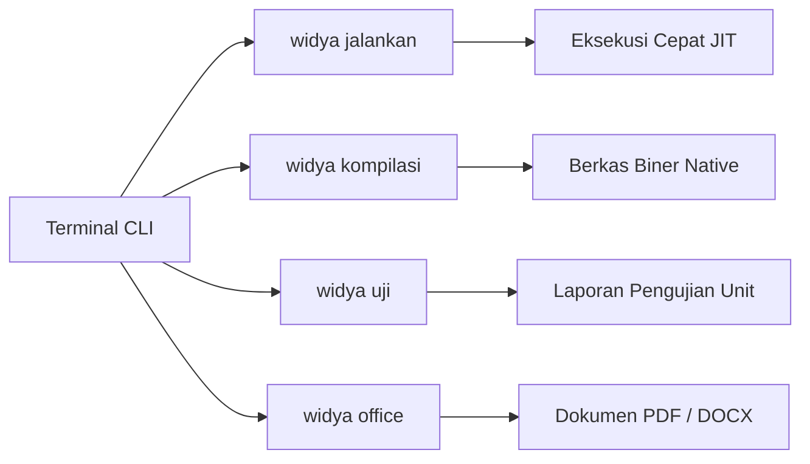
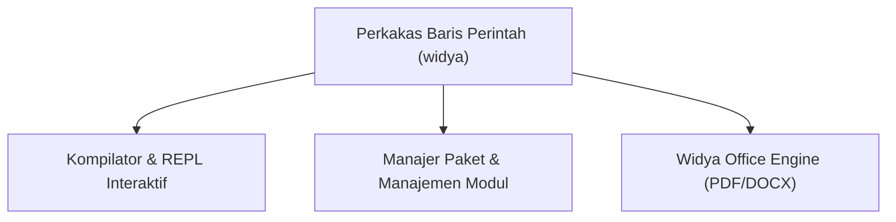
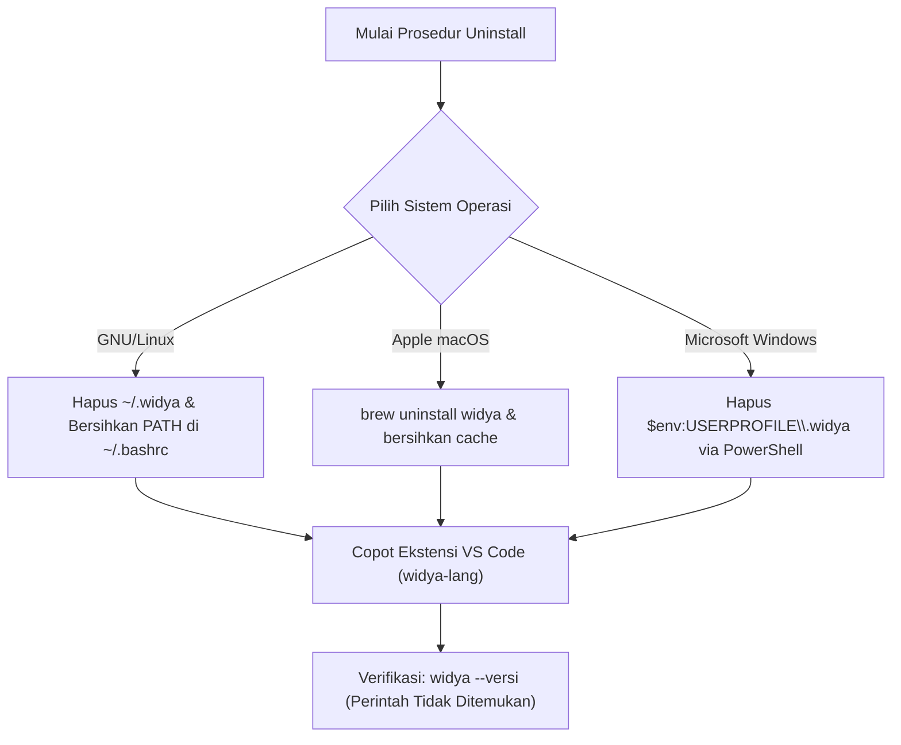

## Bab 2: Instalasi Komprehensif, Konfigurasi Lingkungan, dan Ekosistem Perkakas

### 2.1 Persyaratan Sistem Komputer



Sebelum memulai instalasi Widya-Lang, pastikan workstation kerja Anda memenuhi spesifikasi perangkat keras dan lunak minimum:
- **Arsitektur Pemroses**: 64-bit x86_64 (Intel Core i3/i5/i7/i9 atau AMD Ryzen) maupun 64-bit ARM64 (Apple Silicon M-Series atau Raspberry Pi 4/5).
- **Kapasitas RAM**: Minimal 2 GB RAM fisik (disarankan 4 GB atau lebih untuk kenyamanan kompilasi proyek besar).
- **Penyimpanan Disk**: Minimal 350 MB ruang kosong untuk biner kompilator, pustaka standar, serta perkakas format.
- **Sistem Operasi**: GNU/Linux (Kernel 5.4+), Apple macOS (Monterey 12.0+), atau Microsoft Windows 10/11 64-bit.

### 2.2 Prosedur Instalasi pada Berbagai Sistem Operasi

#### A. Lingkungan GNU/Linux (Debian, Ubuntu, Linux Mint)
Buka emulator terminal Anda dan jalankan perintah bash berikut:
```bash
# 1. Pemasangan dependensi dasar pembangun
sudo apt-get update && sudo apt-get install -y curl build-essential git

# 2. Pengunduhan otomatis skrip penginstal resmi
curl -fsSL https://get.widya-lang.id/install.sh | bash

# 3. Penerapan konfigurasi shell terminal
source ~/.bashrc
```

#### B. Lingkungan Apple macOS
Bagi pengguna macOS, perkakas Widya didistribusikan melalui manajer paket Homebrew:
```bash
# 1. Mendaftarkan repositori resmi
brew tap widya-lang/distro

# 2. Memasang biner kompilator
brew install widya

# 3. Memverifikasi pemasangan
widya --versi
```

#### C. Lingkungan Microsoft Windows
Pada sistem Windows 10 atau 11, buka PowerShell dengan hak akses Administrator (*Run as Administrator*):
```powershell
# Menjalankan skrip penginstal Windows
Set-ExecutionPolicy RemoteSigned -Scope CurrentUser
irm https://get.widya-lang.id/install.ps1 | iex
```

### 2.3 Membedah Perintah Baris CLI `widya`
Paket biner `widya` merupakan perkakas serbaguna (*all-in-one developer tool*) yang mencakup berbagai subperintah:

| Subperintah CLI | Contoh Pemanggilan | Deskripsi Kegunaan |
| :--- | :--- | :--- |
| `jalankan` | `widya jalankan program.widya` | Menjalankan kode seketika dengan mode JIT tanpa membuat berkas biner. |
| `kompilasi` | `widya kompilasi program.widya -o aplikasi` | Mengompilasi naskah menjadi biner mandiri yang siap dipublikasikan. |
| `uji` | `widya uji tests/` | Menjalankan seluruh pengujian unit otomatis dalam direktori. |
| `format` | `widya format berkas.widya` | Merapikan spasi dan indentasi naskah secara otomatis sesuai standar. |
| `office convert`| `widya office convert naskah.md -o naskah.pdf --toc` | Mengonversi naskah Markdown menjadi PDF/DOCX perkantoran asli. |
| `periksa` | `widya periksa-lingkungan` | Melakukan audit kelengkapan dependensi sistem dan pustaka. |



### 2.4 Konfigurasi Editor Visual Studio Code
Untuk menghadirkan pengalaman pengembangan yang produktif, sangat disarankan menggunakan editor VS Code dengan ekstensi resmi `Widya Language Official Extension`:
1. Buka menu Extensions di VS Code (`Ctrl + Shift + X` atau `Cmd + Shift + X`).
2. Cari kata kunci: `widya-lang`.
3. Klik tombol **Install**.
4. Fitur yang langsung aktif:
   - Pewarnaan sintaksis berdaulat (*Syntax Highlighting*).
   - Pelengkapan otomatis (*Autocompletion & IntelliSense*).
   - Format otomatis saat berkas disimpan (*Format on Save*).

### 2.5 Contoh Kode Praktik 1: Skrip Uji Kelayakan Lingkungan
Buatlah berkas bernama `uji_instalasi.widya` untuk mengonfirmasi bahwa pustaka standar dapat dimuat dengan baik:

```widya
// Berkas: bab02_uji_instalasi.widya
// Mengonfirmasi bahwa kompilator bekerja secara normal

fungsi utama() {
    cetak("Pemeriksaan Lingkungan Pengembangan:");
    tetap status_kompiler = "AKTIF";
    tetap bahasa_baku = "Bahasa Indonesia";
    tetap waktu_cek = "2026-10-19";
    
    cetak("[OK] Status Kompilator : " + status_kompiler);
    cetak("[OK] Standar Bahasa    : " + bahasa_baku);
    cetak("[OK] Tanggal Verifikasi : " + waktu_cek);
    cetak("Selamat! Lingkungan Widya-Lang Anda telah siap digunakan 100%.");
}
```

Jalankan program di atas melalui terminal:
```bash
widya jalankan uji_instalasi.widya
```

### 2.6 Contoh Kode Praktik 2: Menampilkan Parameter Eksekusi
Program berikut mendemonstrasikan bagaimana aplikasi menerima opsi konfigurasi:

```widya
// Berkas: bab02_cek_opsi.widya

fungsi utama() {
    cetak("Program Utilitas Siap Menerima Instruksi Pengguna.");
    cetak("Gunakan perintah 'widya bantuan' untuk melihat daftar opsi.");
}
```

### 2.7 Prosedur Pencopotan Pemasangan (Uninstall) Widya-Lang
Apabila Anda perlu mencopot pemasangan (*uninstall*) kompilator Widya-Lang dari sistem—baik untuk pembaruan versi bersih (*clean reinstall*), migrasi mesin, atau pemeliharaan lingkungan kerja—seluruh berkas biner dan pustaka dapat dibersihkan secara tuntas tanpa meninggalkan *residue* pada sistem operasi.



#### A. Pencopotan pada GNU/Linux (Ubuntu, Debian, Fedora, Arch)
1. **Menghapus Direktori Biner dan Pustaka**:
   Buka terminal dan hapus direktori instalasi utama beserta *cache* kompilasi:
   ```bash
   rm -rf ~/.widya
   rm -rf ~/.cache/widya
   ```
2. **Membersihkan Variabel Lingkungan Shell**:
   Buka berkas profil shell Anda (misalnya `~/.bashrc` atau `~/.zshrc`) menggunakan penyunting teks:
   ```bash
   nano ~/.bashrc
   ```
   Hapus atau beri tanda pagar (`#`) pada baris penambahan variabel lingkungan:
   ```bash
   export PATH="$HOME/.widya/bin:$PATH"
   ```
   Simpan berkas (`Ctrl + O`, `Enter`), keluar (`Ctrl + X`), lalu terapkan perubahan seketika:
   ```bash
   source ~/.bashrc
   ```
3. **Skrip Pencopotan Otomatis (Opsional)**:
   Jika Anda memasang melalui skrip instalasi web resmi, Anda dapat menjalankan perintah pencopotan satu baris:
   ```bash
   curl -fsSL https://get.widya-lang.id/uninstall.sh | bash
   ```

#### B. Pencopotan pada Apple macOS
Bagi pengguna macOS yang memasang melalui manajer paket Homebrew:
```bash
# 1. Copot pemasangan paket biner
brew uninstall widya

# 2. Lepaskan repositori resmi
brew untap widya-lang/distro

# 3. Bersihkan berkas konfigurasi lokal
rm -rf ~/.widya
rm -rf ~/Library/Caches/widya-lang
```

#### C. Pencopotan pada Microsoft Windows
Buka PowerShell dengan hak akses Administrator (*Run as Administrator*), kemudian jalankan perintah pembersihan berikut:
```powershell
# 1. Menghapus folder instalasi dan konfigurasi lokal
Remove-Item -Recurse -Force "$env:USERPROFILE\.widya" -ErrorAction SilentlyContinue
Remove-Item -Recurse -Force "$env:LOCALAPPDATA\widya-lang" -ErrorAction SilentlyContinue

# 2. Menghapus jalur biner dari variabel lingkungan PATH Pengguna
$UserPath = [Environment]::GetEnvironmentVariable("Path", "User")
$NewPath = ($UserPath -split ';' | Where-Object { $_ -notlike "*\.widya\bin*" }) -join ';'
[Environment]::SetEnvironmentVariable("Path", $NewPath, "User")

Write-Host "Pencopotan Widya-Lang dari sistem Windows berhasil diselesaikan 100%." -ForegroundColor Green
```
Atau manfaatkan skrip otomatis PowerShell:
```powershell
irm https://get.widya-lang.id/uninstall.ps1 | iex
```

#### D. Pencopotan Ekstensi Visual Studio Code
Jika Anda memasang ekstensi resmi Widya-Lang di VS Code:
1. Buka antarmuka VS Code, tekan `Ctrl + Shift + X` (atau `Cmd + Shift + X` di macOS).
2. Cari `widya-lang` pada kolom pencarian ekstensi.
3. Klik tombol gerigi pada **Widya Language Official Extension**, lalu pilih opsi **Uninstall**.
4. Atau jalankan langsung melalui antarmuka baris perintah terminal:
   ```bash
   code --uninstall-extension widya-lang.widya-official
   ```

#### E. Verifikasi Akhir Pencopotan Pemasangan
Untuk memverifikasi bahwa kompilator telah benar-benar terhapus dari sistem, buka jendela terminal baru dan ketikkan:
```bash
widya --versi
```
Sistem operasi akan merespons dengan pesan galat standar:
- **Linux / macOS**: `bash: widya: command not found`
- **Windows**: `'widya' is not recognized as an internal or external command`

Respons ini mengonfirmasi bahwa mesin kompilator dan seluruh variabel lingkungan telah bersih secara total (*zero residual footprint*).

### 2.8 Kesalahan Pemula dan Solusi (*Troubleshooting*)
- **Masalah**: `bash: widya: command not found`.
  - *Penyebab*: Jalur biner `~/.widya/bin` belum terdaftar dalam variabel lingkungan `$PATH`.
  - *Solusi*: Tambahkan baris `export PATH="$HOME/.widya/bin:$PATH"` ke dalam file `~/.bashrc` atau `~/.zshrc`, lalu jalankan `source ~/.bashrc`.
- **Masalah**: Ekstensi file bukan `.widya` (misal `program.txt`).
  - *Penyebab*: Kompilator mengharuskan ekstensi baku `.widya`.
  - *Solusi*: Selalu gunakan ekstensi resmi `.widya` untuk seluruh kode sumber.

### 2.9 Rangkuman Konsep Kunci Bab 2
- Perkakas `widya` CLI menyediakan fasilitas lengkap: eksekusi langsung, kompilasi biner, pengujian otomatis, dan konversi dokumen office.
- Konfigurasi variabel `$PATH` sangat krusial agar perintah dapat dipanggil dari folder mana pun.
- Editor teks VS Code dilengkapi ekstensi resmi untuk pewarnaan sintaksis dan pemformatan otomatis.
- Prosedur pencopotan pemasangan (*uninstall*) dapat dilakukan secara bersih (*clean uninstall*) dengan menghapus direktori biner serta memulihkan konfigurasi `$PATH` shell.

### 2.10 Latihan Mandiri & Evaluasi Pemahaman
1. Jelaskan perbedaan mendasar antara perintah `widya jalankan` dan `widya kompilasi`!
2. Mengapa sebuah berkas eksekusi biner hasil kompilasi native dapat berjalan lebih cepat daripada eksekusi berbasis skrip penerjemah?
3. **Tantangan Praktik**: Lakukan kompilasi berkas `uji_instalasi.widya` menjadi berkas biner mandiri bernama `cek_sistem` dengan perintah `widya kompilasi uji_instalasi.widya -o cek_sistem`, lalu jalankan biner tersebut secara langsung dengan `./cek_sistem` di terminal!

---

### 2.11 Latihan Soal Pilihan Ganda (10 Soal)

Pilihlah satu jawaban yang paling tepat (A, B, C, atau D) untuk menguji penguasaan materi bab ini:

**1. Perintah CLI untuk menjalankan berkas Widya secara instan tanpa membuat biner adalah...**
- A. widya kompilasi
- B. widya format
- C. widya jalankan
- D. widya periksa

**2. Perintah CLI untuk menghasilkan berkas biner mandiri yang dapat didistribusikan adalah...**
- A. widya kompilasi
- B. widya cetak
- C. widya biner
- D. widya paket

**3. Variabel lingkungan yang wajib memuat jalur biner Widya agar dapat dipanggil dari folder mana pun adalah...**
- A. $HOME
- B. $USER
- C. $PATH
- D. $TEMP

**4. Perintah untuk menjalankan seluruh rangkaian pengujian otomatis dalam proyek adalah...**
- A. widya test-all
- B. widya uji
- C. widya periksa
- D. widya verifikasi

**5. Perintah untuk merapikan indentasi kode sesuai standar konvensi nusantara adalah...**
- A. widya rapikan
- B. widya format
- C. widya bersih
- D. widya tata

**6. Berapa kapasitas RAM fisik minimum yang disarankan untuk pengembangan Widya-Lang?**
- A. 512 MB
- B. 1 GB
- C. 2 GB hingga 4 GB
- D. 16 GB

**7. Arsitektur prosesor 64-bit yang didukung penuh oleh Widya-Lang adalah...**
- A. x86_64 dan ARM64
- B. Hanya MIPS
- C. Hanya SPARC
- D. Hanya 16-bit 8086

**8. Ekstensi editor apa yang disarankan untuk memprogram Widya di VS Code?**
- A. Widya Language Official Extension
- B. Python Tools
- C. C/C++ Intellisense
- D. Rust Analyzer

**9. Apa fungsi subperintah `widya office convert`?**
- A. Mengubah berkas video
- B. Mengonversi naskah Markdown menjadi PDF / DOCX perkantoran
- C. Menghapus dokumen lama
- D. Mengirim surel otomatis

**10. Perintah untuk memverifikasi versi biner yang terpasang di terminal adalah...**
- A. widya --versi
- B. widya info-ver
- C. widya rilis
- D. widya cek-tahun
