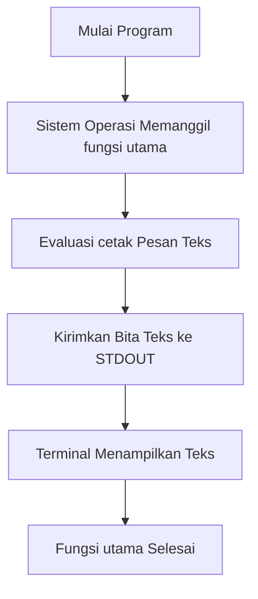
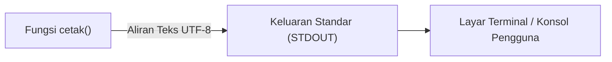

## Bab 3: Program Pertama dan Anatomi Eksekusi Kode

### 3.1 Tradisi "Halo Dunia" dan Makna Filosofisnya



Dalam dunia rekayasa perangkat lunak, menulis program pertama yang menampilkan teks "Halo Dunia" (*Hello World*) ke layar terminal merupakan ritual wajib bagi setiap pemrogram. Ritual ini pertama kali dipopulerkan oleh Brian Kernighan pada tahun 1972 dalam dokumentasi bahasa B, lalu dibakukan dalam buku legendaris *The C Programming Language* (1978). 

Tujuan utama program "Halo Dunia" bukan untuk menyelesaikan persoalan kalkulasi yang rumit, melainkan untuk **memverifikasi integritas seluruh rantai kerja (*toolchain integrity*)**:
1. Memastikan editor teks mampu menyimpan berkas dalam format UTF-8 bersih.
2. Memastikan kompilator mampu mem-parsing sintaksis tanpa kesalahan leksikal.
3. Memastikan subsistem penaut (*linker*) mampu menghubungkan fungsi ke aliran keluaran standar (*Standard Output* / STDOUT) sistem operasi.



### 3.2 Anatomi Kode Sumber Baris demi Baris
Mari kita perhatikan program dasar berikut:

```widya
fungsi utama() {
    cetak("Halo Dunia! Salam sejahtera dari Widya-Lang.");
}
```

Setiap elemen pada kode di atas memiliki peran gramatikal yang kaku:
- `fungsi`: Kata kunci pembuka deklarasi subprogram.
- `utama`: Nama pengenal khusus yang ditetapkan sebagai gerbang awal eksekusi program.
- `()`: Tanda kurung tempat menampung parameter masukan (kosong berarti tidak menerima parameter).
- `{`: Tanda kurung kurawal buka yang mendefinisikan awal lingkup (*scope*) badan fungsi.
- `cetak(...)`: Pemanggilan fungsi pencetak bawaan dengan melewatkan argumen string teks.
- `;`: Tanda titik koma (*semicolon*) yang menandakan akhir satu pernyataan komputasi (*statement terminator*).
- `}`: Tanda kurung kurawal tutup yang menandakan berakhirnya fungsi.

### 3.3 Karakter Khusus (*Escape Sequences*)
Saat memformat keluaran teks agar rapi, kita memerlukan karakter non-cetak seperti ganti baris atau tabulasi horizontal. Karakter escape diawali dengan simbol garis miring terbalik (*backslash* `\`):

| Simbol Escape | Nama Karakter | Fungsi Pemformatan |
| :---: | :--- | :--- |
| `\n` | *Line Feed / Newline* | Memindahkan kursor keluaran ke baris baru di bawahnya. |
| `\t` | *Horizontal Tab* | Memberikan jarak tabulasi sejauh 4 atau 8 kolom karakter. |
| `\"` | *Escaped Double Quote* | Menampilkan tanda petik ganda tanpa menutup string. |
| `\\` | *Escaped Backslash* | Menampilkan karakter garis miring terbalik tunggal secara aman. |
| `\r` | *Carriage Return* | Mengembalikan kursor ke posisi kolom paling kiri baris aktif. |

### 3.4 Contoh Kode Praktik 1: Pencetakan Struk Mini Kasir Terminal
Program ini mendemonstrasikan pemanfaatan karakter escape `\t` dan `\n` untuk membentuk tata letak tabel yang rapi di layar terminal:

```widya
// Berkas: bab03_struk_terminal.widya

fungsi utama() {
    cetak("================================================");
    cetak("           TOKO BUKU LITERASI NUSANTARA         ");
    cetak("        Jl. Malioboro No. 12, Yogyakarta       ");
    cetak("================================================");
    cetak("No.	Item Belanja		Qty	Subtotal");
    cetak("------------------------------------------------");
    cetak("1.	Buku Widya Dasar	1	Rp 85.000");
    cetak("2.	Buku Algoritma		2	Rp 120.000");
    cetak("3.	Buku Struktur Data	1	Rp 95.000");
    cetak("------------------------------------------------");
    cetak("Total Tagihan Transaksi:		Rp 300.000");
    cetak("Tunai Dibayarkan Pembeli:		Rp 350.000");
    cetak("Uang Kembalian Pelanggan:		Rp  50.000");
    cetak("================================================");
    cetak("   Terima kasih atas dedikasi belajar Anda!     ");
}
```

### 3.5 Contoh Kode Praktik 2: Banner Seni Huruf ASCII
Kode berikut menampilkan seni teks tipografi kebanggaan nasional:

```widya
// Berkas: bab03_seni_ascii.widya

fungsi utama() {
    cetak(" _    _ _     _             _                            ");
    cetak("| |  | (_)   | |           | |                           ");
    cetak("| |  | |_  __| |_   _  __ _| |     __ _ _ __   __ _      ");
    cetak("| |/\| | |/ _` | | | |/ _` | |    / _` | '_ \ / _` |     ");
    cetak("\  /\  / | (_| | |_| | (_| | |___| (_| | | | | (_| |     ");
    cetak(" \/  \/|_|\__,_|\__, |\__,_|______\__,_|_| |_|\__, |     ");
    cetak("                 __/ |                         __/ |     ");
    cetak("                |___/                         |___/      ");
    cetak(">> Bahasa Pemrograman Berdaulat Republik Indonesia <<");
}
```

### 3.6 Kesalahan Pemula dan Panduan Perbaikan
1. **Lupa Tanda Titik Koma**:
   ```widya
   cetak("Baris Satu") // Kurang titik koma!
   cetak("Baris Dua");
   ```
   *Diagnostik*: Kompilator akan menunjuk baris tersebut dengan pesan `Galat: Diharapkan ';' setelah ekspresi`.
2. **String Tidak Tertutup Petik**:
   ```widya
   cetak("Teks lupa ditutup petik);
   ```
   *Diagnostik*: Kompilator menampilkan `Galat Leksikal: String literal tidak ditutup sebelum akhir baris`.

### 3.7 Rangkuman Konsep Kunci Bab 3
- Fungsi `utama` adalah entry-point eksekusi program.
- `cetak(...)` mengalirkan data ke STDOUT terminal.
- Karakter escape `\n` memicu garis baru, `\t` memberikan tabulasi sejajar.
- Setiap pernyataan diakhiri dengan titik koma `;`.

### 3.8 Latihan Mandiri & Evaluasi Pemahaman
1. Apakah program Widya-Lang dapat dieksekusi jika fungsi pembuka tidak dinamai `utama`? Jelaskan alasannya!
2. Tuliskan kode untuk mencetak kalimat berikut persis seperti tertulis (termasuk tanda petik ganda):
   `Bung Karno berpesan: "Gantungkan cita-citamu setinggi langit!"`
3. **Tantangan Praktik**: Rancanglah program `papan_catur_mini.widya` yang mencetak pola kotak-kotak papan catur ukuran 4x4 menggunakan karakter pagar `#` dan spasi kosong ` `!

---

### 3.9 Latihan Soal Pilihan Ganda (10 Soal)

Pilihlah satu jawaban yang paling tepat (A, B, C, atau D) untuk menguji penguasaan materi bab ini:

**1. Tanda baca apa yang digunakan untuk mengakhiri sebuah pernyataan instruksi di Widya?**
- A. Titik (.)
- B. Koma (,)
- C. Titik koma (;)
- D. Titik dua (:)

**2. Karakter escape `\n` berfungsi untuk...**
- A. Menyisipkan tabulasi horizontal
- B. Pindah baris (newline)
- C. Menghapus huruf sebelumnya
- D. Menampilkan tanda petik

**3. Karakter escape `\t` menghasilkan efek visual...**
- A. Garis baru
- B. Spasi tabulasi horizontal
- C. Karakter bunyi bel
- D. Warna merah teks

**4. Untuk mencetak simbol tanda petik ganda di dalam string, urutan escape yang tepat adalah...**
- A. /"
- B. \"
- C. ''
- D. &quote;

**5. Aliran keluaran standar terminal dalam sistem operasi dikenal dengan singkatan...**
- A. STDIN
- B. STDOUT
- C. STDERR
- D. DEVNULL

**6. Gaya peletakan kurung kurawal pembuka `{` yang dianjurkan dalam style guide Widya adalah...**
- A. Pada baris baru tersendiri
- B. Pada baris yang sama dengan deklarasi fungsi (1TBS)
- C. Di akhir file
- D. Tidak memerlukan kurung

**7. Berapa spasi indentasi standar untuk setiap tingkat blok kurung kurawal?**
- A. 1 spasi
- B. 2 spasi
- C. 4 spasi
- D. 8 spasi

**8. Apa yang terjadi jika Anda memanggil `cetak("Halo");` di luar badan fungsi apa pun?**
- A. Program berjalan normal
- B. Ditolak kompilator karena instruksi harus berada dalam blok fungsi
- C. Terminal mencetak dua kali
- D. Komputer restart

**9. Untuk mencetak karakter garis miring terbalik (backslash) literal, kita menuliskan...**
- A. //
- B. \\
- C. /*
- D. /\

**10. Apa akibatnya jika tanda petik penutup string terlupakan pada baris instruksi?**
- A. Kompilator otomatis menutupnya
- B. Muncul galat leksikal string literal tidak tertutup
- C. Program mencetak spasi kosong
- D. Program mengulang dari awal
