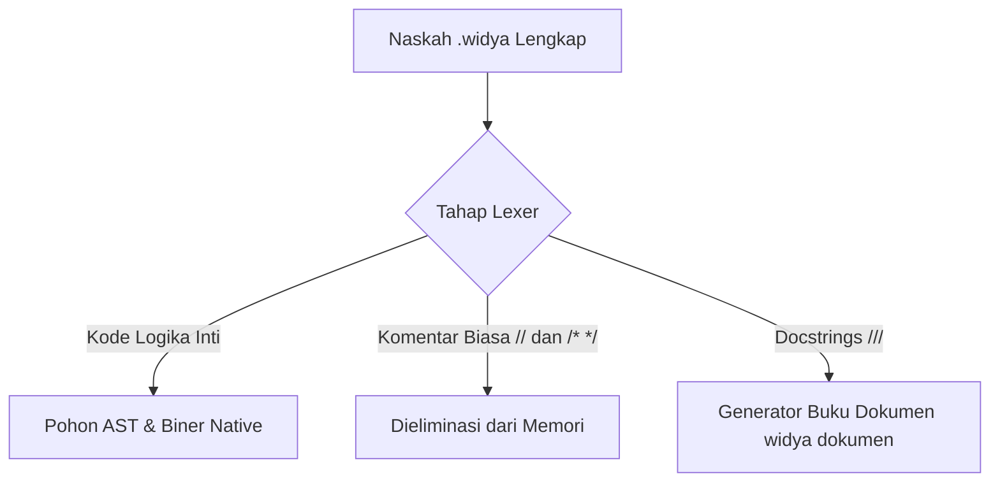
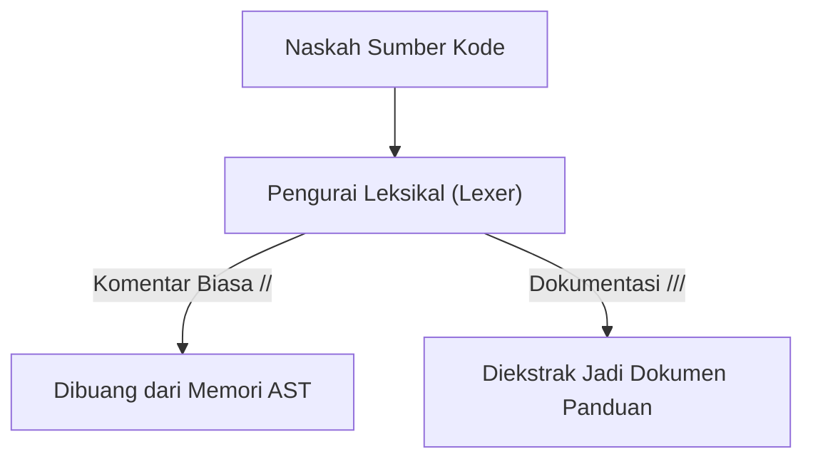

## Bab 4: Sistem Komentar dan Dokumentasi Kode

### 4.1 Filosofi Kode Bersih dan Dokumentasi Berkelanjutan



Salah satu pepatah paling terkenal dalam rekayasa perangkat lunak berbunyi: *"Kode program dibaca manusia sepuluh kali lebih sering daripada ditulis."* Program yang Anda rancang hari ini mungkin akan dibaca oleh rekan satu tim dua tahun lagi, atau bahkan oleh diri Anda sendiri yang telah lupa detail logika di baliknya.

Komentar adalah teks penjelas yang disisipkan ke dalam kode sumber untuk mempermudah pemahaman manusia. Kompilator Widya-Lang secara otomatis membuang seluruh teks komentar pada tahap analisis leksikal, sehingga keberadaan komentar—sebanyak apa pun—**sama sekali tidak menambah ukuran berkas biner dan tidak memperlambat kecepatan eksekusi program**.



### 4.2 Tiga Jenis Komentar dalam Widya-Lang
Widya-Lang menyediakan tiga tingkatan sintaksis komentar:
1. **Komentar Sebaris (*Single-Line Comment*)**: Menggunakan tanda garis miring ganda `//`. Komentar ini berlaku dari tanda `//` hingga akhir baris tersebut.
2. **Komentar Multi-Baris (*Block Comment*)**: Diapit oleh pembuka `/*` dan penutup `*/`. Dapat membentang melintasi puluhan baris teks.
3. **Komentar Dokumentasi (*Docstrings*)**: Menggunakan tiga garis miring `///`. Format ini dibaca oleh perkakas `widya dokumen` untuk menghasilkan buku petunjuk teknis otomatis.

### 4.3 Contoh Kode Praktik 1: Penerapan Komentar Terstruktur
Perhatikan bagaimana komentar digunakan secara proporsional untuk menjelaskan aturan bisnis di balik formula matematika:

```widya
// Berkas: bab04_komentar_pajak.widya
// Modul Perhitungan Pajak Penghasilan Pegawai Negeri & Swasta

/*
  Catatan Kebijakan:
  Berdasarkan Undang-Undang Harmonisasi Peraturan Perpajakan (UU HPP),
  lapisan tarif PPh Pasal 21 diterapkan secara progresif:
  - Lapisan 1 (0 s.d. 60 Juta)       : Tarif 5%
  - Lapisan 2 (> 60 s.d. 250 Juta)   : Tarif 15%
*/

fungsi utama() {
    // Penghasilan Kena Pajak (PKP) tahunan wajib pajak
    tetap pkp_tahunan = 85000000; // Rp 85.000.000
    
    // Perhitungan Lapisan 1 (Maksimum 60 Juta pertama)
    tetap pajak_lapisan_1 = 60000000 * 0.05; // 5% x 60 Juta = Rp 3.000.000
    
    // Perhitungan Lapisan 2 (Sisa 25 Juta berikutnya)
    tetap sisa_pkp = pkp_tahunan - 60000000;
    tetap pajak_lapisan_2 = sisa_pkp * 0.15; // 15% x 25 Juta = Rp 3.750.000
    
    tetap total_pajak = pajak_lapisan_1 + pajak_lapisan_2;
    
    cetak("Pajak Terutang Tahunan: Rp " + teks(total_pajak));
}
```

### 4.4 Contoh Kode Praktik 2: Format Dokumentasi Resmi (*Docstrings*)
Contoh berikut menunjukkan penulisan dokumentasi profesional yang memenuhi standar ekstraksi API dokumen:

```widya
// Berkas: bab04_docstring_fisika.widya

/// Menghitung hambatan jenis konduktor listrik kawat tembaga.
///
/// # Formula Fisika
/// R = (rho * L) / A
///
/// # Parameter Masukan
/// * `rho`: Hambatan jenis bahan material (Ohm-meter).
/// * `panjang_kawat`: Panjang fisik kawat dalam satuan meter (m).
/// * `luas_penampang`: Luas irisan melintang kawat dalam meter persegi (m²).
///
/// # Nilai Kembalian
/// Nilai resistansi total kawat dalam satuan Ohm.
fungsi hitung_resistansi(rho, panjang_kawat, luas_penampang) {
    kembalikan (rho * panjang_kawat) / luas_penampang;
}

fungsi utama() {
    // Tembaga murni: rho ~ 1.68e-8 Ohm.m
    tetap rho_tembaga = 0.0000000168;
    tetap panjang = 50.0; // 50 meter
    tetap luas = 0.0000025; // 2.5 mm²
    
    tetap r = hitung_resistansi(rho_tembaga, panjang, luas);
    cetak("Resistansi Total Kawat: " + teks(r) + " Ohm");
}
```

### 4.5 Prinsip Kode Bersih (*Clean Code Best Practices*)
- **JANGAN Mengomentari Hal yang Sudah Jelas**:
  - *Buruk*: `variabel umur = 18; // mengisi umur dengan 18`
  - *Baik*: `variabel umur = 18; // Ambang batas kedewasaan hukum perdata`
- **JELASKAN ALASAN (*WHY*), BUKAN CARA KERJA (*HOW*)**:
  - Kode program sudah menjelaskan *bagaimana* sesuatu bekerja. Komentar harus menerangkan *mengapa* solusi tersebut dipilih di atas alternatif lain.
- **PERBARUI KOMENTAR SAAT KODE BERUBAH**:
  - Komentar yang usang dan tidak sesuai lagi dengan perilaku kode jauh lebih berbahaya daripada ketiadaan komentar, karena menyesatkan pemrogram lain.

### 4.6 Kesalahan Pemula dalam Menulis Komentar
- **Blok Komentar Tidak Ditutup**:
  ```widya
  /* Lupa memberikan penutup blok komentar
  fungsi utama() {
      cetak("Ini tidak akan pernah dieksekusi!");
  }
  ```
  Kompilator akan menganggap seluruh sisa naskah hingga akhir berkas sebagai komentar dan memicu peringatan tak terduga.

### 4.7 Rangkuman Konsep Kunci Bab 4
- Komentar `//` untuk satu baris, `/* ... */` untuk blok banyak baris.
- Komentar `///` untuk generator dokumentasi otomatis (*docstrings*).
- Komentar diabaikan 100% oleh kompilator dan tidak membebani memori maupun kecepatan aplikasi.

### 4.8 Latihan Mandiri & Evaluasi Pemahaman
1. Mengapa keberadaan ribuan baris komentar dalam berkas kode sumber tidak memperlambat kinerja eksekusi biner program Widya-Lang?
2. Kapan sebaiknya kita menggunakan komentar satu baris dibandingkan komentar multi-baris?
3. **Tantangan Praktik**: Ambil naskah program penghitung zakat atau kasir belanja, lalu tambahkan anotasi *docstring* tiga garis miring `///` lengkap dengan penjelasan parameter dan rumus hitungnya!

---

### 4.9 Latihan Soal Pilihan Ganda (10 Soal)

Pilihlah satu jawaban yang paling tepat (A, B, C, atau D) untuk menguji penguasaan materi bab ini:

**1. Sintaksis untuk membuat komentar satu baris di Widya-Lang adalah...**
- A. # Komentar
- B. // Komentar
- C. -- Komentar
- D. <!-- Komentar -->

**2. Sintaksis untuk membuat komentar multi-baris (blok) adalah...**
- A. /* ... */
- B. ''' ... '''
- C. ### ... ###
- D. {* ... *}

**3. Format komentar khusus yang diekstraksi menjadi dokumentasi API otomatis adalah...**
- A. //!
- B. ///
- C. /**
- D. ##?

**4. Kapan teks komentar dibuang selama proses kompilasi kode?**
- A. Saat runtime berlangsung
- B. Saat tahap penguraian leksikal (lexer)
- C. Saat berkas biner diunduh
- D. Tidak pernah dibuang

**5. Apakah keberadaan 10.000 baris komentar memperbesar ukuran berkas biner executable hasil kompilasi?**
- A. Ya, menjadi sangat besar
- B. Tidak sama sekali (0 bita bertambah)
- C. Tergantung sistem operasi
- D. Ya, sekitar 1 MB

**6. Prinsip penulisan komentar yang baik adalah menjelaskan...**
- A. Bagaimana syntax bahasa bekerja
- B. Alasan di balik keputusan logika (WHY), bukan cuma WHAT
- C. Nama pembuat komputer
- D. Daftar seluruh fungsi OS

**7. Apa risiko utama membiarkan komentar yang tidak diperbarui saat kode logika berubah?**
- A. Kompilator akan mogok
- B. Menyesatkan pemrogram lain yang membaca kode (Misleading comments)
- C. Ukuran CPU melonjak
- D. Koneksi internet putus

**8. Perintah CLI untuk menghasilkan buku dokumentasi proyek otomatis dari docstrings adalah...**
- A. widya html
- B. widya buat-buku
- C. widya dokumen
- D. widya api

**9. Manakah contoh komentar yang DIANGGAP BURUK dalam praktik Clean Code?**
- A. `// batas aman memori buffer`
- B. `variabel x = 10; // mengisi x dengan 10`
- C. `// rumus anuitas bank syariah`
- D. `// perbaikan bug race condition`

**10. Bagaimana cara menonaktifkan sementara sebaris kode logika saat pengujian?**
- A. Menghapus baris selamanya
- B. Menyematkan tanda // di awal baris (commenting out)
- C. Mengubah nama file
- D. Mematikan monitor
