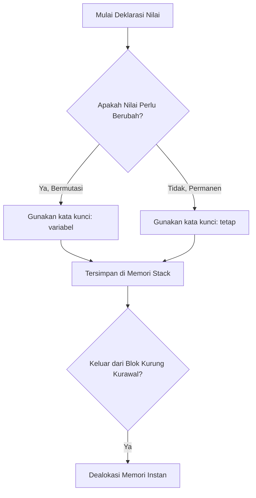

## Bab 5: Deklarasi Variabel dan Konstanta

### 5.1 Memori Komputer dan Konsep Penampung Data



Dalam setiap aplikasi komputasi, program harus memproses data yang bervariasi: jumlah barang di keranjang belanja, koordinat posisi pesawat tempur, atau status persetujuan transaksi perbankan. Seluruh data aktif ini disimpan di dalam **Memori Akses Acak (*Random Access Memory* / RAM)** komputer.

Setiap lokasi penyimpanan di RAM ditandai dengan sebuah alamat fisik dalam format heksadesimal (misalnya `0x7FFEE4B20910`). Mengingat deretan angka heksadesimal tentu mustahil bagi pemrogram manusia. Oleh karena itu, bahasa pemrograman menghadirkan abstraksi bernama **Variabel**—yakni pengenal berupa kata (*identifier*) yang diasosiasikan oleh kompilator langsung ke alamat memori fisik tempat data tersimpan.

```
+---------------------------------------------------------------+
|              PEMETAAN VARIABEL KE ALAMAT FISIK RAM            |
+---------------------------------------------------------------+
|  Nama Pengenal Kode    |  Alamat Memori Hex  |  Nilai Tersimpan|
+------------------------+---------------------+-----------------+
|  saldo_kasir           |  0x0040A100         |  Rp 1.500.000   |
|  kuantitas_terjual     |  0x0040A108         |  12 unit        |
|  status_toko_buka      |  0x0040A110         |  benar          |
+------------------------+---------------------+-----------------+
```

### 5.2 Dua Paradigma Data: Variabel (`variabel`) vs Konstanta (`tetap`)
Widya-Lang secara tegas membedakan data yang boleh bermutasi dengan data yang terkunci permanen:

1. **Variabel Dinamis (`variabel` / Mutable)**:
   Digunakan untuk nilai yang diharapkan dapat berubah seiring berjalannya program (misalnya penghitung iterasi, akumulator total belanja, skor permainan).
2. **Konstanta Terikat (`tetap` / Immutable)**:
   Digunakan untuk nilai yang sekali ditetapkan tidak boleh dan tidak dapat diubah lagi hingga program berakhir.

```widya
fungsi utama() {
    // 1. Deklarasi Konstanta Terkunci
    tetap RASIO_PPN = 0.11; // 11% sesuai undang-undang
    tetap NAMA_TOKO = "Warung Sembako Nusantara";
    
    // 2. Deklarasi Variabel Bermutasi
    variabel total_belanja = 150000;
    cetak("Belanja Awal: Rp " + teks(total_belanja));
    
    // Mutasi nilai variabel
    total_belanja = total_belanja + 75000;
    cetak("Setelah Tambah Belanja: Rp " + teks(total_belanja));
    
    // PERCOBAAN ILEGAL MENGUBAH 'tetap':
    // RASIO_PPN = 0.12; 
    // -> Kompilator Widya akan menolak kompilasi dengan pesan:
    // "Galat Mutasi: Nilai konstanta 'RASIO_PPN' bersifat tetap dan tidak dapat diubah!"
}
```

### 5.3 Filosofi Keselamatan Data: Mengapa Harus Mengutamakan `tetap`?
Bagi pemula, mendefinisikan semua nilai sebagai `variabel` mungkin terkesan lebih fleksibel dan mudah. Namun, dalam sistem rekayasa berskala besar dengan ratusan ribu baris kode, **kemampuan memutasi data di mana saja adalah penyebab utama timbulnya *bug* misterius (*unintended side-effects*)**.

Jika sebuah nilai dideklarasikan dengan `tetap`:
- Kompilator menjamin secara matematis bahwa tidak ada baris kode lain yang dapat merusak nilai tersebut.
- Kompilator dapat melakukan optimasi tingkat tinggi, seperti menanamkan nilai secara langsung ke dalam instruksi mesin prosesor (*constant folding*).
- Kode menjadi sangat aman untuk dijalankan dalam lingkungan multi-threading (*thread-safe*).

> [!TIP]
> **Aturan Emas Pengembang Widya**: Mulailah selalu dengan kata kunci `tetap`. Ubahlah deklarasi menjadi `variabel` hanya jika Anda benar-benar memiliki alasan logis bahwa nilai penampung tersebut harus diperbarui nilainya!

### 5.4 Konvensi Penamaan Pengenal (*Identifier Conventions*)
Agar kode memiliki keselarasan estetika dan profesionalisme, ikuti konvensi resmi Widya-Lang berikut:
- **Gaya Penulisan Variabel**: Gunakan huruf kecil bersambung garis bawah (**`snake_case`**).
  - *Contoh*: `kecepatan_kendaraan`, `nomor_induk_kependudukan`, `saldo_rekening`.
- **Gaya Penulisan Konstanta Global**: Gunakan huruf kapital penuh bersambung garis bawah (**`SCREAMING_SNAKE_CASE`**).
  - *Contoh*: `KECEPATAN_CAHAYA_M_S`, `BATAS_MAKSIMUM_KREDIT`, `NAMA_INSTITUSI`.
- **Karakter Terlarang**: Pengenal tidak boleh diawali angka (`1hari` salah, `hari_pertama` benar), dan tidak boleh mengandung spasi atau simbol khusus seperti `@`, `#`, `$`, `%`.

### 5.5 Ruang Lingkup (*Scope*) dan Siklus Hidup Memori
Setiap variabel memiliki masa hidup (*lifetime*) yang dibatasi oleh blok kurung kurawal `{}` tempat deklarasinya berada:

```widya
fungsi utama() {
    variabel level_luar = 10;
    
    {
        variabel level_dalam = 25;
        cetak("Di dalam blok: " + teks(level_luar + level_dalam)); // Sah
    }
    
    cetak("Di luar blok: " + teks(level_luar)); // Sah
    // cetak(level_dalam); 
    // GALAT KOMPILATOR: Variabel 'level_dalam' sudah musnah dari memori stack!
}
```

### 5.6 Contoh Kode Praktik 1: Pelacak Arus Kas Harian
Program ini mensimulasikan pencatatan buku kas warung yang mencatat mutasi pemasukan dan pengeluaran harian:

```widya
// Berkas: bab05_arus_kas.widya

fungsi utama() {
    tetap SALDO_AWAL_BULAN = 2500000;
    variabel saldo_berjalan = SALDO_AWAL_BULAN;
    
    cetak("=== BUKU KAS HARIAN TOKO BERKAH ===");
    cetak("Saldo Permulaan Kas : Rp " + teks(saldo_berjalan));
    
    // Transaksi 1: Penjualan Beras Pagi
    tetap pemasukan_1 = 450000;
    saldo_berjalan = saldo_berjalan + pemasukan_1;
    cetak("+ Pemasukan (Beras) : Rp " + teks(pemasukan_1) + " -> Saldo: Rp " + teks(saldo_berjalan));
    
    // Transaksi 2: Pembayaran Tagihan Listrik
    tetap pengeluaran_1 = 175000;
    saldo_berjalan = saldo_berjalan - pengeluaran_1;
    cetak("- Pengeluaran (PLN) : Rp " + teks(pengeluaran_1) + " -> Saldo: Rp " + teks(saldo_berjalan));
    
    // Transaksi 3: Penjualan Minyak & Gula Sore
    tetap pemasukan_2 = 320000;
    saldo_berjalan = saldo_berjalan + pemasukan_2;
    cetak("+ Pemasukan (Grosir): Rp " + teks(pemasukan_2) + " -> Saldo: Rp " + teks(saldo_berjalan));
    
    cetak("-----------------------------------");
    cetak("Saldo Akhir Hari Ini: Rp " + teks(saldo_berjalan));
    tetap surplus = saldo_berjalan - SALDO_AWAL_BULAN;
    cetak("Surplus Kas Harian  : Rp " + teks(surplus));
}
```

### 5.7 Contoh Kode Praktik 2: Kalkulator Geometri Bangun Ruang
Program ini menggunakan konstanta matematika presisi tinggi untuk menghitung volume dan luas permukaan tabung:

```widya
// Berkas: bab05_geometri_tabung.widya

fungsi utama() {
    tetap PI = 3.141592653589793;
    tetap radius_alas = 7.0; // cm
    tetap tinggi_tabung = 20.0; // cm
    
    tetap luas_alas = PI * (radius_alas ^ 2);
    tetap volume = luas_alas * tinggi_tabung;
    tetap luas_selimut = 2.0 * PI * radius_alas * tinggi_tabung;
    tetap total_luas_permukaan = (2.0 * luas_alas) + luas_selimut;
    
    cetak("ANALISIS GEOMETRI TABUNG SILINDER:");
    cetak("- Jari-jari Alas  : " + teks(radius_alas) + " cm");
    cetak("- Tinggi Silinder : " + teks(tinggi_tabung) + " cm");
    cetak("- Volume Silinder : " + teks(volume) + " cm³");
    cetak("- Luas Permukaan  : " + teks(total_luas_permukaan) + " cm²");
}
```

### 5.8 Kesalahan Pemula dan Solusi
- **Mengubah Nilai Konstanta `tetap`**:
  - *Galat*: `Galat: Tidak dapat melakukan penugasan ulang pada pengenal tetap 'NILAI_MAX'`.
  - *Perbaikan*: Periksa apakah nilai memang harus berubah. Jika ya, ubah deklarasi awal dari `tetap` menjadi `variabel`.
- **Menggunakan Variabel Sebelum Dideklarasikan**:
  - *Galat*: `Galat Nama: Pengenal 'total' belum didefinisikan dalam ruang lingkup ini`.
  - *Perbaikan*: Deklarasikan variabel terlebih dahulu sebelum memanggilnya di baris instruksi berikutnya.

### 5.9 Rangkuman Konsep Kunci Bab 5
| Kata Kunci | Karakteristik Utama | Rekomendasi Penggunaan |
| :--- | :--- | :--- |
| `tetap` | Terkunci, aman dari kutu mutasi, teroptimasi kompilator. | Pilihan bawaan (*default*) untuk seluruh penampung data. |
| `variabel` | Dapat diubah nilainya berulang kali di memori. | Gunakan hanya untuk penampung akumulasi dan penghitung. |

### 5.10 Latihan Mandiri & Evaluasi Pemahaman
1. Mengapa para insinyur perangkat lunak modern sangat memprioritaskan prinsip data tak berubah (*immutability*)?
2. Jelaskan perbedaan mendasar antara memori tumpukan (*stack memory*) dan siklus hidup variabel lokal!
3. **Tantangan Praktik**: Rancanglah program `konversi_suhu_lengkap.widya` yang mendeklarasikan suhu ruangan `tetap celcius = 30.0;`, lalu hitung dan tampilkan suhu tersebut dalam satuan Fahrenheit, Reamur, dan Kelvin menggunakan rumus fisika yang tepat!

---

### 5.9 Latihan Soal Pilihan Ganda (10 Soal)

Pilihlah satu jawaban yang paling tepat (A, B, C, atau D) untuk menguji penguasaan materi bab ini:

**1. Kata kunci untuk mendeklarasikan penampung data yang nilainya dapat diubah kembali adalah...**
- A. tetap
- B. variabel
- C. konstan
- D. wadah

**2. Kata kunci untuk mendeklarasikan konstanta terikat yang permanen dan tidak boleh dimutasi adalah...**
- A. tetap
- B. kunci
- C. variabel
- D. abadi

**3. Apa filosofi keamanan data bawaan (default) yang dianjurkan dalam pemrograman Widya-Lang?**
- A. Gunakan variabel untuk semua data
- B. Gunakan tetap secara bawaan (Default to Immutability)
- C. Jangan simpan data di memori
- D. Ubah nilai sesering mungkin

**4. Format penamaan resmi untuk variabel biasa dalam Widya-Lang adalah...**
- A. camelCase
- B. snake_case (huruf kecil bersambung garis bawah)
- C. PascalCase
- D. kebab-case

**5. Format penamaan standar untuk konstanta global permanen adalah...**
- A. SCREAMING_SNAKE_CASE (kapital penuh)
- B. lowercase
- C. TitleCase
- D. mixed_CASE

**6. Manakah nama variabel berikut yang ILEGAL dalam tata bahasa Widya?**
- A. _nomor_induk
- B. total_pajak_2026
- C. 2hari_kerja
- D. nilai_kkm

**7. Di area memori manakah variabel lokal fungsi dialokasikan?**
- A. Memori Tumpukan (Stack)
- B. Hard Disk Permanen
- C. Kartu VGA
- D. BIOS ROM

**8. Apa yang terjadi pada variabel lokal saat eksekusi keluar dari blok kurung kurawal `{}`?**
- A. Tersimpan selamanya di RAM
- B. Dihapus dan dibebaskan seketika dari Stack
- C. Dikirim ke server cloud
- D. Menjadi variabel global

**9. Apa pesan diagnostik jika Anda mencoba menugaskan ulang nilai pada konstanta `tetap`?**
- A. Nilai berhasil diganti
- B. Galat Mutasi: Tidak dapat mengubah nilai konstanta yang bersifat tetap
- C. Komputer berhenti
- D. Muncul angka acak

**10. Fenomena di mana variabel di lingkup dalam memiliki nama yang sama dengan lingkup luar disebut...**
- A. Overclocking
- B. Pembayangan Variabel (Variable Shadowing)
- C. Peluapan Buffer
- D. Deadlock
