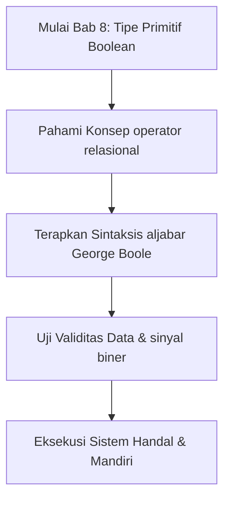

## Bab 8: Sistem Tipe Data Primitif Bagian 3 - Nilai Logika (Boolean)

### 8.1 Aljabar Boolean dan Dasar Sirkuit Logika Digital



Seluruh sistem komputasi beroperasi di atas prinsip kebenaran logika biner yang dirumuskan oleh matematikawan George Boole pada tahun 1854. Dalam aljabar logika, sebuah premis atau proposisi tidak mengenal spektrum keraguan atau abu-abu; ia pasti bernilai salah satu dari dua kondisi absolut: **Benar** atau **Salah**.

Di dalam Widya-Lang, nilai kebenaran logika dimodelkan secara berdaulat menggunakan kata kunci:
- `benar` (setara dengan `true` dalam bahasa internasional)
- `salah` (setara dengan `false` dalam bahasa internasional)

Tipe boolean hanya membutuhkan 1 bita memori fisik untuk merepresentasikan status sakelar tegangan logika.

```
+---------------------------------------------------------------+
|             STATUS SAKELAR BOOLEAN DAN SINYAL TEGANGAN        |
+---------------------------------------------------------------+
|  Kata Kunci Widya | Nilai Biner | Keadaan Sakelar | Sinyal TTL|
+-------------------+-------------+-----------------+-----------+
|  benar            |      1      | Tertutup (On)   | +5.0 Volt |
|  salah            |      0      | Terbuka (Off)   |  0.0 Volt |
+-------------------+-------------+-----------------+-----------+
```

### 8.2 Operator Perbandingan Penghasil Nilai Boolean
Nilai boolean umumnya dihasilkan dari perbandingan dua variabel:
- `==` : Memeriksa kesamaan nilai persis.
- `!=` : Memeriksa ketidaksamaan.
- `>` dan `<` : Lebih besar dan lebih kecil.
- `>=` dan `<=` : Lebih besar sama dengan dan lebih kecil sama dengan.

```widya
fungsi utama() {
    tetap ambang_batas_kecepatan = 80; // km/jam
    tetap laju_kendaraan = 95; // km/jam
    
    tetap terjadi_pelanggaran = laju_kendaraan > ambang_batas_kecepatan;
    cetak("Apakah terdeteksi pelanggaran batas kecepatan? " + teks(terjadi_pelanggaran));
}
```

### 8.3 Penanda Status Sistem (*Boolean Flags*)
Dalam arsitektur perangkat lunak industri (seperti kontrol pabrik, keamanan perbankan, atau verifikasi e-KTP), variabel boolean digunakan sebagai penanda (*flag*) untuk mengarahkan alur kerja:

```widya
fungsi utama() {
    variabel kartu_terverifikasi = benar;
    variabel pin_cocok = benar;
    variabel saldo_mencukupi = salah;
    
    cetak("Audit Transaksi ATM Bank Syariah:");
    cetak("- Kartu Sah   : " + teks(kartu_terverifikasi));
    cetak("- PIN Sesuai  : " + teks(pin_cocok));
    cetak("- Saldo Cukup : " + teks(saldo_mencukupi));
}
```

### 8.4 Contoh Kode Praktik 1: Sistem Otomasi Palang Gerbang Tol
Program berikut mensimulasikan logika gerbang tol otomatis jalan bebas hambatan:

```widya
// Berkas: bab08_gerbang_tol.widya

fungsi utama() {
    tetap saldo_kartu = 45000;
    tetap tarif_tol = 28500;
    tetap sensor_kendaraan_hadir = benar;
    
    tetap saldo_cukup = saldo_kartu >= tarif_tol;
    tetap boleh_buka_palang = sensor_kendaraan_hadir dan saldo_cukup;
    
    cetak("=== SISTEM GERBANG TOL OTOMATIS (GTO) ===");
    cetak("Tarif Ruas Tol      : Rp " + teks(tarif_tol));
    cetak("Saldo Terbaca       : Rp " + teks(saldo_kartu));
    cetak("Sensor Kehadiran    : " + teks(sensor_kendaraan_hadir));
    cetak("-----------------------------------------");
    cetak("Validasi Saldo      : " + teks(saldo_cukup));
    cetak("Instruksi Motor GTO : Buka Palang = " + teks(boleh_buka_palang));
    
    jika (boleh_buka_palang) {
        tetap sisa = saldo_kartu - tarif_tol;
        cetak("Silakan melintas. Sisa saldo kartu Anda: Rp " + teks(sisa));
    } lainnya {
        cetak("Palang Tetap Tertutup! Saldo kurang atau kendaraan tidak terdeteksi.");
    }
}
```

### 8.5 Contoh Kode Praktik 2: Sistem Deteksi Kebakaran Gedung Bertingkat
Program berikut menggabungkan beberapa sensor lingkungan untuk memutuskan pemicu alarm kebakaran:

```widya
// Berkas: bab08_deteksi_api.widya

fungsi utama() {
    tetap sensor_panas_celsius = 68.5; // Batas bahaya >= 55.0 C
    tetap sensor_asap_optik_ppm = 120; // Batas bahaya >= 80 ppm
    tetap sakelar_manual_ditarik = salah;
    
    tetap panas_ekstrem = sensor_panas_celsius >= 55.0;
    tetap asap_pekat = sensor_asap_optik_ppm >= 80;
    
    // Alarm berbunyi jika: (Panas Ekstrem DAN Asap Pekat) ATAU Tombol Manual Ditarik
    tetap aktivasi_alarm = (panas_ekstrem dan asap_pekat) atau sakelar_manual_ditarik;
    
    cetak("SISTEM MONITORING KESELAMATAN GEDUNG GRAHA WIDYA:");
    cetak("- Sensor Panas : " + teks(sensor_panas_celsius) + " °C (Status Bahaya: " + teks(panas_ekstrem) + ")");
    cetak("- Sensor Asap  : " + teks(sensor_asap_optik_ppm) + " PPM (Status Bahaya: " + teks(asap_pekat) + ")");
    cetak("-------------------------------------------------");
    cetak("STATUS KESIAPSIAGAAN SIRENE & SPRINKLER AIR: " + teks(aktivasi_alarm));
}
```

### 8.6 Kesalahan Pemula dan Panduan Solusi
- **Menggunakan Teks `"benar"` Bukannya Literal `benar`**:
  - `variabel status = "benar";` menghasilkan tipe teks string, bukan tipe boolean murni. Hilangkan tanda petik ganda untuk menghasilkan nilai logika asli.
- **Pemeriksaan `== benar` yang Redundan**:
  - Menulis `jika (aktif == benar)` tidak perlu; tulis saja `jika (aktif)` karena ekspresi tersebut sudah bernilai boolean.

### 8.7 Rangkuman Konsep Kunci Bab 8
- Tipe boolean hanya memiliki dua nilai: `benar` dan `salah`.
- Digunakan untuk pengendalian keputusan alur eksekusi aplikasi.
- Dihasilkan dari evaluasi operator relasional perbandingan.

### 8.8 Latihan Mandiri & Evaluasi Pemahaman
1. Sebutkan kelebihan penggunaan tipe boolean dibandingkan menggunakan angka `1` dan `0` untuk status sistem!
2. Buatlah tabel kebenaran untuk kondisi logika: `(A atau B) dan bukan C`!
3. **Tantangan Praktik**: Rancanglah program `kualifikasi_beasiswa.widya` yang memvalidasi tiga kriteria: IPK >= 3.50, Sertifikat TOEFL >= 500, dan Lolos Uji Wawancara (boolean), lalu tampilkan hasil keputusan akhir kelayakannya!

---

### 8.9 Latihan Soal Pilihan Ganda (10 Soal)

Pilihlah satu jawaban yang paling tepat (A, B, C, atau D) untuk menguji penguasaan materi bab ini:

**1. Apa fokus utama pembahasan dalam Bab 8 (Tipe Primitif Boolean)?**
- A. Membahas secara mendalam Nilai logika benar dan salah
- B. Mengonfigurasi kabel jaringan lokal
- C. Memperbaiki motherboard komputer
- D. Menghapus database peladen

**2. Manakah kata kunci atau sintaksis yang menjadi inti materi bab ini?**
- A. Kata kunci `aljabar George Boole`
- B. perintah format disk
- C. bahasa assembly x86
- D. tag HTML

**3. Mengapa konsep operator relasional sangat penting dalam rekayasa perangkat lunak modern?**
- A. Menjamin efisiensi komputasi dan keterbacaan kode secara modular
- B. Hanya formalitas akademis
- C. Agar program berjalan lambat
- D. Mengurangi resolusi layar

**4. Dalam pengolahan data, bagaimana sinyal biner memengaruhi performa memori?**
- A. Mengoptimalkan struktur alokasi data di RAM secara efisien
- B. Membuat memori penuh seketika
- C. Menghapus seluruh file disk
- D. Menghentikan kipas prosesor

**5. Manakah best practice yang dianjurkan dalam menerapkan materi Bab 8?**
- A. Menerapkan validasi data dan isolasi ruang lingkup yang bersih
- B. Menulis seluruh kode dalam satu baris panjang
- C. Mengabaikan penanganan kesalahan
- D. Menggunakan variabel global sembarangan

**6. Apa risiko yang timbul jika pemrogram mengabaikan kaidah operator relasional?**
- A. Munculnya kutu logika atau kerentanan runtime saat data ekstrem masuk
- B. Komputer langsung terbakar
- C. Kecepatan internet naik dua kali lipat
- D. Keyboard tidak berfungsi

**7. Bagaimana kompilator Widya-Lang memproses instruksi yang berkaitan dengan aljabar George Boole?**
- A. Divalidasi pada tahap analisis semantik dan diterjemahkan ke instruksi biner native
- B. Dikirimkan ke cloud pihak ketiga
- C. Diterjemahkan baris per baris secara lambat
- D. Diabaikan seluruhnya

**8. Di lingkungan industri, penerapan modul Bab 8 lazim ditemukan pada...**
- A. Sistem perbankan, backend peladen, aplikasi sains data, dan otomatisasi bisnis
- B. Hanya pada kalkulator saku sederhana
- C. Hanya pada game lawas 8-bit
- D. Tidak pernah digunakan di industri

**9. Fungsi pendukung apa yang paling sering dikombinasikan dengan materi bab ini?**
- A. Fungsi bawaan `cetak()`, `teks()`, atau asersi pengujian `pastikan()`
- B. Perintah mematikan komputer
- C. Fungsi memutar musik
- D. Fungsi mencetak kertas printer

**10. Setelah menuntaskan Bab 8, kompetensi apa yang diharapkan dikuasai oleh pembaca?**
- A. Mampu merancang, mengimplementasikan, dan menguji solusi berbasis Nilai logika benar dan salah secara mandiri
- B. Mampu merakit kabel listrik tegangan tinggi
- C. Mampu mendesain grafis vektor 3D
- D. Mampu memasang antena radio
