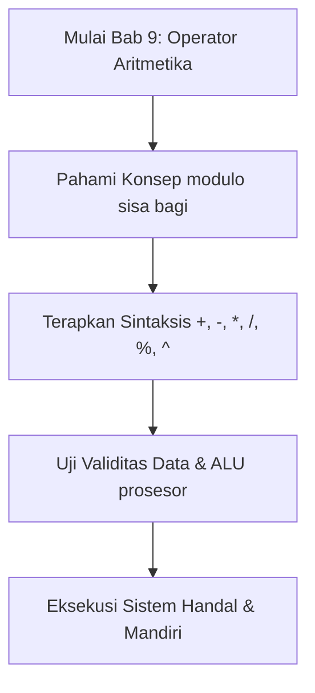
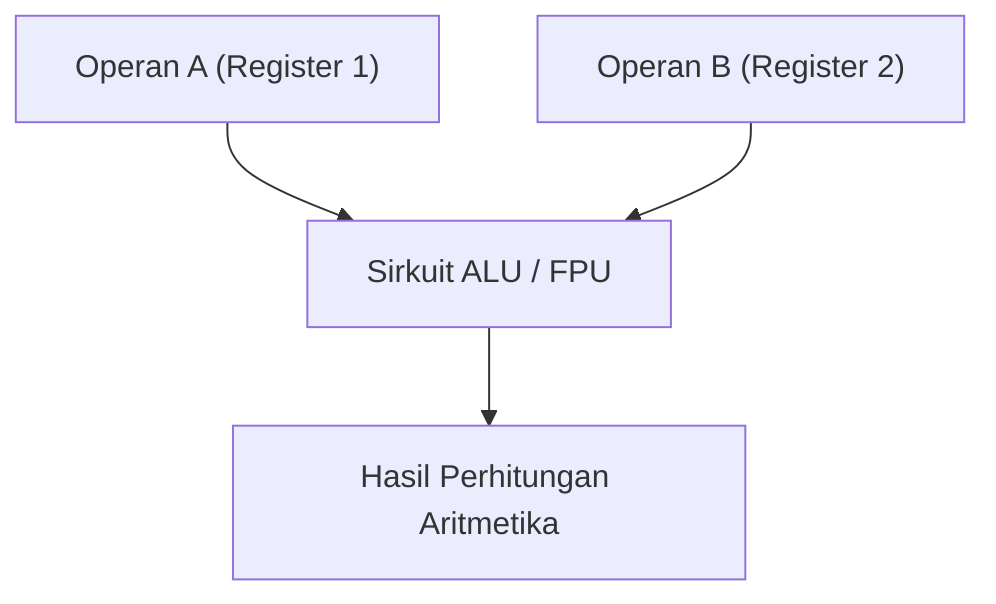

## Bab 9: Operator Aritmetika dan Presedensi Perhitungan

### 9.1 Landasan Teori Aritmetika Komputer



Dalam unit pemroses pusat (CPU), seluruh perhitungan matematika dilakukan di dalam sirkuit khusus bernama **Unit Aritmetika dan Logika (*Arithmetic Logic Unit* / ALU)**. Pada tingkat arsitektur mikro, prosesor modern tidak memproses persamaan aljabar panjang secara instan dalam satu siklus detak (*clock cycle*); ia memecahnya menjadi serangkaian operasi biner elementer yang melibatkan register cepat (seperti register `RAX`, `RBX`, `RCX` pada arsitektur x86_64).

Widya-Lang menyediakan enam operator aritmetika fundamental yang dipetakan langsung oleh kompilator ke instruksi mesin prosesor:

| Operator | Nama Resmi | Contoh Widya | Instruksi Mesin Rujukan | Perilaku Operasional |
| :---: | :--- | :--- | :--- | :--- |
| `+` | Penjumlahan | `a + b` | `ADD reg, reg` | Menjumlahkan dua besaran numerik sejenis. |
| `-` | Pengurangan | `a - b` | `SUB reg, reg` | Mengurangkan operan kanan dari operan kiri. |
| `*` | Perkalian | `a * b` | `IMUL reg, reg` | Mengalikan dua besaran numerik. |
| `/` | Pembagian | `a / b` | `IDIV reg` | Membagi operan kiri dengan operan kanan. |
| `%` | Sisa Bagi (Modulo) | `a % b` | Menghitung sisa bagi register `RDX`. | Menghasilkan sisa pembagian bulat. |
| `^` | Perpangkatan | `a ^ b` | Pemanggilan intrinsik cepat prosesor. | Memangkatkan basis kiri dengan eksponen kanan. |



### 9.2 Aturan Presedensi Operator Matematika (KABATAKU)
Ketika beberapa operator berkumpul dalam satu baris instruksi tanpa tanda kurung pemisah, kompilator Widya-Lang mengevaluasinya secara deterministik mengikuti kaidah matematika universal:
1. **Tingkat 1 (Tertinggi)**: Pengelompokan tanda kurung `(...)`
2. **Tingkat 2**: Operasi perpangkatan `^`
3. **Tingkat 3**: Perkalian `*`, Pembagian `/`, dan Modulo `%` (dievaluasi dari kiri ke kanan)
4. **Tingkat 4 (Terendah)**: Penjumlahan `+` dan Pengurangan `-` (dievaluasi dari kiri ke kanan)

```widya
fungsi utama() {
    tetap hasil_tanpa_kurung = 10 + 5 * 2;   // Dihitung: 10 + 10 = 20
    tetap hasil_dengan_kurung = (10 + 5) * 2; // Dihitung: 15 * 2 = 30
    
    cetak("Tanpa kurung  : " + teks(hasil_tanpa_kurung));
    cetak("Dengan kurung : " + teks(hasil_dengan_kurung));
}
```

### 9.3 Operator Penugasan Gabungan (*Compound Assignment*)
Untuk meningkatkan keterbacaan kode dan meminimalkan pengulangan penulisan nama variabel, Widya-Lang mendukung operator penugasan gabungan:
- `x += n` setara dengan `x = x + n`
- `x -= n` setara dengan `x = x - n`
- `x *= n` setara dengan `x = x * n`
- `x /= n` setara dengan `x = x / n`
- `x %= n` setara dengan `x = x % n`

### 9.4 Contoh Kode Praktik 1: Perhitungan Amortisasi Pinjaman Bank
Program berikut menghitung cicilan pokok, bunga flat tahunan, dan total angsuran per bulan:

```widya
// Berkas: bab09_angsuran_bank.widya

fungsi utama() {
    tetap pokok_pinjaman = 60000000.0; // Rp 60 Juta
    tetap bunga_tahunan_persen = 9.5;  // 9.5%
    tetap durasi_tahun = 3.0;          // 3 Tahun (36 Bulan)
    
    tetap total_bulan = durasi_tahun * 12.0;
    tetap total_bunga = pokok_pinjaman * (bunga_tahunan_persen / 100.0) * durasi_tahun;
    tetap total_kewajiban = pokok_pinjaman + total_bunga;
    tetap angsuran_per_bulan = total_kewajiban / total_bulan;
    
    cetak("SIMULASI KREDIT USAHA RAKYAT (KUR):");
    cetak("- Pokok Pinjaman    : Rp " + teks(pokok_pinjaman));
    cetak("- Bunga Tahunan     : " + teks(bunga_tahunan_persen) + "%");
    cetak("- Tenor Pembayaran  : " + teks(total_bulan) + " Bulan");
    cetak("-------------------------------------------------");
    cetak("- Total Bunga       : Rp " + teks(total_bunga));
    cetak("- Total Pengembalian: Rp " + teks(total_kewajiban));
    cetak(">> ANGSURAN / BULAN : Rp " + teks(angsuran_per_bulan));
}
```

### 9.5 Contoh Kode Praktik 2: Penguraian Satuan Waktu Presisi
Program berikut memecah nominal detik masukan mentah menjadi komponen hari, jam, menit, dan detik:

```widya
// Berkas: bab09_pengurai_waktu.widya

fungsi utama() {
    tetap detik_masukan = 254825;
    
    tetap DETIK_PER_MENIT = 60;
    tetap DETIK_PER_JAM = 3600;
    tetap DETIK_PER_HARI = 86400;
    
    tetap hari = detik_masukan / DETIK_PER_HARI;
    variabel sisa = detik_masukan % DETIK_PER_HARI;
    
    tetap jam = sisa / DETIK_PER_JAM;
    sisa = sisa % DETIK_PER_JAM;
    
    tetap menit = sisa / DETIK_PER_MENIT;
    tetap detik = sisa % DETIK_PER_MENIT;
    
    cetak("PENGURAIAN WAKTU SISTEM:");
    cetak("Detik Mentah : " + teks(detik_masukan) + " detik");
    cetak("Terurai Menjadi: " + teks(hari) + " Hari, " 
                             + teks(jam) + " Jam, " 
                             + teks(menit) + " Menit, " 
                             + teks(detik) + " Detik.");
}
```

### 9.6 Kesalahan Pemula dan Jebakan Umum (*Common Pitfalls*)
1. **Pembagian Integer yang Menghasilkan Bilangan Pecahan**:
   - Jika kedua operan adalah bilangan bulat, hasil pembagian tetap mempertahankan presisi titik kambang tanpa pembulatan liar.
2. **Bahaya Pembagian dengan Nol (*Division by Zero*)**:
   - Menjalankan `100 / 0` akan memicu interupsi kesalahan komputasi. Selalu validasi penyebut dengan `jika (penyebut != 0)`.

### 9.7 Rangkuman Konsep Kunci Bab 9
- Operator aritmetika inti: `+`, `-`, `*`, `/`, `%`, `^`.
- Presedensi KABATAKU menjamin urutan kalkulasi sesuai aturan matematika universal.
- Modulo `%` sangat krusial untuk penentuan ganjil/genap, rotasi antrian sirkular, dan konversi satuan waktu.

### 9.8 Latihan Mandiri & Evaluasi Pemahaman
1. Hitung hasil dari: `5 + 3 * 2 ^ 2 - 8 / 4` sesuai urutan presedensi operator!
2. Bagaimana cara menguji apakah suatu angka tahun habis dibagi 4 menggunakan operator modulo?
3. **Tantangan Praktik**: Rancanglah kalkulator energi listrik rumah tangga yang menghitung total tagihan bulanan berdasarkan pemakaian kWh peralatan: kulkas (150W x 24 jam), AC (750W x 8 jam), dan TV (100W x 5 jam) dengan tarif Rp 1.444,70 per kWh!

---

### 9.9 Latihan Soal Pilihan Ganda (10 Soal)

Pilihlah satu jawaban yang paling tepat (A, B, C, atau D) untuk menguji penguasaan materi bab ini:

**1. Apa fokus utama pembahasan dalam Bab 9 (Operator Aritmetika)?**
- A. Membahas secara mendalam KABATAKU dan presedensi
- B. Mengonfigurasi kabel jaringan lokal
- C. Memperbaiki motherboard komputer
- D. Menghapus database peladen

**2. Manakah kata kunci atau sintaksis yang menjadi inti materi bab ini?**
- A. Kata kunci `+, -, *, /, %, ^`
- B. perintah format disk
- C. bahasa assembly x86
- D. tag HTML

**3. Mengapa konsep modulo sisa bagi sangat penting dalam rekayasa perangkat lunak modern?**
- A. Menjamin efisiensi komputasi dan keterbacaan kode secara modular
- B. Hanya formalitas akademis
- C. Agar program berjalan lambat
- D. Mengurangi resolusi layar

**4. Dalam pengolahan data, bagaimana ALU prosesor memengaruhi performa memori?**
- A. Mengoptimalkan struktur alokasi data di RAM secara efisien
- B. Membuat memori penuh seketika
- C. Menghapus seluruh file disk
- D. Menghentikan kipas prosesor

**5. Manakah best practice yang dianjurkan dalam menerapkan materi Bab 9?**
- A. Menerapkan validasi data dan isolasi ruang lingkup yang bersih
- B. Menulis seluruh kode dalam satu baris panjang
- C. Mengabaikan penanganan kesalahan
- D. Menggunakan variabel global sembarangan

**6. Apa risiko yang timbul jika pemrogram mengabaikan kaidah modulo sisa bagi?**
- A. Munculnya kutu logika atau kerentanan runtime saat data ekstrem masuk
- B. Komputer langsung terbakar
- C. Kecepatan internet naik dua kali lipat
- D. Keyboard tidak berfungsi

**7. Bagaimana kompilator Widya-Lang memproses instruksi yang berkaitan dengan +, -, *, /, %, ^?**
- A. Divalidasi pada tahap analisis semantik dan diterjemahkan ke instruksi biner native
- B. Dikirimkan ke cloud pihak ketiga
- C. Diterjemahkan baris per baris secara lambat
- D. Diabaikan seluruhnya

**8. Di lingkungan industri, penerapan modul Bab 9 lazim ditemukan pada...**
- A. Sistem perbankan, backend peladen, aplikasi sains data, dan otomatisasi bisnis
- B. Hanya pada kalkulator saku sederhana
- C. Hanya pada game lawas 8-bit
- D. Tidak pernah digunakan di industri

**9. Fungsi pendukung apa yang paling sering dikombinasikan dengan materi bab ini?**
- A. Fungsi bawaan `cetak()`, `teks()`, atau asersi pengujian `pastikan()`
- B. Perintah mematikan komputer
- C. Fungsi memutar musik
- D. Fungsi mencetak kertas printer

**10. Setelah menuntaskan Bab 9, kompetensi apa yang diharapkan dikuasai oleh pembaca?**
- A. Mampu merancang, mengimplementasikan, dan menguji solusi berbasis KABATAKU dan presedensi secara mandiri
- B. Mampu merakit kabel listrik tegangan tinggi
- C. Mampu mendesain grafis vektor 3D
- D. Mampu memasang antena radio
