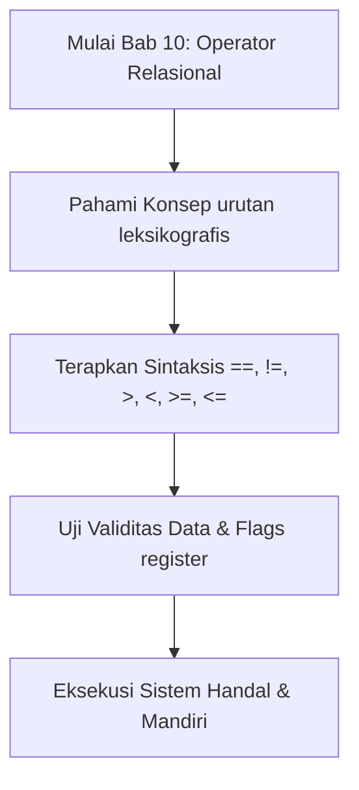
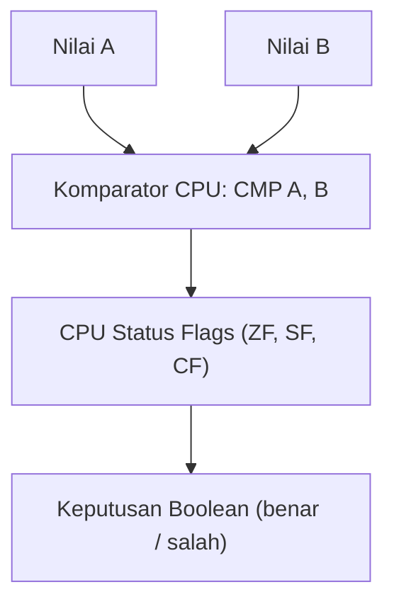

## Bab 10: Operator Relasional dan Perbandingan Nilai

### 10.1 Teori Perbandingan Relasional Komputer



Dalam unit pemroses mikro (CPU), perbandingan dua angka numerik dilakukan melalui instruksi pengurangan internal (*compare instruction* atau `CMP`). Instruksi ini mengurangkan nilai kedua dari nilai pertama tanpa mengubah isi register penampung, melainkan hanya memperbarui status register bendera prosesor (**FLAGS Register**):
- **Bendera Nol (*Zero Flag* / ZF)**: Bernilai `1` jika kedua angka sama persis ($A - B = 0$).
- **Bendera Tanda (*Sign Flag* / SF)**: Bernilai `1` jika hasil perbandingan menghasilkan nilai negatif ($A < B$).

Widya-Lang menerjemahkan kondisi bendera prosesor ini ke dalam tipe logika boolean berdaulat: `benar` atau `salah`.

| Operator | Definisi Matematika | Contoh Kasus | Hasil Evaluasi | Logika FLAGS CPU |
| :---: | :--- | :--- | :---: | :--- |
| `==` | Sama Dengan Persis | `150 == 150` | `benar` | $ZF = 1$ |
| `!=` | Tidak Sama Dengan | `150 != 100` | `benar` | $ZF = 0$ |
| `>` | Lebih Besar Dari | `90 > 50` | `benar` | $ZF = 0, SF = 0$ |
| `<` | Lebih Kecil Dari | `25 < 75` | `benar` | $SF = 1$ |
| `>=` | Lebih Besar atau Sama | `80 >= 80` | `benar` | $ZF = 1$ atau $SF = 0$ |
| `<=` | Lebih Kecil atau Sama | `40 <= 50` | `benar` | $ZF = 1$ atau $SF = 1$ |



### 10.2 Perbandingan Leksikografis String
Perbandingan pada teks string tidak didasarkan pada panjang kata, melainkan pada urutan biner karakter UTF-8 dari kiri ke kanan:

```widya
fungsi utama() {
    tetap kata_1 = "Aceh";
    tetap kata_2 = "Bali";
    
    // Karakter 'A' (bita 65) lebih kecil dari 'B' (bita 66)
    cetak("Aceh < Bali : " + teks(kata_1 < kata_2)); // benar
    cetak("Aceh == Bali: " + teks(kata_1 == kata_2)); // salah
}
```

### 10.3 Contoh Kode Praktik 1: Sistem Validasi Nilai Mutu Kelulusan
Program berikut menguji nilai ujian siswa terhadap kriteria ketuntasan minimal (KKM) dan ambang batas predikat kelulusan:

```widya
// Berkas: bab10_validasi_nilai.widya

fungsi utama() {
    tetap KKM = 75;
    tetap nilai_tugas = 82;
    tetap nilai_uts = 78;
    tetap nilai_uas = 88;
    
    tetap nilai_akhir = (nilai_tugas * 0.2) + (nilai_uts * 0.3) + (nilai_uas * 0.5);
    
    cetak("EVALUASI AKADEMIK KOMPETENSI:");
    cetak("- Nilai Tugas  : " + teks(nilai_tugas));
    cetak("- Nilai UTS    : " + teks(nilai_uts));
    cetak("- Nilai UAS    : " + teks(nilai_uas));
    cetak("- Nilai Akhir  : " + teks(nilai_akhir));
    cetak("-----------------------------------");
    
    tetap lulus = nilai_akhir >= KKM;
    tetap predikat_a = nilai_akhir >= 85;
    
    cetak("Status Kelulusan (>= 75) : " + teks(lulus));
    cetak("Mendapat Predikat A (>= 85): " + teks(predikat_a));
}
```

### 10.4 Contoh Kode Praktik 2: Sistem Radar Tilang Kecepatan Tol
Program ini memvalidasi laju kendaraan terhadap batas minimum dan batas maksimum jalan tol:

```widya
// Berkas: bab10_tilang_tol.widya

fungsi utama() {
    tetap BATAS_MINIMUM = 60;  // km/jam
    tetap BATAS_MAKSIMUM = 100; // km/jam
    
    tetap kecepatan_truk = 45;
    tetap kecepatan_sedan = 88;
    tetap kecepatan_sport = 135;
    
    cetak("AUDIT ELEKTRONIK TILANG JALAN TOL:");
    cetak("Truk (45 km/jam) : Terlalu Lambat = " + teks(kecepatan_truk < BATAS_MINIMUM));
    cetak("Sedan (88 km/jam): Kecepatan Sah   = " + teks(kecepatan_sedan >= BATAS_MINIMUM dan kecepatan_sedan <= BATAS_MAKSIMUM));
    cetak("Sport (135 km/jam): Melanggar Batas = " + teks(kecepatan_sport > BATAS_MAKSIMUM));
}
```

### 10.5 Kesalahan Pemula dan Panduan Solusi
- **Tertukar Operator `=` (Penugasan) dengan `==` (Kesamaan)**:
  - Menggunakan `=` di dalam kondisi pengujian adalah kesalahan klasik pemula. Kompilator Widya-Lang secara tegas menolak sintaksis penugasan di dalam ekspresi bersyarat.
- **Membandingkan String dengan Angka Secara Langsung**:
  - Ekspresi `"100" == 100` akan memicu penolakan tipe statis (*Type Mismatch*). Konversikan salah satu tipe secara eksplisit dengan `angka(...)` atau `teks(...)`.

### 10.6 Rangkuman Konsep Kunci Bab 10
- Operator relasional membandingkan dua besaran dan mengembalikan nilai boolean murni.
- Operasi perbandingan string dilakukan secara leksikografis berdasarkan titik kode UTF-8.

### 10.7 Latihan Mandiri & Evaluasi Pemahaman
1. Mengapa ekspresi `"Budi" < "budi"` menghasilkan nilai `benar` dalam pengujian UTF-8?
2. Bagaimana instruksi CPU `CMP` bekerja mendasari operator relasional?
3. **Tantangan Praktik**: Buatlah program `verifikasi_usia_sim.widya` yang membandingkan umur pendaftar SIM (misal 16 tahun) dengan batas usia legal minimum penerbitan SIM C (17 tahun)!

---

### 10.9 Latihan Soal Pilihan Ganda (10 Soal)

Pilihlah satu jawaban yang paling tepat (A, B, C, atau D) untuk menguji penguasaan materi bab ini:

**1. Apa fokus utama pembahasan dalam Bab 10 (Operator Relasional)?**
- A. Membahas secara mendalam Perbandingan besaran
- B. Mengonfigurasi kabel jaringan lokal
- C. Memperbaiki motherboard komputer
- D. Menghapus database peladen

**2. Manakah kata kunci atau sintaksis yang menjadi inti materi bab ini?**
- A. Kata kunci `==, !=, >, <, >=, <=`
- B. perintah format disk
- C. bahasa assembly x86
- D. tag HTML

**3. Mengapa konsep urutan leksikografis sangat penting dalam rekayasa perangkat lunak modern?**
- A. Menjamin efisiensi komputasi dan keterbacaan kode secara modular
- B. Hanya formalitas akademis
- C. Agar program berjalan lambat
- D. Mengurangi resolusi layar

**4. Dalam pengolahan data, bagaimana Flags register memengaruhi performa memori?**
- A. Mengoptimalkan struktur alokasi data di RAM secara efisien
- B. Membuat memori penuh seketika
- C. Menghapus seluruh file disk
- D. Menghentikan kipas prosesor

**5. Manakah best practice yang dianjurkan dalam menerapkan materi Bab 10?**
- A. Menerapkan validasi data dan isolasi ruang lingkup yang bersih
- B. Menulis seluruh kode dalam satu baris panjang
- C. Mengabaikan penanganan kesalahan
- D. Menggunakan variabel global sembarangan

**6. Apa risiko yang timbul jika pemrogram mengabaikan kaidah urutan leksikografis?**
- A. Munculnya kutu logika atau kerentanan runtime saat data ekstrem masuk
- B. Komputer langsung terbakar
- C. Kecepatan internet naik dua kali lipat
- D. Keyboard tidak berfungsi

**7. Bagaimana kompilator Widya-Lang memproses instruksi yang berkaitan dengan ==, !=, >, <, >=, <=?**
- A. Divalidasi pada tahap analisis semantik dan diterjemahkan ke instruksi biner native
- B. Dikirimkan ke cloud pihak ketiga
- C. Diterjemahkan baris per baris secara lambat
- D. Diabaikan seluruhnya

**8. Di lingkungan industri, penerapan modul Bab 10 lazim ditemukan pada...**
- A. Sistem perbankan, backend peladen, aplikasi sains data, dan otomatisasi bisnis
- B. Hanya pada kalkulator saku sederhana
- C. Hanya pada game lawas 8-bit
- D. Tidak pernah digunakan di industri

**9. Fungsi pendukung apa yang paling sering dikombinasikan dengan materi bab ini?**
- A. Fungsi bawaan `cetak()`, `teks()`, atau asersi pengujian `pastikan()`
- B. Perintah mematikan komputer
- C. Fungsi memutar musik
- D. Fungsi mencetak kertas printer

**10. Setelah menuntaskan Bab 10, kompetensi apa yang diharapkan dikuasai oleh pembaca?**
- A. Mampu merancang, mengimplementasikan, dan menguji solusi berbasis Perbandingan besaran secara mandiri
- B. Mampu merakit kabel listrik tegangan tinggi
- C. Mampu mendesain grafis vektor 3D
- D. Mampu memasang antena radio
