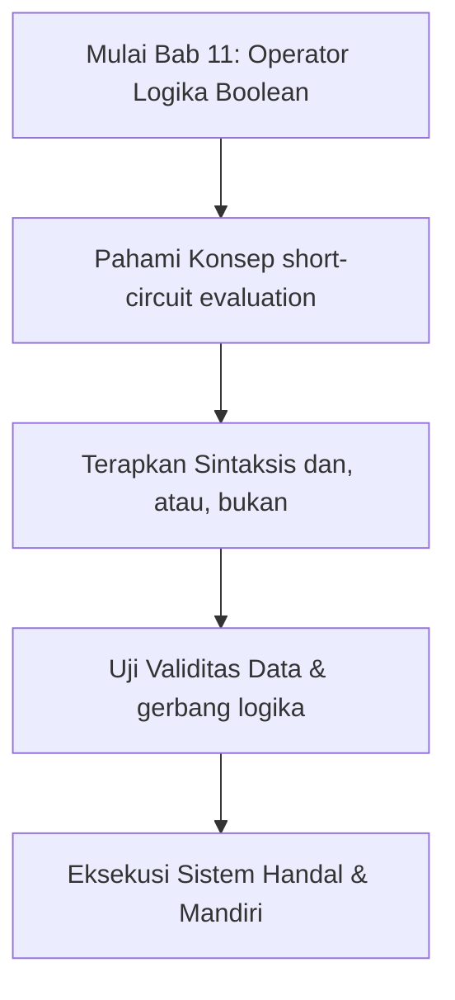
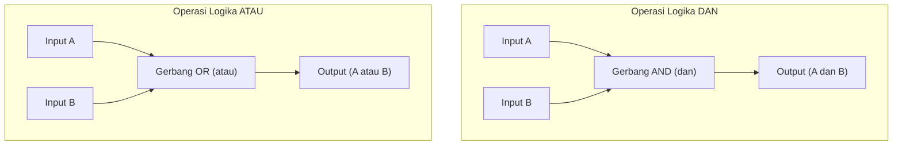

## Bab 11: Operator Logika Boolean Lanjutan

### 11.1 Aljabar Proposisi dan Gerbang Logika Digital



Dalam teknologi semikonduktor, pengambilan keputusan otomatis diwujudkan melalui susunan **Gerbang Logika (*Logic Gates*)**. Gerbang logika mengambil satu atau beberapa sinyal input biner dan menghasilkan tepat satu sinyal output biner sesuai aturan aljabar George Boole:
- **Gerbang AND (Konjungsi `dan`)**: Sinyal keluaran aktif HANYA JIKA seluruh sinyal masukan aktif.
- **Gerbang OR (Disjungsi `atau`)**: Sinyal keluaran aktif JIKA SALAH SATU atau SELURUH masukan aktif.
- **Gerbang NOT (Negasi `bukan`)**: Membalik polaritas sinyal masukan (1 menjadi 0, 0 menjadi 1).

Widya-Lang menghadirkan ketiga operator ini dengan kosakata berdaulat bahasa Indonesia yang anggun: `dan`, `atau`, dan `bukan`.



### 11.2 Tabel Kebenaran Lengkap Operasi Majemuk

| Nilai Premis A | Nilai Premis B | `A dan B` | `A atau B` | `bukan A` |
| :---: | :---: | :---: | :---: | :---: |
| `benar` | `benar` | `benar` | `benar` | `salah` |
| `benar` | `salah` | `salah` | `benar` | `salah` |
| `salah` | `benar` | `salah` | `benar` | `benar` |
| `salah` | `salah` | `salah` | `salah` | `benar` |

### 11.3 Mekanisme Evaluasi Hubung Singkat (*Short-Circuit Evaluation*)
Kompilator Widya-Lang menerapkan optimasi eksekusi cepat tingkat sirkuit:
1. **Pada Operator `A dan B`**: Jika evaluasi premis `A` bernilai `salah`, maka seluruh ekspresi dipastikan bernilai `salah`. Mesin runtime **TIDAK AKAN** mengevaluasi premis `B`.
2. **Pada Operator `A atau B`**: Jika evaluasi premis `A` bernilai `benar`, maka seluruh ekspresi dipastikan bernilai `benar`. Mesin runtime **TIDAK AKAN** mengevaluasi premis `B`.

Manfaat terbesar dari evaluasi hubung singkat adalah perlindungan terhadap runtime error yang fatal:

```widya
// Contoh Keselamatan: Pembagi bernilai 0 tidak akan dieksekusi
tetap pembagi = 0;
jika (pembagi != 0 dan (100 / pembagi) > 2) {
    cetak("Instruksi ini aman dieksekusi tanpa risiko crash!");
}
```

### 11.4 Contoh Kode Praktik 1: Autentikasi Pengguna Multi-Faktor (2FA)
Program ini memvalidasi kredensial pengguna, token OTP numerik, dan status akun aktif:

```widya
// Berkas: bab11_autentikasi_2fa.widya

fungsi utama() {
    tetap USER_VALID = "analis_sistem";
    tetap PASS_VALID = "WidyaSakti2026";
    tetap OTP_VALID = 492018;
    
    tetap masukan_user = "analis_sistem";
    tetap masukan_pass = "WidyaSakti2026";
    tetap masukan_otp = 492018;
    tetap akun_diblokir = salah;
    
    tetap user_cocok = masukan_user == USER_VALID;
    tetap pass_cocok = masukan_pass == PASS_VALID;
    tetap otp_cocok = masukan_otp == OTP_VALID;
    
    // Akses diberikan jika kredensial benar DAN OTP cocok DAN akun tidak diblokir
    tetap akses_diterima = (user_cocok dan pass_cocok) dan (otp_cocok dan bukan akun_diblokir);
    
    cetak("PORTAL KEAMANAN DATA STRATEGIS:");
    cetak("- Validasi Nama Pengguna : " + teks(user_cocok));
    cetak("- Validasi Kata Sandi    : " + teks(pass_cocok));
    cetak("- Validasi Token OTP     : " + teks(otp_cocok));
    cetak("- Status Akun Bebas Blok : " + teks(bukan akun_diblokir));
    cetak("------------------------------------------");
    cetak("STATUS KELAYAKAN AKSES   : " + teks(akses_diterima));
}
```

### 11.5 Contoh Kode Praktik 2: Sistem Kualifikasi Beasiswa Prestasi
Program ini menguji kombinasi kriteria akademik dan sosio-ekonomi calon penerima beasiswa:

```widya
// Berkas: bab11_seleksi_beasiswa.widya

fungsi utama() {
    tetap ipk_mahasiswa = 3.82;
    tetap penghasilan_ortu = 4200000; // Rp 4,2 Juta
    tetap juara_nasional = benar;
    tetap pelanggaran_disiplin = salah;
    
    // Kriteria Jalur Prestasi: (IPK >= 3.75 ATAU Juara Nasional) DAN Tanpa Pelanggaran
    tetap lolos_prestasi = (ipk_mahasiswa >= 3.75 atau juara_nasional) dan bukan pelanggaran_disiplin;
    
    // Kriteria Jalur Bantuan Sosial: (IPK >= 3.25 DAN Gaji Ortu <= 4.5 Juta) DAN Tanpa Pelanggaran
    tetap lolos_bansos = (ipk_mahasiswa >= 3.25 dan penghasilan_ortu <= 4500000) dan bukan pelanggaran_disiplin;
    
    cetak("HASIL SELEKSI BEASISWA PENDIDIKAN:");
    cetak("- Kelayakan Jalur Prestasi : " + teks(lolos_prestasi));
    cetak("- Kelayakan Jalur Afirmasi : " + teks(lolos_bansos));
}
```

### 11.6 Kesalahan Pemula dan Panduan Solusi
- **Mengabaikan Tanda Kurung pada Operator Campuran**:
  Ekspresi `A dan B atau C` dapat menimbulkan tafsir berbeda antara manusia dan mesin. Selalu kelompokkan dengan tanda kurung eksplisit: `(A dan B) atau C`.
- **Menuliskan `== benar` Berulang Kali**:
  Menulis `jika (aktif == benar dan valid == benar)` redundan; cukup tulis `jika (aktif dan valid)`.

### 11.7 Rangkuman Konsep Kunci Bab 11
- Operator logika majemuk: `dan` (AND), `atau` (OR), `bukan` (NOT).
- Evaluasi hubung singkat (*Short-circuiting*) menghemat siklus clock dan mencegah pembagian ilegal.

### 11.8 Latihan Mandiri & Evaluasi Pemahaman
1. Jelaskan bagaimana Hukum De Morgan menyederhanakan ekspresi `bukan (A atau B)`!
2. Jika variabel boolean `X = salah`, apakah bagian kanan dari `X dan fungsi_berat()` akan dieksekusi mesin?
3. **Tantangan Praktik**: Buatlah sistem pengendali AC pintar yang menyalakan pendingin ruangan jika: (Suhu > 28°C ATAU Kelembapan > 70%) DAN Ada Orang di Ruangan!

---

### 11.9 Latihan Soal Pilihan Ganda (10 Soal)

Pilihlah satu jawaban yang paling tepat (A, B, C, atau D) untuk menguji penguasaan materi bab ini:

**1. Apa fokus utama pembahasan dalam Bab 11 (Operator Logika Boolean)?**
- A. Membahas secara mendalam Konjungsi dan disjungsi
- B. Mengonfigurasi kabel jaringan lokal
- C. Memperbaiki motherboard komputer
- D. Menghapus database peladen

**2. Manakah kata kunci atau sintaksis yang menjadi inti materi bab ini?**
- A. Kata kunci `dan, atau, bukan`
- B. perintah format disk
- C. bahasa assembly x86
- D. tag HTML

**3. Mengapa konsep short-circuit evaluation sangat penting dalam rekayasa perangkat lunak modern?**
- A. Menjamin efisiensi komputasi dan keterbacaan kode secara modular
- B. Hanya formalitas akademis
- C. Agar program berjalan lambat
- D. Mengurangi resolusi layar

**4. Dalam pengolahan data, bagaimana gerbang logika memengaruhi performa memori?**
- A. Mengoptimalkan struktur alokasi data di RAM secara efisien
- B. Membuat memori penuh seketika
- C. Menghapus seluruh file disk
- D. Menghentikan kipas prosesor

**5. Manakah best practice yang dianjurkan dalam menerapkan materi Bab 11?**
- A. Menerapkan validasi data dan isolasi ruang lingkup yang bersih
- B. Menulis seluruh kode dalam satu baris panjang
- C. Mengabaikan penanganan kesalahan
- D. Menggunakan variabel global sembarangan

**6. Apa risiko yang timbul jika pemrogram mengabaikan kaidah short-circuit evaluation?**
- A. Munculnya kutu logika atau kerentanan runtime saat data ekstrem masuk
- B. Komputer langsung terbakar
- C. Kecepatan internet naik dua kali lipat
- D. Keyboard tidak berfungsi

**7. Bagaimana kompilator Widya-Lang memproses instruksi yang berkaitan dengan dan, atau, bukan?**
- A. Divalidasi pada tahap analisis semantik dan diterjemahkan ke instruksi biner native
- B. Dikirimkan ke cloud pihak ketiga
- C. Diterjemahkan baris per baris secara lambat
- D. Diabaikan seluruhnya

**8. Di lingkungan industri, penerapan modul Bab 11 lazim ditemukan pada...**
- A. Sistem perbankan, backend peladen, aplikasi sains data, dan otomatisasi bisnis
- B. Hanya pada kalkulator saku sederhana
- C. Hanya pada game lawas 8-bit
- D. Tidak pernah digunakan di industri

**9. Fungsi pendukung apa yang paling sering dikombinasikan dengan materi bab ini?**
- A. Fungsi bawaan `cetak()`, `teks()`, atau asersi pengujian `pastikan()`
- B. Perintah mematikan komputer
- C. Fungsi memutar musik
- D. Fungsi mencetak kertas printer

**10. Setelah menuntaskan Bab 11, kompetensi apa yang diharapkan dikuasai oleh pembaca?**
- A. Mampu merancang, mengimplementasikan, dan menguji solusi berbasis Konjungsi dan disjungsi secara mandiri
- B. Mampu merakit kabel listrik tegangan tinggi
- C. Mampu mendesain grafis vektor 3D
- D. Mampu memasang antena radio
